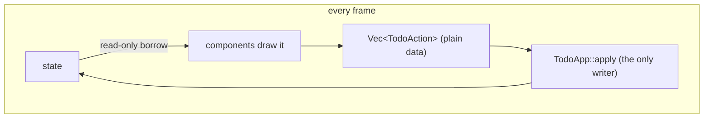

# Stage 2: reusable components

**Goal:** the same app plus priorities, restructured so that it can grow.

```text
src/
├── main.rs                  window setup only
├── app.rs                   owns the state, composes components, applies actions
├── model.rs                 data and rules; no egui in here
└── components/
    ├── mod.rs
    ├── priority_badge.rs    leaf widget         (impl egui::Widget)
    ├── todo_row.rs          composite component (returns an action)
    └── add_bar.rs           stateful component  (owns its draft)
```

The design rests on one rule: **components describe what the user asked for; only the app
changes state.**

```text
        ┌────────────── every frame ──────────────┐
        │                                         │
   state ──► components draw it ──► Vec<TodoAction> ──► TodoApp::apply ──► state
            (read-only borrow)        (plain data)       (the only writer)
```



That gives you three component shapes, each used below:

| Shape | Signature | Use it for |
|---|---|---|
| **Leaf widget** | `impl egui::Widget`, used as `ui.add(MyWidget::new(..))` | Something that is drawn and at most reports a `Response`: badges, icons, gauges. |
| **Composite component** | `fn show(self, ui: &mut Ui) -> Option<Action>` | A group of widgets that turns interaction into a domain action. Borrows data immutably. |
| **Stateful component** | `fn show(&mut self, ui: &mut Ui) -> Option<Action>` on a struct the app owns | UI with private working state, such as a half-typed draft. |

## The model

`src/model.rs`:

@@file code/stage2/src/model.rs

- **No `egui` import.** The model compiles and is tested without a window. `cargo test` runs
  these tests in milliseconds.
- **`TodoAction` is plain data.** It derives `Debug` and `PartialEq`, so tests can assert on
  it, and you could later log it or push it onto an undo stack.
- **`TodoList` hides its `Vec`.** Callers can only change todos through methods that keep the
  rules (trimmed titles, unique IDs) intact.

## A leaf widget: `PriorityBadge`

`src/components/priority_badge.rs`:

@@file code/stage2/src/components/priority_badge.rs

Every custom-painted widget follows the same three steps: **measure**, **allocate**,
**paint**. `allocate_exact_size` is the important call. It reserves the rectangle, moves the
layout cursor, and performs hit-testing according to the `Sense` you pass, returning a
`Response` like any built-in widget.

`widget_info` describes the widget to assistive technology. It also makes it findable in the
UI tests you will write in Stage 4.

## A composite component: `TodoRow`

`src/components/todo_row.rs`:

@@file code/stage2/src/components/todo_row.rs

`TodoRow` holds `&Todo`, not `&mut Todo`. That one choice means the compiler proves that
drawing never changes data, and it means the row can be shown from any context that has a
shared reference.

The `accessible_name` calls name widgets that have no visible label of their own. Do this as
you write each widget. Stage 4 turns it into a test that fails when you forget.

## A stateful component: `AddBar`

`src/components/add_bar.rs`:

@@file code/stage2/src/components/add_bar.rs

- **The draft lives in the component, not in the app.** `TodoApp` does not care what is
  half-typed, so it should not have fields for it.
- **`focus_requested` is a one-shot flag.** Focus can only be requested on a `Response`,
  which exists only while the widget is being drawn. So `request_focus()` records the wish
  and `show` grants it. You will use this "request now, fulfil during the next draw"
  pattern whenever something outside a widget needs to affect it.
- **`egui::Sides`** solves the classic "stretchy input with fixed buttons on the right"
  layout without measuring anything.

`src/components/mod.rs`:

@@file code/stage2/src/components/mod.rs

## The app

`src/app.rs`:

@@file code/stage2/src/app.rs

`src/main.rs`:

@@file code/stage2/src/main.rs


`ui` is now two phases. Phase 1 holds shared borrows of the state and only *collects*
actions. Phase 2 holds no borrows and mutates freely. The borrow checker enforces the
split for you: try to call `self.todos.remove(..)` inside the row loop and it will not compile.

Run `cargo test` and the three model tests pass without a window opening.
