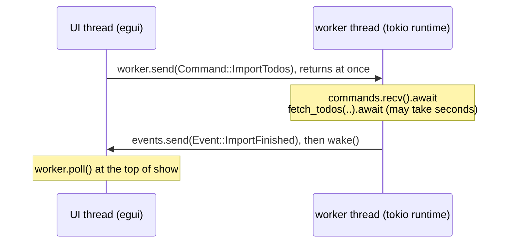

# Stage 5: HTTP requests on a background worker

**Goal:** import todos from a URL, without the window ever freezing while the request runs.

`Cargo.toml` dependencies added in this stage:

```toml
[dependencies]
# HTTP client. "json" adds `Response::json`, which decodes a body with serde.
reqwest = { version = "0.13", features = ["json"] }
# reqwest is async, so something has to drive it: "rt" is the runtime and "sync" the
# channel the UI uses to send it work.
tokio = { version = "1", features = ["rt", "sync"] }

[dev-dependencies]
# A real HTTP server on a random local port, so tests never touch the network.
wiremock = "0.6"
tokio = { version = "1", features = ["macros"] }
```

An HTTP request takes anywhere from milliseconds to the length of its timeout. `ui` has to
return in a few milliseconds, every frame. So the request cannot happen inside `ui`, and
`ui` cannot wait for it. This stage solves that with three pieces, each ignorant of the
other two:

| File | Knows about | Does not know about |
|---|---|---|
| `import.rs` | HTTP, JSON, the model | egui, threads |
| `worker.rs` | threads, channels, the async runtime | egui, what a window is |
| `components/import_dialog.rs` | egui | HTTP, threads |

`TodoApp` is the only place that connects them:

```text
UI thread (egui)                          worker thread (tokio runtime)
----------------                          -----------------------------
worker.send(Command::ImportTodos)  ---->  commands.recv().await
        (returns at once)                 fetch_todos(..).await   (may take seconds)
worker.poll() at the top of `show` <----  events.send(Event::ImportFinished); wake()
```



## The request: `import.rs`

Create `src/import.rs`:

@@file code/stage5/src/import.rs

What to notice:

- **`RemoteTodo` is not `NewTodo`.** The server's JSON shape and the app's model are
  different things that happen to look alike today. Decoding into a private wire type and
  converting keeps a renamed JSON field from rippling through the app.
- **One `Client`, built once, with a timeout.** A `Client` owns a connection pool. The
  default has *no* overall timeout, so a server that accepts the connection and then says
  nothing would leave the import running forever.
- **A non-2xx status is not an error to reqwest.** `send` succeeds for a 404. Check
  `status()` yourself (or call `error_for_status`).
- **`ImportError` is written for the user.** `reqwest::Error` says things like
  "error sending request for url"; the enum turns that into something a person can act on,
  and gives tests a value to compare against.

The tests run against `wiremock`, which starts a real HTTP server on a free local port.
That exercises the whole client stack (connection, status, headers, body decoding,
timeout) with no dependency on the internet.

## The background worker: `worker.rs`

Create `src/worker.rs`:

@@file code/stage5/src/worker.rs

What to notice:

- **Messages, not shared state.** No `Arc<Mutex<..>>` appears anywhere. The UI owns the
  todos, the worker owns the HTTP client, and the only things that cross between threads
  are `Command` and `Event` values.
- **The worker does not depend on egui.** It is handed a `wake` closure and calls it when
  an event is ready. The app passes `ctx.request_repaint()`; the test passes a counter.
- **`send` and `poll` never block.** Both are safe to call in the middle of drawing.
- **The import is spawned, not awaited.** If the loop awaited the request, it could not
  receive `CancelImport` until the request had finished, which defeats the purpose.
- **`Drop` shuts the thread down.** Dropping the handle closes the command channel, the
  loop ends, the runtime is dropped and any request in flight is cancelled with it.

## The dialog: `ImportDialog`

Create `src/components/import_dialog.rs` and re-export `ImportDialog` and `ImportOutcome`
from `components/mod.rs`:

@@file code/stage5/src/components/import_dialog.rs

This is the stateful component shape from Stage 2 again, with one difference: part of its
state (`Progress`) is set from outside. The dialog cannot know when a download finishes,
so it exposes `set_fetching`, `set_idle` and `set_failed` and lets the app call them.
`ui.add_enabled(false, ..)` greys the URL box out and stops it taking input while a
request for that URL is running.

## The model

An imported item is not a `Todo` yet, because only the list hands out IDs. Add a type for
it, an action that carries a batch of them, and a method that appends them:

@@excerpt code/stage5/src/model.rs ||| /// A todo that does not exist yet ||| pub done: bool, ||| 1

@@excerpt code/stage5/src/model.rs ||| /// Append todos that came from outside the app. ||| Import(Vec<NewTodo>),

@@excerpt code/stage5/src/model.rs ||| /// Appends imported todos and returns how many ||| added_count += 1; ||| 4

## Wiring it into the app

Add `mod import;` and `mod worker;` to `main.rs`. The complete `app.rs` for this stage is
in [`code/stage5/src/app.rs`](../code/stage5/src/app.rs); these are the parts that changed.

`TodoApp` gains the worker handle and the transient state for one import:

@@excerpt code/stage5/src/app.rs ||| /// Does the slow work on another thread; see `worker.rs`. ||| notice: Option<String>,

`new` starts the worker, giving it a way to wake the UI. `from_state` now takes the worker
as a second argument and stores it:

@@excerpt code/stage5/src/app.rs ||| // `Context` is a cheap, thread-safe handle. ||| Self::from_state(state, worker)

`apply` gets an arm for the new action:

@@excerpt code/stage5/src/app.rs ||| TodoAction::Import(new_todos) => { ||| self.notice = Some(format!( ||| 1

Three new functions talk to the worker:

@@excerpt code/stage5/src/app.rs ||| /// Picks up whatever the worker has finished since the last frame. ||| self.worker.send(Command::CancelImport); ||| 1

`show` starts by taking in whatever the worker finished since the last frame:

@@excerpt code/stage5/src/app.rs ||| // Phase 0: take in results from the worker ||| self.handle_worker_events();

And, after the edit dialog, it shows the import dialog and acts on what the user asked for:

@@excerpt code/stage5/src/app.rs ||| // The dialog only reports what the user asked for. ||| ImportOutcome::Closed => { ||| 9

The File menu gets an "Import from URL…" item that sets
`self.import_dialog = Some(ImportDialog::new(&self.import_url))`, and the status bar shows
`notice` when there is one.


What changed, and why:

- **Results enter through `apply`, like everything else.** A downloaded batch becomes a
  `TodoAction::Import`, so there is still exactly one function that changes the list.
- **`latest_import_id` handles the race that cancelling cannot.** Pressing Stop aborts the
  request, but its answer may already be sitting in the channel. Every request carries an
  ID, and an answer whose ID is not the newest is dropped. Without this, a stopped import
  could add its todos a moment after the user pressed Stop.
- **The spinner keeps the window alive while it is visible.** `ui.spinner()` requests a
  repaint each frame, so events are picked up promptly. Once the dialog closes nothing is
  animating, and that is when the `wake` callback matters: without it, a result arriving
  while the window is idle would not appear until the user moved the mouse.
- **Nothing in `ui` waits.** `worker.poll()` returns an empty list when nothing has
  arrived. There is no `recv()`, no `block_on`, no `join` on the UI thread.

## Testing asynchronous UI

The existing tests call `harness.run()`, which steps frames until the UI stops asking for
repaints. Two things are different once a worker is involved: the result arrives in its
own time, and a visible spinner asks for repaints forever. So the tests step one frame at
a time until the thing they are waiting for is true:

@@excerpt code/stage5/src/app.rs ||| /// Steps the app one frame at a time ||| harness.step(); ||| 2

A whole-app test then reads like the user's actions, against a local mock server:

@@excerpt code/stage5/src/app.rs ||| fn importing_from_a_url_appends_the_downloaded_todos() { ||| harness.get_by_label("Imported 2 todos"); ||| 1

```powershell
cargo test -p stage5
```

```text
test result: ok. 32 passed; 0 failed; 0 ignored; 0 measured; 0 filtered out
```

The thirteen new tests cover the request (six cases, including a timeout and a server
that is not there), the worker, the dialog on its own, the model, and three whole-app
flows: a successful import, a failed one, and one stopped half-way.
