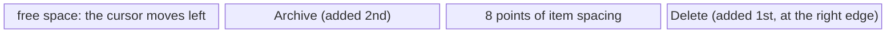
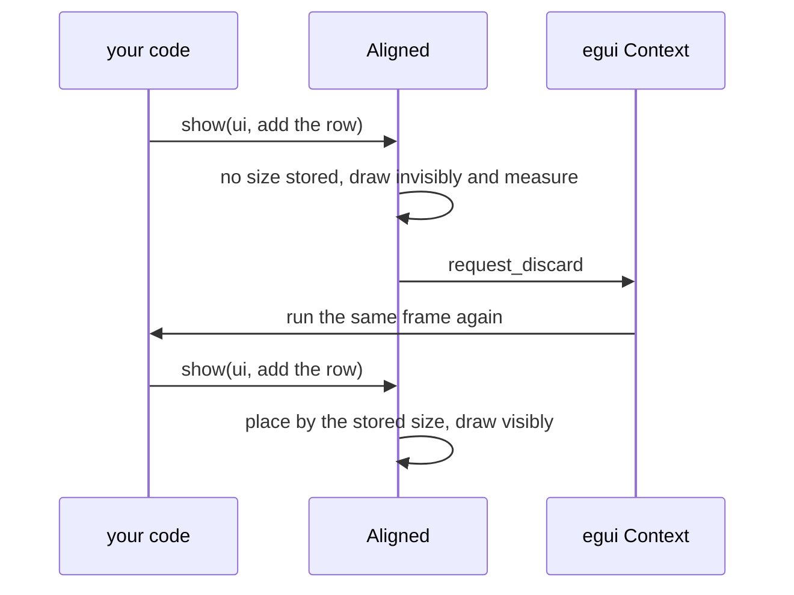

# `Layout`

[Back to the tutorial](../chapters/03-hello-world.md)

## In one paragraph

Every `Ui` has a `Layout` that decides where its next widget goes: which way the cursor
moves, how widgets line up across that direction, whether they wrap, and whether they
stretch to fill the space. `ui.horizontal`, `ui.vertical`, `ui.horizontal_wrapped` and
`ui.vertical_centered` make a child `Ui` with a ready-made layout; `ui.with_layout` takes
any `Layout`; `ui.columns` and `Grid` line things up in columns. Each widget is placed once,
as it is added, which makes centring a group whose size is not known yet the one hard case.

## The mental model

A layout is a direction and a rule for the other axis. The *main axis* is the direction the
cursor moves; the *cross axis* is the one across it. In a row, the main axis runs left to
right and the cross axis decides whether a short widget sits at the top, the middle or the
bottom of the row. Nesting does the rest: a column of rows, a row of columns. The cursor
only moves forward: whatever a layout does, it does to each widget as it is added.

> **If you come from the web.** A layout is a flex container. `ui.horizontal` is a row with
> `align-items: center`, `ui.vertical` a column with `align-items: flex-start`, the item
> spacing is the `gap` (8 points across, 3 down by default), `horizontal_wrapped` is
> `flex-wrap: wrap`, and a justified layout is `align-items: stretch`.
>
> Where the comparison breaks:
>
> - **It is a single pass.** A flex container measures every child, then sizes and places
>   them all. egui places each widget the moment you add it, knowing only what came before.
> - **There is no grow or shrink.** A widget gets the size it asks for: spare space is never
>   shared out, and no widget is squeezed to make room for a later sibling.
> - **There is no `justify-content`.** Widgets are always packed from the start of the main
>   axis. To put something at the far end, you change the direction (a right-to-left row)
>   instead of distributing space; to centre a group, something has to measure it first.
>
> Below, wherever the web has an equivalent, the web way (CSS, HTML or JS) is shown first and
> the egui way after it.

## How it works

A `Layout` is six fields: `main_dir` (one of `LeftToRight`, `RightToLeft`, `TopDown`,
`BottomUp`), `main_wrap`, `main_align`, `main_justify`, `cross_align` and `cross_justify`.
The default is `Layout::top_down(Align::LEFT)`. The constructors (`left_to_right`,
`right_to_left`, `top_down`, `top_down_justified`, `bottom_up`) take the direction's cross
alignment, and the `with_*` methods change one field each. `ui.horizontal` is
`left_to_right(Align::Center)`, `ui.vertical` is `top_down(Align::Min)`.

For each widget, the layout does three things:

1. **It finds the widget a frame** at the cursor, as long as the widget along the main axis.
   Across, the frame spans the whole row (or column) if the cross alignment is `Center` or
   the layout is justified; otherwise it is the widget's size.
2. **It places the widget in the frame** by the cross alignment, or stretches it if the
   layout is justified. Along the main axis the widget always goes at the start: `main_align`
   does not move it, so it is not `justify-content`.
3. **It moves the cursor** past the widget plus the item spacing. The whole frame counts as
   used, so a centred widget in a column uses the column's full width.

A right-to-left layout is the same, mirrored: the cursor starts at the right edge.

```text
with_layout(Layout::right_to_left(Align::Center))
+------------------------------------------------------+
|   free space        [Archive] 8 points [Delete]      |
|   (cursor moves     added 2nd          added 1st,    |
|    left)                               at the edge   |
+------------------------------------------------------+
```



A wrapping layout adds one check first: if the widget does not fit in what is left of a
row that is not empty, it starts a new row at the left edge, `item_spacing.y` below
everything so far. A widget wider than the whole row gets a row of its own, and sticks out.

### Centring something whose size is not known yet

Right-aligning needs no size: a right-to-left layout starts at the edge. Centring does. A
centred column copes with single widgets, whose size is known when they are added. A
*group*, such as a row of buttons, has a size only once it has been drawn, and by then it
has been placed (the [`Ui` page](ui.md#why-sizes-are-known-only-after-drawing) explains why).

So draw it twice. `egui::Aligned` draws the contents invisibly, stores their size and asks
egui to discard the pass; egui runs your code again before anything reaches the screen, and
the contents are placed by the stored size. After that it uses the previous pass's size.

```text
frame 1, pass 1:  Aligned has no size stored
                  -> draws the row invisibly, measures it (say 190 points)
                  -> stores the size, calls request_discard
frame 1, pass 2:  Aligned has 190 points stored
                  -> places the row at (available width - 190) / 2
                  -> this pass is the one painted
frame 2 onwards:  uses the previous pass's size (discards again only if it changed)
```



`Grid` uses the same trick for its column widths. For something pinned to both edges of a
row, such as a title on the left and buttons on the right, `egui::Sides` places the two
groups without needing any size.

## Standard usage

**The CSS way:** a flex container per row or column, with the direction and the cross-axis
alignment on the container.

```html
<div class="row"><span>A row:</span> <button>One</button> <button>Two</button> <button>Three</button></div>
<div class="row top">
  <div class="column"><span>Column one</span> <button>Above</button> <button>Below</button></div>
  <div class="column"><span>Column two</span> <button>Only one</button></div>
</div>
```

```css
.row    { display: flex; flex-direction: row; align-items: center; gap: 8px; }
.top    { align-items: flex-start; }
.column { display: flex; flex-direction: column; align-items: flex-start; gap: 3px; }
```

**The egui way:** a closure per row or column. One `item_spacing` covers both gaps: its `x`
in rows, its `y` in columns.

@@excerpt code/concepts/src/layout.rs ||| /// A row is a child `Ui` ||| let _ = ui.button("Only one"); ||| 3

Run: `cargo run -p concepts -- "Rows and columns"`


`ui.horizontal` centres its widgets across the row, so columns of different heights would
be centred against each other; `horizontal_top` aligns them at the top instead.

## Micro-examples

Every example is real code from [`code/concepts/src/layout.rs`](../code/concepts/src/layout.rs),
drawn into the gallery's pane as into a panel of yours. Each command, run from `tutorial/code`,
opens the gallery at it; the checks are in `code/concepts/tests/layout.rs`.

### Buttons on the right

**Use this when** some widgets belong at the left of a row and others at the right.

**The CSS way:** keep the source order and push the second group over with an auto margin,
which takes up the spare space.

```html
<div class="toolbar">
  <span>3 items selected</span> <button class="push">Archive</button> <button>Delete</button>
</div>
```

```css
.toolbar { display: flex; align-items: center; gap: 8px; }
.push    { margin-left: auto; } /* this item and those after it go to the right */
```

**The egui way:** there is no spare space to take. A right-to-left layout starts at the right
edge, so the widgets are written in reverse: the first one added is the one furthest right.

@@excerpt code/concepts/src/layout.rs ||| /// A label on the left, buttons pushed ||| let _ = ui.button("Archive"); ||| 3

Run: `cargo run -p concepts -- "Buttons on the right"`


`with_layout` gives its child all the space left in the row, so the buttons reach the edge
and anything added to the row afterwards has no room. A `ui.horizontal` inside a
right-to-left `Ui` runs right to left too. For a left group and a right group in one row,
`egui::Sides` is the tidier tool; the next example shows it.

### Title left, buttons right

**Use this when** a row has a title at the left edge and buttons at the right edge.

**The CSS way:** let the container share out the spare space between its two children.

```html
<div class="header">
  <h2>Inbox</h2>
  <div class="actions"><button>Archive</button> <button>Delete</button></div>
</div>
```

```css
.header  { display: flex; justify-content: space-between; align-items: center; }
.actions { display: flex; gap: 8px; }
```

**The egui way:** `Sides` takes one closure per side. The left side is laid out left to right
from the left edge, the right side right to left from the right edge, so the right side's
widgets are written in reverse, as in the last example. The gap between the two is whatever
is left over.

@@excerpt code/concepts/src/layout.rs ||| /// A title pinned to the left edge ||| let _ = ui.button("Archive"); // added second ||| 3

Run: `cargo run -p concepts -- "Title left, buttons right"`

By default both sides take the room they need, and if the row is too narrow the parent
`Ui` grows to the right. `shrink_left()` or `shrink_right()` makes one side give way instead,
and `truncate()` or `wrap()` sets what its text does then; stage 2's `AddBar` shrinks its
text field this way. The row is `interact_size.y` tall unless you set `height`, with both
sides centred in it.

### Wrapping row

**Use this when** a row holds more items than fit, and they should flow onto new lines.

**The CSS way:** one property to wrap and one for the gap.

```css
.tags { display: flex; flex-wrap: wrap; gap: 4px; }
```

**The egui way:** `horizontal_wrapped`. The gap is the item spacing, set in a `scope` so it
applies to this section only.

@@excerpt code/concepts/src/layout.rs ||| /// A row that starts a new line ||| let _ = ui.button(tag); ||| 4

Run: `cargo run -p concepts -- "Wrapping row"`


Both fill each line greedily. `ui.end_row()` starts a new line early. A long label in a
wrapping row continues after the widget before it and wraps like a paragraph.

### Fixed-height bar

**Use this when** a strip should have a set height with its contents centred in it.

**The CSS way:** a row with a fixed height and the cross axis centred.

```css
.bar { display: flex; align-items: center; gap: 8px; height: 48px; }
```

**The egui way:** `allocate_ui_with_layout` reserves a region of the size you ask for and
gives it the layout you pass. The size is a request, not a limit: taller contents make the
region grow, where the CSS bar would overflow.

@@excerpt code/concepts/src/layout.rs ||| /// Ask for a region of a set size ||| bar.response.rect.height() ||| 2

Run: `cargo run -p concepts -- "Fixed-height bar"`


The region counts as used up to the last widget, so the outline ends at Refresh, but it is
48 points tall: each widget's frame spans the full height. `ui.horizontal_centered` does the
same with all the space that is left.

### Full-width buttons

**Use this when** every widget in a column should be as wide as the column.

**The CSS way:** stretching is the flex default, so it is only written out here for contrast.

```css
.menu { display: flex; flex-direction: column; align-items: stretch; gap: 3px; max-width: 200px; }
```

**The egui way:** a justified layout. egui's default is the opposite of the CSS one: widgets
are as wide as their content unless the layout is justified.

@@excerpt code/concepts/src/layout.rs ||| /// A justified top-down layout ||| let _ = ui.button("Settings"); ||| 4

Run: `cargo run -p concepts -- "Full-width buttons"`

All three buttons are 200 points wide, the width left by `set_max_width`.
`ui.vertical_centered_justified` is the same layout as a helper.

### Equal columns

**Use this when** the space should be split into columns of the same width.

**The CSS way:** a grid of equal fractions. `minmax(0, 1fr)` keeps them equal even when one
column's content is wider; plain `1fr` would let it grow.

```css
.board { display: grid; grid-template-columns: repeat(3, minmax(0, 1fr)); gap: 8px; }
.board > div { display: flex; flex-direction: column; align-items: stretch; gap: 3px; }
```

**The egui way:** `columns` hands you a slice of child `Ui`s, one per column.

@@excerpt code/concepts/src/layout.rs ||| /// `columns` splits the width ||| columns[2].label("Done"); ||| 2

Run: `cargo run -p concepts -- "Equal columns"`


Each column is a third of the width left after the spacing, and justified, so buttons fill
it. `columns_const` takes the count as a constant: `ui.columns_const(|[left, right]| ..)`.

### Form grid

**Use this when** labels and fields should line up in columns, as in a form.

**The CSS way:** a grid whose columns are as wide as their widest cell.

```html
<div class="form">
  <label for="name">Name</label>           <input id="name">
  <label for="email">Email address</label> <input id="email">
  <span>Newsletter</span> <label><input type="checkbox"> Send me the newsletter</label>
</div>
```

```css
.form { display: grid; grid-template-columns: max-content max-content; align-items: center; gap: 3px 8px; }
```

**The egui way:** `Grid` places cells left to right and `end_row` starts the next row. The
browser measures every cell before placing any; `Grid` uses the column widths from the
previous frame, and on its first frame measures invisibly and asks for the pass to be
discarded, as `Aligned` does.

@@excerpt code/concepts/src/layout.rs ||| /// A grid lines its cells up ||| ui.checkbox(&mut self.newsletter ||| 4

Run: `cargo run -p concepts -- "Form grid"`


Cells are aligned left and centred vertically. The grid keeps its column widths under its id
salt (`"form"`), so two grids in one `Ui` need different ones. `num_columns(2)` lets the last
column use the width up to the right edge; `striped(true)` shades every other row.
`labelled_by` ties a field to its label, as `for` does.

### Centre content of unknown width

**Use this when** a group of widgets should be centred, and its width is not known until it
is drawn.

**The CSS way:** centre the column's children and its text, and centre a row's contents with
`justify-content`. The browser measures the row first, so this is all it takes.

```css
.centred { display: flex; flex-direction: column; align-items: center; text-align: center; gap: 3px; }
.pager   { display: flex; justify-content: center; gap: 8px; }
```

**The egui way:** a centred column for single widgets; `Aligned` for a group, because only
something that measures the group first can centre it.

@@excerpt code/concepts/src/layout.rs ||| /// A centred column centres each widget ||| ui.label("Page 3 of 7"); ||| 4

Run: `cargo run -p concepts -- "Centre content of unknown width"`


The First / Last row is the trap: in a centred column a row's frame is the full width, so
its widgets start at the left. `Aligned` takes any `Align2` (`RIGHT_BOTTOM` for a corner);
give it an `id_salt` if one `Ui` has more than one.

## Best practices

- **Right-align with a right-to-left layout**, and add its widgets in reverse order. For a
  left group and a right group in one row, use `Sides`.
- **Change spacing in a `scope`:** `ui.spacing_mut().item_spacing` sets the gap for one
  section, `button_padding` the room inside buttons.
- **Use `Grid` for forms and `columns` for equal splits**, not `add_space` by hand.
- **Centre groups with `Aligned`**, or store last frame's size yourself; never guess a width.

## Common mistakes

**Wrapping a row in `vertical_centered` to centre it.** The row is as wide as the column, so
nothing moves. Use `Aligned`, as in the last example.

**Forgetting `end_row` in a `Grid`.** Without it every cell goes into one long row.

**Adding right-to-left widgets in reading order.** In a right-to-left layout, and on the
right side of `Sides`, the first widget added is the one furthest right. Writing Archive then
Delete puts Delete on the left. Add them in reverse.

**Centring with `add_space` and a guessed width.** `ui.add_space((ui.available_width() - 190.0)
/ 2.0)` centres the row only while it is 190 points wide: a different font, text size,
translation or theme moves it. Use `Aligned`, which measures the row.

**Two `Grid`s with the same id salt in one `Ui`.** A grid has no automatic id: its id is the
`Ui`'s id scope combined with the salt passed to `Grid::new`, and its column widths are stored
under it. Two grids built with the same salt in the same `Ui` share one set of widths, so one
grid's column widths end up in the other, and debug builds paint an id-clash warning over the second. Give
each grid its own salt, or put each in its own `ui.push_id`.

## See also

- [Hello World](../chapters/03-hello-world.md), where `ui.horizontal` first appears.
- [`Ui`](ui.md), for the cursor, asking for space, `add_space` and why sizes arrive a frame
  late.
- [Stage 2: reusable components](../chapters/05-stage-2-components.md#a-composite-component-todorow),
  where `TodoRow` pushes its buttons right with a right-to-left layout, and `AddBar` uses
  `Sides`.
- [Stage 3: a modal](../chapters/06-stage-3-app-shell.md#a-modal-editdialog), whose fields sit
  in a two-column `Grid`.
- docs.rs: [`Layout`](https://docs.rs/egui/0.37.0/egui/struct.Layout.html),
  [`Grid`](https://docs.rs/egui/0.37.0/egui/struct.Grid.html),
  [`Aligned`](https://docs.rs/egui/0.37.0/egui/containers/struct.Aligned.html),
  [`Sides`](https://docs.rs/egui/0.37.0/egui/containers/struct.Sides.html),
  [`Spacing`](https://docs.rs/egui/0.37.0/egui/style/struct.Spacing.html).
