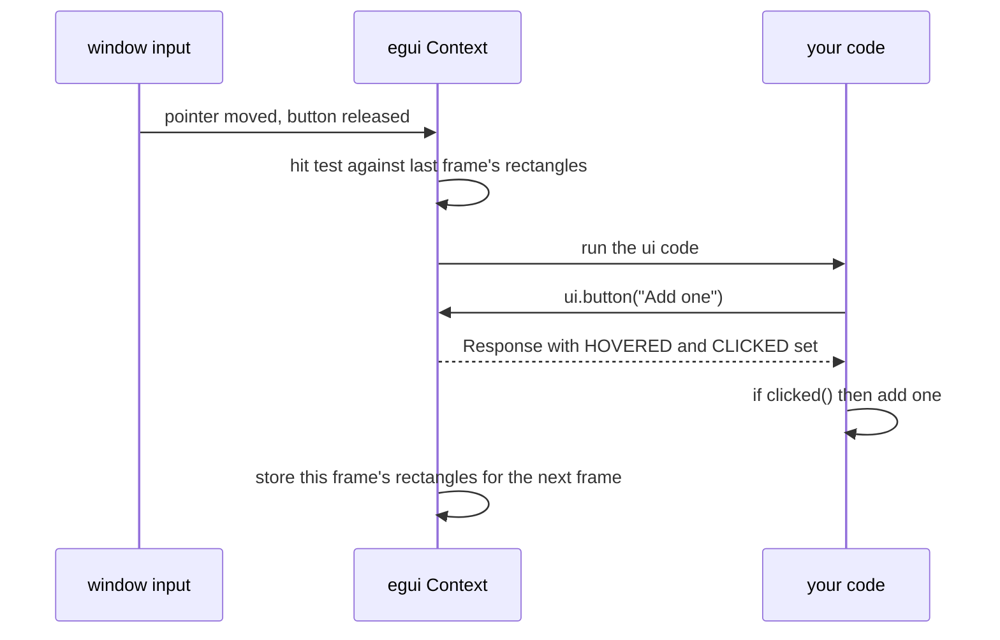

# `Response`

[Back to the tutorial](../chapters/03-hello-world.md)

## In one paragraph

Every widget call returns a `Response`: what happened to that widget on this frame. Was it
clicked, double-clicked or right-clicked, is the pointer over it, is it being dragged and by
how much, did the user change its value, does it have the keyboard focus, and where on the
screen did it end up. You ask on the same line you draw it, as in
`if ui.button("Save").clicked() { .. }`, and act on the answer straight away. A `Response`
also carries the follow-ups that belong to one widget: a tooltip (`on_hover_text`), a
right-click menu (`context_menu`), asking for the keyboard focus (`request_focus`).
Containers return an `InnerResponse`: your closure's value plus a `Response` for the whole
area.

## The mental model

A `Response` is a report, not a handle. When you add a widget, egui looks up what the
pointer and keyboard did to it this frame and gives you the answer as a small value. You
read it, decide, and drop it. Next frame the widget is drawn again and you get a new report.
Nothing calls you back later, so whatever should happen on a click happens in the `if` that
asked.

What a widget can report depends on its `Sense`: what it asked to notice. A `Button` senses
clicks, a `DragValue` clicks and drags, and a container nothing at all. A `Label` senses
hover, plus click and drag while its text is selectable, which is the default
(`style.interaction.selectable_labels`). `clicked()` on something that does not sense clicks
is always `false`.

> **If you come from the web.** In the DOM you register listeners once, and the browser
> calls them when something happens: `button.addEventListener("click", onClick)`. In egui
> there is nothing to register. You draw the button every frame, and the call that draws it
> returns whether it was clicked this frame.
>
> Where the comparison breaks:
>
> - **There are no listeners.** No `addEventListener`, no `removeEventListener`, nothing to
>   clean up when a widget goes away: a widget you stop drawing simply stops reporting.
> - **There is no bubbling or capture.** A click goes to one widget, the top one under the
>   pointer. A container does not hear about clicks on its children unless you ask it
>   (`union`, `container_clicked`).
> - **There is no event object.** You get booleans and numbers (`clicked()`,
>   `drag_delta()`), not an event with `target`, `preventDefault` or `stopPropagation`.
>   Raw input (which key, which modifiers) comes from `ui.input(..)`.
> - **You poll, every frame.** `clicked()` is `true` on exactly one frame. If your code does
>   not ask on that frame, the click is gone.
>
> Below, wherever the web has an equivalent, the web way (CSS, HTML or JS; on this page mostly
> HTML and JavaScript events) is shown first and the egui way after it.

## How it works

At the start of every frame, before any of your code runs, egui decides who is being
interacted with. It takes this frame's input (pointer position, button presses and releases,
keys) and tests the pointer against the widget rectangles **from the previous frame**,
top-most first. The result is a small snapshot: which widgets are hovered, which one (if any)
was clicked, which one is being dragged.

Then your code runs. Each widget call allocates its rectangle, works out its id, and asks the
snapshot about that id; the answers become the flags in the `Response`. At the end of the
frame the new rectangles are stored for the next frame's test.

```text
frame N begins
  input arrives: pointer at (120, 40), primary button released
  hit test against the widget rectangles stored in frame N-1
    -> hovered: [Add one]   clicked: Add one   dragged: none
your code runs
  ui.button("Add one")      allocates a rect, gets an id,
                            looks the id up in the snapshot
    -> Response { rect, id, flags: HOVERED | CLICKED }
  .clicked()                -> true, on this frame only
frame N ends
  this frame's widget rectangles are stored for frame N+1
```



Three things follow from this:

- **A widget needs the same id every frame.** The snapshot is keyed by id. A widget whose id
  changes between frames is a new widget each time, and is never clicked. The
  [`Ui` page](ui.md#repeated-widgets) explains ids and `push_id`.
- **One widget gets the click.** The snapshot holds one clicked widget, the top-most one that
  senses clicks. When widgets overlap, the one added last is on top.
- **Not every answer comes from the snapshot.** `has_focus` and `lost_focus` look at
  egui's memory when you call them, and `request_focus`, `context_menu` and `on_hover_text`
  change it. They can, because the `Response` holds a clone of the `Context`.

The senses you can ask for are `Sense::hover()` (nothing beyond hover), `Sense::click()`, `Sense::drag()` and
`Sense::click_and_drag()`. The last three also make the widget focusable, so Tab can reach it
and Enter or Space clicks it. A widget that senses both clicks and drags cannot tell which a
press is at first: `dragged()` waits until the pointer has moved a little or been held a
while, or left the widget.

### Why `changed()` rather than comparing values

You could copy a value before drawing its widget and compare afterwards. `changed()` is
better for three reasons: there is no copy to make, it says *which* widget did it (a value
can be shown by two widgets), and it is the widget's own statement that the *data* changed,
not the view (moving the cursor in a text field is not a change). Two things to know: it can
be `true` when the result is the same (a character typed and erased on one frame), and it
can be `true` without the user doing anything, if a widget clamps a value into its range. A
`Button` never reports `changed()`; it has no data.

## Standard usage

**The JS way:** register a listener once; the browser calls it on each click.

```html
<button id="add">Add one</button> <span id="count">Clicks: 0</span>
```

```js
let clicks = 0;
document.querySelector("#add").addEventListener("click", () => {
  clicks += 1;
  document.querySelector("#count").textContent = `Clicks: ${clicks}`;
});
```

**The egui way:** draw the button and ask the answer in the same expression. The label is
drawn after it, from the new count, so there is no text to keep in step.

@@excerpt code/concepts/src/response.rs ||| /// Counts clicks on a button. ||| ui.label(format!("Clicks: {}", self.clicks)); ||| 2

Run: `cargo run -p concepts -- "Click counter"`

The `if` runs on the frame of the click, before anything else is drawn, so the label shows
the new count on that same frame. `ui.button` is marked `#[must_use]`, so the compiler warns
if you drop its response without asking; write `let _ = ui.button(..)` when you mean to.

## Micro-examples

Every example is real code from
[`code/concepts/src/response.rs`](../code/concepts/src/response.rs), drawn into the gallery's
pane as it would be in a panel of yours. Each command, run from `tutorial/code`, opens the
gallery at it; the checks behind this page are in `code/concepts/tests/response.rs`.

### Clickable label

**Use this when** a label, or a container around several widgets, should react to a click.

**The JS way:** a `<span>` needs a listener for the mouse, plus `tabindex`, a role and a key
handler to work from the keyboard. A click on the card's text bubbles up to the card.

```html
<span id="open" role="button" tabindex="0">Open the report</span>
<div id="card" class="card"><p>Archive this card</p></div>
```

```js
const open = document.querySelector("#open");
open.addEventListener("click", openReport);
open.addEventListener("keydown", (event) => {
  if (event.key === "Enter" || event.key === " ") openReport();
});
document.querySelector("#card").addEventListener("click", archive);
```

**The egui way:** ask the label for clicks with `sense`; that also makes it focusable, so
Tab reaches it and Enter or Space clicks it. For a container, add the sense to the response
it returned with `interact`.

@@excerpt code/concepts/src/response.rs ||| /// A label that asks for clicks ||| ui.label(format!("Archived: {}", self.archived)); ||| 2

Run: `cargo run -p concepts -- "Clickable label"`

`interact` registers the card again, after its contents, so it is on top of them: a click
anywhere on the card, the text included, goes to the card. To keep the children clickable and
still hear about clicks inside the container, ask the container's own response
`container_clicked()` instead, which is the closest thing to a bubbling click.

A plain `ui.label(..)` does report `clicked()` today, but only because label text is
selectable by default (`style.interaction.selectable_labels`), and selecting needs clicks.
Do not rely on it: the label is not focusable, has no hover effect, and stops reporting
clicks when selection is turned off.

### Double-click and right-click

**Use this when** an item should react to a double-click, or offer a menu on a right-click.

**The JS way:** separate event types, and a menu you build and position yourself after
cancelling the browser's own.

```js
item.addEventListener("click", () => { clicks += 1; });
item.addEventListener("dblclick", () => { last = "double-clicked"; });
item.addEventListener("contextmenu", (event) => {
  event.preventDefault();
  showMenu(event.clientX, event.clientY);
});
```

**The egui way:** three questions to one response, and `context_menu`, which opens the menu
at the pointer on a right-click and draws it while it is open.

@@excerpt code/concepts/src/response.rs ||| /// One item that reports clicks, double-clicks ||| ui.label(format!("Last: {}" ||| 2

Run: `cargo run -p concepts -- "Double-click and right-click"`

As on the web, a double-click is two clicks: the second click's frame reports both
`clicked()` and `double_clicked()`, so do not also act on the click if the two would clash.
The two clicks must come within 0.3 seconds (`InputOptions::max_double_click_delay`).
`secondary_clicked()` is also `true` for a long press on a touch screen. `ui.close()` inside
the menu closes it.

### Hover and tooltip

**Use this when** a widget should explain itself on hover, or you need its size and position.

**The JS way:** a `title` attribute for the tooltip, `mouseenter` and `mouseleave` to track
hovering, and `getBoundingClientRect()` for the box.

```html
<button id="hover" title="A tooltip appears after the pointer rests here.">Hover over me</button>
```

```js
const button = document.querySelector("#hover");
button.addEventListener("mouseenter", () => { status.textContent = "The pointer is over the button."; });
button.addEventListener("mouseleave", () => { status.textContent = "The pointer is elsewhere."; });
const { width, height, left, top } = button.getBoundingClientRect();
```

**The egui way:** `on_hover_text` takes the response and gives it back, so it chains on the
widget call. `hovered()` and `rect` are read from the same value.

@@excerpt code/concepts/src/response.rs ||| /// A tooltip, a hover check ||| rect.top() ||| 2

Run: `cargo run -p concepts -- "Hover and tooltip"`

The tooltip appears once the pointer has rested for half a second
(`style.interaction.tooltip_delay`), and only on enabled widgets: use
`on_disabled_hover_text` to explain why a widget is greyed out. The tooltip text also becomes
the widget's accessible description. `rect` is in points from the window's top left corner,
where `getBoundingClientRect` is in CSS pixels from the viewport's.

### Typing and Enter

**Use this when** you react to edits in a text field, or submit it with Enter.

**The JS way:** `input` fires on every edit; `keydown` tells you which key was pressed.

```js
field.addEventListener("input", () => { framesChanged += 1; });
field.addEventListener("keydown", (event) => {
  if (event.key === "Enter") submit(field.value);
});
```

**The egui way:** `changed()` for edits. There is no submit event: a single-line field gives
up the focus when Enter is pressed, so "lost the focus, and Enter was pressed" means
submitted.

@@excerpt code/concepts/src/response.rs ||| /// Counts the frames on which the text changed ||| ui.label(format!("Searched for: {query}")); ||| 3

Run: `cargo run -p concepts -- "Typing and Enter"`

`lost_focus()` on its own is the web's `blur`: Tab, Escape or a click elsewhere also cause
it, which is why the key is checked too. It is also `true` on two frames in a row, because
the loss is reported to a widget that was drawn before focus moved; the key press is
reported on one frame only, so the pair submits once. This is how stage 1 adds a todo when
you press Enter.

### Focus

**Use this when** a button or a shortcut should put the keyboard focus in a field.

**The JS way:** `focus()` on the element, and `document.activeElement` to ask where the
focus is.

```js
document.querySelector("#focus").addEventListener("click", () => name.focus());
const nameHasFocus = document.hasFocus() && document.activeElement === name;
```

**The egui way:** `request_focus()` on the field's response, so the request has to happen
where the field is drawn. The button's answer is kept in a variable until the field's
response exists.

@@excerpt code/concepts/src/response.rs ||| /// A button that moves the keyboard focus ||| ui.label("The name field does not have focus."); ||| 3

Run: `cargo run -p concepts -- "Focus"`

`has_focus()` is `false` while the window itself is not focused, like the
`document.hasFocus()` check above. When the wish to focus starts somewhere else (a menu, a
shortcut, another component), store it as a flag and grant it where the field is drawn; that
is what stage 2's `AddBar` does with `focus_requested`. `surrender_focus()` gives the focus
up, and `gained_focus()` is `true` on the first frame a widget has it.

### Drag

**Use this when** something should follow the pointer while it is dragged.

**The JS way:** capture the pointer on `pointerdown` so moves keep coming after it leaves
the element, then add up `movementX` and `movementY` on `pointermove`.

```js
square.addEventListener("pointerdown", (event) => square.setPointerCapture(event.pointerId));
square.addEventListener("pointermove", (event) => {
  if (!square.hasPointerCapture(event.pointerId)) return;
  x += event.movementX;
  y += event.movementY;
  square.style.translate = `${x}px ${y}px`;
});
```

**The egui way:** a rectangle that senses drags, made with `ui.interact`. While it is
dragged, `drag_delta()` is how far the pointer moved since the last frame. A drag keeps
going when the pointer leaves the square, so there is nothing to capture.

@@excerpt code/concepts/src/response.rs ||| /// A square that follows the pointer ||| self.offset = (self.offset + response.drag_delta()) ||| 1

Run: `cargo run -p concepts -- "Drag"`


The rest of the function paints the area, and the square at its new offset, in the colours
`ui.style().interact(&response)` picks for its hovered or dragged state. The square has no
text, so it is named for screen readers (and for the tests) with `accessible_name`.
`total_drag_delta()` gives the distance since the drag started, and `drag_started()` and
`drag_stopped()` are `true` on the first and last frame.

### Several widgets as one

**Use this when** a group of widgets should be asked one question, such as whether any of them changed.

**The JS way:** `input` events bubble, so one listener on a parent hears both fields.

```html
<div id="point">Point: <input type="number" id="x"> <input type="number" id="y"></div>
```

```js
document.querySelector("#point").addEventListener("input", () => { framesChanged += 1; });
```

**The egui way:** combine the two responses with `|` and ask the result. The closure returns
it, and `horizontal` hands it back as `inner`, next to the row's own `response`.

@@excerpt code/concepts/src/response.rs ||| /// Two number fields asked as one ||| ui.label(format!("Frames with a change: {}", self.frames_changed)); ||| 2

Run: `cargo run -p concepts -- "Several widgets as one"`

`a | b` (or `a.union(b)`) is an "or" of every flag: changed, clicked, hovered, dragged. Its
rect is the box around both and its id is `a`'s, so do not call `interact` on it. `|=` adds
to a response in a loop. The row's tooltip shows over its children too: a container's
tooltip appears when one of its widgets is hovered, unless that widget has its own.

## Best practices

- **Ask on the line you draw.** `if ui.button("Delete").clicked()` keeps the cause and the
  effect together. In a component, turn the answer into a value and return it, as stage 2's
  `TodoRow` returns a `TodoAction`, rather than changing shared state from deep inside.
- **Use `changed()` to react to edits**, not a comparison with a copy.
- **Give a label `Sense::click()` when it should act like a button**, rather than relying on
  selectable text; it then gets a hover effect and works from the keyboard.
- **Name text-less interactive widgets** with `accessible_name` (or a tooltip, which names
  them if nothing else does).
- **Combine with `|` when several widgets answer one question**, such as "did anything in
  this form change, so save it?".

## Common mistakes

**Asking a response that was never kept.** `ui.button("Save");` followed by a check of
something else loses the click; there is no event to come back for. Keep the response, or ask
it in the same expression.

**Checking `clicked()` on something that does not sense clicks.** A container's response, or
an `allocate_exact_size(.., Sense::hover())`, never reports a click. Ask for the sense you
need, or add it with `interact`. A plain label is the opposite trap: it reports clicks only
while its text is selectable, so give it `Sense::click()` if the click matters.

**Treating `lost_focus()` as "submitted".** On its own it is also Tab, Escape and clicking
away. Pair it with `key_pressed(egui::Key::Enter)`.

**Requesting focus before the widget exists.** `request_focus` is a method on the field's
response, so it must run after the field is drawn on that frame (or on a later frame, from a
flag).

**Ids that change between frames.** A widget whose id is built from something that changes,
such as a counter, a position in a list that is sorted, or text the user is typing, is a new
widget every frame and never reports a click or a drag. Give it a stable id (see
[`Ui`](ui.md#repeated-widgets)).

**Expecting a callback later.** Nothing runs your code when the user clicks; egui runs your
whole `ui` function again. If nothing else is happening, that happens when input arrives,
which is what makes the click visible (see [`eframe::App`](app-trait.md)).

## See also

- [Hello World](../chapters/03-hello-world.md), where `ui.button("Click me").clicked()`
  first appears.
- [Stage 1](../chapters/04-stage-1-one-file.md), which submits a todo with `lost_focus()`
  plus Enter.
- [Stage 2: reusable components](../chapters/05-stage-2-components.md#a-composite-component-todorow),
  where components turn responses into `TodoAction`s instead of changing the list, and
  [`AddBar`](../chapters/05-stage-2-components.md#a-stateful-component-addbar) grants a focus
  request.
- [Stage 3: a shared context menu](../chapters/06-stage-3-app-shell.md#a-shared-context-menu),
  where one `context_menu` serves the list and the table.
- [`Ui`](ui.md), for ids, `push_id` and `allocate_response`, and
  [`eframe::App`](app-trait.md), for when your code runs again.
- docs.rs: [`Response`](https://docs.rs/egui/0.37.0/egui/struct.Response.html),
  [`InnerResponse`](https://docs.rs/egui/0.37.0/egui/struct.InnerResponse.html),
  [`Sense`](https://docs.rs/egui/0.37.0/egui/struct.Sense.html),
  [`Label::sense`](https://docs.rs/egui/0.37.0/egui/widgets/struct.Label.html#method.sense).
