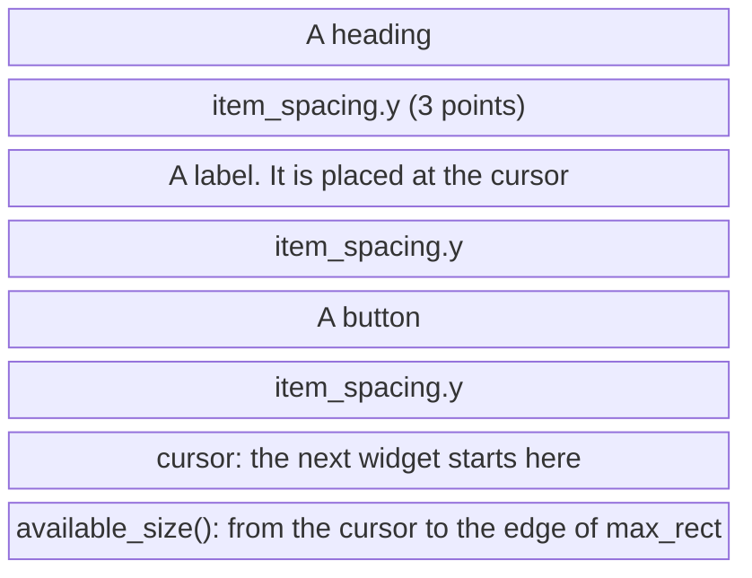

# `Ui`

[Back to the tutorial](../chapters/03-hello-world.md)

## In one paragraph

A `Ui` is a rectangular region you add widgets to, one call at a time. Every widget call
(`ui.label`, `ui.button`, `ui.add(..)`) asks the `Ui` for space, and the `Ui` places it where
its cursor is, then moves the cursor past it. Containers such as `ui.horizontal` and
`ui.group` make a child `Ui`, hand it to your closure, and afterwards take up as much of the
parent as the child used. Nothing is laid out ahead of time or laid out again: the order of
your calls is the layout, and each frame starts afresh from your state.

## The mental model

Think of a typewriter. The cursor is the carriage: each widget is typed there, and the
carriage moves down past it plus a small gap (the item spacing), or to the right in a
horizontal layout. You can skip forward (`add_space`), ask how much paper is left
(`available_size`), or reserve a block to draw in yourself (`allocate_exact_size`). You
cannot go back and move what is already typed.

Every `Ui` also carries a `Style`, an enabled flag and an id scope. A child `Ui` starts with
copies of its parent's; changing them in the child does not touch the parent.

> **If you come from the web.** A vertical `Ui` behaves like normal block flow, or more
> exactly like a flex column with `align-items: flex-start` and a 3px `gap`: children stack
> top to bottom, each as wide as its content, and long text wraps at the container's edge.
>
> Where the comparison breaks:
>
> - **There is no reflow.** A browser lays the element tree out again whenever anything
>   changes, and a later sibling can resize an earlier one. An egui widget is placed and
>   painted when you call it, and nothing added later moves it, which is why some sizes are
>   only known a frame late (see below).
> - **There is no stylesheet.** No selectors, no cascade. Each `Ui` holds a style value; a
>   child gets a copy when it is created, and you change it in code, usually in a `scope`.
> - **Margins do not collapse.** The gap is the item spacing plus any `add_space`, always.
> - **No element remembers anything.** Widgets do not live between frames. One that needs
>   memory (is this header open?) keeps it under an id derived from where it is drawn, which
>   is what `push_id` is for.
>
> Below, wherever the web has an equivalent, the web way (CSS, HTML or JS) is shown first and
> the egui way after it.

## How it works

A `Ui` keeps three rectangles:

- **`max_rect`**: the space the parent offered. Widgets *try* to fit in it and text wraps at
  its right edge, but a widget that is too big still gets its size and the `Ui` grows.
- **`min_rect`**: the box around everything added so far. It only grows. When a child `Ui`
  is finished, this is the size the parent takes up for it.
- **`cursor`**: where the next widget goes. After a widget, it waits `item_spacing` past it
  (8 points across, 3 down, by default). `available_size()` is the space from the cursor to
  the edge of `max_rect`, so it shrinks as you add widgets.

In a top-to-bottom `Ui` with three widgets, that looks like this:

```text
max_rect: the space the parent offered
+--------------------------------------------+
| A heading                                  |
|   item_spacing.y (3 points)                |
| A label. It is placed at the cursor ...    |
|   item_spacing.y                           |
| [A button]                                 |
|   item_spacing.y                           |
|- - - - - - - - - cursor - - - - - - - - - -|  <- the next widget starts here
|                                            |
|             available_size()               |
|                                            |
+--------------------------------------------+
min_rect: the box around the heading, the label and the button
```



Adding a widget does all of this inside the one call: the widget works out the size it
wants, the `Ui` finds room at the cursor and moves the cursor past it, and the widget paints
itself and returns a `Response`. `ui.allocate_space(size)` is the middle step on its own: it
reserves the space and returns an `Id` and the `Rect`, painting nothing. `allocate_response`,
`allocate_exact_size` and `allocate_at_least` are built on it.

### Why sizes are known only after drawing

A widget's size is known when its call returns (`Response::rect`), a container's when its
closure finishes (the `InnerResponse`'s `response.rect`). So you cannot centre something by
its own size before drawing it. The answer is last frame's size: store it, read it next
frame. egui does this itself in places, with two tools to hide the first, wrong frame:

- **A sizing pass.** A `Ui` can be marked as a sizing pass (`UiBuilder::sizing_pass`, read
  with `ui.is_sizing_pass()`): its contents are laid out without stretching to fill, only
  to be measured. A new `Window`, menu or popup (anything built on `Area`) does a sizing pass
  invisibly the first time it is shown, then appears next frame at the right size. A new
  `Grid` also measures its column widths in a sizing pass, but it then discards that pass
  (below), so its first frame is never shown at all.
- **Discarding a pass.** `ctx.request_discard(reason)` asks egui to throw the current pass
  away and run your code again before anything reaches the screen. A new `Grid` does this,
  so its first, guessed column widths are never seen. egui runs at most `Options::max_passes` passes per
  frame, 2 by default, so a request made during the second pass is declined.

The `egui::Aligned` container packages the pattern: it places its contents by their size
from the last pass, and on its first pass draws them invisibly and asks for a discard.

## Standard usage

Most of the time you do not think about the `Ui` at all: you add widgets in order and they
stack. The example draws a line where the cursor is after each widget, so you can see the
item spacing and the space left.

**The CSS way:** a column whose children are as wide as their content and 3px apart (egui's
`item_spacing.y`). The browser lays the whole tree out, and again whenever anything changes.

```html
<div class="ui">
  <h2>A heading</h2>
  <p>A label. It is placed at the cursor, and the cursor moves below it.</p>
  <button>A button</button>
</div>
```

```css
.ui { display: flex; flex-direction: column; align-items: flex-start; gap: 3px; }
.ui > * { margin: 0; }
```

**The egui way:** each call places one widget at the cursor and moves the cursor on.
Nothing is laid out again.

@@excerpt code/concepts/src/ui_region.rs ||| /// Widgets go one below the other. ||| ui.label(format!("Space left: ||| 1

Run: `cargo run -p concepts -- "The cursor"`


Painting (`ui.painter()`) allocates no space, so the lines drawn by `mark_cursor` do not move
the cursor. The numbers at the end are what `available_size()` returned at that point:
everything from the cursor to the bottom right of the pane.

## Micro-examples

Every example is real code from
[`code/concepts/src/ui_region.rs`](../code/concepts/src/ui_region.rs), drawn into the
gallery's pane as it would be in a panel of yours. Each command, run from `tutorial/code`,
opens the gallery at it; the checks behind this page are in `code/concepts/tests/ui_region.rs`.

### Fill the available width

**Use this when** you draw something yourself and it should be as wide as the space left.

**The CSS way:** a percentage, which the browser resolves during layout and again on every
resize.

```css
.bar { width: 100%; height: 16px; border-radius: 4px; background: Highlight; }
```

**The egui way:** read the number now, ask for exactly that much, paint into the rectangle
you get back. After a resize, the code runs again with the new number.

@@excerpt code/concepts/src/ui_region.rs ||| /// Read how much width is left ||| ui.label(format!("available_width() was ||| 1

Run: `cargo run -p concepts -- "Fill the available width"`

There are four ways to ask for space, and they differ in what they give back:

| Method | Returns | Use it for |
|---|---|---|
| `allocate_space(size)` | `(Id, Rect)`, no interaction | Reserving room you will paint into, nothing to click |
| `allocate_response(size, sense)` | `Response` | A custom widget that reacts to the pointer |
| `allocate_exact_size(size, sense)` | `(Rect, Response)`, the `Rect` exactly `size` | Painting something of a fixed size; the response may be bigger in a justified layout |
| `allocate_at_least(size, sense)` | `(Rect, Response)`, both the full space given | Painting that should fill whatever it was given |

You never get less than you asked for.

### Reserve a region

**Use this when** a group of widgets should get at most a given size, and take only what it
uses.

No honest CSS pair: a CSS box has the size you give it or the size of its content, while
`allocate_ui` offers a size as a limit and then takes only what the contents used.

@@excerpt code/concepts/src/ui_region.rs ||| /// `allocate_ui` offers its contents ||| outline_offered_and_used(ui, offered, used); ||| 1

Run: `cargo run -p concepts -- "Reserve a region"`


The thin outline is what was offered, the strong one what was used; the next label starts
just below the strong one. The text wrapped at the child's 220-point `max_rect`. Contents
taller than 120 points would have made the region grow to fit them.

### Extra space

**Use this when** two widgets need more room between them than the usual spacing.

**The CSS way:** a margin. In a flex column it adds to the `gap`; in plain block flow it
would collapse with the margin of the element above.

```css
.next { margin-top: 20px; } /* 3px gap + 20px = 23px between the two lines */
```

**The egui way:** move the cursor on. The space is added to the item spacing, never merged
with it.

@@excerpt code/concepts/src/ui_region.rs ||| /// `add_space` moves the cursor on ||| ui.label("The next line, 20 points lower"); ||| 3

Run: `cargo run -p concepts -- "Extra space"`

`add_space` follows the layout's direction: in the row holding the columns, `add_space(40.0)`
is sideways. In a `Grid` it stops debug builds with an assertion; leave an empty cell.

### Width limits

**Use this when** a box must be at least, or at most, a given width.

**The CSS way:** two constraints, which the browser solves together however they are
written.

```css
.at-least { min-width: 240px; }
.at-most  { max-width: 240px; } /* text inside wraps at 240px */
```

**The egui way:** two calls on the child `Ui` inside each group. Order matters:
`set_max_width` limits only the widgets added after it, so call it first.

@@excerpt code/concepts/src/ui_region.rs ||| /// `set_min_width` makes a `Ui` at least ||| instead of running on across the pane. ||| 3

Run: `cargo run -p concepts -- "Width limits"`


Neither can shrink what is already drawn. The limits apply to the `Ui` inside the group's
frame, so its margin and border come on top, like `box-sizing: content-box` (the CSS
default). `set_width(w)` sets both at once.

### Disabled widgets

**Use this when** a widget or a whole section should be visible but not usable yet.

**The JS way:** a `disabled` attribute on the element, or on a `<fieldset>` around a
section. It lives on the element, so script must keep it in step with the checkbox.

```html
<label><input type="checkbox" id="terms"> I have read the terms</label>
<button id="continue" disabled>Continue</button>

<fieldset disabled>
  <label><input type="checkbox"> Compact rows</label> <button>Reset</button>
</fieldset>
```

```js
const terms = document.querySelector("#terms");
const go = document.querySelector("#continue");
terms.addEventListener("change", () => { go.disabled = !terms.checked; });
```

**The egui way:** pass the condition each frame. There is no state to keep in step.

@@excerpt code/concepts/src/ui_region.rs ||| impl Demo for DisabledWidgets { ||| self.compact_rows = false; ||| 4

Run: `cargo run -p concepts -- "Disabled widgets"`


A disabled widget is drawn faded and ignores the pointer: `clicked()` stays `false`. As
with `<fieldset disabled>`, nothing inside a disabled `Ui` can be enabled again:
`add_enabled(true, ..)` there still gives a disabled widget. `add_enabled_ui` is `scope`
plus `ui.disable()`. There is no `enable()`, so call `disable()` yourself only in a child
`Ui`: everything added to that `Ui` afterwards stays disabled.

### Scoped style

**Use this when** a few widgets need different spacing or colours from the rest.

**The CSS way:** a class on a wrapper and a rule that matches inside it. Buttons do not
inherit `color` by default, so the rule says so.

```html
<button>Normal button</button>
<div class="loud"><button>Bigger button</button> <p>Text in the warning colour</p></div>
<button>Normal again</button>
```

```css
.loud { color: var(--warn); }
.loud button { padding: 8px 16px; color: inherit; }
```

**The egui way:** change a copy of the style inside a child `Ui`. The change ends with the
closure.

@@excerpt code/concepts/src/ui_region.rs ||| /// Style changes inside `scope` ||| let _ = ui.button("Normal again"); ||| 1

Run: `cargo run -p concepts -- "Scoped style"`

`spacing_mut()`, `visuals_mut()` and `style_mut()` change a copy of this `Ui`'s style; on the
parent they would change every widget added after. `override_text_color` covers buttons too.

### Repeated widgets

**Use this when** the same stateful widget appears more than once, such as in a loop.

**The HTML way:** nothing to do. Each `<details>` element is an object that keeps its own
open state.

```html
<p>Inbox</p> <details><summary>Details</summary>Details of Inbox.</details>
<!-- the same for Archive and Spam: three elements, three open states -->
```

**The egui way:** a collapsing header stores its open state under an id made from the `Ui`'s
id scope and its title. Three headers called "Details" in one `Ui` would share an id, so
each row gets its own scope with `push_id`.

@@excerpt code/concepts/src/ui_region.rs ||| /// Each collapsing header keeps ||| ui.label(format!("Details of {folder}.")); ||| 4

Run: `cargo run -p concepts -- "Repeated widgets"`

A loop index would hand the stored state to another item when the list is sorted or
filtered. `ui.scope` does **not** do this job (see Common mistakes). The todo app wraps each
row in `ui.push_id(todo.id, ..)`, and the gallery each example in `push_id(example.name, ..)`.

## Best practices

- **Ask for what you need.** A widget should ask for its natural size; ask
  `available_size()` only when the point is to fill the space.
- **Derive enabled state from your data each frame**, as in `add_enabled(can_save, ..)`,
  rather than storing it.
- **Change style in a `scope`**, and give repeated stateful widgets a stable id with
  `push_id(item.id, ..)`.
- **Use `add_space` for a one-off gap and `item_spacing` for a rhythm.** Changing
  `ui.spacing_mut().item_spacing` in a scope spaces out a whole section.

## Common mistakes

**Using `scope` to fix an id clash.** Every plain child `Ui` gets the same id scope, so two
`scope`s holding a "Details" header still clash; `push_id` is what changes it. In debug
builds egui paints a red warning over widgets whose ids clash.

**Filling the available space and then adding more.** After
`allocate_exact_size(ui.available_size(), ..)` nothing is left; the next widget goes past
the edge and the `Ui` grows to hold it.

**Reading a size before it exists.** You cannot centre a row by its width before drawing it.
Store last frame's width and use that, or a container that does it for you (`Aligned`).

## See also

- [Hello World](../chapters/03-hello-world.md), where `App::ui` hands you the root
  `Ui`.
- [Pitfall 1: unstable or clashing widget IDs](../chapters/10-pitfalls.md#pitfall-1-unstable-or-clashing-widget-ids),
  the longer story of `push_id` in the todo app.
- [Stage 2: reusable components](../chapters/05-stage-2-components.md), where
  `PriorityBadge` paints into space from `allocate_exact_size`.
- [`CentralPanel`](central-panel.md), the usual `Ui` you add widgets to.
- docs.rs: [`Ui`](https://docs.rs/egui/0.37.0/egui/struct.Ui.html),
  [`UiBuilder`](https://docs.rs/egui/0.37.0/egui/struct.UiBuilder.html),
  [`Spacing`](https://docs.rs/egui/0.37.0/egui/style/struct.Spacing.html),
  [`Aligned`](https://docs.rs/egui/0.37.0/egui/containers/struct.Aligned.html).
