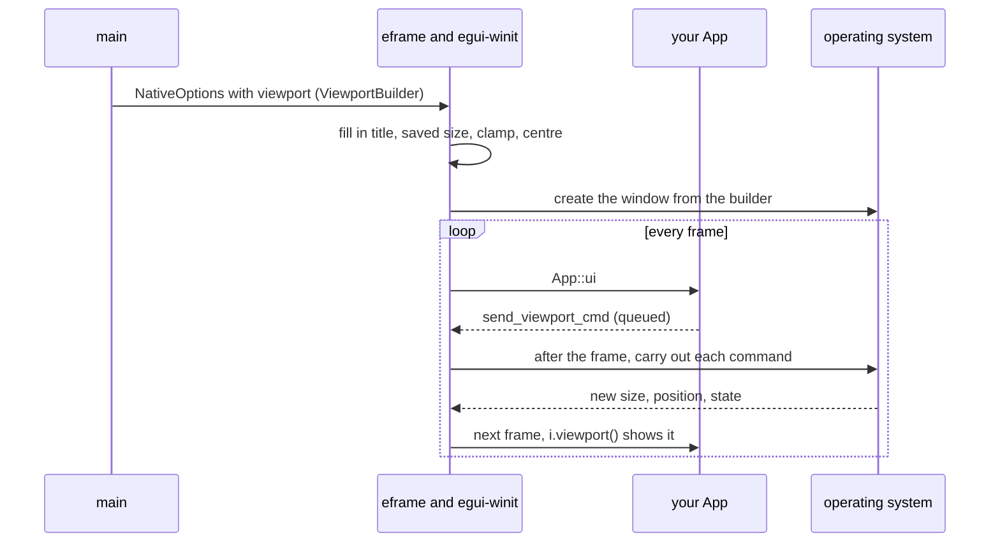

# `ViewportBuilder`

[Back to the tutorial](../chapters/03-hello-world.md)

## In one paragraph

`ViewportBuilder` describes a native window: its title, size, size limits, position, icon,
whether it has a border and title bar, whether it is transparent, resizable, maximized,
fullscreen or always on top. You build one with `with_*` methods and put it in the `viewport`
field of [`NativeOptions`](native-options.md). eframe uses it once, to create the window. To
change any of these while the app runs, you send the matching `ViewportCommand` with
`ctx.send_viewport_cmd`. The same type also describes every extra window you open with
`ctx.show_viewport_deferred` or `ctx.show_viewport_immediate`.

## The mental model

Think of `ViewportBuilder` as a list of requests, each one optional. Every field is an
`Option`, and `None` means "I have no opinion, use the default". `ViewportBuilder::default()`
asks for nothing, so the operating system and eframe choose everything. Each `with_*` call
fills in one request. Nothing happens until eframe reads the list and creates the window.

`ViewportCommand` is the same list, sent later, one change at a time. egui calls it
"essentially a way to diff `ViewportBuilder`s", and does exactly that for extra windows: it
compares this frame's builder with last frame's and turns each difference into a command
(`with_title` into `Title`, `with_decorations` into `Decorations`). A few settings have no
command, because the windowing library cannot change them on a live window; for those, egui
recreates the window.

The builder is the window; the rest of `NativeOptions` is everything around it (renderer,
vsync, saving, centring). [`NativeOptions`](native-options.md#where-a-setting-goes) has the
full table.

> **If you come from the web.** A web page does not own its window, so a browser offers only
> a few pieces of this: the features string of `window.open(url, name, "width=460,height=220")`
> for a popup's size, `document.title` for the title, `<link rel="icon">` for the icon and
> `element.requestFullscreen()` for fullscreen. The builder is all of those and more, in one
> place, and `ViewportCommand` is how you change them later.
>
> Where the comparison breaks:
>
> - **There is no window object.** You send a command from inside `ui`, and it is carried
>   out after the frame.
> - **You cannot ask the window for its settings.** egui reports some state back (size,
>   position, maximized, fullscreen, focused) through `ui.input(|i| i.viewport())`, but not
>   the title, the window level or whether it is resizable. Keep those in your app's state.
>
> Below, wherever the browser has a real equivalent, the web way (CSS, HTML or JS) is shown
> first and the egui way after it. Most settings have none.

## How it works

1. **You fill in the builder** and put it in `NativeOptions::viewport`.
2. **eframe adjusts it.** It fills in a missing title from the app name. With persistence on,
   a saved position and size replace yours. It clamps the starting size to the largest
   monitor (turn that off with `with_clamp_size_to_monitor_size(false)`). With
   `centered: true`, it replaces your position with one in the middle of the screen.
3. **egui-winit turns it into window attributes.** Sizes and positions are in points, scaled
   by the zoom factor and the screen's scale. Anything left at `None` gets the default in the
   table below.
4. **The window is created**, and the builder is not read again.
5. **Every frame, `App::ui` runs.** A `ctx.send_viewport_cmd(..)` inside it only queues the
   command.
6. **After the frame, egui-winit carries out the queued commands** on the window, in order.
7. **The operating system answers.** Some commands take effect at once, others (a resize on
   Windows, for example) arrive later as an event. Either way, the new size, position or
   state shows up in `ui.input(|i| i.viewport())` on a later frame.

```text
main            eframe / egui-winit                  operating system
 |  ViewportBuilder
 |  in NativeOptions --> fill in title, apply saved size,
 |                       clamp to monitor, centre
 |                       builder -> window attributes --> create the window
 |                                                         |
 |                 every frame:                            |
 |                 App::ui                                 |
 |                   send_viewport_cmd(cmd)  (queued)      |
 |                 after the frame:                        |
 |                   carry out each command  -----------> change the window
 |                 next frame:                             |
 |                   i.viewport() has the new state <----- size, position, state
```



### Settings and their commands

| Setting | Builder method | When left unset | Changed while running with |
|---|---|---|---|
| Title | `with_title` | The app name (filled in by eframe) | `Title(String)` |
| Size of the content area | `with_inner_size` | Chosen by the platform | `InnerSize(Vec2)` |
| Size limits | `with_min_inner_size`, `with_max_inner_size` | The platform's own limits | `MinInnerSize`, `MaxInnerSize` |
| Position | `with_position` | Chosen by the operating system | `OuterPosition(Pos2)` |
| Border and title bar | `with_decorations` | On | `Decorations(bool)` |
| Transparent background | `with_transparent` | Off | `Transparent(bool)` |
| Resizable by the edges | `with_resizable` | Yes | `Resizable(bool)` |
| Title bar buttons | `with_close_button`, `with_minimize_button`, `with_maximize_button` | All enabled | `EnableButtons { close, minimized, maximize }` |
| Always on top | `with_always_on_top`, `with_window_level` | `WindowLevel::Normal` | `WindowLevel(WindowLevel)` |
| Icon | `with_icon` | eframe's own: a white "e" on black | `Icon(Option<Arc<IconData>>)` |
| Maximized | `with_maximized` | No | `Maximized(bool)` |
| Fullscreen | `with_fullscreen` | No | `Fullscreen(bool)` |
| Visible | `with_visible` | Yes | `Visible(bool)` |

Some commands are actions, with no builder method: `Close`, `Minimized(bool)`, `StartDrag`,
`BeginResize`, `Focus`. Some builder methods work on one platform only: `with_taskbar` on
Windows, `with_titlebar_shown` and `with_has_shadow` on macOS. `with_app_id` reaches the
window on Wayland only, but through eframe it also names the save folder on every platform
(see [`NativeOptions`](native-options.md)).

## Standard usage

Most windows need a title, a starting size and a minimum size. Here the example also sets a
maximum size and a starting position.

**The JS way:** a page can set its title at any time, but it can only size and place a
window that its own script opens, and the browser may ignore the request. There is no
minimum or maximum size.

```js
document.title = "Viewport builder: size";
window.open("app.html", "app", "width=460,height=220,left=120,top=120");
```

**The egui way:** the program owns its window, so the size and limits it asks for are the ones
it gets.

@@excerpt code/concepts/examples/viewport_builder_size.rs ||| /// Size and place the window ||| .with_position([120.0, 120.0]); ||| 0

Run: `cargo run -p concepts --example viewport_builder_size`


The inner size is the area your `ui` draws in. The outer size adds the title bar and border
(on Windows 11 also an invisible resize border, which is why the outer size is wider than the
visible window). `with_position` places the outer top-left corner, title bar included. All of
them are in points, not physical pixels, so the window looks the same size on a high-DPI
screen. Wayland and Android ignore the position.

## Micro-examples

Every example on this page is a whole program in
[`code/concepts/examples/`](../code/concepts/examples/), because each one changes the window
itself, which the gallery cannot show. Run them from `tutorial/code` with the command under
each.

### Borderless window with its own title bar

**Use this when** the app draws its own title bar: a custom look, or tabs and toolbars in the
title bar as in many editors and browsers.

**The CSS way:** only Chromium has this, in installed web apps that use the window controls
overlay. A CSS property marks what drags the window, and the buttons must opt out again.

```css
.title-bar { app-region: drag; }
.title-bar button { app-region: no-drag; }
```

**The egui way:** turn the decorations off in the builder.

@@excerpt code/concepts/examples/viewport_builder_borderless.rs ||| viewport: egui::ViewportBuilder::default() ||| .with_min_inner_size([320.0, 150.0]), ||| 0

Then draw a title bar. Dragging it hands the move to the operating system with `StartDrag`;
the buttons send `Close` and `Minimized`.

@@excerpt code/concepts/examples/viewport_builder_borderless.rs ||| /// A title bar drawn by the app. ||| .send_viewport_cmd(egui::ViewportCommand::Minimized(true)); ||| 5

Run: `cargo run -p concepts --example viewport_builder_borderless`


The bar is one `ui.interact` over the whole strip, added before the label and buttons so that
they sit on top and keep their own clicks. The title is a label with `selectable(false)`:
a selectable label would take the press for selecting text. Double-clicking the bar toggles
maximized, as a real title bar does. `StartDrag` only works while the left button is held
down, so it is sent when a drag starts (the pointer has moved a little with the button still
down), and egui-winit ignores it if the window does not have focus. The window has no resize
border either; `ViewportCommand::BeginResize` lets you build resize handles of your own. The
tests in this example check that each part sends the right command.

### Transparent window

**Use this when** the window should not be a rectangle: a rounded card, a splash screen, an
overlay.

The browser has no equivalent: a page cannot make the window behind it see-through.

@@excerpt code/concepts/examples/viewport_builder_transparent.rs ||| // Both are needed for a window of any shape ||| .with_transparent(true), ||| 0

`with_transparent(true)` only gives the window an alpha channel. Two things still paint over
it. eframe clears every frame to `App::clear_color`, a partly see-through dark grey by default,
so return a fully transparent colour:

@@excerpt code/concepts/examples/viewport_builder_transparent.rs ||| /// The colour eframe clears the window to ||| egui::Color32::TRANSPARENT.to_normalized_gamma_f32() ||| 1

and the default `CentralPanel` paints the whole window, so use `CentralPanel::no_frame()` and
paint only the shape you want:

@@excerpt code/concepts/examples/viewport_builder_transparent.rs ||| // The usual central panel would paint the whole window. ||| card.show(ui, |ui| { ||| 0

The card is also the drag region, the same way as the title bar above.

Run: `cargo run -p concepts --example viewport_builder_transparent`

There is no screenshot: the tool that takes them asks the window to paint itself into an
image, and that turns the see-through corners white. On screen, the desktop shows through
them. Whether transparency works at all depends on the platform and the graphics driver;
egui's documentation calls it "more of a hint" on some systems. On macOS, its documentation
also suggests `with_has_shadow(false)` to avoid ghosting around the shape.

### Always on top

**Use this when** a small window must stay visible over others: a timer, a colour picker, a
video call.

**The JS way:** Chromium's Document Picture-in-Picture API opens a small window that stays
above the others. It needs a click to start it, and the page cannot turn "on top" off.

```js
button.onclick = async () => {
  const pip = await documentPictureInPicture.requestWindow({ width: 400, height: 140 });
  pip.document.body.append(timer);
};
```

**The egui way:** a window level in the builder, which the example's checkbox changes with
`ViewportCommand::WindowLevel(WindowLevel::Normal)` and back.

@@excerpt code/concepts/examples/viewport_builder_always_on_top.rs ||| // Short for ||| .with_always_on_top(), ||| 0

Run: `cargo run -p concepts --example viewport_builder_always_on_top`

The app keeps the level in its own field, because egui does not report it back. There is
also `WindowLevel::AlwaysOnBottom`, for a window that stays behind all others. The exact
behaviour is the operating system's; winit's documentation lists the platform differences.

### Window icon

**Use this when** the app should have its own icon in the title bar, the taskbar and the
Alt+Tab list, instead of eframe's white "e" on black.

**The JS way:** a link in the page's head, and a script that sets a new `href` to change it.

```html
<link rel="icon" href="red.png">
<script>document.querySelector("link[rel=icon]").href = "blue.png";</script>
```

**The egui way:** `IconData` is raw pixels, four bytes per pixel (red, green, blue, alpha, the
alpha not premultiplied), with a width and height. The example's `round_icon` fills them in
to draw a disc, so it needs no image file:

@@excerpt code/concepts/examples/viewport_builder_icon.rs ||| // Without this, eframe uses its own icon ||| .with_icon(round_icon(RED)), ||| 0

and the `Icon` command changes it:

@@excerpt code/concepts/examples/viewport_builder_icon.rs ||| if ui.button("Change the icon").clicked() { ||| )))); ||| 1

Run: `cargo run -p concepts --example viewport_builder_icon`


A real app usually embeds a PNG: `eframe::icon_data::from_png_bytes(include_bytes!(..))`
returns an `IconData`. egui asks for a square image whose width and height are multiples of 4,
such as 256 by 256. `IconData::default()`, which is empty, means "the operating system's
default icon" instead of eframe's. On Windows, eframe sets both the large icon (taskbar,
Alt+Tab) and the small one (title bar) at start-up. The `Icon` command goes through winit,
which, according to a comment in eframe's source, sets only the small one, so the taskbar may
keep the start-up icon.

### Maximized, minimized and fullscreen

**Use this when** the app has a fullscreen mode (a presentation, a video, a game), or a button
that maximizes the window.

**The JS way:** the Fullscreen API. The browser leaves fullscreen on Esc by itself. There is
nothing for maximizing or minimizing.

```js
button.onclick = () => document.documentElement.requestFullscreen();
const isFullscreen = document.fullscreenElement !== null;
```

**The egui way:** `with_maximized(true)` or `with_fullscreen(true)` in the builder to start
that way; at run time, read the state from the viewport info and send a command:

@@excerpt code/concepts/examples/viewport_builder_window_state.rs ||| let (maximized, fullscreen) = ui.input ||| }); ||| 0

@@excerpt code/concepts/examples/viewport_builder_window_state.rs ||| let maximize = if maximized ||| .send_viewport_cmd(egui::ViewportCommand::Fullscreen(!fullscreen)); ||| 1

Run: `cargo run -p concepts --example viewport_builder_window_state`

egui's fullscreen is always borderless fullscreen: the window covers the monitor it is on,
without changing the screen's resolution. Unlike a browser, eframe does not leave fullscreen
on Esc, so the example sends `Fullscreen(false)` when Esc is pressed, as any app with a
fullscreen mode should. `maximized` and `fullscreen` in the viewport info are `Option`s:
`None` until the platform has reported them.
`Minimized(true)` has no builder method, so the builder cannot open a window minimized.

### Fixed-size window

**Use this when** the window is a dialog or a tool whose layout has one size.

The browser has no equivalent: the `resizable` feature of `window.open` is ignored by current
browsers.

@@excerpt code/concepts/examples/viewport_builder_resizable.rs ||| // No resizing by the edges ||| .with_maximize_button(false), ||| 0

Run: `cargo run -p concepts --example viewport_builder_resizable`


`with_resizable(false)` stops resizing by the edges, but the maximize button would still
change the size, so it is turned off too (it shows greyed out). The example's checkbox sends
`Resizable(true)` and `EnableButtons { close: true, minimized: true, maximize: true }`: the
three buttons share one command, which sets all three at once. In the builder they are three
methods, and for an extra window, changing one of them in the builder makes egui recreate the
window rather than send `EnableButtons`.

## Best practices

- **Set a title, an inner size and a minimum inner size**, and leave the rest unset unless you
  need it. The defaults are the ones the user expects of a normal window.
- **Change the window with `ViewportCommand`.** Building a new `ViewportBuilder` for the root
  window does nothing after start-up.
- **Keep your own copy of what egui does not report**, such as the window level or whether
  the window is resizable, and read the rest from `ui.input(|i| i.viewport())`.
- **Give a borderless window every job of the title bar**: dragging, closing, minimizing,
  double-click to maximize, and resizing if it is resizable.
- **Give fullscreen a keyboard way out.** Esc is what users try first.

## Common mistakes

**Turning decorations off and losing the window.** Without a title bar there is nothing to drag
or close the window with. Draw a title bar, or at least send `StartDrag` when the
background is dragged, and give a way to close.

**Seeing a dark grey background in a transparent window.** `with_transparent(true)` is not
enough: return a transparent `clear_color`, and use `CentralPanel::no_frame()` or a frame
with a transparent fill.

**Sending `StartDrag` from `clicked()`.** A click is reported when the button is released,
and by then there is no drag to hand over. Send it while the button is down: from
`drag_started_by(PointerButton::Primary)`, as the example does.

**Expecting `with_position` to place the content area.** It places the outer corner of the
window, title bar included. And with `centered: true` in `NativeOptions`, eframe replaces it.

**Changing `with_inner_size` and seeing no difference.** With persistence on, the saved size
from the last run wins; see [`NativeOptions`](native-options.md#common-mistakes).

**Reading `viewport().maximized` as a `bool`.** It is an `Option<bool>`, `None` until the
platform has said; `unwrap_or(false)` is the usual answer.

## See also

- [Hello World](../chapters/03-hello-world.md), where `ViewportBuilder` first appears.
- [`NativeOptions`](native-options.md), the start-up settings that hold the builder, and the
  table of what goes where.
- [`CentralPanel`](central-panel.md), and its frame, which a transparent window replaces.
- docs.rs: [`ViewportBuilder`](https://docs.rs/egui/0.37.0/egui/viewport/struct.ViewportBuilder.html),
  [`ViewportCommand`](https://docs.rs/egui/0.37.0/egui/viewport/enum.ViewportCommand.html),
  [`ViewportInfo`](https://docs.rs/egui/0.37.0/egui/struct.ViewportInfo.html),
  [`IconData`](https://docs.rs/egui/0.37.0/egui/viewport/struct.IconData.html), and egui's
  [viewport module](https://docs.rs/egui/0.37.0/egui/viewport/index.html) on extra windows.
