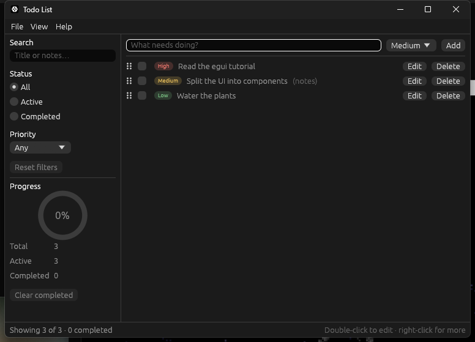

# eframe::egui tutorial

A hands-on tutorial for building a Todo List desktop app in Rust with
[egui](https://crates.io/crates/egui) 0.37.

**[Read the tutorial](tutorial/README.md)**



The tutorial is written for experienced Rust developers who are new to egui. It builds the
app in six stages, ending with reusable, tested UI components, HTTP requests that never
freeze the window, and todos stored in SQLite.

## What is in this repository

| Path | Contents |
| --- | --- |
| [`tutorial/README.md`](tutorial/README.md) | The tutorial's contents page |
| [`tutorial/chapters/`](tutorial/chapters/) | The tutorial itself, one page per chapter |
| [`tutorial/concepts/`](tutorial/concepts/README.md) | In-depth pages for the egui types the tutorial uses |
| [`tutorial/code/`](tutorial/code/) | A Cargo workspace with one crate per stage: `hello`, then `stage1` to `stage6`, plus `concepts` (the gallery and examples behind the concept pages) |
| [`tutorial/images/`](tutorial/images/) | Screenshots of each stage and of the concept-page examples |
| [`.claude/`](.claude/) | The playbook and tools used to write and rebuild the tutorial |

## Running a stage

egui 0.37 needs Rust 1.95 or newer.

```sh
cd tutorial/code
cargo run -p hello
cargo run -p stage6
```

Each stage is a complete app, so you can run any of them on its own.
