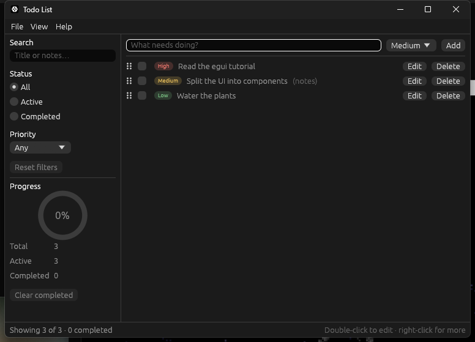
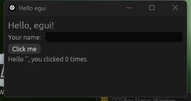
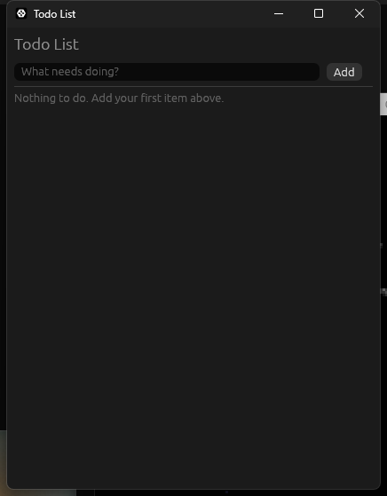
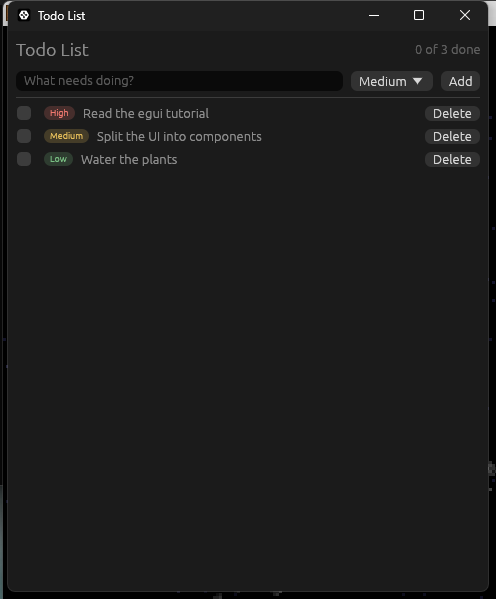
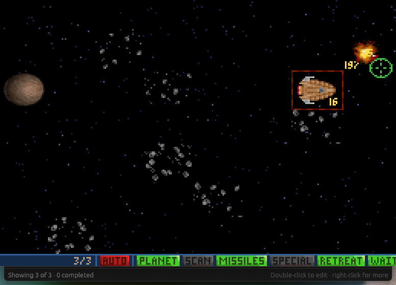
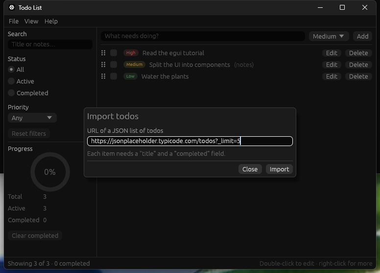
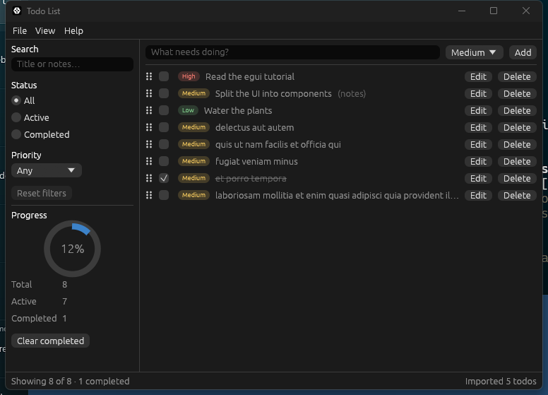
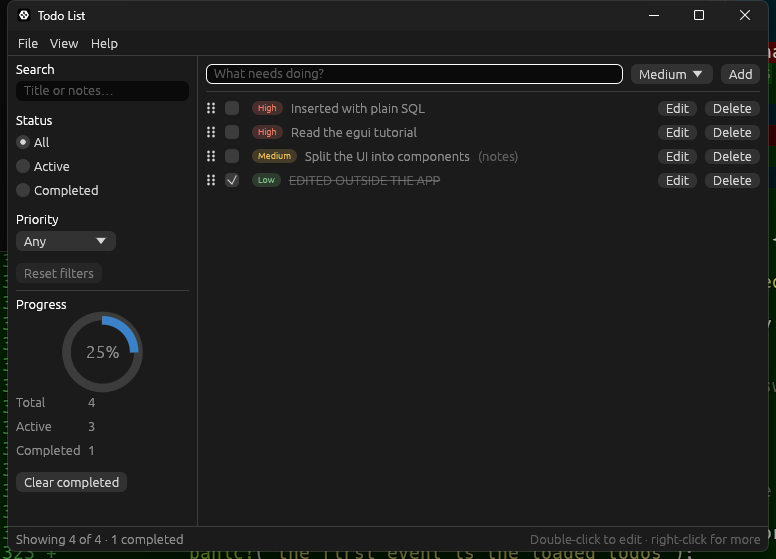

# Building a Todo List desktop app with egui 0.37

A hands-on tutorial for experienced Rust developers who are new to [egui](https://crates.io/crates/egui).
You will build a Windows desktop todo app in six stages, ending with a set of reusable,
tested UI components, HTTP requests that never freeze the window, and todos stored in SQLite.

> **Tested against:** `egui` / `eframe` / `egui_extras` / `egui_kittest` **0.37.0**, `reqwest` 0.13,
> `sqlx` 0.9, `tokio` 1.54, Rust 1.99, Windows 11.
> Every Rust block below is copied from a file under [`code/`](code/) that compiles with zero warnings
> under `cargo clippy -- -D warnings`. egui 0.37 needs **Rust 1.95 or newer**.

**Contents**

1. [Introduction](#1-introduction)
2. [Setup & installation](#2-setup--installation)
3. [Core concepts: Hello World](#3-core-concepts-hello-world)
4. [Step-by-step project build](#4-step-by-step-project-build)
   - [Stage 1: a working list in one file](#stage-1-a-working-list-in-one-file)
   - [Stage 2: reusable components](#stage-2-reusable-components)
   - [Stage 3: a full application shell](#stage-3-a-full-application-shell)
   - [Stage 4: persistence, theming, custom painting and UI tests](#stage-4-persistence-theming-custom-painting-and-ui-tests)
   - [Stage 5: HTTP requests on a background worker](#stage-5-http-requests-on-a-background-worker)
   - [Stage 6: a SQLite database with sqlx](#stage-6-a-sqlite-database-with-sqlx)
5. [Common pitfalls & best practices](#5-common-pitfalls--best-practices)
6. [Next steps](#6-next-steps)

---

## 1. Introduction

**egui** is an *immediate mode* GUI library. There is no widget tree that you build once and
then mutate, no callbacks, and no data binding. Instead, your code runs every frame, and each
call both draws a widget and tells you what the user did with it:

```rust,ignore
if ui.button("Save").clicked() {
    save();
}
```

Developers pick egui because:

- **State stays in your own structs.** The UI is a function of your data, so it cannot drift
  out of sync with it.
- **It is plain Rust.** Layout is closures, lists are `for` loops, conditional UI is `if`.
- **It is portable and self-contained.** The same code runs natively and on the web, with no
  system toolkit to install.

egui itself only turns input into shapes to draw. **eframe** is the official framework that
opens the window, runs the event loop and renders those shapes. An app depends on `eframe`,
which re-exports `egui`.

### What we are building



A todo app with a menu bar, a collapsible filter sidebar, list and table views, a modal edit
dialog, drag-to-reorder, keyboard shortcuts, a settings window, light and dark themes,
import over HTTP, and todos stored in a SQLite database.

| Stage | You add | egui features introduced |
|---|---|---|
| 1 | A working list in one file | `CentralPanel`, `TextEdit`, `ScrollArea`, layouts, `RichText`, `push_id` |
| 2 | A data model and reusable components | `impl Widget`, custom painting, `Sides`, `ComboBox`, accessibility names |
| 3 | A full application shell | `Panel`, `MenuBar`, `Modal`, `Grid`, `TableBuilder`, context menus, drag and drop, shortcuts |
| 4 | Persistence, theming, a custom widget, UI tests | `eframe::Storage`, `Style`, `Window`, `Slider`, colour picker, animation, `egui_kittest` |
| 5 | Import from a URL with `reqwest` | A background worker, `Context::request_repaint`, `Spinner`, disabled widgets, async results in an immediate mode UI |
| 6 | Todos in SQLite with `sqlx` | Loading state, saving as you go, error reporting in the status bar |

**What is left out.** "All of egui" is larger than one app can use sensibly. This tutorial
does not cover images and textures, custom fonts, multiple native windows (viewports),
plotting (`egui_plot`), custom GPU rendering, or the web target.

---

## 2. Setup & installation

You need a Rust toolchain (1.95+) with the MSVC build tools, which `rustup` installs by
default on Windows. No environment variables or extra configuration are required.

```powershell
rustc --version          # must print 1.95.0 or newer; run `rustup update` if not

cargo new todo_app
cd todo_app
cargo add eframe@0.37
```

Later stages add more dependencies. You can add them now or when you reach the stage:

```powershell
# Stage 3: tables
cargo add egui_extras@0.37

# Stage 4: saving state, and headless UI tests
cargo add eframe@0.37 --features persistence
cargo add serde --features derive
cargo add --dev egui_kittest@0.37

# Stage 5: HTTP requests, and a local mock server for the tests
cargo add reqwest@0.13 --features json
cargo add tokio@1 --features rt,sync
cargo add --dev wiremock@0.6
cargo add --dev tokio@1 --features macros

# Stage 6: SQLite
cargo add sqlx@0.9 --no-default-features --features runtime-tokio,sqlite,migrate,macros
cargo add --dev tempfile@3
```

Stage 5 makes real network requests. The first time a newly built executable connects,
Windows security software may ask you to allow it, and the request waits until you answer.

The first build compiles the renderer and takes a few minutes. Later builds take seconds.

### Running the companion code

Every stage is also a ready-to-run crate in this directory:

```powershell
cd tutorial/code
cargo run -p hello
cargo run -p stage1      # ... stage2 to stage6
cargo test --workspace
```

---

## 3. Core concepts: Hello World

Replace `src/main.rs` with:

```rust
// Release builds on Windows would otherwise open a console window next to the GUI.
#![cfg_attr(not(debug_assertions), windows_subsystem = "windows")]

use eframe::egui;

fn main() -> eframe::Result {
    // `NativeOptions` configures the OS window; `viewport` is egui's word for "native window".
    let native_options = eframe::NativeOptions {
        viewport: egui::ViewportBuilder::default().with_inner_size([360.0, 160.0]),
        ..Default::default()
    };

    // The closure runs once, after the window and renderer exist, and returns our app state.
    eframe::run_native(
        "Hello egui",
        native_options,
        Box::new(|_creation_context| Ok(Box::new(HelloApp::default()))),
    )
}

/// All state lives in a plain struct that we own; egui keeps no copy of it.
#[derive(Default)]
struct HelloApp {
    name: String,
    click_count: u32,
}

impl eframe::App for HelloApp {
    /// Called every time the window needs repainting. The whole UI is rebuilt from `self`.
    fn ui(&mut self, ui: &mut egui::Ui, _frame: &mut eframe::Frame) {
        // The root `ui` has no margin or background; `CentralPanel` adds both.
        egui::CentralPanel::default().show(ui, |ui| {
            ui.heading("Hello, egui!");

            // `horizontal` lays its children out left-to-right instead of top-down.
            ui.horizontal(|ui| {
                ui.label("Your name:");
                // The widget edits our field in place through the `&mut` borrow.
                ui.text_edit_singleline(&mut self.name);
            });

            // A widget is drawn and its interaction reported in the same call.
            if ui.button("Click me").clicked() {
                self.click_count += 1;
            }

            ui.label(format!(
                "Hello '{}', you clicked {} times.",
                self.name, self.click_count
            ));
        });
    }
}
```



Run it with `cargo run`. What each part does, and why:

| Code | Why it is there |
|---|---|
| `#![cfg_attr(..., windows_subsystem = "windows")]` | Without it, a release build opens a console window behind the GUI. Debug builds keep the console so you can see `println!` and panics. |
| `use eframe::egui;` | `eframe` re-exports the exact `egui` version it was built with, so you never need a separate `egui` dependency that could drift out of step. |
| `fn main() -> eframe::Result` | Creating a window can fail (no GPU, no display). Returning the result reports that instead of panicking. |
| `NativeOptions { viewport, .. }` | A *viewport* is a native OS window. `ViewportBuilder` sets its size, title, icon and so on. |
| `run_native(name, options, creator)` | Blocks until the window closes. The `creator` closure runs once, after the renderer exists, which is why it (and not `main`) receives the context you use to load fonts or saved state. It returns a `Result` so app setup can fail cleanly. |
| `struct HelloApp` | Your state. egui stores none of it. |
| `impl eframe::App` / `fn ui` | The one required method. eframe calls it whenever the window needs repainting and gives you the root `Ui`. |
| `CentralPanel::default().show(ui, ...)` | The root `Ui` has no margin or background. `CentralPanel` fills the remaining space and adds both. |
| `ui.horizontal(\|ui\| ...)` | Layout is nested closures. Each closure gets a child `Ui` with its own layout direction. |
| `ui.text_edit_singleline(&mut self.name)` | Widgets borrow your data for the duration of the call and edit it in place. |
| `ui.button("Click me").clicked()` | Every widget returns a `Response`. You ask it what happened: `clicked()`, `hovered()`, `changed()`, `lost_focus()` and so on. |

Three ideas explain almost everything else in egui:

1. **The UI is rebuilt from your state every frame.** A frame is cheap (typically a millisecond or
   two for an app like this), and egui only runs one when there is input or an
   animation in progress. You never "update" a label; you draw it again with the new value.
2. **`Ui` is a region with a layout cursor.** Adding a widget allocates the next rectangle
   and advances the cursor. Containers such as `horizontal`, `ScrollArea` and `Grid` hand
   you a child `Ui`.
3. **egui remembers a little state for you, keyed by widget ID.** Scroll offsets, which
   text box has focus, whether a header is collapsed. IDs are derived automatically, and
   [pitfall 1](#pitfall-1-unstable-or-clashing-widget-ids) covers when you must help.

> **If you are following an older tutorial:** in earlier versions the trait method was
> `fn update(&mut self, ctx: &egui::Context, frame: &mut eframe::Frame)` and panels were shown
> with `.show(ctx, ...)`. In 0.37 that method no longer exists. You implement `fn ui` and
> pass the `ui` you are given. See the [migration table](#coming-from-an-older-egui-version).

---

## 4. Step-by-step project build

### Stage 1: a working list in one file

**Goal:** add, complete and delete todos. One file, no abstractions yet, so the raw
mechanics are visible.

`src/main.rs`:

```rust
#![cfg_attr(not(debug_assertions), windows_subsystem = "windows")]

use eframe::egui;

fn main() -> eframe::Result {
    let native_options = eframe::NativeOptions {
        viewport: egui::ViewportBuilder::default()
            .with_inner_size([420.0, 520.0])
            .with_min_inner_size([320.0, 240.0]),
        ..Default::default()
    };

    eframe::run_native(
        "Todo List",
        native_options,
        Box::new(|_creation_context| Ok(Box::new(TodoApp::default()))),
    )
}

struct Todo {
    /// A stable identity that survives deletions, unlike the item's index in the `Vec`.
    id: u64,
    title: String,
    done: bool,
}

#[derive(Default)]
struct TodoApp {
    todos: Vec<Todo>,
    /// The text currently typed into the "new todo" box.
    draft_title: String,
    next_id: u64,
}

impl TodoApp {
    fn add_todo_from_draft(&mut self) {
        let title = self.draft_title.trim();
        if title.is_empty() {
            return;
        }
        self.todos.push(Todo {
            id: self.next_id,
            title: title.to_owned(),
            done: false,
        });
        self.next_id += 1;
        self.draft_title.clear();
    }
}

impl eframe::App for TodoApp {
    fn ui(&mut self, ui: &mut egui::Ui, _frame: &mut eframe::Frame) {
        egui::CentralPanel::default().show(ui, |ui| {
            ui.heading("Todo List");
            ui.add_space(8.0);

            // --- Input row -------------------------------------------------------
            ui.horizontal(|ui| {
                // `TextEdit` is the builder behind `ui.text_edit_singleline`; using it
                // directly gives access to options such as the hint text.
                let draft_response = ui.add(
                    egui::TextEdit::singleline(&mut self.draft_title)
                        .hint_text("What needs doing?")
                        .desired_width(ui.available_width() - 60.0),
                );

                // A single-line `TextEdit` gives up focus when Enter is pressed, so
                // "lost focus + Enter pressed" means "the user submitted the text".
                let submitted_with_enter = draft_response.lost_focus()
                    && ui.input(|input| input.key_pressed(egui::Key::Enter));

                if ui.button("Add").clicked() || submitted_with_enter {
                    self.add_todo_from_draft();
                    // Put the cursor back so the user can keep typing the next item.
                    draft_response.request_focus();
                }
            });

            ui.separator();

            // --- List --------------------------------------------------------------
            // We cannot remove from `self.todos` while iterating over it, so we only
            // record what the user asked for and act on it after the loop.
            let mut id_to_delete = None;

            egui::ScrollArea::vertical()
                .auto_shrink([false, false])
                .show(ui, |ui| {
                    if self.todos.is_empty() {
                        ui.weak("Nothing to do. Add your first item above.");
                    }

                    for todo in &mut self.todos {
                        // Every row has the same widgets, so each row needs its own ID
                        // scope. Keying it by `todo.id` keeps widget state (focus,
                        // animations) attached to the item rather than to its position.
                        ui.push_id(todo.id, |ui| {
                            ui.horizontal(|ui| {
                                ui.checkbox(&mut todo.done, "");

                                let mut title = egui::RichText::new(&todo.title);
                                if todo.done {
                                    title = title.strikethrough().weak();
                                }
                                ui.label(title);

                                // Switch to a right-to-left layout to pin the delete
                                // button to the right edge of the row.
                                ui.with_layout(
                                    egui::Layout::right_to_left(egui::Align::Center),
                                    |ui| {
                                        if ui.small_button("Delete").clicked() {
                                            id_to_delete = Some(todo.id);
                                        }
                                    },
                                );
                            });
                        });
                    }
                });

            if let Some(id) = id_to_delete {
                self.todos.retain(|todo| todo.id != id);
            }
        });
    }
}
```



Why it is written this way:

- **`egui::TextEdit::singleline(..)` instead of `ui.text_edit_singleline(..)`.** The `ui.*`
  helpers are shortcuts for the common case. Every widget is also a builder struct that you
  configure and pass to `ui.add(..)`, which is how you reach options like `hint_text`.
- **`lost_focus()` plus `key_pressed(Enter)`.** There is no "on submit" event because there
  are no events. A single-line text box gives up focus when Enter is pressed, so that
  combination is the idiomatic test for "the user submitted this field".
- **`ui.input(|input| ...)`.** Input state is read through a closure because it sits behind a
  lock. Keep the closure short and never call other `ui` methods inside it.
- **`ui.push_id(todo.id, ...)`.** Each row contains identical widgets. Keying the row by a
  stable ID keeps egui's per-widget memory attached to the todo when rows are added or removed.
- **`id_to_delete`.** The list is borrowed by the `for` loop, so the delete button cannot
  remove from it. Recording the request and acting after the loop is the seed of the pattern
  that Stage 2 turns into the app's architecture.

This is a complete app, but it will not scale. The data rules (`trim`, "no blank titles")
are tangled into UI code, nothing can be unit tested, and every new feature makes `ui` longer.

---

### Stage 2: reusable components

**Goal:** the same app plus priorities, restructured so that it can grow.

```text
src/
├── main.rs                  window setup only
├── app.rs                   owns the state, composes components, applies actions
├── model.rs                 data and rules; no egui in here
└── components/
    ├── mod.rs
    ├── priority_badge.rs    leaf widget         (impl egui::Widget)
    ├── todo_row.rs          composite component (returns an action)
    └── add_bar.rs           stateful component  (owns its draft)
```

The design rests on one rule: **components describe what the user asked for; only the app
changes state.**

```text
        ┌────────────── every frame ──────────────┐
        │                                         │
   state ──► components draw it ──► Vec<TodoAction> ──► TodoApp::apply ──► state
            (read-only borrow)        (plain data)       (the only writer)
```

That gives you three component shapes, each used below:

| Shape | Signature | Use it for |
|---|---|---|
| **Leaf widget** | `impl egui::Widget`, used as `ui.add(MyWidget::new(..))` | Something that is drawn and at most reports a `Response`: badges, icons, gauges. |
| **Composite component** | `fn show(self, ui: &mut Ui) -> Option<Action>` | A group of widgets that turns interaction into a domain action. Borrows data immutably. |
| **Stateful component** | `fn show(&mut self, ui: &mut Ui) -> Option<Action>` on a struct the app owns | UI with private working state, such as a half-typed draft. |

#### The model

`src/model.rs`:

```rust
//! The data model. Nothing in this file depends on egui, so it can be unit tested
//! without opening a window and reused behind any other front end.

/// Identifies a todo for its whole lifetime. A newtype stops a `TodoId` from being
/// confused with an index or any other number.
#[derive(Clone, Copy, Debug, PartialEq, Eq, Hash)]
pub struct TodoId(u64);

#[derive(Clone, Copy, Debug, Default, PartialEq, Eq, PartialOrd, Ord)]
pub enum Priority {
    Low,
    #[default]
    Medium,
    High,
}

impl Priority {
    /// Every variant, in display order. Lets the UI build pickers with a loop.
    pub const ALL: [Self; 3] = [Self::Low, Self::Medium, Self::High];

    pub fn label(self) -> &'static str {
        match self {
            Self::Low => "Low",
            Self::Medium => "Medium",
            Self::High => "High",
        }
    }
}

#[derive(Clone, Debug, PartialEq)]
pub struct Todo {
    pub id: TodoId,
    pub title: String,
    pub priority: Priority,
    pub done: bool,
}

/// Everything the UI is allowed to ask for. Components return these instead of
/// mutating the list, which keeps every state change in one place: `TodoApp::apply`.
#[derive(Clone, Debug, PartialEq)]
pub enum TodoAction {
    Add { title: String, priority: Priority },
    Toggle(TodoId),
    Delete(TodoId),
}

/// Owns the todos and hands out IDs. The fields are private so the "IDs are never
/// reused" rule cannot be broken from outside.
#[derive(Debug, Default)]
pub struct TodoList {
    todos: Vec<Todo>,
    next_id: u64,
}

impl TodoList {
    /// Adds a todo and returns its ID, or `None` if the title is blank.
    pub fn add(&mut self, title: &str, priority: Priority) -> Option<TodoId> {
        let title = title.trim();
        if title.is_empty() {
            return None;
        }

        let id = TodoId(self.next_id);
        self.next_id += 1;
        self.todos.push(Todo {
            id,
            title: title.to_owned(),
            priority,
            done: false,
        });
        Some(id)
    }

    pub fn toggle(&mut self, id: TodoId) {
        if let Some(todo) = self.todos.iter_mut().find(|todo| todo.id == id) {
            todo.done = !todo.done;
        }
    }

    pub fn remove(&mut self, id: TodoId) {
        self.todos.retain(|todo| todo.id != id);
    }

    pub fn iter(&self) -> impl Iterator<Item = &Todo> {
        self.todos.iter()
    }

    pub fn len(&self) -> usize {
        self.todos.len()
    }

    pub fn is_empty(&self) -> bool {
        self.todos.is_empty()
    }

    pub fn completed_count(&self) -> usize {
        self.todos.iter().filter(|todo| todo.done).count()
    }
}

#[cfg(test)]
mod tests {
    use super::*;

    #[test]
    fn add_trims_the_title_and_rejects_blank_input() {
        let mut list = TodoList::default();

        assert!(list.add("   ", Priority::Low).is_none());
        assert!(list.is_empty());

        list.add("  Buy milk  ", Priority::High);
        let todo = list.iter().next().expect("one todo was added");
        assert_eq!(todo.title, "Buy milk");
        assert_eq!(todo.priority, Priority::High);
        assert!(!todo.done);
    }

    #[test]
    fn toggle_flips_only_the_matching_todo() {
        let mut list = TodoList::default();
        let first = list.add("First", Priority::Medium).unwrap();
        list.add("Second", Priority::Medium).unwrap();

        list.toggle(first);
        assert_eq!(list.completed_count(), 1);
        assert!(list.iter().next().unwrap().done);

        list.toggle(first);
        assert_eq!(list.completed_count(), 0);
    }

    #[test]
    fn ids_are_not_reused_after_a_removal() {
        let mut list = TodoList::default();
        let first = list.add("First", Priority::Medium).unwrap();
        list.remove(first);
        let second = list.add("Second", Priority::Medium).unwrap();

        assert_ne!(first, second);
        assert_eq!(list.len(), 1);
    }
}
```

- **No `egui` import.** The model compiles and is tested without a window. `cargo test` runs
  these tests in milliseconds.
- **`TodoAction` is plain data.** It derives `Debug` and `PartialEq`, so tests can assert on
  it, and you could later log it or push it onto an undo stack.
- **`TodoList` hides its `Vec`.** Callers can only change todos through methods that keep the
  rules (trimmed titles, unique IDs) intact.

#### A leaf widget: `PriorityBadge`

`src/components/priority_badge.rs`:

```rust
use eframe::egui;

use crate::model::Priority;

/// A small coloured pill showing a priority.
///
/// This is a *leaf* widget: it draws itself, reports a `Response`, and changes
/// nothing. Implementing `egui::Widget` lets callers write `ui.add(PriorityBadge::new(..))`
/// exactly as they would for a built-in widget.
pub struct PriorityBadge {
    priority: Priority,
}

impl PriorityBadge {
    pub fn new(priority: Priority) -> Self {
        Self { priority }
    }

    /// Chosen per theme so the badge stays readable on both light and dark backgrounds.
    fn accent_color(&self, dark_mode: bool) -> egui::Color32 {
        match (self.priority, dark_mode) {
            (Priority::Low, true) => egui::Color32::from_rgb(120, 190, 130),
            (Priority::Low, false) => egui::Color32::from_rgb(40, 120, 60),
            (Priority::Medium, true) => egui::Color32::from_rgb(230, 190, 90),
            (Priority::Medium, false) => egui::Color32::from_rgb(150, 100, 0),
            (Priority::High, true) => egui::Color32::from_rgb(240, 120, 110),
            (Priority::High, false) => egui::Color32::from_rgb(180, 40, 40),
        }
    }
}

impl egui::Widget for PriorityBadge {
    fn ui(self, ui: &mut egui::Ui) -> egui::Response {
        let label = self.priority.label();
        let accent_color = self.accent_color(ui.visuals().dark_mode);
        let padding = egui::vec2(6.0, 2.0);

        // 1. Measure. Lay the text out first so we know how much space to ask for.
        let font_id = egui::TextStyle::Small.resolve(ui.style());
        let galley = ui
            .painter()
            .layout_no_wrap(label.to_owned(), font_id, accent_color);

        // 2. Allocate. This reserves the rectangle, advances the layout cursor and
        //    tells us how the pointer is interacting with that rectangle.
        let (rect, response) =
            ui.allocate_exact_size(galley.size() + 2.0 * padding, egui::Sense::hover());

        // Tell screen readers (and UI tests) what this rectangle of pixels means.
        response.widget_info(|| {
            egui::WidgetInfo::labeled(egui::Role::Label, true, format!("{label} priority"))
        });

        // 3. Paint. Skipped when the widget is scrolled out of view.
        if ui.is_rect_visible(rect) {
            let corner_radius = rect.height() / 2.0;
            ui.painter()
                .rect_filled(rect, corner_radius, accent_color.gamma_multiply(0.2));
            ui.painter()
                .galley(rect.min + padding, galley, accent_color);
        }

        response
    }
}
```

Every custom-painted widget follows the same three steps: **measure**, **allocate**,
**paint**. `allocate_exact_size` is the important call. It reserves the rectangle, moves the
layout cursor, and performs hit-testing according to the `Sense` you pass, returning a
`Response` like any built-in widget.

`widget_info` describes the widget to assistive technology. It also makes it findable in the
UI tests you will write in Stage 4.

#### A composite component: `TodoRow`

`src/components/todo_row.rs`:

```rust
use eframe::egui;

use super::PriorityBadge;
use crate::model::{Todo, TodoAction};

/// One line in the list.
///
/// This is a *composite* component: it arranges other widgets and translates what
/// the user did into a `TodoAction`. It borrows the todo immutably, so the compiler
/// guarantees that drawing a row can never modify the data.
pub struct TodoRow<'a> {
    todo: &'a Todo,
}

impl<'a> TodoRow<'a> {
    pub fn new(todo: &'a Todo) -> Self {
        Self { todo }
    }

    pub fn show(self, ui: &mut egui::Ui) -> Option<TodoAction> {
        let todo = self.todo;
        let mut action = None;

        ui.horizontal(|ui| {
            // `checkbox` needs a `&mut bool`, so give it a copy and report the change.
            let mut done = todo.done;
            let checkbox = ui
                .checkbox(&mut done, "")
                // Nothing visible names this checkbox, so name it for screen
                // readers and UI tests.
                .accessible_name(format!("Done: {}", todo.title));
            if checkbox.changed() {
                action = Some(TodoAction::Toggle(todo.id));
            }

            ui.add(PriorityBadge::new(todo.priority));

            let mut title = egui::RichText::new(&todo.title);
            if todo.done {
                title = title.strikethrough().weak();
            }
            // Long titles are cut off with "…" rather than pushing the row wider.
            ui.add(egui::Label::new(title).truncate());

            ui.with_layout(egui::Layout::right_to_left(egui::Align::Center), |ui| {
                let delete_button = ui
                    .small_button("Delete")
                    // Every row has a "Delete" button; say which todo this one is for.
                    .accessible_name(format!("Delete: {}", todo.title));
                if delete_button.clicked() {
                    action = Some(TodoAction::Delete(todo.id));
                }
            });
        });

        action
    }
}
```

`TodoRow` holds `&Todo`, not `&mut Todo`. That one choice means the compiler proves that
drawing never changes data, and it means the row can be shown from any context that has a
shared reference.

The `accessible_name` calls name widgets that have no visible label of their own. Do this as
you write each widget. Stage 4 turns it into a test that fails when you forget.

#### A stateful component: `AddBar`

`src/components/add_bar.rs`:

```rust
use eframe::egui;

use crate::model::{Priority, TodoAction};

/// The "new todo" input row.
///
/// This is a *stateful* component: it owns the half-typed draft, which is nobody
/// else's business, and only tells the outside world when the user commits it.
#[derive(Default)]
pub struct AddBar {
    draft_title: String,
    draft_priority: Priority,
    /// Set by `request_focus`, consumed the next time the bar is shown.
    focus_requested: bool,
}

impl AddBar {
    /// Moves keyboard focus to the title box on the next frame.
    pub fn request_focus(&mut self) {
        self.focus_requested = true;
    }

    /// Draws the bar. Returns `TodoAction::Add` on the frame the user submits.
    pub fn show(&mut self, ui: &mut egui::Ui) -> Option<TodoAction> {
        // `Sides` pins one group of widgets to each edge. With `shrink_left` the right
        // group is laid out first and the left group gets whatever width remains,
        // which is how the text box stretches without us hard-coding any widths.
        let (title_response, add_clicked) = egui::Sides::new().shrink_left().show(
            ui,
            |ui| {
                ui.add(
                    egui::TextEdit::singleline(&mut self.draft_title)
                        .hint_text("What needs doing?")
                        .desired_width(f32::INFINITY),
                )
                // The hint disappears once the user types, so name the box explicitly
                // for screen readers and UI tests.
                .accessible_name("New todo title")
            },
            |ui| {
                // The right side is filled right-to-left, so the button comes first.
                let add_clicked = ui.button("Add").clicked();

                // The salt only has to be unique among this widget's siblings.
                egui::ComboBox::from_id_salt("draft_priority")
                    .selected_text(self.draft_priority.label())
                    .width(80.0)
                    .show_ui(ui, |ui| {
                        for priority in Priority::ALL {
                            ui.selectable_value(
                                &mut self.draft_priority,
                                priority,
                                priority.label(),
                            );
                        }
                    })
                    .response
                    .accessible_name("Priority of the new todo");

                add_clicked
            },
        );

        if std::mem::take(&mut self.focus_requested) {
            title_response.request_focus();
        }

        // A single-line `TextEdit` surrenders focus when Enter is pressed.
        let submitted_with_enter =
            title_response.lost_focus() && ui.input(|input| input.key_pressed(egui::Key::Enter));

        if !(add_clicked || submitted_with_enter) || self.draft_title.trim().is_empty() {
            return None;
        }

        // Keep the cursor in the box so several todos can be typed in a row.
        title_response.request_focus();

        Some(TodoAction::Add {
            // `take` moves the text out and leaves the draft empty for the next todo.
            title: std::mem::take(&mut self.draft_title),
            priority: self.draft_priority,
        })
    }
}
```

- **The draft lives in the component, not in the app.** `TodoApp` does not care what is
  half-typed, so it should not have fields for it.
- **`focus_requested` is a one-shot flag.** Focus can only be requested on a `Response`,
  which exists only while the widget is being drawn. So `request_focus()` records the wish
  and `show` grants it. You will use this "request now, fulfil during the next draw"
  pattern whenever something outside a widget needs to affect it.
- **`egui::Sides`** solves the classic "stretchy input with fixed buttons on the right"
  layout without measuring anything.

`src/components/mod.rs`:

```rust
//! Reusable UI building blocks. Each component lives in its own file and only the
//! types re-exported here are part of the module's public surface.

mod add_bar;
mod priority_badge;
mod todo_row;

pub use add_bar::AddBar;
pub use priority_badge::PriorityBadge;
pub use todo_row::TodoRow;
```

#### The app

`src/app.rs`:

```rust
use eframe::egui;

use crate::components::{AddBar, TodoRow};
use crate::model::{Priority, TodoAction, TodoList};

pub struct TodoApp {
    todos: TodoList,
    add_bar: AddBar,
}

impl TodoApp {
    pub fn new(_creation_context: &eframe::CreationContext<'_>) -> Self {
        let mut todos = TodoList::default();
        todos.add("Read the egui tutorial", Priority::High);
        todos.add("Split the UI into components", Priority::Medium);
        todos.add("Water the plants", Priority::Low);

        let mut add_bar = AddBar::default();
        // Start with the cursor in the input so the user can type straight away.
        add_bar.request_focus();

        Self { todos, add_bar }
    }

    /// The only place where app state changes in response to the UI.
    fn apply(&mut self, action: TodoAction) {
        match action {
            TodoAction::Add { title, priority } => {
                self.todos.add(&title, priority);
            }
            TodoAction::Toggle(id) => self.todos.toggle(id),
            TodoAction::Delete(id) => self.todos.remove(id),
        }
    }
}

impl eframe::App for TodoApp {
    fn ui(&mut self, ui: &mut egui::Ui, _frame: &mut eframe::Frame) {
        // Phase 1: draw the UI from the current state and collect what the user did.
        let mut actions: Vec<TodoAction> = Vec::new();

        egui::CentralPanel::default().show(ui, |ui| {
            ui.horizontal(|ui| {
                ui.heading("Todo List");
                ui.with_layout(egui::Layout::right_to_left(egui::Align::Center), |ui| {
                    ui.weak(format!(
                        "{} of {} done",
                        self.todos.completed_count(),
                        self.todos.len()
                    ));
                });
            });
            ui.add_space(8.0);

            // `Option` is iterable, so `extend` adds zero or one actions.
            actions.extend(self.add_bar.show(ui));

            ui.separator();

            egui::ScrollArea::vertical()
                .auto_shrink([false, false])
                .show(ui, |ui| {
                    if self.todos.is_empty() {
                        ui.weak("Nothing to do. Add your first item above.");
                    }

                    for todo in self.todos.iter() {
                        // Scope each row's widget IDs to the todo, not to its position.
                        ui.push_id(todo.id, |ui| {
                            actions.extend(TodoRow::new(todo).show(ui));
                        });
                    }
                });
        });

        // Phase 2: mutate. Nothing is borrowed any more, so this is always allowed.
        for action in actions {
            self.apply(action);
        }
    }
}
```

`src/main.rs`:

```rust
#![cfg_attr(not(debug_assertions), windows_subsystem = "windows")]

mod app;
mod components;
mod model;

use eframe::egui;

fn main() -> eframe::Result {
    let native_options = eframe::NativeOptions {
        viewport: egui::ViewportBuilder::default()
            .with_inner_size([480.0, 560.0])
            .with_min_inner_size([360.0, 280.0]),
        ..Default::default()
    };

    eframe::run_native(
        "Todo List",
        native_options,
        Box::new(|creation_context| Ok(Box::new(app::TodoApp::new(creation_context)))),
    )
}
```



`ui` is now two phases. Phase 1 holds shared borrows of the state and only *collects*
actions. Phase 2 holds no borrows and mutates freely. The borrow checker enforces the
split for you: try to call `self.todos.remove(..)` inside the row loop and it will not compile.

Run `cargo test` and the three model tests pass without a window opening.

---

### Stage 3: a full application shell

**Goal:** make it feel like a desktop application: menus, a sidebar with filters, an edit
dialog, a table view, context menus, drag-to-reorder and keyboard shortcuts.

```powershell
cargo add egui_extras@0.37
```

```text
src/components/
├── add_bar.rs           unchanged
├── priority_badge.rs    unchanged
├── todo_row.rs          + drag handle, edit button, context menu, drop target
├── todo_menu.rs         new: context menu shared by the row and the table
├── filter_panel.rs      new: sidebar
├── edit_dialog.rs       new: modal dialog
└── todo_table.rs        new: table view
```

Two of the Stage 2 components are reused without touching them. That is the payoff of
the action pattern: `AddBar` and `PriorityBadge` know nothing about the rest of the app.

#### The model grows

Todos gain notes, the action enum gains the new commands, and a `Filter` type describes
which todos are visible. `src/model.rs`, in full:

```rust
//! The data model. Nothing in this file depends on egui, so it can be unit tested
//! without opening a window and reused behind any other front end.

/// Identifies a todo for its whole lifetime. A newtype stops a `TodoId` from being
/// confused with an index or any other number.
#[derive(Clone, Copy, Debug, PartialEq, Eq, Hash)]
pub struct TodoId(u64);

#[derive(Clone, Copy, Debug, Default, PartialEq, Eq, PartialOrd, Ord)]
pub enum Priority {
    Low,
    #[default]
    Medium,
    High,
}

impl Priority {
    /// Every variant, in display order. Lets the UI build pickers with a loop.
    pub const ALL: [Self; 3] = [Self::Low, Self::Medium, Self::High];

    pub fn label(self) -> &'static str {
        match self {
            Self::Low => "Low",
            Self::Medium => "Medium",
            Self::High => "High",
        }
    }
}

#[derive(Clone, Debug, PartialEq)]
pub struct Todo {
    pub id: TodoId,
    pub title: String,
    pub notes: String,
    pub priority: Priority,
    pub done: bool,
}

/// Everything the UI is allowed to ask for. Components return these instead of
/// mutating the list, which keeps every state change in one place: `TodoApp::apply`.
#[derive(Clone, Debug, PartialEq)]
pub enum TodoAction {
    Add {
        title: String,
        priority: Priority,
    },
    Toggle(TodoId),
    Delete(TodoId),
    /// Open the edit dialog for this todo. Changes nothing by itself.
    StartEditing(TodoId),
    /// Commit the values typed into the edit dialog.
    Update {
        id: TodoId,
        title: String,
        notes: String,
        priority: Priority,
    },
    SetPriority(TodoId, Priority),
    /// Move `moved` into the list position currently held by `target`.
    Reorder {
        moved: TodoId,
        target: TodoId,
    },
    ClearCompleted,
}

/// Owns the todos and hands out IDs. The fields are private so the "IDs are never
/// reused" rule cannot be broken from outside.
#[derive(Debug, Default)]
pub struct TodoList {
    todos: Vec<Todo>,
    next_id: u64,
}

impl TodoList {
    /// Adds a todo and returns its ID, or `None` if the title is blank.
    pub fn add(&mut self, title: &str, priority: Priority) -> Option<TodoId> {
        let title = title.trim();
        if title.is_empty() {
            return None;
        }

        let id = TodoId(self.next_id);
        self.next_id += 1;
        self.todos.push(Todo {
            id,
            title: title.to_owned(),
            notes: String::new(),
            priority,
            done: false,
        });
        Some(id)
    }

    pub fn get(&self, id: TodoId) -> Option<&Todo> {
        self.todos.iter().find(|todo| todo.id == id)
    }

    fn get_mut(&mut self, id: TodoId) -> Option<&mut Todo> {
        self.todos.iter_mut().find(|todo| todo.id == id)
    }

    pub fn toggle(&mut self, id: TodoId) {
        if let Some(todo) = self.get_mut(id) {
            todo.done = !todo.done;
        }
    }

    pub fn set_priority(&mut self, id: TodoId, priority: Priority) {
        if let Some(todo) = self.get_mut(id) {
            todo.priority = priority;
        }
    }

    /// Replaces the editable fields. A blank title is ignored so that a todo can
    /// never end up without one.
    pub fn update(&mut self, id: TodoId, title: &str, notes: &str, priority: Priority) {
        let title = title.trim();
        if title.is_empty() {
            return;
        }
        if let Some(todo) = self.get_mut(id) {
            todo.title = title.to_owned();
            todo.notes = notes.trim().to_owned();
            todo.priority = priority;
        }
    }

    pub fn remove(&mut self, id: TodoId) {
        self.todos.retain(|todo| todo.id != id);
    }

    pub fn clear_completed(&mut self) {
        self.todos.retain(|todo| !todo.done);
    }

    /// Moves `moved` into the position currently held by `target`, shifting the
    /// todos in between. Dragging down therefore lands *after* the target and
    /// dragging up lands *before* it, which is what a user expects from a drop.
    pub fn reorder(&mut self, moved: TodoId, target: TodoId) {
        let position_of = |id| self.todos.iter().position(|todo| todo.id == id);
        let (Some(from), Some(to)) = (position_of(moved), position_of(target)) else {
            return;
        };
        let todo = self.todos.remove(from);
        self.todos.insert(to, todo);
    }

    pub fn iter(&self) -> impl Iterator<Item = &Todo> {
        self.todos.iter()
    }

    pub fn len(&self) -> usize {
        self.todos.len()
    }

    pub fn is_empty(&self) -> bool {
        self.todos.is_empty()
    }

    pub fn completed_count(&self) -> usize {
        self.todos.iter().filter(|todo| todo.done).count()
    }
}

#[derive(Clone, Copy, Debug, Default, PartialEq, Eq)]
pub enum StatusFilter {
    #[default]
    All,
    Active,
    Completed,
}

impl StatusFilter {
    pub const ALL: [Self; 3] = [Self::All, Self::Active, Self::Completed];

    pub fn label(self) -> &'static str {
        match self {
            Self::All => "All",
            Self::Active => "Active",
            Self::Completed => "Completed",
        }
    }
}

/// Which todos are shown. This is *view* state: it changes what the user sees but
/// never the todos themselves, so the UI is allowed to edit it directly.
#[derive(Clone, Debug, Default, PartialEq)]
pub struct Filter {
    pub status: StatusFilter,
    /// Case-insensitive text to look for in the title and notes.
    pub search: String,
    /// `None` shows every priority.
    pub priority: Option<Priority>,
}

impl Filter {
    pub fn matches(&self, todo: &Todo) -> bool {
        let status_matches = match self.status {
            StatusFilter::All => true,
            StatusFilter::Active => !todo.done,
            StatusFilter::Completed => todo.done,
        };

        let priority_matches = self
            .priority
            .is_none_or(|priority| priority == todo.priority);

        let needle = self.search.trim().to_lowercase();
        let search_matches = needle.is_empty()
            || todo.title.to_lowercase().contains(&needle)
            || todo.notes.to_lowercase().contains(&needle);

        status_matches && priority_matches && search_matches
    }

    pub fn is_active(&self) -> bool {
        *self != Self::default()
    }
}

#[cfg(test)]
mod tests {
    use super::*;

    /// Builds a list from titles and returns it with the IDs in insertion order.
    fn list_of(titles: &[&str]) -> (TodoList, Vec<TodoId>) {
        let mut list = TodoList::default();
        let ids = titles
            .iter()
            .map(|title| list.add(title, Priority::Medium).unwrap())
            .collect();
        (list, ids)
    }

    fn titles(list: &TodoList) -> Vec<&str> {
        list.iter().map(|todo| todo.title.as_str()).collect()
    }

    #[test]
    fn add_trims_the_title_and_rejects_blank_input() {
        let mut list = TodoList::default();

        assert!(list.add("   ", Priority::Low).is_none());
        assert!(list.is_empty());

        list.add("  Buy milk  ", Priority::High);
        let todo = list.iter().next().expect("one todo was added");
        assert_eq!(todo.title, "Buy milk");
        assert_eq!(todo.priority, Priority::High);
        assert!(!todo.done);
    }

    #[test]
    fn toggle_flips_only_the_matching_todo() {
        let (mut list, ids) = list_of(&["First", "Second"]);

        list.toggle(ids[0]);
        assert_eq!(list.completed_count(), 1);
        assert!(list.get(ids[0]).unwrap().done);

        list.toggle(ids[0]);
        assert_eq!(list.completed_count(), 0);
    }

    #[test]
    fn ids_are_not_reused_after_a_removal() {
        let (mut list, ids) = list_of(&["First"]);
        list.remove(ids[0]);
        let second = list.add("Second", Priority::Medium).unwrap();

        assert_ne!(ids[0], second);
        assert_eq!(list.len(), 1);
    }

    #[test]
    fn update_changes_fields_but_refuses_a_blank_title() {
        let (mut list, ids) = list_of(&["Old title"]);

        list.update(ids[0], " New title ", " some notes ", Priority::High);
        let todo = list.get(ids[0]).unwrap();
        assert_eq!(todo.title, "New title");
        assert_eq!(todo.notes, "some notes");
        assert_eq!(todo.priority, Priority::High);

        list.update(ids[0], "   ", "", Priority::Low);
        assert_eq!(list.get(ids[0]).unwrap().title, "New title");
    }

    #[test]
    fn clear_completed_keeps_active_todos() {
        let (mut list, ids) = list_of(&["Keep", "Drop"]);
        list.toggle(ids[1]);

        list.clear_completed();
        assert_eq!(titles(&list), ["Keep"]);
    }

    #[test]
    fn reorder_moves_a_todo_into_the_targets_position() {
        let (mut list, ids) = list_of(&["A", "B", "C", "D"]);

        // Dragging down: A lands after C.
        list.reorder(ids[0], ids[2]);
        assert_eq!(titles(&list), ["B", "C", "A", "D"]);

        // Dragging up: D lands before B.
        list.reorder(ids[3], ids[1]);
        assert_eq!(titles(&list), ["D", "B", "C", "A"]);

        // Dropping a todo on itself changes nothing.
        list.reorder(ids[2], ids[2]);
        assert_eq!(titles(&list), ["D", "B", "C", "A"]);
    }

    #[test]
    fn filter_combines_status_priority_and_search() {
        let (mut list, ids) = list_of(&["Buy milk", "Call the bank"]);
        list.toggle(ids[0]);
        list.update(
            ids[1],
            "Call the bank",
            "Ask about the MILK subsidy",
            Priority::High,
        );
        let matching = |filter: &Filter| -> Vec<TodoId> {
            list.iter()
                .filter(|todo| filter.matches(todo))
                .map(|todo| todo.id)
                .collect()
        };

        let mut filter = Filter::default();
        assert!(!filter.is_active());
        assert_eq!(matching(&filter), ids);

        // The search is case-insensitive and also looks inside the notes.
        filter.search = "milk".to_owned();
        assert!(filter.is_active());
        assert_eq!(matching(&filter), ids);

        filter.status = StatusFilter::Active;
        assert_eq!(matching(&filter), [ids[1]]);

        filter.priority = Some(Priority::Low);
        assert!(matching(&filter).is_empty());
    }
}
```

`Filter` is *view state*: changing it never changes a todo. That distinction decides how
components may treat it, as you will see in `FilterPanel`.

#### A shared context menu

`src/components/todo_menu.rs`:

```rust
use eframe::egui;

use crate::model::{Priority, Todo, TodoAction};

/// The contents of a todo's right-click menu.
///
/// A plain function is the lightest kind of component. It is shared by the list
/// row and the table row, so both views offer exactly the same commands.
pub fn todo_context_menu(ui: &mut egui::Ui, todo: &Todo) -> Option<TodoAction> {
    let mut action = None;

    if ui.button("Edit…").clicked() {
        action = Some(TodoAction::StartEditing(todo.id));
    }

    // A `menu_button` inside a menu becomes a sub-menu.
    ui.menu_button("Priority", |ui| {
        for priority in Priority::ALL {
            if ui
                .radio(todo.priority == priority, priority.label())
                .clicked()
            {
                action = Some(TodoAction::SetPriority(todo.id, priority));
            }
        }
    });

    ui.separator();

    if ui.button("Delete").clicked() {
        action = Some(TodoAction::Delete(todo.id));
    }

    // No explicit "close" call is needed: menus close when something in them is clicked.
    action
}
```

A component does not have to be a struct. A function that takes `&mut Ui` and returns an
action is enough when there are no options to configure.

#### `TodoRow`, upgraded

`src/components/todo_row.rs`:

```rust
use eframe::egui;

use super::{PriorityBadge, todo_context_menu};
use crate::model::{Todo, TodoAction, TodoId};

/// One line in the list.
///
/// This is a *composite* component: it arranges other widgets and translates what
/// the user did into a `TodoAction`. It borrows the todo immutably, so the compiler
/// guarantees that drawing a row can never modify the data.
pub struct TodoRow<'a> {
    todo: &'a Todo,
}

impl<'a> TodoRow<'a> {
    pub fn new(todo: &'a Todo) -> Self {
        Self { todo }
    }

    pub fn show(self, ui: &mut egui::Ui) -> Option<TodoAction> {
        let todo = self.todo;
        let mut action = None;

        // Make the row itself clickable. Giving the *scope* a sense registers it
        // before its children, so the checkbox and buttons stay on top and still
        // receive their own clicks; the row only gets what they do not use.
        let row_builder = egui::UiBuilder::new().sense(egui::Sense::click());
        let row_response = ui
            .scope_builder(row_builder, |ui| {
                ui.horizontal(|ui| {
                    // --- Drag handle ---------------------------------------------
                    let handle = drag_handle(ui);
                    // Stores the ID as the drag payload when a drag starts here.
                    handle.dnd_set_drag_payload(todo.id);

                    // `checkbox` needs a `&mut bool`, so give it a copy and report
                    // the change.
                    let mut done = todo.done;
                    let checkbox = ui
                        .checkbox(&mut done, "")
                        // Nothing visible names this checkbox, so name it for
                        // screen readers and UI tests.
                        .accessible_name(format!("Done: {}", todo.title));
                    if checkbox.changed() {
                        action = Some(TodoAction::Toggle(todo.id));
                    }

                    ui.add(PriorityBadge::new(todo.priority));

                    // Buttons first, in a right-to-left layout, so the title can
                    // then take whatever width is left over.
                    ui.with_layout(egui::Layout::right_to_left(egui::Align::Center), |ui| {
                        // Every row has these two buttons, so their accessible
                        // names say which todo they belong to.
                        let delete_button = ui
                            .small_button("Delete")
                            .accessible_name(format!("Delete: {}", todo.title));
                        if delete_button.clicked() {
                            action = Some(TodoAction::Delete(todo.id));
                        }
                        let edit_button = ui
                            .small_button("Edit")
                            .accessible_name(format!("Edit: {}", todo.title));
                        if edit_button.clicked() {
                            action = Some(TodoAction::StartEditing(todo.id));
                        }

                        // Back to left-to-right for the text itself.
                        ui.with_layout(egui::Layout::left_to_right(egui::Align::Center), |ui| {
                            let mut title = egui::RichText::new(&todo.title);
                            if todo.done {
                                title = title.strikethrough().weak();
                            }
                            // Not selectable, so that clicks on the text fall
                            // through to the row (double-click, context menu).
                            let title_label = egui::Label::new(title).truncate().selectable(false);
                            let title_response = ui.add(title_label);
                            if !todo.notes.is_empty() {
                                title_response.on_hover_text(&todo.notes);
                                ui.weak("(notes)");
                            }
                        });
                    });
                });
            })
            .response;

        if row_response.double_clicked() {
            action = Some(TodoAction::StartEditing(todo.id));
        }

        row_response.context_menu(|ui| {
            if let Some(menu_action) = todo_context_menu(ui, todo) {
                action = Some(menu_action);
            }
        });

        // --- Drop target ---------------------------------------------------------
        // While another todo is dragged over this row, outline it as the target.
        if let Some(dragged_id) = row_response.dnd_hover_payload::<TodoId>()
            && *dragged_id != todo.id
        {
            ui.painter().rect_stroke(
                row_response.rect.expand(2.0),
                4.0,
                ui.visuals().selection.stroke,
                egui::StrokeKind::Outside,
            );
        }

        // The payload is handed over on the frame the pointer is released here.
        if let Some(dragged_id) = row_response.dnd_release_payload::<TodoId>()
            && *dragged_id != todo.id
        {
            action = Some(TodoAction::Reorder {
                moved: *dragged_id,
                target: todo.id,
            });
        }

        action
    }
}

/// A six-dot "grip" that can be dragged. Painted by hand rather than with a text
/// glyph, so it does not depend on what the current font happens to contain.
fn drag_handle(ui: &mut egui::Ui) -> egui::Response {
    let size = egui::vec2(10.0, ui.spacing().interact_size.y);
    let (rect, response) = ui.allocate_exact_size(size, egui::Sense::drag());

    if ui.is_rect_visible(rect) {
        // `interact` picks the colours for the widget's current state (idle,
        // hovered, dragged), so the grip lights up like any built-in widget.
        let dot_color = ui.style().interact(&response).fg_stroke.color;
        for column in [-1.0, 1.0] {
            for row in [-1.0, 0.0, 1.0] {
                let dot_center = rect.center() + egui::vec2(column * 2.5, row * 4.0);
                ui.painter().circle_filled(dot_center, 1.2, dot_color);
            }
        }
    }

    response.on_hover_text("Drag to reorder")
}
```

Three techniques are worth studying here:

- **Making a container clickable.** `UiBuilder::new().sense(Sense::click())` gives the row's
  own `Ui` a click sense. Because the scope is registered *before* its children, the
  children sit on top of it and keep their clicks. If you instead called
  `ui.interact(rect, ..)` *after* drawing the children, the row would cover them and the
  checkbox would stop working.
- **Drag and drop is typed.** `dnd_set_drag_payload(todo.id)` stores a `TodoId`, and
  `dnd_release_payload::<TodoId>()` only returns payloads of that type. A row cannot
  accidentally accept something else that is being dragged.
- **Painting your own icon.** The grip is six circles rather than a character such as "☰",
  because egui 0.37's bundled font contains no symbols or emoji
  (see [the migration table](#coming-from-an-older-egui-version)).

#### The sidebar: `FilterPanel`

`src/components/filter_panel.rs`:

```rust
use eframe::egui;

use crate::model::{Filter, Priority, StatusFilter, TodoAction, TodoList};

/// The sidebar: filter controls on top, progress underneath.
///
/// The filter is passed as `&mut` and edited in place, exactly like the built-in
/// widgets edit a `&mut String` or `&mut bool`. That is appropriate here because the
/// filter is view state. Anything that touches the todos still goes out as an action.
pub struct FilterPanel<'a> {
    filter: &'a mut Filter,
    total_count: usize,
    completed_count: usize,
    focus_search: bool,
}

impl<'a> FilterPanel<'a> {
    pub fn new(filter: &'a mut Filter, todos: &TodoList) -> Self {
        Self {
            filter,
            total_count: todos.len(),
            completed_count: todos.completed_count(),
            focus_search: false,
        }
    }

    /// Builder-style option, following the convention of egui's own widgets.
    pub fn focus_search(mut self, focus_search: bool) -> Self {
        self.focus_search = focus_search;
        self
    }

    pub fn show(self, ui: &mut egui::Ui) -> Option<TodoAction> {
        let mut action = None;

        ui.add_space(4.0);
        let search_label = ui.strong("Search");
        let search_response = ui
            .add(
                egui::TextEdit::singleline(&mut self.filter.search)
                    .hint_text("Title or notes…")
                    .desired_width(f32::INFINITY),
            )
            // Ties the box to the visible label next to it, for screen readers.
            .labelled_by(search_label.id);
        if self.focus_search {
            search_response.request_focus();
        }

        ui.add_space(8.0);
        ui.strong("Status");
        for status in StatusFilter::ALL {
            ui.radio_value(&mut self.filter.status, status, status.label());
        }

        ui.add_space(8.0);
        let priority_label = ui.strong("Priority");
        egui::ComboBox::from_id_salt("priority_filter")
            .selected_text(self.filter.priority.map_or("Any", Priority::label))
            .show_ui(ui, |ui| {
                ui.selectable_value(&mut self.filter.priority, None, "Any");
                for priority in Priority::ALL {
                    ui.selectable_value(
                        &mut self.filter.priority,
                        Some(priority),
                        priority.label(),
                    );
                }
            })
            .response
            .labelled_by(priority_label.id);

        ui.add_space(8.0);
        // `add_enabled` greys the button out and ignores clicks when the flag is false.
        let reset_button = egui::Button::new("Reset filters");
        if ui
            .add_enabled(self.filter.is_active(), reset_button)
            .clicked()
        {
            *self.filter = Filter::default();
        }

        ui.separator();

        ui.strong("Progress");
        let completed_fraction = if self.total_count == 0 {
            0.0
        } else {
            self.completed_count as f32 / self.total_count as f32
        };
        ui.add(egui::ProgressBar::new(completed_fraction).show_percentage());

        // `Grid` aligns its cells into columns; `end_row` starts the next line.
        egui::Grid::new("todo_statistics")
            .num_columns(2)
            .show(ui, |ui| {
                ui.label("Total");
                ui.label(self.total_count.to_string());
                ui.end_row();

                ui.label("Active");
                ui.label((self.total_count - self.completed_count).to_string());
                ui.end_row();

                ui.label("Completed");
                ui.label(self.completed_count.to_string());
                ui.end_row();
            });

        ui.add_space(8.0);
        let clear_button = egui::Button::new("Clear completed");
        if ui
            .add_enabled(self.completed_count > 0, clear_button)
            .clicked()
        {
            action = Some(TodoAction::ClearCompleted);
        }

        action
    }
}
```

This component takes `&mut Filter` and edits it directly, which looks like a violation of
"components only return actions". It is not. The rule protects *domain* state. `Filter`
is view state, and editing a borrowed value in place is exactly what `ui.checkbox(&mut bool)`
does. The one thing here that touches todos, "Clear completed", still goes out as an action.

`focus_search(..)` is a builder method, mirroring how egui's own widgets take options.

#### A modal: `EditDialog`

`src/components/edit_dialog.rs`:

```rust
use eframe::egui;

use crate::model::{Priority, Todo, TodoAction, TodoId};

/// What happened to the dialog this frame.
pub enum DialogOutcome {
    /// Still open; keep showing it.
    Open,
    /// Closed without saving.
    Cancelled,
    /// Closed with changes to apply.
    Saved(TodoAction),
}

/// A modal editor for one todo.
///
/// The dialog edits its *own copy* of the fields. The real todo is untouched until
/// the user presses Save, which makes Cancel trivial: just drop the dialog.
pub struct EditDialog {
    id: TodoId,
    title: String,
    notes: String,
    priority: Priority,
    /// True until the first frame has been shown, to focus the title box once.
    focus_title: bool,
}

impl EditDialog {
    pub fn new(todo: &Todo) -> Self {
        Self {
            id: todo.id,
            title: todo.title.clone(),
            notes: todo.notes.clone(),
            priority: todo.priority,
            focus_title: true,
        }
    }

    pub fn show(&mut self, ctx: &egui::Context) -> DialogOutcome {
        let can_save = !self.title.trim().is_empty();
        let mut save_requested = false;
        let mut cancel_requested = false;

        // A `Modal` is drawn above everything else and blocks input to the rest of
        // the window. It takes the `Context` because it is not placed inside a parent
        // `Ui`; it floats over the whole viewport.
        let modal = egui::Modal::new(egui::Id::unique("edit_todo_dialog")).show(ctx, |ui| {
            ui.set_width(360.0);
            ui.heading("Edit todo");
            ui.add_space(8.0);

            egui::Grid::new("edit_todo_fields")
                .num_columns(2)
                .spacing([12.0, 8.0])
                .show(ui, |ui| {
                    let title_label = ui.label("Title");
                    let title_response = ui
                        .add(egui::TextEdit::singleline(&mut self.title).desired_width(280.0))
                        .labelled_by(title_label.id);
                    if std::mem::take(&mut self.focus_title) {
                        title_response.request_focus();
                    }
                    // Enter in the title box is a shortcut for Save.
                    if title_response.lost_focus()
                        && ui.input(|input| input.key_pressed(egui::Key::Enter))
                    {
                        save_requested = true;
                    }
                    ui.end_row();

                    ui.label("Priority");
                    ui.horizontal(|ui| {
                        for priority in Priority::ALL {
                            ui.selectable_value(&mut self.priority, priority, priority.label());
                        }
                    });
                    ui.end_row();

                    let notes_label = ui.label("Notes");
                    ui.add(
                        egui::TextEdit::multiline(&mut self.notes)
                            .desired_rows(4)
                            .desired_width(280.0),
                    )
                    .labelled_by(notes_label.id);
                    ui.end_row();
                });

            ui.separator();

            egui::Sides::new().show(
                ui,
                |_left| {},
                |ui| {
                    if ui
                        .add_enabled(can_save, egui::Button::new("Save"))
                        .clicked()
                    {
                        save_requested = true;
                    }
                    if ui.button("Cancel").clicked() {
                        cancel_requested = true;
                    }
                },
            );
        });

        if save_requested && can_save {
            DialogOutcome::Saved(TodoAction::Update {
                id: self.id,
                title: self.title.clone(),
                notes: self.notes.clone(),
                priority: self.priority,
            })
        } else if cancel_requested || modal.should_close() {
            // `should_close` is true when Escape is pressed or the backdrop is clicked.
            DialogOutcome::Cancelled
        } else {
            DialogOutcome::Open
        }
    }
}
```

- **Edit a copy.** The dialog owns clones of the fields. Cancel is free (drop the
  dialog), and a half-edited title never appears in the list behind it.
- **A three-way outcome enum** is clearer than `Option<Option<..>>` or a pair of booleans, and
  the `match` in the app must handle every case.
- **`Id::unique`.** `Modal` floats above everything, outside any parent `Ui`, so its ID
  must be unique across the whole app. Compare that with `Grid::new("edit_todo_fields")`,
  whose string is only a *salt* that has to be unique among its siblings.

#### A table: `TodoTable`

`src/components/todo_table.rs`:

```rust
use eframe::egui;
use egui_extras::{Column, TableBuilder};

use super::{PriorityBadge, todo_context_menu};
use crate::model::{Todo, TodoAction};

/// A denser, spreadsheet-like view of the same todos.
///
/// It reuses `PriorityBadge` and `todo_context_menu`, and returns the same
/// `TodoAction`s as `TodoRow`, so the app can swap views without any other change.
pub struct TodoTable<'a> {
    todos: &'a [&'a Todo],
}

impl<'a> TodoTable<'a> {
    pub fn new(todos: &'a [&'a Todo]) -> Self {
        Self { todos }
    }

    pub fn show(self, ui: &mut egui::Ui) -> Option<TodoAction> {
        let todos = self.todos;
        let mut action = None;
        let row_height = ui.spacing().interact_size.y + 4.0;

        TableBuilder::new(ui)
            .striped(true)
            .resizable(true)
            // Lets whole rows report clicks, for double-click and the context menu.
            .sense(egui::Sense::click())
            .cell_layout(egui::Layout::left_to_right(egui::Align::Center))
            .column(Column::auto())
            .column(Column::auto().at_least(64.0))
            .column(Column::initial(220.0).at_least(80.0).clip(true))
            .column(Column::remainder().clip(true))
            .header(row_height, |mut header| {
                for column_title in ["Done", "Priority", "Title", "Notes"] {
                    header.col(|ui| {
                        ui.strong(column_title);
                    });
                }
            })
            .body(|body| {
                // `rows` only runs the closure for rows that are scrolled into view,
                // so the table stays fast with thousands of todos.
                body.rows(row_height, todos.len(), |mut row| {
                    let todo = todos[row.index()];

                    row.col(|ui| {
                        let mut done = todo.done;
                        let checkbox = ui
                            .checkbox(&mut done, "")
                            .accessible_name(format!("Done: {}", todo.title));
                        if checkbox.changed() {
                            action = Some(TodoAction::Toggle(todo.id));
                        }
                    });
                    row.col(|ui| {
                        ui.add(PriorityBadge::new(todo.priority));
                    });
                    row.col(|ui| {
                        let mut title = egui::RichText::new(&todo.title);
                        if todo.done {
                            title = title.strikethrough().weak();
                        }
                        ui.add(egui::Label::new(title).selectable(false));
                    });
                    row.col(|ui| {
                        // Show only the first line; the edit dialog has the rest.
                        let first_line = todo.notes.lines().next().unwrap_or_default();
                        let notes = egui::RichText::new(first_line).weak();
                        ui.add(egui::Label::new(notes).selectable(false));
                    });

                    let row_response = row.response();
                    if row_response.double_clicked() {
                        action = Some(TodoAction::StartEditing(todo.id));
                    }
                    row_response.context_menu(|ui| {
                        if let Some(menu_action) = todo_context_menu(ui, todo) {
                            action = Some(menu_action);
                        }
                    });
                });
            });

        action
    }
}
```

`TodoTable` returns the same `TodoAction`s as `TodoRow`, so the app treats the two views
identically. Note the `body.rows(..)` call: it is virtualised, so only visible rows run.

`src/components/mod.rs`:

```rust
//! Reusable UI building blocks. Each component lives in its own file and only the
//! types re-exported here are part of the module's public surface.

mod add_bar;
mod edit_dialog;
mod filter_panel;
mod priority_badge;
mod todo_menu;
mod todo_row;
mod todo_table;

pub use add_bar::AddBar;
pub use edit_dialog::{DialogOutcome, EditDialog};
pub use filter_panel::FilterPanel;
pub use priority_badge::PriorityBadge;
pub use todo_menu::todo_context_menu;
pub use todo_row::TodoRow;
pub use todo_table::TodoTable;
```

#### The app shell

`src/app.rs`:

```rust
use eframe::egui;

use crate::components::{AddBar, DialogOutcome, EditDialog, FilterPanel, TodoRow, TodoTable};
use crate::model::{Filter, Priority, Todo, TodoAction, TodoList};

// `COMMAND` means Ctrl on Windows and Linux and ⌘ on macOS.
const FOCUS_NEW_TODO: egui::KeyboardShortcut =
    egui::KeyboardShortcut::new(egui::Modifiers::COMMAND, egui::Key::N);
const FOCUS_SEARCH: egui::KeyboardShortcut =
    egui::KeyboardShortcut::new(egui::Modifiers::COMMAND, egui::Key::F);

#[derive(Clone, Copy, Default, PartialEq)]
enum ViewMode {
    #[default]
    List,
    Table,
}

pub struct TodoApp {
    todos: TodoList,
    add_bar: AddBar,
    filter: Filter,
    view_mode: ViewMode,
    sidebar_open: bool,
    /// Set by the Ctrl+F shortcut, consumed when the sidebar is next drawn.
    search_focus_requested: bool,
    /// `Some` while the edit dialog is open.
    edit_dialog: Option<EditDialog>,
}

impl TodoApp {
    pub fn new(_creation_context: &eframe::CreationContext<'_>) -> Self {
        let mut add_bar = AddBar::default();
        // Start with the cursor in the input so the user can type straight away.
        add_bar.request_focus();

        Self {
            todos: sample_todos(),
            add_bar,
            filter: Filter::default(),
            view_mode: ViewMode::default(),
            sidebar_open: true,
            search_focus_requested: false,
            edit_dialog: None,
        }
    }

    /// The only place where app state changes in response to the UI.
    fn apply(&mut self, action: TodoAction) {
        match action {
            TodoAction::Add { title, priority } => {
                self.todos.add(&title, priority);
            }
            TodoAction::Toggle(id) => self.todos.toggle(id),
            TodoAction::Delete(id) => self.todos.remove(id),
            TodoAction::StartEditing(id) => {
                self.edit_dialog = self.todos.get(id).map(EditDialog::new);
            }
            TodoAction::Update {
                id,
                title,
                notes,
                priority,
            } => self.todos.update(id, &title, &notes, priority),
            TodoAction::SetPriority(id, priority) => self.todos.set_priority(id, priority),
            TodoAction::Reorder { moved, target } => self.todos.reorder(moved, target),
            TodoAction::ClearCompleted => self.todos.clear_completed(),
        }
    }

    fn handle_shortcuts(&mut self, ctx: &egui::Context) {
        // While the modal is open the rest of the window is blocked, so the
        // shortcuts that target it should be too.
        if self.edit_dialog.is_some() {
            return;
        }

        // `consume_shortcut` removes the key press from this frame's input, so a
        // focused text box will not also see it as typing.
        if ctx.input_mut(|input| input.consume_shortcut(&FOCUS_NEW_TODO)) {
            self.add_bar.request_focus();
        }
        if ctx.input_mut(|input| input.consume_shortcut(&FOCUS_SEARCH)) {
            self.sidebar_open = true;
            self.search_focus_requested = true;
        }
    }

    fn menu_bar(&mut self, ui: &mut egui::Ui, actions: &mut Vec<TodoAction>) {
        egui::MenuBar::new().ui(ui, |ui| {
            ui.menu_button("File", |ui| {
                let new_todo_button = egui::Button::new("New todo")
                    .shortcut_text(ui.ctx().format_shortcut(&FOCUS_NEW_TODO));
                if ui.add(new_todo_button).clicked() {
                    self.add_bar.request_focus();
                }

                let clear_button = egui::Button::new("Clear completed");
                if ui
                    .add_enabled(self.todos.completed_count() > 0, clear_button)
                    .clicked()
                {
                    actions.push(TodoAction::ClearCompleted);
                }

                ui.separator();

                if ui.button("Quit").clicked() {
                    // Window-level requests go to the viewport, not to a widget.
                    ui.send_viewport_cmd(egui::ViewportCommand::Close);
                }
            });

            ui.menu_button("View", |ui| {
                ui.checkbox(&mut self.sidebar_open, "Sidebar");
                let find_button = egui::Button::new("Find…")
                    .shortcut_text(ui.ctx().format_shortcut(&FOCUS_SEARCH));
                if ui.add(find_button).clicked() {
                    self.sidebar_open = true;
                    self.search_focus_requested = true;
                }

                ui.separator();

                ui.radio_value(&mut self.view_mode, ViewMode::List, "List");
                ui.radio_value(&mut self.view_mode, ViewMode::Table, "Table");
            });

            ui.menu_button("Help", |ui| {
                ui.hyperlink_to("egui documentation", "https://docs.rs/egui/0.37.0");
            });
        });
    }

    fn status_bar(&self, ui: &mut egui::Ui, visible_count: usize) {
        egui::Sides::new().show(
            ui,
            |ui| {
                ui.label(format!(
                    "Showing {visible_count} of {} · {} completed",
                    self.todos.len(),
                    self.todos.completed_count()
                ));
            },
            |ui| {
                ui.weak("Double-click to edit · right-click for more");
            },
        );
    }

    fn todo_views(
        &self,
        ui: &mut egui::Ui,
        visible_todos: &[&Todo],
        actions: &mut Vec<TodoAction>,
    ) {
        if visible_todos.is_empty() {
            // Tell the user *why* the list is empty.
            let message = if self.todos.is_empty() {
                "Nothing to do. Add your first item above."
            } else {
                "No todos match the current filters."
            };
            ui.weak(message);
            return;
        }

        match self.view_mode {
            ViewMode::List => {
                egui::ScrollArea::vertical()
                    .auto_shrink([false, false])
                    .show(ui, |ui| {
                        for &todo in visible_todos {
                            // Scope each row's widget IDs to the todo, not to its position.
                            ui.push_id(todo.id, |ui| {
                                actions.extend(TodoRow::new(todo).show(ui));
                            });
                        }
                    });
            }
            ViewMode::Table => actions.extend(TodoTable::new(visible_todos).show(ui)),
        }
    }
}

impl eframe::App for TodoApp {
    fn ui(&mut self, ui: &mut egui::Ui, _frame: &mut eframe::Frame) {
        // Phase 1: draw the UI from the current state and collect what the user did.
        let mut actions: Vec<TodoAction> = Vec::new();

        self.handle_shortcuts(ui.ctx());

        // Panels are carved out of the remaining space in the order they are shown,
        // so the outer panels come first and `CentralPanel` must come last.
        egui::Panel::top("menu_bar").show(ui, |ui| self.menu_bar(ui, &mut actions));

        let visible_count = self
            .todos
            .iter()
            .filter(|todo| self.filter.matches(todo))
            .count();
        egui::Panel::bottom("status_bar").show(ui, |ui| self.status_bar(ui, visible_count));

        let focus_search = std::mem::take(&mut self.search_focus_requested);
        egui::Panel::left("sidebar")
            .resizable(true)
            .default_size(190.0)
            .size_range(160.0..=320.0)
            // Slides the panel in and out, and lets the user drag it shut.
            .show_collapsible(ui, &mut self.sidebar_open, |ui| {
                actions.extend(
                    FilterPanel::new(&mut self.filter, &self.todos)
                        .focus_search(focus_search)
                        .show(ui),
                );
            });

        egui::CentralPanel::default().show(ui, |ui| {
            actions.extend(self.add_bar.show(ui));
            ui.separator();

            // Computed after the sidebar so that typing in the search box filters
            // the list in the same frame.
            let visible_todos: Vec<&Todo> = self
                .todos
                .iter()
                .filter(|todo| self.filter.matches(todo))
                .collect();
            self.todo_views(ui, &visible_todos, &mut actions);
        });

        if let Some(dialog) = &mut self.edit_dialog {
            match dialog.show(ui.ctx()) {
                DialogOutcome::Open => {}
                DialogOutcome::Cancelled => self.edit_dialog = None,
                DialogOutcome::Saved(action) => {
                    actions.push(action);
                    self.edit_dialog = None;
                }
            }
        }

        // Phase 2: mutate. Nothing is borrowed any more, so this is always allowed.
        for action in actions {
            self.apply(action);
        }
    }
}

fn sample_todos() -> TodoList {
    let mut todos = TodoList::default();
    todos.add("Read the egui tutorial", Priority::High);
    if let Some(id) = todos.add("Split the UI into components", Priority::Medium) {
        todos.update(
            id,
            "Split the UI into components",
            "Leaf widgets implement egui::Widget.\nComposite components return actions.",
            Priority::Medium,
        );
    }
    todos.add("Water the plants", Priority::Low);
    todos
}
```

In `src/main.rs`, only the window size changes, to make room for the sidebar:

```rust
            .with_inner_size([760.0, 520.0])
            .with_min_inner_size([520.0, 320.0]),
```



Points to notice in `app.rs`:

- **Panel order is layout.** Each `Panel` takes its space from what is left, so top and
  bottom bars are shown first, then the sidebar, and `CentralPanel` last. Add the central
  panel first and it would take everything.
- **`show_collapsible`** takes `&mut bool`, animates the slide, and clears the flag if the
  user drags the panel shut. The *View → Sidebar* checkbox edits the same flag.
- **Shortcuts are declared once** as `KeyboardShortcut` constants and used twice: to
  consume the key press and to print the platform-correct text ("Ctrl+N" or "⌘N") in the menu.
- **The methods take `&mut Vec<TodoAction>`** rather than returning one. With several
  sources of actions per frame, pushing into a shared buffer keeps the call sites short.
- **`apply` grew, `ui` did not get more complicated.** Each new feature added one `match`
  arm. `StartEditing` shows that an action does not have to change the todos: it opens a
  dialog, which later produces an `Update` action of its own.

Try it: right-click a row, double-click to edit, drag a row by its grip, press Ctrl+F,
switch *View → Table*. `cargo test` now runs seven model tests.

---

### Stage 4: persistence, theming, custom painting and UI tests

**Goal:** remember todos and settings between runs, let the user restyle the app, replace
the stock progress bar with a custom animated widget, and test the UI headlessly.

`Cargo.toml` dependencies:

```toml
[dependencies]
# "persistence" lets eframe save app state (and egui's own memory) between runs.
eframe = { version = "0.37", features = ["persistence"] }
egui_extras = "0.37"
serde = { version = "1", features = ["derive"] }

[dev-dependencies]
egui_kittest = "0.37"
```

#### Make the model serialisable

In `src/model.rs`, import serde and add the two derives to the four persisted types.
Nothing else in the file changes:

```rust
use serde::{Deserialize, Serialize};
```

```rust
#[derive(Clone, Copy, Debug, PartialEq, Eq, Hash, Serialize, Deserialize)]
pub struct TodoId(u64);
```

```rust
#[derive(Clone, Copy, Debug, Default, PartialEq, Eq, PartialOrd, Ord, Serialize, Deserialize)]
pub enum Priority {
```

```rust
#[derive(Clone, Debug, PartialEq, Serialize, Deserialize)]
pub struct Todo {
```

```rust
#[derive(Debug, Default, Serialize, Deserialize)]
pub struct TodoList {
```

`Filter` is deliberately not persisted. Reopening the app to a list that is silently
filtered by last week's search is a bug from the user's point of view.

#### Settings and style

`src/settings.rs`:

```rust
use eframe::egui;
use serde::{Deserialize, Serialize};

/// User preferences that change how the app looks.
///
/// `#[serde(default)]` fills in any field missing from an older save file with its
/// default, so adding a setting later never invalidates what users already saved.
#[derive(Clone, Debug, PartialEq, Serialize, Deserialize)]
#[serde(default)]
pub struct Settings {
    /// Colour of selections, the progress ring and links, as sRGB bytes.
    pub accent_color: [u8; 3],
    /// Vertical gap between neighbouring widgets, in points.
    pub row_spacing: f32,
}

impl Default for Settings {
    fn default() -> Self {
        Self {
            accent_color: [60, 130, 200],
            row_spacing: 4.0,
        }
    }
}

impl Settings {
    pub const ROW_SPACING_RANGE: std::ops::RangeInclusive<f32> = 2.0..=12.0;

    /// Pushes the settings into egui's style. Call once at startup and again
    /// whenever a setting changes; the style then stays in effect for every frame.
    pub fn apply(&self, ctx: &egui::Context) {
        let [red, green, blue] = self.accent_color;
        let accent_color = egui::Color32::from_rgb(red, green, blue);
        let text_on_accent = readable_text_color(self.accent_color);

        // egui keeps one style for the light theme and one for the dark theme.
        // `all_styles_mut` edits both, so the settings survive a theme switch.
        ctx.all_styles_mut(|style| {
            style.visuals.selection.bg_fill = accent_color;
            style.visuals.selection.stroke.color = text_on_accent;
            style.visuals.hyperlink_color = accent_color;
            style.spacing.item_spacing.y = self.row_spacing;
        });
    }
}

/// Picks black or white, whichever contrasts better with the given background.
fn readable_text_color([red, green, blue]: [u8; 3]) -> egui::Color32 {
    // Perceived brightness: the eye is most sensitive to green and least to blue.
    let brightness = 0.299 * f32::from(red) + 0.587 * f32::from(green) + 0.114 * f32::from(blue);
    if brightness > 150.0 {
        egui::Color32::BLACK
    } else {
        egui::Color32::WHITE
    }
}

#[cfg(test)]
mod tests {
    use super::*;

    #[test]
    fn text_on_the_accent_colour_stays_readable() {
        assert_eq!(readable_text_color([250, 240, 120]), egui::Color32::BLACK);
        assert_eq!(readable_text_color([20, 40, 120]), egui::Color32::WHITE);
    }

    #[test]
    fn apply_writes_the_settings_into_both_themes() {
        let ctx = egui::Context::default();
        let settings = Settings {
            accent_color: [200, 30, 30],
            row_spacing: 9.0,
        };

        settings.apply(&ctx);

        for theme in [egui::Theme::Light, egui::Theme::Dark] {
            let style = ctx.style_of(theme);
            assert_eq!(
                style.visuals.selection.bg_fill,
                egui::Color32::from_rgb(200, 30, 30)
            );
            assert_eq!(style.spacing.item_spacing.y, 9.0);
        }
    }
}
```

egui's look is data: a `Style` holding `Visuals` (colours, strokes) and `Spacing`. You
change it once and it stays in effect, so `apply` is called at startup and when a setting
changes, not every frame. The theme itself (light, dark or follow the system) is not in
`Settings` because egui already stores and saves that preference.

`apply` is tested against a bare `egui::Context`. No window is needed to check styling.

#### A custom animated widget: `ProgressRing`

`src/components/progress_ring.rs`:

```rust
use std::f32::consts::TAU;

use eframe::egui;

/// A circular progress indicator, drawn entirely with the painter.
pub struct ProgressRing {
    fraction: f32,
    diameter: f32,
}

impl ProgressRing {
    /// `fraction` is the completed share, from 0.0 to 1.0.
    pub fn new(fraction: f32) -> Self {
        Self {
            fraction: fraction.clamp(0.0, 1.0),
            diameter: 64.0,
        }
    }

    pub fn diameter(mut self, diameter: f32) -> Self {
        self.diameter = diameter;
        self
    }
}

impl egui::Widget for ProgressRing {
    fn ui(self, ui: &mut egui::Ui) -> egui::Response {
        let (rect, response) =
            ui.allocate_exact_size(egui::Vec2::splat(self.diameter), egui::Sense::hover());

        response.widget_info(|| {
            let percent = (self.fraction * 100.0).round();
            egui::WidgetInfo::labeled(
                egui::Role::ProgressIndicator,
                true,
                format!("{percent}% completed"),
            )
        });

        // egui remembers the previous value under this ID and eases towards the new
        // one. While the animation runs it also requests repaints for us.
        let animated_fraction = ui
            .ctx()
            .animate_value_with_time(response.id, self.fraction, 0.4);

        if ui.is_rect_visible(rect) {
            let visuals = ui.visuals();
            let ring_width = self.diameter * 0.12;
            let radius = (self.diameter - ring_width) / 2.0;
            let center = rect.center();

            // The full circle underneath, as the "empty" track.
            ui.painter().circle_stroke(
                center,
                radius,
                egui::Stroke::new(ring_width, visuals.widgets.inactive.bg_fill),
            );

            // The completed part: a polyline along the arc, starting at 12 o'clock
            // and running clockwise.
            if animated_fraction > 0.0 {
                let segment_count = (64.0 * animated_fraction).ceil().max(2.0) as usize;
                let arc_points = (0..=segment_count)
                    .map(|segment| {
                        let progress = segment as f32 / segment_count as f32;
                        let angle = -TAU / 4.0 + TAU * animated_fraction * progress;
                        center + radius * egui::Vec2::angled(angle)
                    })
                    .collect();
                ui.painter().line(
                    arc_points,
                    egui::Stroke::new(ring_width, visuals.selection.bg_fill),
                );
            }

            ui.painter().text(
                center,
                egui::Align2::CENTER_CENTER,
                format!("{:.0}%", animated_fraction * 100.0),
                egui::FontId::proportional(self.diameter * 0.24),
                visuals.text_color(),
            );
        }

        response
    }
}
```

`animate_value_with_time` is all it takes to animate. egui stores the previous value under
the given ID, interpolates, and keeps requesting repaints until the animation settles. The
colours come from `ui.visuals()`, so the ring follows the theme and the accent colour
without knowing that `Settings` exists.

To use it, change two places in `src/components/filter_panel.rs`. Add the import:

```rust
use super::ProgressRing;
```

and replace the `ProgressBar` line with:

```rust
        ui.vertical_centered(|ui| {
            ui.add(ProgressRing::new(completed_fraction).diameter(72.0));
        });
```

That is the whole migration, because both are `impl Widget`.

#### A floating window: `SettingsWindow`

`src/components/settings_window.rs`:

```rust
use eframe::egui;

use crate::settings::Settings;

/// A floating, non-modal settings window.
///
/// Unlike the edit dialog it does not block the rest of the app, and changes take
/// effect immediately, so the user can watch the list restyle as they adjust.
pub struct SettingsWindow<'a> {
    settings: &'a mut Settings,
    open: &'a mut bool,
    /// Where the app's data is saved, shown for reference.
    storage_path: Option<std::path::PathBuf>,
}

impl<'a> SettingsWindow<'a> {
    pub fn new(settings: &'a mut Settings, open: &'a mut bool) -> Self {
        Self {
            settings,
            open,
            storage_path: None,
        }
    }

    pub fn storage_path(mut self, storage_path: Option<std::path::PathBuf>) -> Self {
        self.storage_path = storage_path;
        self
    }

    /// Returns `true` if any setting changed this frame.
    pub fn show(self, ctx: &egui::Context) -> bool {
        // Comparing before and after is simpler and more robust than collecting
        // `changed()` from every widget, and it also catches the reset button.
        let settings_before = self.settings.clone();

        egui::Window::new("Settings")
            // Adds a close button to the title bar and clears the flag when it is used.
            .open(self.open)
            .collapsible(false)
            .resizable(false)
            .show(ctx, |ui| {
                egui::Grid::new("settings_fields")
                    .num_columns(2)
                    .spacing([16.0, 8.0])
                    .show(ui, |ui| {
                        ui.label("Theme");
                        theme_picker(ui);
                        ui.end_row();

                        let accent_label = ui.label("Accent colour");
                        ui.color_edit_button_srgb(&mut self.settings.accent_color)
                            .labelled_by(accent_label.id);
                        ui.end_row();

                        let spacing_label = ui.label("Row spacing");
                        ui.add(
                            egui::Slider::new(
                                &mut self.settings.row_spacing,
                                Settings::ROW_SPACING_RANGE,
                            )
                            .step_by(1.0)
                            .suffix(" pt"),
                        )
                        .labelled_by(spacing_label.id);
                        ui.end_row();
                    });

                ui.add_space(4.0);
                // Enabled only while the value differs from `Settings::default()`.
                egui::reset_button(ui, self.settings, "Reset to defaults");

                ui.separator();

                // Collapsed by default; egui remembers whether the user opened it.
                ui.collapsing("Storage", |ui| {
                    ui.label("Todos and settings are saved automatically to:");
                    match &self.storage_path {
                        Some(path) => ui.monospace(path.display().to_string()),
                        None => ui.weak("(no storage location available)"),
                    };
                });
            });

        *self.settings != settings_before
    }
}

/// A System / Light / Dark switch.
///
/// The theme preference is not part of our `Settings`: egui already owns it,
/// applies it, and saves it with its own memory, so we only read and write it.
fn theme_picker(ui: &mut egui::Ui) {
    let current_preference = ui.ctx().options(|options| options.theme_preference);
    let mut chosen_preference = current_preference;

    ui.horizontal(|ui| {
        for (preference, label) in [
            (egui::ThemePreference::System, "System"),
            (egui::ThemePreference::Light, "Light"),
            (egui::ThemePreference::Dark, "Dark"),
        ] {
            ui.selectable_value(&mut chosen_preference, preference, label);
        }
    });

    if chosen_preference != current_preference {
        ui.ctx().set_theme(chosen_preference);
    }
}
```

`Window` and `Modal` are both shown on the `Context`, but they behave differently. A window
can be moved, does not block the app, and stays open while the user works. Use a modal when
the user must answer before continuing, and a window for tools and inspectors.

`src/components/mod.rs`:

```rust
//! Reusable UI building blocks. Each component lives in its own file and only the
//! types re-exported here are part of the module's public surface.

mod add_bar;
mod edit_dialog;
mod filter_panel;
mod priority_badge;
mod progress_ring;
mod settings_window;
mod todo_menu;
mod todo_row;
mod todo_table;

pub use add_bar::AddBar;
pub use edit_dialog::{DialogOutcome, EditDialog};
pub use filter_panel::FilterPanel;
pub use priority_badge::PriorityBadge;
pub use progress_ring::ProgressRing;
pub use settings_window::SettingsWindow;
pub use todo_menu::todo_context_menu;
pub use todo_row::TodoRow;
pub use todo_table::TodoTable;
```

#### Persistence in the app

`src/main.rs`:

```rust
#![cfg_attr(not(debug_assertions), windows_subsystem = "windows")]

mod app;
mod components;
mod model;
mod settings;

use eframe::egui;

fn main() -> eframe::Result {
    let native_options = eframe::NativeOptions {
        viewport: egui::ViewportBuilder::default()
            .with_title("Todo List")
            .with_inner_size([760.0, 520.0])
            .with_min_inner_size([520.0, 320.0]),
        ..Default::default()
    };

    // The first argument names the storage folder; the window title is set above.
    eframe::run_native(
        app::APP_ID,
        native_options,
        Box::new(|creation_context| Ok(Box::new(app::TodoApp::new(creation_context)))),
    )
}
```

`src/app.rs`:

```rust
use eframe::egui;
use serde::{Deserialize, Serialize};

use crate::components::{
    AddBar, DialogOutcome, EditDialog, FilterPanel, SettingsWindow, TodoRow, TodoTable,
};
use crate::model::{Filter, Priority, Todo, TodoAction, TodoList};
use crate::settings::Settings;

/// Names the folder the app's data is saved in. Kept separate from the window
/// title so that renaming the window never orphans existing save files.
pub const APP_ID: &str = "egui-todo-tutorial";

// `COMMAND` means Ctrl on Windows and Linux and ⌘ on macOS.
const FOCUS_NEW_TODO: egui::KeyboardShortcut =
    egui::KeyboardShortcut::new(egui::Modifiers::COMMAND, egui::Key::N);
const FOCUS_SEARCH: egui::KeyboardShortcut =
    egui::KeyboardShortcut::new(egui::Modifiers::COMMAND, egui::Key::F);

#[derive(Clone, Copy, Default, PartialEq, Serialize, Deserialize)]
enum ViewMode {
    #[default]
    List,
    Table,
}

/// Everything that should survive a restart, and nothing else.
#[derive(Serialize, Deserialize)]
#[serde(default)]
pub struct PersistedState {
    todos: TodoList,
    view_mode: ViewMode,
    sidebar_open: bool,
    settings: Settings,
}

impl Default for PersistedState {
    fn default() -> Self {
        Self {
            todos: TodoList::default(),
            view_mode: ViewMode::default(),
            sidebar_open: true,
            settings: Settings::default(),
        }
    }
}

impl PersistedState {
    /// What a new user sees the first time the app starts.
    pub fn with_sample_todos() -> Self {
        let mut todos = TodoList::default();
        todos.add("Read the egui tutorial", Priority::High);
        if let Some(id) = todos.add("Split the UI into components", Priority::Medium) {
            todos.update(
                id,
                "Split the UI into components",
                "Leaf widgets implement egui::Widget.\nComposite components return actions.",
                Priority::Medium,
            );
        }
        todos.add("Water the plants", Priority::Low);

        Self {
            todos,
            ..Self::default()
        }
    }
}

pub struct TodoApp {
    /// Saved to disk.
    state: PersistedState,

    // Everything below is transient: it is rebuilt from scratch on every start.
    add_bar: AddBar,
    filter: Filter,
    /// Set by the Ctrl+F shortcut, consumed when the sidebar is next drawn.
    search_focus_requested: bool,
    /// `Some` while the edit dialog is open.
    edit_dialog: Option<EditDialog>,
    settings_open: bool,
}

impl TodoApp {
    pub fn new(creation_context: &eframe::CreationContext<'_>) -> Self {
        // `storage` is `None` if the "persistence" feature is off, and `get_value`
        // returns `None` on first launch or if the saved data cannot be parsed.
        let state = creation_context
            .storage
            .and_then(|storage| eframe::get_value(storage, eframe::APP_KEY))
            .unwrap_or_else(PersistedState::with_sample_todos);

        state.settings.apply(&creation_context.egui_ctx);
        Self::from_state(state)
    }

    /// Builds the app without a window, which is what the UI tests use.
    pub fn from_state(state: PersistedState) -> Self {
        let mut add_bar = AddBar::default();
        // Start with the cursor in the input so the user can type straight away.
        add_bar.request_focus();

        Self {
            state,
            add_bar,
            filter: Filter::default(),
            search_focus_requested: false,
            edit_dialog: None,
            settings_open: false,
        }
    }

    /// The only place where app state changes in response to the UI.
    fn apply(&mut self, action: TodoAction) {
        let todos = &mut self.state.todos;
        match action {
            TodoAction::Add { title, priority } => {
                todos.add(&title, priority);
            }
            TodoAction::Toggle(id) => todos.toggle(id),
            TodoAction::Delete(id) => todos.remove(id),
            TodoAction::StartEditing(id) => {
                self.edit_dialog = todos.get(id).map(EditDialog::new);
            }
            TodoAction::Update {
                id,
                title,
                notes,
                priority,
            } => todos.update(id, &title, &notes, priority),
            TodoAction::SetPriority(id, priority) => todos.set_priority(id, priority),
            TodoAction::Reorder { moved, target } => todos.reorder(moved, target),
            TodoAction::ClearCompleted => todos.clear_completed(),
        }
    }

    fn handle_shortcuts(&mut self, ctx: &egui::Context) {
        // While the modal is open the rest of the window is blocked, so the
        // shortcuts that target it should be too.
        if self.edit_dialog.is_some() {
            return;
        }

        // `consume_shortcut` removes the key press from this frame's input, so a
        // focused text box will not also see it as typing.
        if ctx.input_mut(|input| input.consume_shortcut(&FOCUS_NEW_TODO)) {
            self.add_bar.request_focus();
        }
        if ctx.input_mut(|input| input.consume_shortcut(&FOCUS_SEARCH)) {
            self.state.sidebar_open = true;
            self.search_focus_requested = true;
        }
    }

    fn menu_bar(&mut self, ui: &mut egui::Ui, actions: &mut Vec<TodoAction>) {
        egui::MenuBar::new().ui(ui, |ui| {
            ui.menu_button("File", |ui| {
                let new_todo_button = egui::Button::new("New todo")
                    .shortcut_text(ui.ctx().format_shortcut(&FOCUS_NEW_TODO));
                if ui.add(new_todo_button).clicked() {
                    self.add_bar.request_focus();
                }

                let clear_button = egui::Button::new("Clear completed");
                if ui
                    .add_enabled(self.state.todos.completed_count() > 0, clear_button)
                    .clicked()
                {
                    actions.push(TodoAction::ClearCompleted);
                }

                ui.separator();

                if ui.button("Settings…").clicked() {
                    self.settings_open = true;
                }

                ui.separator();

                if ui.button("Quit").clicked() {
                    // Window-level requests go to the viewport, not to a widget.
                    ui.send_viewport_cmd(egui::ViewportCommand::Close);
                }
            });

            ui.menu_button("View", |ui| {
                ui.checkbox(&mut self.state.sidebar_open, "Sidebar");
                let find_button = egui::Button::new("Find…")
                    .shortcut_text(ui.ctx().format_shortcut(&FOCUS_SEARCH));
                if ui.add(find_button).clicked() {
                    self.state.sidebar_open = true;
                    self.search_focus_requested = true;
                }

                ui.separator();

                ui.radio_value(&mut self.state.view_mode, ViewMode::List, "List");
                ui.radio_value(&mut self.state.view_mode, ViewMode::Table, "Table");
            });

            ui.menu_button("Help", |ui| {
                ui.hyperlink_to("egui documentation", "https://docs.rs/egui/0.37.0");
            });
        });
    }

    fn status_bar(&self, ui: &mut egui::Ui, visible_count: usize) {
        egui::Sides::new().show(
            ui,
            |ui| {
                ui.label(format!(
                    "Showing {visible_count} of {} · {} completed",
                    self.state.todos.len(),
                    self.state.todos.completed_count()
                ));
            },
            |ui| {
                ui.weak("Double-click to edit · right-click for more");
            },
        );
    }

    fn todo_views(
        &self,
        ui: &mut egui::Ui,
        visible_todos: &[&Todo],
        actions: &mut Vec<TodoAction>,
    ) {
        if visible_todos.is_empty() {
            // Tell the user *why* the list is empty.
            let message = if self.state.todos.is_empty() {
                "Nothing to do. Add your first item above."
            } else {
                "No todos match the current filters."
            };
            ui.weak(message);
            return;
        }

        match self.state.view_mode {
            ViewMode::List => {
                egui::ScrollArea::vertical()
                    .auto_shrink([false, false])
                    .show(ui, |ui| {
                        for &todo in visible_todos {
                            // Scope each row's widget IDs to the todo, not to its position.
                            ui.push_id(todo.id, |ui| {
                                actions.extend(TodoRow::new(todo).show(ui));
                            });
                        }
                    });
            }
            ViewMode::Table => actions.extend(TodoTable::new(visible_todos).show(ui)),
        }
    }

    /// Draws the whole app into `ui`. Separate from `eframe::App::ui` so that tests
    /// can drive it without an `eframe::Frame`.
    pub fn show(&mut self, ui: &mut egui::Ui) {
        // Phase 1: draw the UI from the current state and collect what the user did.
        let mut actions: Vec<TodoAction> = Vec::new();

        self.handle_shortcuts(ui.ctx());

        // Panels are carved out of the remaining space in the order they are shown,
        // so the outer panels come first and `CentralPanel` must come last.
        egui::Panel::top("menu_bar").show(ui, |ui| self.menu_bar(ui, &mut actions));

        let visible_count = self
            .state
            .todos
            .iter()
            .filter(|todo| self.filter.matches(todo))
            .count();
        egui::Panel::bottom("status_bar").show(ui, |ui| self.status_bar(ui, visible_count));

        let focus_search = std::mem::take(&mut self.search_focus_requested);
        egui::Panel::left("sidebar")
            .resizable(true)
            .default_size(190.0)
            .size_range(160.0..=320.0)
            // Slides the panel in and out, and lets the user drag it shut.
            .show_collapsible(ui, &mut self.state.sidebar_open, |ui| {
                actions.extend(
                    FilterPanel::new(&mut self.filter, &self.state.todos)
                        .focus_search(focus_search)
                        .show(ui),
                );
            });

        egui::CentralPanel::default().show(ui, |ui| {
            actions.extend(self.add_bar.show(ui));
            ui.separator();

            // Computed after the sidebar so that typing in the search box filters
            // the list in the same frame.
            let visible_todos: Vec<&Todo> = self
                .state
                .todos
                .iter()
                .filter(|todo| self.filter.matches(todo))
                .collect();
            self.todo_views(ui, &visible_todos, &mut actions);
        });

        if let Some(dialog) = &mut self.edit_dialog {
            match dialog.show(ui.ctx()) {
                DialogOutcome::Open => {}
                DialogOutcome::Cancelled => self.edit_dialog = None,
                DialogOutcome::Saved(action) => {
                    actions.push(action);
                    self.edit_dialog = None;
                }
            }
        }

        let settings_changed =
            SettingsWindow::new(&mut self.state.settings, &mut self.settings_open)
                .storage_path(eframe::storage_dir(APP_ID))
                .show(ui.ctx());
        if settings_changed {
            self.state.settings.apply(ui.ctx());
        }

        // Phase 2: mutate. Nothing is borrowed any more, so this is always allowed.
        for action in actions {
            self.apply(action);
        }
    }
}

impl eframe::App for TodoApp {
    fn ui(&mut self, ui: &mut egui::Ui, _frame: &mut eframe::Frame) {
        self.show(ui);
    }

    /// Called on shutdown and every `auto_save_interval` (30 seconds by default).
    fn save(&mut self, storage: &mut dyn eframe::Storage) {
        eframe::set_value(storage, eframe::APP_KEY, &self.state);
    }
}

#[cfg(test)]
mod tests {
    use egui_kittest::Harness;
    use egui_kittest::kittest::Queryable as _;

    use super::*;

    /// Runs the real app headlessly, starting from the sample todos.
    fn app_harness() -> Harness<'static, TodoApp> {
        let app = TodoApp::from_state(PersistedState::with_sample_todos());
        let mut harness = Harness::builder()
            .with_size(egui::vec2(760.0, 520.0))
            .build_ui_state(|ui, app: &mut TodoApp| app.show(ui), app);
        // Let the first frames settle (focus requests, panel sizing).
        harness.run();
        harness
    }

    /// Focuses the text box with the given accessible name, then types into it.
    /// `type_text` on its own sends the text to whichever widget has focus.
    fn type_into(harness: &mut Harness<'_, TodoApp>, label: &str, text: &str) {
        harness.get_by_label(label).focus();
        harness.run();
        harness.get_by_label(label).type_text(text);
        harness.run();
    }

    fn titles(harness: &Harness<'_, TodoApp>) -> Vec<String> {
        let todos = &harness.state().state.todos;
        todos.iter().map(|todo| todo.title.clone()).collect()
    }

    #[test]
    fn typing_a_title_and_pressing_enter_adds_a_todo() {
        let mut harness = app_harness();

        type_into(&mut harness, "New todo title", "Buy milk");
        harness.key_press(egui::Key::Enter);
        harness.run();

        assert_eq!(titles(&harness).last().unwrap(), "Buy milk");
        // The new row is on screen, and the box is ready for the next todo.
        harness.get_by_label("Done: Buy milk");
        assert!(harness.get_by_label("New todo title").is_focused());
    }

    #[test]
    fn ticking_a_checkbox_completes_the_todo() {
        let mut harness = app_harness();

        harness.get_by_label("Done: Water the plants").click();
        harness.run();

        assert_eq!(harness.state().state.todos.completed_count(), 1);
        harness.get_by_label("Showing 3 of 3 · 1 completed");
    }

    #[test]
    fn searching_hides_todos_that_do_not_match() {
        let mut harness = app_harness();

        type_into(&mut harness, "Search", "plants");

        harness.get_by_label("Done: Water the plants");
        assert!(
            harness
                .query_by_label("Done: Read the egui tutorial")
                .is_none()
        );
        // Filtering is a view concern: the todos themselves are untouched.
        assert_eq!(titles(&harness).len(), 3);
    }

    #[test]
    fn the_edit_dialog_saves_a_new_title() {
        let mut harness = app_harness();

        harness.get_by_label("Edit: Water the plants").click();
        harness.run();

        type_into(&mut harness, "Title", " today");
        harness.get_by_label("Save").click();
        harness.run();

        assert!(titles(&harness).contains(&"Water the plants today".to_owned()));
        // The dialog is gone again.
        assert!(harness.query_by_label("Edit todo").is_none());
    }

    #[test]
    fn cancelling_the_edit_dialog_changes_nothing() {
        let mut harness = app_harness();
        let titles_before = titles(&harness);

        harness.get_by_label("Edit: Water the plants").click();
        harness.run();
        type_into(&mut harness, "Title", " (changed)");
        harness.get_by_label("Cancel").click();
        harness.run();

        assert_eq!(titles(&harness), titles_before);
    }

    #[test]
    fn the_table_view_reports_the_same_actions_as_the_list() {
        let mut harness = app_harness();
        harness.state_mut().state.view_mode = ViewMode::Table;
        harness.run();

        harness.get_by_label("Done: Water the plants").click();
        harness.run();

        assert_eq!(harness.state().state.todos.completed_count(), 1);
    }

    #[test]
    fn the_file_menu_opens_the_settings_window() {
        let mut harness = app_harness();
        assert!(harness.query_by_label("Accent colour").is_none());

        harness.get_by_label("File").click();
        harness.run();
        harness.get_by_label("Settings…").click();
        harness.run();

        harness.get_by_label("Accent colour");

        // Choosing a theme goes straight to egui, which owns that preference.
        harness.get_by_label("Light").click();
        harness.run();
        assert_eq!(harness.ctx.theme(), egui::Theme::Light);
    }

    #[test]
    fn right_clicking_a_row_offers_delete_in_a_context_menu() {
        let mut harness = app_harness();

        // The title label does not sense clicks, so the click reaches the row.
        harness.get_by_label("Water the plants").click_secondary();
        harness.run();
        harness.get_by_label("Delete").click();
        harness.run();

        assert_eq!(
            titles(&harness),
            ["Read the egui tutorial", "Split the UI into components"]
        );
    }

    #[test]
    fn dragging_a_row_by_its_handle_reorders_the_list() {
        let mut harness = app_harness();

        // The drag handle sits just left of each row's checkbox.
        let handle_of = |harness: &Harness<'_, TodoApp>, title: &str| {
            let checkbox_label = format!("Done: {title}");
            let checkbox_rect = harness.get_by_label(&checkbox_label).rect();
            checkbox_rect.left_center() - egui::vec2(13.0, 0.0)
        };
        let drag_from = handle_of(&harness, "Read the egui tutorial");
        let drop_onto = handle_of(&harness, "Water the plants");

        harness.hover_at(drag_from);
        harness.run();
        harness.drag_at(drag_from);
        harness.run();
        harness.hover_at(drop_onto);
        harness.run();
        harness.drop_at(drop_onto);
        harness.run();

        assert_eq!(
            titles(&harness),
            [
                "Split the UI into components",
                "Water the plants",
                "Read the egui tutorial"
            ]
        );
    }
}
```


What changed, and why:

- **`PersistedState` separates what is saved from what is not.** Serialising the whole
  `TodoApp` would either save transient things (an open dialog, a half-typed draft) or
  need `#[serde(skip)]` on most fields. One nested struct makes the boundary obvious.
- **`#[serde(default)]` on every persisted struct** is what makes old save files load after
  you add a field. Without it, one new setting discards every user's data.
- **`save` is called for you** on exit and every 30 seconds. On Windows the file is
  `%APPDATA%\egui-todo-tutorial\data\app.ron`. Delete it to reset the app.
- **`APP_ID` is not the window title.** The first argument of `run_native` names the storage
  folder, so the title is set separately with `with_title`.
- **`show` is separate from `eframe::App::ui`** so that tests can drive the whole app
  without an `eframe::Frame`.

#### Testing the UI

`egui_kittest` runs your UI without a window or GPU. It finds widgets through the
accessibility tree, the same way a screen reader does, and simulates clicks and typing.
The tests at the bottom of `app.rs` above cover the main flows. Three things to know:

- **`harness.run()`** runs frames until the UI settles. Call it after each simulated input.
- **Widgets are found by accessible name.** This is why the earlier stages added `accessible_name` and
  `labelled_by`. After each `run`, the harness also *fails the test* if any interactive
  widget has no name, so accessibility regressions are caught automatically.
- **`type_text` types into whichever widget has focus.** Focus the target first, as the
  `type_into` helper does.

Components that return actions can also be tested in isolation. Append this to
`src/components/todo_row.rs`:

```rust
#[cfg(test)]
mod tests {
    use egui_kittest::Harness;
    use egui_kittest::kittest::Queryable as _;

    use super::*;
    use crate::model::{Priority, TodoList};

    /// A component that returns actions can be tested on its own: no app, no
    /// window, just "given this todo and this click, expect this action".
    #[test]
    fn clicking_delete_returns_a_delete_action_and_changes_nothing() {
        let mut todos = TodoList::default();
        let id = todos.add("Water the plants", Priority::Low).unwrap();
        let todo = todos.get(id).unwrap();

        let mut harness = Harness::new_ui_state(
            |ui, actions: &mut Vec<TodoAction>| actions.extend(TodoRow::new(todo).show(ui)),
            Vec::new(),
        );

        harness.get_by_label("Delete: Water the plants").click();
        harness.run();

        assert_eq!(harness.state(), &[TodoAction::Delete(id)]);
        assert_eq!(todos.len(), 1);
    }
}
```

```powershell
cargo test
```

```text
test result: ok. 19 passed; 0 failed; 0 ignored; 0 measured; 0 filtered out
```

Seven model tests, two settings tests, nine whole-app UI tests and one component test, all
without opening a window.

---

### Stage 5: HTTP requests on a background worker

**Goal:** import todos from a URL, without the window ever freezing while the request runs.

`Cargo.toml` dependencies added in this stage:

```toml
[dependencies]
# HTTP client. "json" adds `Response::json`, which decodes a body with serde.
reqwest = { version = "0.13", features = ["json"] }
# reqwest is async, so something has to drive it: "rt" is the runtime and "sync" the
# channel the UI uses to send it work.
tokio = { version = "1", features = ["rt", "sync"] }

[dev-dependencies]
# A real HTTP server on a random local port, so tests never touch the network.
wiremock = "0.6"
tokio = { version = "1", features = ["macros"] }
```

An HTTP request takes anywhere from milliseconds to the length of its timeout. `ui` has to
return in a few milliseconds, every frame. So the request cannot happen inside `ui`, and
`ui` cannot wait for it. This stage solves that with three pieces, each ignorant of the
other two:

| File | Knows about | Does not know about |
|---|---|---|
| `import.rs` | HTTP, JSON, the model | egui, threads |
| `worker.rs` | threads, channels, the async runtime | egui, what a window is |
| `components/import_dialog.rs` | egui | HTTP, threads |

`TodoApp` is the only place that connects them:

```text
UI thread (egui)                          worker thread (tokio runtime)
----------------                          -----------------------------
worker.send(Command::ImportTodos)  ---->  commands.recv().await
        (returns at once)                 fetch_todos(..).await   (may take seconds)
worker.poll() at the top of `show` <----  events.send(Event::ImportFinished); wake()
```

#### The request: `import.rs`

Create `src/import.rs`:

```rust
//! Fetching todos over HTTP. Like the model, nothing here depends on egui: it is plain
//! async code that can be tested against a local server without opening a window.

use std::fmt;
use std::time::Duration;

use serde::Deserialize;

use crate::model::NewTodo;

/// A public demo API that returns todo-shaped JSON. `/todos` on its own returns 200
/// items, so the default asks for the first five.
pub const DEFAULT_URL: &str = "https://jsonplaceholder.typicode.com/todos?_limit=5";

/// How long one request may take from start to finish, body included.
pub const REQUEST_TIMEOUT: Duration = Duration::from_secs(10);

/// One item exactly as the server sends it. Keeping the wire format in its own type
/// means a change to the API touches this file and nothing else. Fields the app has
/// no use for (`id`, `userId`) are simply not listed; serde skips them.
#[derive(Deserialize)]
struct RemoteTodo {
    title: String,
    completed: bool,
}

impl From<RemoteTodo> for NewTodo {
    fn from(remote: RemoteTodo) -> Self {
        Self {
            title: remote.title,
            done: remote.completed,
        }
    }
}

/// Why an import failed, in terms the user can act on.
#[derive(Clone, Debug, PartialEq, Eq)]
pub enum ImportError {
    InvalidUrl,
    TimedOut,
    /// The server could not be reached at all.
    Unreachable,
    /// The server answered, but not with a success status.
    Status(u16),
    /// The body was not the JSON we expected.
    UnexpectedBody,
}

impl fmt::Display for ImportError {
    fn fmt(&self, formatter: &mut fmt::Formatter<'_>) -> fmt::Result {
        match self {
            Self::InvalidUrl => write!(formatter, "That is not a valid http(s) URL."),
            Self::TimedOut => write!(formatter, "The server took too long to answer."),
            Self::Unreachable => write!(formatter, "Could not reach the server."),
            Self::Status(code) => write!(formatter, "The server answered with HTTP {code}."),
            Self::UnexpectedBody => write!(formatter, "The response was not a list of todos."),
        }
    }
}

impl From<reqwest::Error> for ImportError {
    fn from(error: reqwest::Error) -> Self {
        // reqwest reports every failure through one error type; these predicates sort
        // it into the cases the user would want told apart.
        if error.is_timeout() {
            Self::TimedOut
        } else if error.is_builder() {
            Self::InvalidUrl
        } else if error.is_decode() {
            Self::UnexpectedBody
        } else {
            Self::Unreachable
        }
    }
}

/// Builds the HTTP client. A `Client` holds a connection pool, so the app creates one
/// and reuses it for every request instead of building one per call.
pub fn build_client(timeout: Duration) -> reqwest::Result<reqwest::Client> {
    reqwest::Client::builder()
        // Without a timeout a stalled server would leave the request waiting forever.
        .timeout(timeout)
        .user_agent("egui-todo-tutorial")
        .build()
}

/// Downloads a JSON array of todos from `url`.
pub async fn fetch_todos(client: &reqwest::Client, url: &str) -> Result<Vec<NewTodo>, ImportError> {
    let response = client.get(url.trim()).send().await?;

    // A 404 or 500 is a *successful* request as far as the transport is concerned, so
    // it has to be checked for explicitly.
    let status = response.status();
    if !status.is_success() {
        return Err(ImportError::Status(status.as_u16()));
    }

    let remote_todos: Vec<RemoteTodo> = response.json().await?;
    Ok(remote_todos.into_iter().map(NewTodo::from).collect())
}

#[cfg(test)]
mod tests {
    use wiremock::matchers::{method, path};
    use wiremock::{Mock, MockServer, ResponseTemplate};

    use super::*;

    /// Starts a local server that answers `GET /todos` with `response`.
    async fn server_answering(response: ResponseTemplate) -> MockServer {
        let server = MockServer::start().await;
        Mock::given(method("GET"))
            .and(path("/todos"))
            .respond_with(response)
            .mount(&server)
            .await;
        server
    }

    fn todos_url(server: &MockServer) -> String {
        format!("{}/todos", server.uri())
    }

    #[tokio::test]
    async fn a_json_array_becomes_new_todos() {
        let body = r#"[
            {"userId": 1, "id": 1, "title": "Buy milk", "completed": false},
            {"userId": 1, "id": 2, "title": "Call the bank", "completed": true}
        ]"#;
        let server =
            server_answering(ResponseTemplate::new(200).set_body_raw(body, "application/json"))
                .await;
        let client = build_client(REQUEST_TIMEOUT).unwrap();

        let todos = fetch_todos(&client, &todos_url(&server)).await.unwrap();

        assert_eq!(
            todos,
            [
                NewTodo {
                    title: "Buy milk".to_owned(),
                    done: false
                },
                NewTodo {
                    title: "Call the bank".to_owned(),
                    done: true
                },
            ]
        );
    }

    #[tokio::test]
    async fn an_error_status_is_reported_with_its_code() {
        let server = server_answering(ResponseTemplate::new(500)).await;
        let client = build_client(REQUEST_TIMEOUT).unwrap();

        let error = fetch_todos(&client, &todos_url(&server)).await.unwrap_err();

        assert_eq!(error, ImportError::Status(500));
    }

    #[tokio::test]
    async fn a_body_that_is_not_a_todo_list_is_rejected() {
        let server = server_answering(
            ResponseTemplate::new(200).set_body_raw(r#"{"message": "hello"}"#, "application/json"),
        )
        .await;
        let client = build_client(REQUEST_TIMEOUT).unwrap();

        let error = fetch_todos(&client, &todos_url(&server)).await.unwrap_err();

        assert_eq!(error, ImportError::UnexpectedBody);
    }

    #[tokio::test]
    async fn a_slow_server_times_out() {
        let server = server_answering(
            ResponseTemplate::new(200)
                .set_body_raw("[]", "application/json")
                .set_delay(Duration::from_secs(5)),
        )
        .await;
        let impatient_client = build_client(Duration::from_millis(200)).unwrap();

        let error = fetch_todos(&impatient_client, &todos_url(&server))
            .await
            .unwrap_err();

        assert_eq!(error, ImportError::TimedOut);
    }

    #[tokio::test]
    async fn a_malformed_url_is_rejected_before_any_request_is_made() {
        let client = build_client(REQUEST_TIMEOUT).unwrap();

        let error = fetch_todos(&client, "not a url").await.unwrap_err();

        assert_eq!(error, ImportError::InvalidUrl);
    }

    #[tokio::test]
    async fn a_server_that_is_not_listening_is_unreachable() {
        // Port 9 ("discard") on localhost has nothing listening on a normal machine.
        let client = build_client(REQUEST_TIMEOUT).unwrap();

        let error = fetch_todos(&client, "http://127.0.0.1:9/todos")
            .await
            .unwrap_err();

        assert_eq!(error, ImportError::Unreachable);
    }
}
```

What to notice:

- **`RemoteTodo` is not `NewTodo`.** The server's JSON shape and the app's model are
  different things that happen to look alike today. Decoding into a private wire type and
  converting keeps a renamed JSON field from rippling through the app.
- **One `Client`, built once, with a timeout.** A `Client` owns a connection pool. The
  default has *no* overall timeout, so a server that accepts the connection and then says
  nothing would leave the import running forever.
- **A non-2xx status is not an error to reqwest.** `send` succeeds for a 404. Check
  `status()` yourself (or call `error_for_status`).
- **`ImportError` is written for the user.** `reqwest::Error` says things like
  "error sending request for url"; the enum turns that into something a person can act on,
  and gives tests a value to compare against.

The tests run against `wiremock`, which starts a real HTTP server on a free local port.
That exercises the whole client stack (connection, status, headers, body decoding,
timeout) with no dependency on the internet.

#### The background worker: `worker.rs`

Create `src/worker.rs`:

```rust
//! The background worker: one thread that owns an async runtime and does every job
//! that would otherwise make the UI wait.
//!
//! The UI thread and the worker never share state. They exchange messages instead:
//! [`Command`]s go in, [`Event`]s come out. That keeps locks out of the UI code and
//! makes the worker testable without a window.

use std::sync::Arc;
use std::sync::mpsc as std_mpsc;
use std::thread;

use tokio::sync::mpsc as tokio_mpsc;
use tokio::task::JoinHandle;

use crate::import::{self, ImportError};
use crate::model::NewTodo;

/// Work the UI can ask for.
#[derive(Debug)]
pub enum Command {
    /// Download todos from `url`. `request_id` comes back with the result so the UI
    /// can tell which request an answer belongs to.
    ImportTodos { request_id: u64, url: String },
    /// Stop the import that is running, if any.
    CancelImport,
}

/// What the worker reports back.
#[derive(Debug)]
pub enum Event {
    ImportFinished {
        request_id: u64,
        result: Result<Vec<NewTodo>, ImportError>,
    },
}

/// The UI's handle to the worker thread.
pub struct Worker {
    /// `Option` so that `Drop` can close the channel before joining the thread.
    commands: Option<tokio_mpsc::UnboundedSender<Command>>,
    events: std_mpsc::Receiver<Event>,
    thread: Option<thread::JoinHandle<()>>,
}

impl Worker {
    /// Starts the worker thread. `wake` is called after every event is queued; the
    /// app passes a closure that asks egui to repaint, so a result is shown even
    /// while the window is idle.
    pub fn spawn(wake: impl Fn() + Send + Sync + 'static) -> Self {
        // Two different channels, because the two ends live in different worlds: the
        // worker *awaits* commands (tokio), the UI *polls* for events (std).
        let (command_sender, command_receiver) = tokio_mpsc::unbounded_channel();
        let (event_sender, event_receiver) = std_mpsc::channel();

        let thread = thread::Builder::new()
            .name("todo-worker".to_owned())
            .spawn(move || run(command_receiver, event_sender, Arc::new(wake)))
            .expect("the operating system refused to start a thread");

        Self {
            commands: Some(command_sender),
            events: event_receiver,
            thread: Some(thread),
        }
    }

    /// Queues a command. Never blocks, so it is safe to call while drawing.
    pub fn send(&self, command: Command) {
        if let Some(commands) = &self.commands {
            // Sending only fails if the worker thread has died, and then there is
            // nobody left to do the work anyway.
            let _ = commands.send(command);
        }
    }

    /// Returns the events that have arrived since the last call, without waiting.
    pub fn poll(&self) -> Vec<Event> {
        self.events.try_iter().collect()
    }
}

impl Drop for Worker {
    fn drop(&mut self) {
        // Closing the command channel is the shutdown signal: the worker's loop ends
        // once it has handled the commands already queued.
        self.commands = None;
        if let Some(thread) = self.thread.take() {
            let _ = thread.join();
        }
    }
}

/// The body of the worker thread.
fn run(
    mut commands: tokio_mpsc::UnboundedReceiver<Command>,
    events: std_mpsc::Sender<Event>,
    wake: Arc<dyn Fn() + Send + Sync>,
) {
    // A current-thread runtime runs every task on this one thread. That is plenty for
    // I/O-bound work and avoids starting a thread pool the app does not need.
    let runtime = tokio::runtime::Builder::new_current_thread()
        .enable_all()
        .build()
        .expect("failed to start the async runtime");
    let client =
        import::build_client(import::REQUEST_TIMEOUT).expect("failed to build the HTTP client");

    runtime.block_on(async move {
        let mut running_import: Option<JoinHandle<()>> = None;

        // `recv` returns `None` once the `Worker` handle has been dropped.
        while let Some(command) = commands.recv().await {
            match command {
                Command::ImportTodos { request_id, url } => {
                    // Only one import at a time: a new one replaces the old one.
                    if let Some(previous_import) = running_import.take() {
                        previous_import.abort();
                    }

                    let client = client.clone();
                    let events = events.clone();
                    let wake = Arc::clone(&wake);
                    // Spawning, rather than awaiting here, keeps the loop free to
                    // receive a `CancelImport` while the request is in flight.
                    running_import = Some(tokio::spawn(async move {
                        let result = import::fetch_todos(&client, &url).await;
                        let _ = events.send(Event::ImportFinished { request_id, result });
                        wake();
                    }));
                }
                Command::CancelImport => {
                    // Aborting drops the request future, which closes the connection.
                    if let Some(running_import) = running_import.take() {
                        running_import.abort();
                    }
                }
            }
        }
    });
    // Dropping the runtime here cancels any request still in flight, so quitting the
    // app never waits for the network.
}

#[cfg(test)]
mod tests {
    use std::sync::atomic::{AtomicUsize, Ordering};
    use std::time::Duration;

    use super::*;

    #[test]
    fn a_command_produces_an_event_and_a_wake_up() {
        let wake_count = Arc::new(AtomicUsize::new(0));
        let worker = Worker::spawn({
            let wake_count = Arc::clone(&wake_count);
            move || {
                wake_count.fetch_add(1, Ordering::SeqCst);
            }
        });

        // An invalid URL fails without any network access, which keeps this test
        // about the plumbing rather than about HTTP.
        worker.send(Command::ImportTodos {
            request_id: 7,
            url: "not a url".to_owned(),
        });

        // `recv_timeout` blocks, which a test may do and the UI never should.
        let event = worker
            .events
            .recv_timeout(Duration::from_secs(5))
            .expect("the worker answers");
        let Event::ImportFinished { request_id, result } = event;
        assert_eq!(request_id, 7);
        assert_eq!(result, Err(ImportError::InvalidUrl));

        // Dropping the handle joins the thread, so the wake-up has happened by now.
        drop(worker);
        assert_eq!(wake_count.load(Ordering::SeqCst), 1);
    }
}
```

What to notice:

- **Messages, not shared state.** No `Arc<Mutex<..>>` appears anywhere. The UI owns the
  todos, the worker owns the HTTP client, and the only things that cross between threads
  are `Command` and `Event` values.
- **The worker does not depend on egui.** It is handed a `wake` closure and calls it when
  an event is ready. The app passes `ctx.request_repaint()`; the test passes a counter.
- **`send` and `poll` never block.** Both are safe to call in the middle of drawing.
- **The import is spawned, not awaited.** If the loop awaited the request, it could not
  receive `CancelImport` until the request had finished, which defeats the purpose.
- **`Drop` shuts the thread down.** Dropping the handle closes the command channel, the
  loop ends, the runtime is dropped and any request in flight is cancelled with it.

#### The dialog: `ImportDialog`

Create `src/components/import_dialog.rs` and re-export `ImportDialog` and `ImportOutcome`
from `components/mod.rs`:

```rust
use eframe::egui;

/// What the dialog wants the app to do this frame.
pub enum ImportOutcome {
    /// Still open; nothing to do.
    Open,
    /// The user dismissed the dialog.
    Closed,
    /// Start downloading from this URL.
    Start(String),
    /// Stop the download that is running.
    Stop,
}

/// Where the import currently stands. The dialog only *displays* this; the app
/// decides when it changes, because the app is what talks to the worker.
#[derive(Debug, PartialEq)]
enum Progress {
    Idle,
    Fetching,
    Failed(String),
}

/// A modal that asks for a URL and shows the progress of the download.
///
/// It knows nothing about HTTP or threads. It reports what the user asked for and
/// is told what happened, which is why it can be tested with no network at all.
pub struct ImportDialog {
    url: String,
    progress: Progress,
    /// True until the first frame has been shown, to focus the URL box once.
    focus_url: bool,
}

impl ImportDialog {
    pub fn new(url: &str) -> Self {
        Self {
            url: url.to_owned(),
            progress: Progress::Idle,
            focus_url: true,
        }
    }

    pub fn set_fetching(&mut self) {
        self.progress = Progress::Fetching;
    }

    pub fn set_idle(&mut self) {
        self.progress = Progress::Idle;
    }

    pub fn set_failed(&mut self, message: String) {
        self.progress = Progress::Failed(message);
    }

    pub fn is_fetching(&self) -> bool {
        self.progress == Progress::Fetching
    }

    pub fn show(&mut self, ctx: &egui::Context) -> ImportOutcome {
        let fetching = self.is_fetching();
        let can_start = !fetching && !self.url.trim().is_empty();
        let mut start_requested = false;
        let mut stop_requested = false;
        let mut close_requested = false;

        let modal = egui::Modal::new(egui::Id::unique("import_todos_dialog")).show(ctx, |ui| {
            ui.set_width(420.0);
            ui.heading("Import todos");
            ui.add_space(8.0);

            let url_label = ui.label("URL of a JSON list of todos");
            // The URL cannot be changed while a request for it is in flight.
            let url_response = ui
                .add_enabled(
                    !fetching,
                    egui::TextEdit::singleline(&mut self.url).desired_width(f32::INFINITY),
                )
                .labelled_by(url_label.id);
            if std::mem::take(&mut self.focus_url) {
                url_response.request_focus();
            }
            if url_response.lost_focus() && ui.input(|input| input.key_pressed(egui::Key::Enter)) {
                start_requested = true;
            }

            ui.add_space(4.0);
            match &self.progress {
                Progress::Idle => {
                    ui.weak("Each item needs a \"title\" and a \"completed\" field.");
                }
                Progress::Fetching => {
                    ui.horizontal(|ui| {
                        // The spinner animates by asking for a repaint every frame, so
                        // the window stays live for as long as it is on screen.
                        ui.spinner();
                        ui.label("Fetching…");
                    });
                }
                Progress::Failed(message) => {
                    ui.colored_label(ui.visuals().error_fg_color, message);
                }
            }

            ui.separator();

            egui::Sides::new().show(
                ui,
                |_left| {},
                |ui| {
                    if fetching {
                        if ui.button("Stop").clicked() {
                            stop_requested = true;
                        }
                    } else if ui
                        .add_enabled(can_start, egui::Button::new("Import"))
                        .clicked()
                    {
                        start_requested = true;
                    }
                    if ui.button("Close").clicked() {
                        close_requested = true;
                    }
                },
            );
        });

        if start_requested && can_start {
            ImportOutcome::Start(self.url.trim().to_owned())
        } else if stop_requested {
            ImportOutcome::Stop
        } else if close_requested || modal.should_close() {
            ImportOutcome::Closed
        } else {
            ImportOutcome::Open
        }
    }
}

#[cfg(test)]
mod tests {
    use egui_kittest::Harness;
    use egui_kittest::kittest::Queryable as _;

    use super::*;

    /// Shows the dialog on its own and records the last thing it asked for.
    fn dialog_harness(dialog: ImportDialog) -> Harness<'static, (ImportDialog, Option<String>)> {
        Harness::builder()
            .with_size(egui::vec2(520.0, 260.0))
            .build_ui_state(
                |ui, (dialog, started_url): &mut (ImportDialog, Option<String>)| {
                    if let ImportOutcome::Start(url) = dialog.show(ui.ctx()) {
                        *started_url = Some(url);
                    }
                },
                (dialog, None),
            )
    }

    #[test]
    fn import_reports_the_trimmed_url() {
        let mut harness = dialog_harness(ImportDialog::new("  http://example.test/todos  "));
        harness.run();

        harness.get_by_label("Import").click();
        harness.run();

        assert_eq!(
            harness.state().1.as_deref(),
            Some("http://example.test/todos")
        );
    }

    #[test]
    fn a_failure_is_shown_and_the_import_button_comes_back() {
        let mut dialog = ImportDialog::new("http://example.test/todos");
        dialog.set_failed("The server answered with HTTP 500.".to_owned());
        let mut harness = dialog_harness(dialog);
        harness.run();

        harness.get_by_label("The server answered with HTTP 500.");
        harness.get_by_label("Import");
        assert!(harness.query_by_label("Stop").is_none());
    }
}
```

This is the stateful component shape from Stage 2 again, with one difference: part of its
state (`Progress`) is set from outside. The dialog cannot know when a download finishes,
so it exposes `set_fetching`, `set_idle` and `set_failed` and lets the app call them.
`ui.add_enabled(false, ..)` greys the URL box out and stops it taking input while a
request for that URL is running.

#### The model

An imported item is not a `Todo` yet, because only the list hands out IDs. Add a type for
it, an action that carries a batch of them, and a method that appends them:

```rust
/// A todo that does not exist yet: what an import hands over. It has no ID because
/// only the [`TodoList`] gives those out.
#[derive(Clone, Debug, PartialEq, Eq)]
pub struct NewTodo {
    pub title: String,
    pub done: bool,
}
```

```rust
    /// Append todos that came from outside the app.
    Import(Vec<NewTodo>),
```

```rust
    /// Appends imported todos and returns how many were added. Items with a blank
    /// title are skipped, by the same rule as [`TodoList::add`].
    pub fn import(&mut self, new_todos: Vec<NewTodo>) -> usize {
        let mut added_count = 0;
        for new_todo in new_todos {
            if let Some(id) = self.add(&new_todo.title, Priority::default()) {
                if new_todo.done {
                    self.toggle(id);
                }
                added_count += 1;
            }
        }
        added_count
    }
```

#### Wiring it into the app

Add `mod import;` and `mod worker;` to `main.rs`. The complete `app.rs` for this stage is
in [`code/stage5/src/app.rs`](code/stage5/src/app.rs); these are the parts that changed.

`TodoApp` gains the worker handle and the transient state for one import:

```rust
    /// Does the slow work on another thread; see `worker.rs`.
    worker: Worker,
    /// `Some` while the import dialog is open.
    import_dialog: Option<ImportDialog>,
    /// The URL offered when the import dialog opens: the last one used this session.
    import_url: String,
    /// The ID of the newest import request. An answer carrying any other ID belongs
    /// to a request the user has since stopped or replaced, and is thrown away.
    latest_import_id: u64,
    /// A one-line result message for the status bar.
    notice: Option<String>,
```

`new` starts the worker, giving it a way to wake the UI. `from_state` now takes the worker
as a second argument and stores it:

```rust
        // `Context` is a cheap, thread-safe handle. The worker uses its copy for one
        // thing only: waking the UI when a result is ready.
        let ctx = creation_context.egui_ctx.clone();
        let worker = Worker::spawn(move || ctx.request_repaint());

        Self::from_state(state, worker)
```

`apply` gets an arm for the new action:

```rust
            TodoAction::Import(new_todos) => {
                let added_count = todos.import(new_todos);
                self.notice = Some(format!("Imported {added_count} todos"));
            }
```

Three new functions talk to the worker:

```rust
    /// Picks up whatever the worker has finished since the last frame. This never
    /// waits: if nothing has arrived, the loop body simply does not run.
    fn handle_worker_events(&mut self) {
        for event in self.worker.poll() {
            match event {
                Event::ImportFinished { request_id, result } => {
                    if request_id != self.latest_import_id {
                        continue;
                    }
                    match result {
                        Ok(new_todos) => {
                            self.import_dialog = None;
                            self.apply(TodoAction::Import(new_todos));
                        }
                        Err(error) => {
                            if let Some(dialog) = &mut self.import_dialog {
                                dialog.set_failed(error.to_string());
                            }
                        }
                    }
                }
            }
        }
    }

    fn start_import(&mut self, url: String) {
        self.latest_import_id += 1;
        self.import_url.clone_from(&url);
        self.worker.send(Command::ImportTodos {
            request_id: self.latest_import_id,
            url,
        });
    }

    fn cancel_import(&mut self) {
        // Bumping the ID covers the race the abort cannot: an answer that was already
        // in the channel when the user pressed Stop.
        self.latest_import_id += 1;
        self.worker.send(Command::CancelImport);
    }
```

`show` starts by taking in whatever the worker finished since the last frame:

```rust
        // Phase 0: take in results from the worker, so this frame draws them.
        self.handle_worker_events();
```

And, after the edit dialog, it shows the import dialog and acts on what the user asked for:

```rust
        // The dialog only reports what the user asked for. Talking to the worker is
        // the app's job.
        if let Some(dialog) = &mut self.import_dialog {
            match dialog.show(ui.ctx()) {
                ImportOutcome::Open => {}
                ImportOutcome::Start(url) => {
                    dialog.set_fetching();
                    self.start_import(url);
                }
                ImportOutcome::Stop => {
                    dialog.set_idle();
                    self.cancel_import();
                }
                ImportOutcome::Closed => {
                    // Closing mid-download also abandons the download.
                    let was_fetching = dialog.is_fetching();
                    self.import_dialog = None;
                    if was_fetching {
                        self.cancel_import();
                    }
                }
            }
        }
```

The File menu gets an "Import from URL…" item that sets
`self.import_dialog = Some(ImportDialog::new(&self.import_url))`, and the status bar shows
`notice` when there is one.





What changed, and why:

- **Results enter through `apply`, like everything else.** A downloaded batch becomes a
  `TodoAction::Import`, so there is still exactly one function that changes the list.
- **`latest_import_id` handles the race that cancelling cannot.** Pressing Stop aborts the
  request, but its answer may already be sitting in the channel. Every request carries an
  ID, and an answer whose ID is not the newest is dropped. Without this, a stopped import
  could add its todos a moment after the user pressed Stop.
- **The spinner keeps the window alive while it is visible.** `ui.spinner()` requests a
  repaint each frame, so events are picked up promptly. Once the dialog closes nothing is
  animating, and that is when the `wake` callback matters: without it, a result arriving
  while the window is idle would not appear until the user moved the mouse.
- **Nothing in `ui` waits.** `worker.poll()` returns an empty list when nothing has
  arrived. There is no `recv()`, no `block_on`, no `join` on the UI thread.

#### Testing asynchronous UI

The existing tests call `harness.run()`, which steps frames until the UI stops asking for
repaints. Two things are different once a worker is involved: the result arrives in its
own time, and a visible spinner asks for repaints forever. So the tests step one frame at
a time until the thing they are waiting for is true:

```rust
    /// Steps the app one frame at a time until `is_done` holds. Work on the worker
    /// thread finishes in its own time, so the test has to keep drawing frames, as a
    /// real window would, and give up if nothing happens.
    fn step_until(
        harness: &mut Harness<'_, TodoApp>,
        mut is_done: impl FnMut(&Harness<'_, TodoApp>) -> bool,
    ) {
        let deadline = Instant::now() + Duration::from_secs(10);
        while !is_done(harness) {
            assert!(
                Instant::now() < deadline,
                "timed out waiting for the worker"
            );
            std::thread::sleep(Duration::from_millis(10));
            // `step`, not `run`: the spinner repaints forever, so `run` would never
            // see the UI settle.
            harness.step();
        }
    }
```

A whole-app test then reads like the user's actions, against a local mock server:

```rust
    fn importing_from_a_url_appends_the_downloaded_todos() {
        let body = r#"[
            {"userId": 1, "id": 1, "title": "Renew passport", "completed": false},
            {"userId": 1, "id": 2, "title": "Book flights", "completed": true}
        ]"#;
        let (_server, url) =
            todo_server(ResponseTemplate::new(200).set_body_raw(body, "application/json"));
        let mut harness = app_harness();

        open_import_dialog(&mut harness, &url);
        harness.get_by_label("Import").click();
        step_until(&mut harness, |harness| {
            harness.state().import_dialog.is_none()
        });
        harness.run();

        assert_eq!(
            titles(&harness),
            [
                "Read the egui tutorial",
                "Split the UI into components",
                "Water the plants",
                "Renew passport",
                "Book flights"
            ]
        );
        harness.get_by_label("Showing 5 of 5 · 1 completed");
        harness.get_by_label("Imported 2 todos");
    }
```

```powershell
cargo test -p stage5
```

```text
test result: ok. 32 passed; 0 failed; 0 ignored; 0 measured; 0 filtered out
```

The thirteen new tests cover the request (six cases, including a timeout and a server
that is not there), the worker, the dialog on its own, the model, and three whole-app
flows: a successful import, a failed one, and one stopped half-way.

---

### Stage 6: a SQLite database with sqlx

**Goal:** store the todos in a real database, written as they change, and keep the UI as
immediate as it was.

`Cargo.toml` dependencies added in this stage:

```toml
[dependencies]
# Async SQL toolkit. "runtime-tokio" makes it use the runtime the worker already has,
# "sqlite" compiles SQLite into the app (nothing to install), "migrate" runs the
# migrations folder and "macros" provides `migrate!` and `#[derive(FromRow)]`.
sqlx = { version = "0.9", default-features = false, features = ["runtime-tokio", "sqlite", "migrate", "macros"] }

[dev-dependencies]
# Throwaway folders for tests that need a real database file.
tempfile = "3"
```

Until now the whole todo list was serialised into eframe's save file on exit and every 30
seconds. That is fine for preferences, and a poor fit for data: a crash loses up to 30
seconds of work, and nothing else can read the file. From this stage on:

- **Todos** live in `todos.db`, a SQLite file next to the save file, and each change is
  written as it happens.
- **Preferences** (view mode, sidebar, settings) stay in eframe's save file.

The design rule is the one the app already follows. The in-memory `TodoList` remains what
every frame is drawn from. A change is applied to it first, so the UI responds at once,
and the matching write is then sent to the worker from Stage 5. The database is never
read while drawing; it is read once, at start-up.

#### The schema: a migration

Create `migrations/0001_create_todos.sql` next to `Cargo.toml`:

```sql
-- The schema, version 1. sqlx records which migration files have run in a table of
-- its own (_sqlx_migrations), so each file is applied exactly once per database.
CREATE TABLE todos (
    id       INTEGER PRIMARY KEY,
    title    TEXT    NOT NULL,
    notes    TEXT    NOT NULL DEFAULT '',
    -- 0 = low, 1 = medium, 2 = high.
    priority INTEGER NOT NULL DEFAULT 1 CHECK (priority BETWEEN 0 AND 2),
    -- SQLite has no boolean type; 0 and 1 are the convention.
    done     INTEGER NOT NULL DEFAULT 0 CHECK (done IN (0, 1)),
    -- Where the todo sits in the list. Lower comes first.
    position INTEGER NOT NULL
);
```

A migration is a numbered SQL file. sqlx records which ones a database has had, so the
schema can grow one file at a time without ever hand-editing a user's data. `position`
exists because rows in a table have no order of their own, and the user can drag todos.

The migrations are embedded at compile time, and Cargo does not watch SQL files. Add a
`build.rs` next to `Cargo.toml` so that editing a migration triggers a rebuild:

```rust
fn main() {
    // `migrate!` embeds the SQL files at compile time, but Cargo only rebuilds when
    // Rust sources change. This makes a new or edited migration trigger a rebuild too.
    println!("cargo:rerun-if-changed=migrations");
}
```

#### The repository: `storage.rs`

Create `src/storage.rs`. Every line of SQL in the app is in this file:

```rust
//! Saving and loading todos with SQLite, through sqlx.
//!
//! Everything SQL lives in this file. The rest of the app sees a [`Repository`] with
//! a handful of methods that speak in model types, so swapping SQLite for Postgres
//! later would change this file and the migrations folder, and nothing else.

use std::path::PathBuf;

use sqlx::sqlite::{SqliteConnectOptions, SqlitePool, SqlitePoolOptions};

use crate::model::{Priority, Todo, TodoId};

/// Every storage operation can fail the same way, so one alias keeps signatures short.
pub type StorageResult<T> = Result<T, sqlx::Error>;

/// Where the database lives.
#[derive(Clone, Debug)]
pub enum DbLocation {
    File(PathBuf),
    /// A private database that disappears when it is closed. Used by tests.
    InMemory,
}

/// One row of the `todos` table, exactly as SQLite stores it.
///
/// `FromRow` matches columns to fields *by name* when the query runs. Keeping this
/// separate from [`Todo`] lets the table use plain SQL types (integers for the ID
/// and priority) without those choices leaking into the model.
#[derive(sqlx::FromRow)]
struct TodoRecord {
    id: i64,
    title: String,
    notes: String,
    priority: i64,
    done: bool,
}

impl From<TodoRecord> for Todo {
    fn from(record: TodoRecord) -> Self {
        Self {
            id: TodoId::from_raw(record.id),
            title: record.title,
            notes: record.notes,
            priority: priority_from_db(record.priority),
            done: record.done,
        }
    }
}

fn priority_to_db(priority: Priority) -> i64 {
    match priority {
        Priority::Low => 0,
        Priority::Medium => 1,
        Priority::High => 2,
    }
}

fn priority_from_db(value: i64) -> Priority {
    match value {
        0 => Priority::Low,
        2 => Priority::High,
        // The table's CHECK constraint rules out anything but 0, 1 and 2.
        _ => Priority::Medium,
    }
}

pub struct Repository {
    pool: SqlitePool,
}

impl Repository {
    /// Opens the database, creating the file if needed, and brings its schema up
    /// to date.
    pub async fn open(location: &DbLocation) -> StorageResult<Self> {
        let connect_options = match location {
            DbLocation::File(path) => SqliteConnectOptions::new()
                .filename(path)
                .create_if_missing(true),
            DbLocation::InMemory => SqliteConnectOptions::new().in_memory(true),
        };

        let pool = SqlitePoolOptions::new()
            // One connection is the right size here: the worker runs one statement at
            // a time, and SQLite allows only one writer anyway. It is also what makes
            // `InMemory` work, because every new in-memory connection would otherwise
            // get its own empty database.
            .max_connections(1)
            // Keep that connection for the life of the app. Recycling it would wipe
            // an in-memory database.
            .idle_timeout(None)
            .max_lifetime(None)
            .connect_with(connect_options)
            .await?;

        // `migrate!` reads the `migrations` folder at compile time and embeds the SQL
        // in the executable. Running it applies whichever files this database has not
        // seen yet, so it is safe to call on every start.
        sqlx::migrate!("./migrations").run(&pool).await?;

        Ok(Self { pool })
    }

    /// Returns every todo in list order.
    pub async fn load_all(&self) -> StorageResult<Vec<Todo>> {
        let records: Vec<TodoRecord> = sqlx::query_as(
            "SELECT id, title, notes, priority, done FROM todos ORDER BY position, id",
        )
        .fetch_all(&self.pool)
        .await?;

        Ok(records.into_iter().map(Todo::from).collect())
    }

    /// Adds a todo at the end of the list.
    pub async fn insert(&self, todo: &Todo) -> StorageResult<()> {
        // Values always go through `bind`, never into the SQL text. That is what
        // makes a title like `'); DROP TABLE todos; --` harmless.
        sqlx::query(
            "INSERT INTO todos (id, title, notes, priority, done, position)
             VALUES (?, ?, ?, ?, ?, (SELECT COALESCE(MAX(position), -1) + 1 FROM todos))",
        )
        .bind(todo.id.raw())
        .bind(&todo.title)
        .bind(&todo.notes)
        .bind(priority_to_db(todo.priority))
        .bind(todo.done)
        .execute(&self.pool)
        .await?;
        Ok(())
    }

    /// Writes the editable fields of an existing todo.
    pub async fn update(&self, todo: &Todo) -> StorageResult<()> {
        sqlx::query("UPDATE todos SET title = ?, notes = ?, priority = ?, done = ? WHERE id = ?")
            .bind(&todo.title)
            .bind(&todo.notes)
            .bind(priority_to_db(todo.priority))
            .bind(todo.done)
            .bind(todo.id.raw())
            .execute(&self.pool)
            .await?;
        Ok(())
    }

    pub async fn delete(&self, id: TodoId) -> StorageResult<()> {
        sqlx::query("DELETE FROM todos WHERE id = ?")
            .bind(id.raw())
            .execute(&self.pool)
            .await?;
        Ok(())
    }

    pub async fn delete_completed(&self) -> StorageResult<()> {
        sqlx::query("DELETE FROM todos WHERE done = 1")
            .execute(&self.pool)
            .await?;
        Ok(())
    }

    /// Stores a new list order: `ordered_ids[0]` comes first, and so on.
    pub async fn set_order(&self, ordered_ids: &[TodoId]) -> StorageResult<()> {
        // A transaction makes the renumbering all-or-nothing. Without it, a crash
        // half-way through would leave some rows with old positions and some with new.
        let mut transaction = self.pool.begin().await?;
        for (position, id) in ordered_ids.iter().enumerate() {
            sqlx::query("UPDATE todos SET position = ? WHERE id = ?")
                .bind(position as i64)
                .bind(id.raw())
                .execute(&mut *transaction)
                .await?;
        }
        transaction.commit().await
    }

    /// Closes the connection, which flushes everything to the file.
    pub async fn close(self) {
        self.pool.close().await;
    }
}

#[cfg(test)]
mod tests {
    use super::*;

    fn todo(id: i64, title: &str) -> Todo {
        Todo {
            id: TodoId::from_raw(id),
            title: title.to_owned(),
            notes: String::new(),
            priority: Priority::Medium,
            done: false,
        }
    }

    /// An empty in-memory database holding the given titles, with IDs 1, 2, 3, ...
    async fn repository_with(titles: &[&str]) -> Repository {
        let repository = Repository::open(&DbLocation::InMemory).await.unwrap();
        for (index, title) in titles.iter().enumerate() {
            repository
                .insert(&todo(index as i64 + 1, title))
                .await
                .unwrap();
        }
        repository
    }

    async fn titles(repository: &Repository) -> Vec<String> {
        let todos = repository.load_all().await.unwrap();
        todos.into_iter().map(|todo| todo.title).collect()
    }

    #[tokio::test]
    async fn a_new_database_is_empty() {
        let repository = repository_with(&[]).await;

        assert!(repository.load_all().await.unwrap().is_empty());
    }

    #[tokio::test]
    async fn every_field_survives_a_round_trip() {
        let repository = repository_with(&[]).await;
        let original = Todo {
            id: TodoId::from_raw(42),
            title: "Robert'); DROP TABLE todos; --".to_owned(),
            notes: "line one\nline two".to_owned(),
            priority: Priority::High,
            done: true,
        };

        repository.insert(&original).await.unwrap();

        assert_eq!(repository.load_all().await.unwrap(), [original]);
    }

    #[tokio::test]
    async fn todos_load_in_the_order_they_were_inserted() {
        let repository = repository_with(&["First", "Second", "Third"]).await;

        assert_eq!(titles(&repository).await, ["First", "Second", "Third"]);
    }

    #[tokio::test]
    async fn update_changes_only_the_matching_row() {
        let repository = repository_with(&["Keep", "Change"]).await;
        let mut changed = todo(2, "Changed");
        changed.notes = "with notes".to_owned();
        changed.priority = Priority::Low;
        changed.done = true;

        repository.update(&changed).await.unwrap();

        let todos = repository.load_all().await.unwrap();
        assert_eq!(todos, [todo(1, "Keep"), changed]);
    }

    #[tokio::test]
    async fn delete_and_delete_completed_remove_the_right_rows() {
        let repository = repository_with(&["Open", "Done", "Unwanted"]).await;
        let mut done = todo(2, "Done");
        done.done = true;
        repository.update(&done).await.unwrap();

        repository.delete(TodoId::from_raw(3)).await.unwrap();
        assert_eq!(titles(&repository).await, ["Open", "Done"]);

        repository.delete_completed().await.unwrap();
        assert_eq!(titles(&repository).await, ["Open"]);
    }

    #[tokio::test]
    async fn set_order_is_what_load_all_returns() {
        let repository = repository_with(&["A", "B", "C"]).await;
        let id = TodoId::from_raw;

        repository.set_order(&[id(3), id(1), id(2)]).await.unwrap();
        assert_eq!(titles(&repository).await, ["C", "A", "B"]);

        // A todo added after a reorder still goes to the end.
        repository.insert(&todo(4, "D")).await.unwrap();
        assert_eq!(titles(&repository).await, ["C", "A", "B", "D"]);
    }

    #[tokio::test]
    async fn reopening_a_file_keeps_its_data_and_reruns_no_migration() {
        let folder = tempfile::tempdir().unwrap();
        let location = DbLocation::File(folder.path().join("todos.db"));

        let repository = Repository::open(&location).await.unwrap();
        repository.insert(&todo(1, "Still here")).await.unwrap();
        repository.close().await;

        // If the migration ran a second time, `CREATE TABLE` would fail here.
        let reopened = Repository::open(&location).await.unwrap();
        assert_eq!(titles(&reopened).await, ["Still here"]);
        reopened.close().await;
    }
}
```

What to notice:

- **`query_as` with `FromRow`.** `query_as::<_, TodoRecord>` runs the SQL and builds one
  `TodoRecord` per row, matching column names to field names at run time. A misspelt
  column is a run-time error, which is why every method has a test.
- **`TodoRecord` is not `Todo`,** for the same reason `RemoteTodo` was not `NewTodo`. The
  table stores the priority as an integer; the model has an enum. The conversion lives
  here, and the model stays free of sqlx.
- **Always `bind`.** Values never go into the SQL text. One of the tests stores a title
  that would be an injection attack if it were pasted into the statement.
- **One connection.** A pool of one suits a single-user app and SQLite's single writer,
  and it is required for in-memory databases, where each connection would otherwise get
  its own empty database.
- **`set_order` uses a transaction,** so a reorder is stored completely or not at all.

#### The model

`TodoId` now wraps an `i64`, the integer type SQLite stores, and can be rebuilt from a
stored value:

```rust
pub struct TodoId(i64);

impl TodoId {
    /// Rebuilds an ID that was stored outside the app. Signed, because that is the
    /// integer type SQLite stores.
    pub fn from_raw(raw: i64) -> Self {
        Self(raw)
    }

    pub fn raw(self) -> i64 {
        self.0
    }
}
```

`TodoList` can be rebuilt from loaded rows. It carries on numbering after the highest ID
in use, so a new todo never clashes with a stored one:

```rust
    /// Rebuilds a list from todos that were loaded from storage, in the given order.
    pub fn from_todos(todos: Vec<Todo>) -> Self {
        // Carry on numbering after the highest ID in use.
        let highest_id = todos.iter().map(|todo| todo.id.raw()).max();
        Self {
            next_id: highest_id.map_or(0, |id| id + 1),
            todos,
        }
    }
```

Three smaller changes: the `serde` derives are removed from the model, since it is no
longer serialised; the sample todos move from `app.rs` to `TodoList::with_sample_todos`;
and `TodoList::import` returns the IDs it assigned instead of a count, so the app can
save each new todo.

#### The worker learns to save

Add `mod storage;` to `main.rs`. The worker from Stage 5 gains five database commands and
two events, opens the database when it starts, and closes it when it stops:

```rust
//! The background worker: one thread that owns an async runtime and does every job
//! that would otherwise make the UI wait.
//!
//! The UI thread and the worker never share state. They exchange messages instead:
//! [`Command`]s go in, [`Event`]s come out. That keeps locks out of the UI code and
//! makes the worker testable without a window.

use std::sync::Arc;
use std::sync::mpsc as std_mpsc;
use std::thread;

use tokio::sync::mpsc as tokio_mpsc;
use tokio::task::JoinHandle;

use crate::import::{self, ImportError};
use crate::model::{NewTodo, Todo, TodoId, TodoList};
use crate::storage::{DbLocation, Repository, StorageResult};

/// Work the UI can ask for.
#[derive(Debug)]
pub enum Command {
    /// Download todos from `url`. `request_id` comes back with the result so the UI
    /// can tell which request an answer belongs to.
    ImportTodos {
        request_id: u64,
        url: String,
    },
    /// Stop the import that is running, if any.
    CancelImport,

    // Database writes. Each one is answered with an `Event::WriteFinished`.
    InsertTodo(Todo),
    UpdateTodo(Todo),
    DeleteTodo(TodoId),
    DeleteCompletedTodos,
    /// Store the list order: the first ID comes first.
    SetTodoOrder(Vec<TodoId>),
}

/// What the worker reports back. Errors cross the channel as text, because all the
/// UI does with them is show them.
#[derive(Debug)]
pub enum Event {
    ImportFinished {
        request_id: u64,
        result: Result<Vec<NewTodo>, ImportError>,
    },
    /// Sent once, shortly after start-up: the todos read from the database.
    TodosLoaded(Result<Vec<Todo>, String>),
    WriteFinished(Result<(), String>),
}

/// The UI's handle to the worker thread.
pub struct Worker {
    /// `Option` so that `Drop` can close the channel before joining the thread.
    commands: Option<tokio_mpsc::UnboundedSender<Command>>,
    events: std_mpsc::Receiver<Event>,
    thread: Option<thread::JoinHandle<()>>,
}

impl Worker {
    /// Starts the worker thread, which opens the database at `db_location` and
    /// reports its contents. `wake` is called after every event is queued; the app
    /// passes a closure that asks egui to repaint, so a result is shown even while
    /// the window is idle.
    pub fn spawn(db_location: DbLocation, wake: impl Fn() + Send + Sync + 'static) -> Self {
        // Two different channels, because the two ends live in different worlds: the
        // worker *awaits* commands (tokio), the UI *polls* for events (std).
        let (command_sender, command_receiver) = tokio_mpsc::unbounded_channel();
        let (event_sender, event_receiver) = std_mpsc::channel();

        let thread = thread::Builder::new()
            .name("todo-worker".to_owned())
            .spawn(move || run(db_location, command_receiver, event_sender, Arc::new(wake)))
            .expect("the operating system refused to start a thread");

        Self {
            commands: Some(command_sender),
            events: event_receiver,
            thread: Some(thread),
        }
    }

    /// Queues a command. Never blocks, so it is safe to call while drawing.
    pub fn send(&self, command: Command) {
        if let Some(commands) = &self.commands {
            // Sending only fails if the worker thread has died, and then there is
            // nobody left to do the work anyway.
            let _ = commands.send(command);
        }
    }

    /// Returns the events that have arrived since the last call, without waiting.
    pub fn poll(&self) -> Vec<Event> {
        self.events.try_iter().collect()
    }
}

impl Drop for Worker {
    fn drop(&mut self) {
        // Closing the command channel is the shutdown signal: the worker's loop ends
        // once it has handled the commands already queued. Joining then waits for
        // that, so a todo added a moment before quitting is still written.
        self.commands = None;
        if let Some(thread) = self.thread.take() {
            let _ = thread.join();
        }
    }
}

/// Sends events to the UI and wakes it up.
#[derive(Clone)]
struct Reporter {
    events: std_mpsc::Sender<Event>,
    wake: Arc<dyn Fn() + Send + Sync>,
}

impl Reporter {
    fn report(&self, event: Event) {
        // Sending only fails if the UI has gone away, and then nobody is listening.
        let _ = self.events.send(event);
        (self.wake)();
    }
}

/// The body of the worker thread.
fn run(
    db_location: DbLocation,
    mut commands: tokio_mpsc::UnboundedReceiver<Command>,
    events: std_mpsc::Sender<Event>,
    wake: Arc<dyn Fn() + Send + Sync>,
) {
    // A current-thread runtime runs every task on this one thread. That is plenty for
    // I/O-bound work and avoids starting a thread pool the app does not need.
    let runtime = tokio::runtime::Builder::new_current_thread()
        .enable_all()
        .build()
        .expect("failed to start the async runtime");
    let client =
        import::build_client(import::REQUEST_TIMEOUT).expect("failed to build the HTTP client");
    let reporter = Reporter { events, wake };

    runtime.block_on(async move {
        let repository = match open_and_load(&db_location).await {
            Ok((repository, todos)) => {
                reporter.report(Event::TodosLoaded(Ok(todos)));
                Some(repository)
            }
            Err(error) => {
                // Without a database the app still runs; it just cannot save.
                reporter.report(Event::TodosLoaded(Err(error.to_string())));
                None
            }
        };
        let mut running_import: Option<JoinHandle<()>> = None;

        // `recv` returns `None` once the `Worker` handle has been dropped *and* the
        // queue is empty, so nothing that was sent is ever skipped.
        while let Some(command) = commands.recv().await {
            match command {
                Command::ImportTodos { request_id, url } => {
                    // Only one import at a time: a new one replaces the old one.
                    if let Some(previous_import) = running_import.take() {
                        previous_import.abort();
                    }

                    let client = client.clone();
                    let reporter = reporter.clone();
                    // Spawning, rather than awaiting here, keeps the loop free to
                    // receive a `CancelImport` while the request is in flight.
                    running_import = Some(tokio::spawn(async move {
                        let result = import::fetch_todos(&client, &url).await;
                        reporter.report(Event::ImportFinished { request_id, result });
                    }));
                }
                Command::CancelImport => {
                    // Aborting drops the request future, which closes the connection.
                    if let Some(running_import) = running_import.take() {
                        running_import.abort();
                    }
                }
                database_write => {
                    // Awaited right here, unlike the import. Writes take milliseconds,
                    // and finishing one before starting the next keeps them in the
                    // order the user made them: an insert can never overtake the
                    // update that follows it.
                    let result = match &repository {
                        Some(repository) => write(repository, database_write)
                            .await
                            .map_err(|error| error.to_string()),
                        None => Err("The database is not open.".to_owned()),
                    };
                    reporter.report(Event::WriteFinished(result));
                }
            }
        }

        if let Some(repository) = repository {
            repository.close().await;
        }
    });
    // Dropping the runtime here cancels any request still in flight, so quitting the
    // app never waits for the network.
}

/// Opens the database and reads the todos. A database that did not exist before is
/// first filled with the sample todos, so a new user does not start on an empty list.
async fn open_and_load(db_location: &DbLocation) -> StorageResult<(Repository, Vec<Todo>)> {
    let is_new_database = match db_location {
        DbLocation::File(path) => {
            if let Some(folder) = path.parent() {
                // SQLite creates the file but not the folders above it.
                std::fs::create_dir_all(folder)?;
            }
            !path.exists()
        }
        DbLocation::InMemory => true,
    };

    let repository = Repository::open(db_location).await?;
    if is_new_database {
        for todo in TodoList::with_sample_todos().iter() {
            repository.insert(todo).await?;
        }
    }

    let todos = repository.load_all().await?;
    Ok((repository, todos))
}

/// Carries out one database command.
async fn write(repository: &Repository, command: Command) -> StorageResult<()> {
    match command {
        Command::InsertTodo(todo) => repository.insert(&todo).await,
        Command::UpdateTodo(todo) => repository.update(&todo).await,
        Command::DeleteTodo(id) => repository.delete(id).await,
        Command::DeleteCompletedTodos => repository.delete_completed().await,
        Command::SetTodoOrder(ordered_ids) => repository.set_order(&ordered_ids).await,
        // The two import commands are handled by the caller and never reach here.
        Command::ImportTodos { .. } | Command::CancelImport => Ok(()),
    }
}

#[cfg(test)]
mod tests {
    use std::sync::atomic::{AtomicUsize, Ordering};
    use std::time::Duration;

    use super::*;
    use crate::model::Priority;

    /// Waits for the worker's next event. `recv_timeout` blocks, which a test may do
    /// and the UI never should.
    fn next_event(worker: &Worker) -> Event {
        worker
            .events
            .recv_timeout(Duration::from_secs(5))
            .expect("the worker answers")
    }

    #[test]
    fn a_new_database_is_seeded_with_the_sample_todos_and_loaded() {
        let worker = Worker::spawn(DbLocation::InMemory, || {});

        let Event::TodosLoaded(Ok(todos)) = next_event(&worker) else {
            panic!("the first event is the loaded todos");
        };

        let titles: Vec<&str> = todos.iter().map(|todo| todo.title.as_str()).collect();
        assert_eq!(
            titles,
            [
                "Read the egui tutorial",
                "Split the UI into components",
                "Water the plants"
            ]
        );
    }

    #[test]
    fn a_command_produces_an_event_and_a_wake_up() {
        let wake_count = Arc::new(AtomicUsize::new(0));
        let worker = Worker::spawn(DbLocation::InMemory, {
            let wake_count = Arc::clone(&wake_count);
            move || {
                wake_count.fetch_add(1, Ordering::SeqCst);
            }
        });
        assert!(matches!(next_event(&worker), Event::TodosLoaded(Ok(_))));

        // An invalid URL fails without any network access, which keeps this test
        // about the plumbing rather than about HTTP.
        worker.send(Command::ImportTodos {
            request_id: 7,
            url: "not a url".to_owned(),
        });

        let Event::ImportFinished { request_id, result } = next_event(&worker) else {
            panic!("the import is answered");
        };
        assert_eq!(request_id, 7);
        assert_eq!(result, Err(ImportError::InvalidUrl));

        // Dropping the handle joins the thread, so both wake-ups have happened by
        // now: one for the loaded todos and one for the import.
        drop(worker);
        assert_eq!(wake_count.load(Ordering::SeqCst), 2);
    }

    #[test]
    fn writes_queued_just_before_shutdown_still_reach_the_file() {
        let folder = tempfile::tempdir().unwrap();
        let location = DbLocation::File(folder.path().join("nested").join("todos.db"));
        // Start from the samples so the new ID does not clash with theirs.
        let mut todos = TodoList::with_sample_todos();
        let id = todos
            .add("Written at the last moment", Priority::High)
            .unwrap();
        let todo = todos.get(id).unwrap().clone();

        // Send and drop immediately, without waiting for any answer.
        let worker = Worker::spawn(location.clone(), || {});
        worker.send(Command::InsertTodo(todo.clone()));
        drop(worker);

        // A second worker on the same file plays the part of the next launch.
        let worker = Worker::spawn(location, || {});
        let Event::TodosLoaded(Ok(loaded_todos)) = next_event(&worker) else {
            panic!("the first event is the loaded todos");
        };
        assert_eq!(loaded_todos.last(), Some(&todo));
        // Three sample todos plus ours: the file was seeded once, not twice.
        assert_eq!(loaded_todos.len(), 4);
    }
}
```

What to notice:

- **Writes are awaited in the loop; the import is still spawned.** The two kinds of work
  want opposite things. Writes must happen in the order the user made them, and take
  milliseconds. An import must be interruptible, and may take seconds.
- **Shutdown finishes the queue.** `recv` only returns `None` when the channel is closed
  *and* empty, and `Drop` joins the thread. A todo added a moment before the window
  closes is still written; a test proves it by dropping the worker straight after `send`.
- **A new database gets the sample todos.** "New" means the file did not exist, not that
  the table is empty, so deleting every todo does not bring the samples back.
- **A database that cannot be opened is reported, not fatal.** The app starts with an
  empty list and says in the status bar that nothing is being saved.

#### The app

`app.rs` in full:

```rust
use eframe::egui;
use serde::{Deserialize, Serialize};

use crate::components::{
    AddBar, DialogOutcome, EditDialog, FilterPanel, ImportDialog, ImportOutcome, SettingsWindow,
    TodoRow, TodoTable,
};
use crate::import;
use crate::model::{Filter, Todo, TodoAction, TodoId, TodoList};
use crate::settings::Settings;
use crate::storage::DbLocation;
use crate::worker::{Command, Event, Worker};

/// Names the folder the app's data is saved in. Kept separate from the window
/// title so that renaming the window never orphans existing save files.
pub const APP_ID: &str = "egui-todo-tutorial";

// `COMMAND` means Ctrl on Windows and Linux and ⌘ on macOS.
const FOCUS_NEW_TODO: egui::KeyboardShortcut =
    egui::KeyboardShortcut::new(egui::Modifiers::COMMAND, egui::Key::N);
const FOCUS_SEARCH: egui::KeyboardShortcut =
    egui::KeyboardShortcut::new(egui::Modifiers::COMMAND, egui::Key::F);

#[derive(Clone, Copy, Default, PartialEq, Serialize, Deserialize)]
enum ViewMode {
    #[default]
    List,
    Table,
}

/// The file the todos are stored in, inside the app's data folder.
const DATABASE_FILE_NAME: &str = "todos.db";

/// The user's preferences, which eframe saves as one small file. The todos are not
/// here any more: they are rows in the database.
#[derive(Serialize, Deserialize)]
#[serde(default)]
pub struct PersistedState {
    view_mode: ViewMode,
    sidebar_open: bool,
    settings: Settings,
}

impl Default for PersistedState {
    fn default() -> Self {
        Self {
            view_mode: ViewMode::default(),
            sidebar_open: true,
            settings: Settings::default(),
        }
    }
}

pub struct TodoApp {
    /// Saved to disk by eframe.
    state: PersistedState,

    /// The app's working copy of the todos. Every frame is drawn from this, never
    /// from the database; the database is how the list survives a restart.
    todos: TodoList,
    /// False until the worker has reported what is in the database.
    todos_loaded: bool,
    /// How many database writes have been sent and not yet answered.
    pending_writes: usize,
    /// The most recent database failure, shown in the status bar.
    storage_error: Option<String>,

    // Everything below is transient: it is rebuilt from scratch on every start.
    add_bar: AddBar,
    filter: Filter,
    /// Set by the Ctrl+F shortcut, consumed when the sidebar is next drawn.
    search_focus_requested: bool,
    /// `Some` while the edit dialog is open.
    edit_dialog: Option<EditDialog>,
    settings_open: bool,

    /// Does the slow work on another thread; see `worker.rs`.
    worker: Worker,
    /// `Some` while the import dialog is open.
    import_dialog: Option<ImportDialog>,
    /// The URL offered when the import dialog opens: the last one used this session.
    import_url: String,
    /// The ID of the newest import request. An answer carrying any other ID belongs
    /// to a request the user has since stopped or replaced, and is thrown away.
    latest_import_id: u64,
    /// A one-line result message for the status bar.
    notice: Option<String>,
}

impl TodoApp {
    pub fn new(creation_context: &eframe::CreationContext<'_>) -> Self {
        // `storage` is `None` if the "persistence" feature is off, and `get_value`
        // returns `None` on first launch or if the saved data cannot be parsed.
        let state: PersistedState = creation_context
            .storage
            .and_then(|storage| eframe::get_value(storage, eframe::APP_KEY))
            .unwrap_or_default();

        state.settings.apply(&creation_context.egui_ctx);

        // `Context` is a cheap, thread-safe handle. The worker uses its copy for one
        // thing only: waking the UI when a result is ready.
        let ctx = creation_context.egui_ctx.clone();
        // The database sits next to the file eframe saves. Without a data folder
        // (which would be unusual) the app still works, but forgets on exit.
        let db_location = eframe::storage_dir(APP_ID).map_or(DbLocation::InMemory, |folder| {
            DbLocation::File(folder.join(DATABASE_FILE_NAME))
        });
        let worker = Worker::spawn(db_location, move || ctx.request_repaint());

        Self::from_state(state, worker)
    }

    /// Builds the app without a window, which is what the UI tests use.
    pub fn from_state(state: PersistedState, worker: Worker) -> Self {
        let mut add_bar = AddBar::default();
        // Start with the cursor in the input so the user can type straight away.
        add_bar.request_focus();

        Self {
            state,
            todos: TodoList::default(),
            todos_loaded: false,
            pending_writes: 0,
            storage_error: None,
            add_bar,
            filter: Filter::default(),
            search_focus_requested: false,
            edit_dialog: None,
            settings_open: false,
            worker,
            import_dialog: None,
            import_url: import::DEFAULT_URL.to_owned(),
            latest_import_id: 0,
            notice: None,
        }
    }

    /// The only place where app state changes in response to the UI.
    ///
    /// Each change happens twice: to the list in memory straight away, so the next
    /// frame shows it, and then to the database through the worker, so it lasts.
    fn apply(&mut self, action: TodoAction) {
        let todos = &mut self.todos;
        // The database commands that will make this change permanent.
        let mut writes: Vec<Command> = Vec::new();
        // Changed todos are sent whole, read back from the list after the change, so
        // the database always receives exactly what the model decided on.
        let insert_of =
            |todos: &TodoList, id: TodoId| todos.get(id).cloned().map(Command::InsertTodo);
        let update_of =
            |todos: &TodoList, id: TodoId| todos.get(id).cloned().map(Command::UpdateTodo);

        match action {
            TodoAction::Add { title, priority } => {
                if let Some(id) = todos.add(&title, priority) {
                    writes.extend(insert_of(todos, id));
                }
            }
            TodoAction::Toggle(id) => {
                todos.toggle(id);
                writes.extend(update_of(todos, id));
            }
            TodoAction::Delete(id) => {
                todos.remove(id);
                writes.push(Command::DeleteTodo(id));
            }
            TodoAction::StartEditing(id) => {
                self.edit_dialog = todos.get(id).map(EditDialog::new);
            }
            TodoAction::Update {
                id,
                title,
                notes,
                priority,
            } => {
                todos.update(id, &title, &notes, priority);
                writes.extend(update_of(todos, id));
            }
            TodoAction::SetPriority(id, priority) => {
                todos.set_priority(id, priority);
                writes.extend(update_of(todos, id));
            }
            TodoAction::Reorder { moved, target } => {
                todos.reorder(moved, target);
                let ordered_ids = todos.iter().map(|todo| todo.id).collect();
                writes.push(Command::SetTodoOrder(ordered_ids));
            }
            TodoAction::ClearCompleted => {
                todos.clear_completed();
                writes.push(Command::DeleteCompletedTodos);
            }
            TodoAction::Import(new_todos) => {
                let added_ids = todos.import(new_todos);
                self.notice = Some(format!("Imported {} todos", added_ids.len()));
                for id in added_ids {
                    writes.extend(insert_of(todos, id));
                }
            }
        }

        for write in writes {
            self.pending_writes += 1;
            self.worker.send(write);
        }
    }

    /// Picks up whatever the worker has finished since the last frame. This never
    /// waits: if nothing has arrived, the loop body simply does not run.
    fn handle_worker_events(&mut self) {
        for event in self.worker.poll() {
            match event {
                Event::ImportFinished { request_id, result } => {
                    if request_id != self.latest_import_id {
                        continue;
                    }
                    match result {
                        Ok(new_todos) => {
                            self.import_dialog = None;
                            self.apply(TodoAction::Import(new_todos));
                        }
                        Err(error) => {
                            if let Some(dialog) = &mut self.import_dialog {
                                dialog.set_failed(error.to_string());
                            }
                        }
                    }
                }
                Event::TodosLoaded(result) => {
                    self.todos_loaded = true;
                    match result {
                        Ok(todos) => self.todos = TodoList::from_todos(todos),
                        // Carry on with an empty list rather than refuse to start.
                        Err(message) => self.storage_error = Some(message),
                    }
                }
                Event::WriteFinished(result) => {
                    self.pending_writes = self.pending_writes.saturating_sub(1);
                    if let Err(message) = result {
                        self.storage_error = Some(message);
                    }
                }
            }
        }
    }

    fn start_import(&mut self, url: String) {
        self.latest_import_id += 1;
        self.import_url.clone_from(&url);
        self.worker.send(Command::ImportTodos {
            request_id: self.latest_import_id,
            url,
        });
    }

    fn cancel_import(&mut self) {
        // Bumping the ID covers the race the abort cannot: an answer that was already
        // in the channel when the user pressed Stop.
        self.latest_import_id += 1;
        self.worker.send(Command::CancelImport);
    }

    fn handle_shortcuts(&mut self, ctx: &egui::Context) {
        // While a modal is open the rest of the window is blocked, so the
        // shortcuts that target it should be too.
        if self.edit_dialog.is_some() || self.import_dialog.is_some() {
            return;
        }

        // `consume_shortcut` removes the key press from this frame's input, so a
        // focused text box will not also see it as typing.
        if ctx.input_mut(|input| input.consume_shortcut(&FOCUS_NEW_TODO)) {
            self.add_bar.request_focus();
        }
        if ctx.input_mut(|input| input.consume_shortcut(&FOCUS_SEARCH)) {
            self.state.sidebar_open = true;
            self.search_focus_requested = true;
        }
    }

    fn menu_bar(&mut self, ui: &mut egui::Ui, actions: &mut Vec<TodoAction>) {
        egui::MenuBar::new().ui(ui, |ui| {
            ui.menu_button("File", |ui| {
                let new_todo_button = egui::Button::new("New todo")
                    .shortcut_text(ui.ctx().format_shortcut(&FOCUS_NEW_TODO));
                if ui.add(new_todo_button).clicked() {
                    self.add_bar.request_focus();
                }

                // Importing into a list that is about to be replaced by the loaded
                // one would lose the import, so wait for the load.
                let import_button = egui::Button::new("Import from URL…");
                if ui.add_enabled(self.todos_loaded, import_button).clicked() {
                    self.import_dialog = Some(ImportDialog::new(&self.import_url));
                }

                let clear_button = egui::Button::new("Clear completed");
                if ui
                    .add_enabled(self.todos.completed_count() > 0, clear_button)
                    .clicked()
                {
                    actions.push(TodoAction::ClearCompleted);
                }

                ui.separator();

                if ui.button("Settings…").clicked() {
                    self.settings_open = true;
                }

                ui.separator();

                if ui.button("Quit").clicked() {
                    // Window-level requests go to the viewport, not to a widget.
                    ui.send_viewport_cmd(egui::ViewportCommand::Close);
                }
            });

            ui.menu_button("View", |ui| {
                ui.checkbox(&mut self.state.sidebar_open, "Sidebar");
                let find_button = egui::Button::new("Find…")
                    .shortcut_text(ui.ctx().format_shortcut(&FOCUS_SEARCH));
                if ui.add(find_button).clicked() {
                    self.state.sidebar_open = true;
                    self.search_focus_requested = true;
                }

                ui.separator();

                ui.radio_value(&mut self.state.view_mode, ViewMode::List, "List");
                ui.radio_value(&mut self.state.view_mode, ViewMode::Table, "Table");
            });

            ui.menu_button("Help", |ui| {
                ui.hyperlink_to("egui documentation", "https://docs.rs/egui/0.37.0");
            });
        });
    }

    fn status_bar(&self, ui: &mut egui::Ui, visible_count: usize) {
        egui::Sides::new().show(
            ui,
            |ui| {
                ui.label(format!(
                    "Showing {visible_count} of {} · {} completed",
                    self.todos.len(),
                    self.todos.completed_count()
                ));
                if let Some(message) = &self.storage_error {
                    ui.colored_label(ui.visuals().error_fg_color, format!("Not saved: {message}"));
                }
            },
            |ui| {
                if self.pending_writes > 0 {
                    // Usually gone within a frame or two; it lingers only if the
                    // disk is slow, which is exactly when the user should see it.
                    ui.weak("Saving…");
                } else if let Some(notice) = &self.notice {
                    ui.label(notice);
                } else {
                    ui.weak("Double-click to edit · right-click for more");
                }
            },
        );
    }

    fn todo_views(
        &self,
        ui: &mut egui::Ui,
        visible_todos: &[&Todo],
        actions: &mut Vec<TodoAction>,
    ) {
        if visible_todos.is_empty() {
            // Tell the user *why* the list is empty.
            let message = if self.todos.is_empty() {
                "Nothing to do. Add your first item above."
            } else {
                "No todos match the current filters."
            };
            ui.weak(message);
            return;
        }

        match self.state.view_mode {
            ViewMode::List => {
                egui::ScrollArea::vertical()
                    .auto_shrink([false, false])
                    .show(ui, |ui| {
                        for &todo in visible_todos {
                            // Scope each row's widget IDs to the todo, not to its position.
                            ui.push_id(todo.id, |ui| {
                                actions.extend(TodoRow::new(todo).show(ui));
                            });
                        }
                    });
            }
            ViewMode::Table => actions.extend(TodoTable::new(visible_todos).show(ui)),
        }
    }

    /// Draws the whole app into `ui`. Separate from `eframe::App::ui` so that tests
    /// can drive it without an `eframe::Frame`.
    pub fn show(&mut self, ui: &mut egui::Ui) {
        // Phase 0: take in results from the worker, so this frame draws them.
        self.handle_worker_events();

        // Phase 1: draw the UI from the current state and collect what the user did.
        let mut actions: Vec<TodoAction> = Vec::new();

        self.handle_shortcuts(ui.ctx());

        // Panels are carved out of the remaining space in the order they are shown,
        // so the outer panels come first and `CentralPanel` must come last.
        egui::Panel::top("menu_bar").show(ui, |ui| self.menu_bar(ui, &mut actions));

        let visible_count = self
            .todos
            .iter()
            .filter(|todo| self.filter.matches(todo))
            .count();
        egui::Panel::bottom("status_bar").show(ui, |ui| self.status_bar(ui, visible_count));

        let focus_search = std::mem::take(&mut self.search_focus_requested);
        egui::Panel::left("sidebar")
            .resizable(true)
            .default_size(190.0)
            .size_range(160.0..=320.0)
            // Slides the panel in and out, and lets the user drag it shut.
            .show_collapsible(ui, &mut self.state.sidebar_open, |ui| {
                actions.extend(
                    FilterPanel::new(&mut self.filter, &self.todos)
                        .focus_search(focus_search)
                        .show(ui),
                );
            });

        egui::CentralPanel::default().show(ui, |ui| {
            if !self.todos_loaded {
                // Nothing can be added until the list it would be added to exists.
                ui.horizontal(|ui| {
                    ui.spinner();
                    ui.label("Loading todos…");
                });
                return;
            }

            actions.extend(self.add_bar.show(ui));
            ui.separator();

            // Computed after the sidebar so that typing in the search box filters
            // the list in the same frame.
            let visible_todos: Vec<&Todo> = self
                .todos
                .iter()
                .filter(|todo| self.filter.matches(todo))
                .collect();
            self.todo_views(ui, &visible_todos, &mut actions);
        });

        if let Some(dialog) = &mut self.edit_dialog {
            match dialog.show(ui.ctx()) {
                DialogOutcome::Open => {}
                DialogOutcome::Cancelled => self.edit_dialog = None,
                DialogOutcome::Saved(action) => {
                    actions.push(action);
                    self.edit_dialog = None;
                }
            }
        }

        // The dialog only reports what the user asked for. Talking to the worker is
        // the app's job.
        if let Some(dialog) = &mut self.import_dialog {
            match dialog.show(ui.ctx()) {
                ImportOutcome::Open => {}
                ImportOutcome::Start(url) => {
                    dialog.set_fetching();
                    self.start_import(url);
                }
                ImportOutcome::Stop => {
                    dialog.set_idle();
                    self.cancel_import();
                }
                ImportOutcome::Closed => {
                    // Closing mid-download also abandons the download.
                    let was_fetching = dialog.is_fetching();
                    self.import_dialog = None;
                    if was_fetching {
                        self.cancel_import();
                    }
                }
            }
        }

        let settings_changed =
            SettingsWindow::new(&mut self.state.settings, &mut self.settings_open)
                .storage_path(eframe::storage_dir(APP_ID))
                .show(ui.ctx());
        if settings_changed {
            self.state.settings.apply(ui.ctx());
        }

        // Phase 2: mutate. Nothing is borrowed any more, so this is always allowed.
        if !actions.is_empty() {
            // The notice describes the last thing that happened; it is stale now.
            self.notice = None;
        }
        for action in actions {
            self.apply(action);
        }
    }
}

impl eframe::App for TodoApp {
    fn ui(&mut self, ui: &mut egui::Ui, _frame: &mut eframe::Frame) {
        self.show(ui);
    }

    /// Called on shutdown and every `auto_save_interval` (30 seconds by default).
    /// Only the preferences go this way; todos are written as they change.
    fn save(&mut self, storage: &mut dyn eframe::Storage) {
        eframe::set_value(storage, eframe::APP_KEY, &self.state);
    }
}

#[cfg(test)]
mod tests {
    use std::time::{Duration, Instant};

    use egui_kittest::Harness;
    use egui_kittest::kittest::Queryable as _;
    use wiremock::matchers::{method, path};
    use wiremock::{Mock, MockServer, ResponseTemplate};

    use super::*;

    /// Runs the real app headlessly on a new in-memory database, which the worker
    /// fills with the sample todos.
    fn app_harness() -> Harness<'static, TodoApp> {
        app_harness_on(DbLocation::InMemory)
    }

    /// Runs the real app headlessly on the given database and waits for its todos.
    fn app_harness_on(db_location: DbLocation) -> Harness<'static, TodoApp> {
        // No window means nothing to wake, so the wake-up callback does nothing and
        // the tests step the app themselves.
        let worker = Worker::spawn(db_location, || {});
        let app = TodoApp::from_state(PersistedState::default(), worker);
        let mut harness = Harness::builder()
            .with_size(egui::vec2(760.0, 520.0))
            .build_ui_state(|ui, app: &mut TodoApp| app.show(ui), app);
        step_until(&mut harness, |harness| harness.state().todos_loaded);
        // Let the first frames settle (focus requests, panel sizing).
        harness.run();
        harness
    }

    /// Steps until every database write the app has sent has been answered.
    fn wait_for_writes(harness: &mut Harness<'_, TodoApp>) {
        step_until(harness, |harness| harness.state().pending_writes == 0);
        assert_eq!(harness.state().storage_error, None);
    }

    /// Focuses the text box with the given accessible name, then types into it.
    /// `type_text` on its own sends the text to whichever widget has focus.
    fn type_into(harness: &mut Harness<'_, TodoApp>, label: &str, text: &str) {
        harness.get_by_label(label).focus();
        harness.run();
        harness.get_by_label(label).type_text(text);
        harness.run();
    }

    fn titles(harness: &Harness<'_, TodoApp>) -> Vec<String> {
        let todos = &harness.state().todos;
        todos.iter().map(|todo| todo.title.clone()).collect()
    }

    #[test]
    fn changes_made_in_the_ui_are_still_there_after_a_restart() {
        let folder = tempfile::tempdir().unwrap();
        let db_location = DbLocation::File(folder.path().join("todos.db"));

        // First run: add a todo, complete another, delete a third, reorder the rest.
        let mut harness = app_harness_on(db_location.clone());
        type_into(&mut harness, "New todo title", "Buy milk");
        harness.key_press(egui::Key::Enter);
        harness.run();
        harness.get_by_label("Done: Read the egui tutorial").click();
        harness.run();
        harness.get_by_label("Delete: Water the plants").click();
        harness.run();
        let ids: Vec<TodoId> = harness.state().todos.iter().map(|todo| todo.id).collect();
        harness.state_mut().apply(TodoAction::Reorder {
            moved: ids[2],
            target: ids[0],
        });
        wait_for_writes(&mut harness);
        let titles_before_restart = titles(&harness);
        assert_eq!(
            titles_before_restart,
            [
                "Buy milk",
                "Read the egui tutorial",
                "Split the UI into components"
            ]
        );
        // Dropping the app closes the database, as quitting would.
        drop(harness);

        // Second run, on the same file.
        let harness = app_harness_on(db_location);

        assert_eq!(titles(&harness), titles_before_restart);
        assert_eq!(harness.state().todos.completed_count(), 1);
        harness.get_by_label("Showing 3 of 3 · 1 completed");
    }

    #[test]
    fn a_database_that_cannot_be_opened_is_reported_and_the_app_still_runs() {
        // A folder cannot be opened as a database file.
        let folder = tempfile::tempdir().unwrap();
        let mut harness = app_harness_on(DbLocation::File(folder.path().to_owned()));

        assert!(harness.state().storage_error.is_some());
        assert!(titles(&harness).is_empty());

        // Adding still works for this session; the failure to save is shown.
        type_into(&mut harness, "New todo title", "Unsaved");
        harness.key_press(egui::Key::Enter);
        harness.run();
        step_until(&mut harness, |harness| harness.state().pending_writes == 0);
        harness.run();

        assert_eq!(titles(&harness), ["Unsaved"]);
        harness.get_by_label("Not saved: The database is not open.");
    }

    /// Starts a local HTTP server that answers `GET /todos` with `response`, and
    /// returns it with the URL to import from. The server runs on its own thread
    /// until it is dropped.
    fn todo_server(response: ResponseTemplate) -> (MockServer, String) {
        let runtime = tokio::runtime::Builder::new_current_thread()
            .enable_all()
            .build()
            .unwrap();
        let server = runtime.block_on(async {
            let server = MockServer::start().await;
            Mock::given(method("GET"))
                .and(path("/todos"))
                .respond_with(response)
                .mount(&server)
                .await;
            server
        });
        let url = format!("{}/todos", server.uri());
        (server, url)
    }

    /// Opens the import dialog through the menu, pointed at `url`.
    fn open_import_dialog(harness: &mut Harness<'_, TodoApp>, url: &str) {
        harness.state_mut().import_url = url.to_owned();
        harness.get_by_label("File").click();
        harness.run();
        harness.get_by_label("Import from URL…").click();
        harness.run();
    }

    /// Steps the app one frame at a time until `is_done` holds. Work on the worker
    /// thread finishes in its own time, so the test has to keep drawing frames, as a
    /// real window would, and give up if nothing happens.
    fn step_until(
        harness: &mut Harness<'_, TodoApp>,
        mut is_done: impl FnMut(&Harness<'_, TodoApp>) -> bool,
    ) {
        let deadline = Instant::now() + Duration::from_secs(10);
        while !is_done(harness) {
            assert!(
                Instant::now() < deadline,
                "timed out waiting for the worker"
            );
            std::thread::sleep(Duration::from_millis(10));
            // `step`, not `run`: the spinner repaints forever, so `run` would never
            // see the UI settle.
            harness.step();
        }
    }

    #[test]
    fn importing_from_a_url_appends_the_downloaded_todos() {
        let body = r#"[
            {"userId": 1, "id": 1, "title": "Renew passport", "completed": false},
            {"userId": 1, "id": 2, "title": "Book flights", "completed": true}
        ]"#;
        let (_server, url) =
            todo_server(ResponseTemplate::new(200).set_body_raw(body, "application/json"));
        let mut harness = app_harness();

        open_import_dialog(&mut harness, &url);
        harness.get_by_label("Import").click();
        step_until(&mut harness, |harness| {
            harness.state().import_dialog.is_none()
        });
        harness.run();

        assert_eq!(
            titles(&harness),
            [
                "Read the egui tutorial",
                "Split the UI into components",
                "Water the plants",
                "Renew passport",
                "Book flights"
            ]
        );
        harness.get_by_label("Showing 5 of 5 · 1 completed");
        harness.get_by_label("Imported 2 todos");
    }

    #[test]
    fn a_failed_import_shows_the_error_and_leaves_the_list_unchanged() {
        let (_server, url) = todo_server(ResponseTemplate::new(500));
        let mut harness = app_harness();
        let titles_before = titles(&harness);

        open_import_dialog(&mut harness, &url);
        harness.get_by_label("Import").click();
        step_until(&mut harness, |harness| {
            harness
                .query_by_label("The server answered with HTTP 500.")
                .is_some()
        });
        harness.run();

        // The dialog stays open so the user can correct the URL and try again.
        harness.get_by_label("Import");
        assert_eq!(titles(&harness), titles_before);
    }

    #[test]
    fn stopping_an_import_discards_its_result() {
        let slow_response = ResponseTemplate::new(200)
            .set_body_raw(
                r#"[{"title": "Too late", "completed": false}]"#,
                "application/json",
            )
            .set_delay(Duration::from_millis(300));
        let (_server, url) = todo_server(slow_response);
        let mut harness = app_harness();
        let titles_before = titles(&harness);

        open_import_dialog(&mut harness, &url);
        harness.get_by_label("Import").click();
        step_until(&mut harness, |harness| {
            harness.query_by_label("Stop").is_some()
        });
        harness.get_by_label("Stop").click();
        harness.run();

        // Wait past the point where the answer would have arrived.
        std::thread::sleep(Duration::from_millis(600));
        harness.run();

        harness.get_by_label("Import");
        assert_eq!(titles(&harness), titles_before);
    }

    #[test]
    fn typing_a_title_and_pressing_enter_adds_a_todo() {
        let mut harness = app_harness();

        type_into(&mut harness, "New todo title", "Buy milk");
        harness.key_press(egui::Key::Enter);
        harness.run();

        assert_eq!(titles(&harness).last().unwrap(), "Buy milk");
        // The new row is on screen, and the box is ready for the next todo.
        harness.get_by_label("Done: Buy milk");
        assert!(harness.get_by_label("New todo title").is_focused());
    }

    #[test]
    fn ticking_a_checkbox_completes_the_todo() {
        let mut harness = app_harness();

        harness.get_by_label("Done: Water the plants").click();
        harness.run();

        assert_eq!(harness.state().todos.completed_count(), 1);
        harness.get_by_label("Showing 3 of 3 · 1 completed");
    }

    #[test]
    fn searching_hides_todos_that_do_not_match() {
        let mut harness = app_harness();

        type_into(&mut harness, "Search", "plants");

        harness.get_by_label("Done: Water the plants");
        assert!(
            harness
                .query_by_label("Done: Read the egui tutorial")
                .is_none()
        );
        // Filtering is a view concern: the todos themselves are untouched.
        assert_eq!(titles(&harness).len(), 3);
    }

    #[test]
    fn the_edit_dialog_saves_a_new_title() {
        let mut harness = app_harness();

        harness.get_by_label("Edit: Water the plants").click();
        harness.run();

        type_into(&mut harness, "Title", " today");
        harness.get_by_label("Save").click();
        harness.run();

        assert!(titles(&harness).contains(&"Water the plants today".to_owned()));
        // The dialog is gone again.
        assert!(harness.query_by_label("Edit todo").is_none());
    }

    #[test]
    fn cancelling_the_edit_dialog_changes_nothing() {
        let mut harness = app_harness();
        let titles_before = titles(&harness);

        harness.get_by_label("Edit: Water the plants").click();
        harness.run();
        type_into(&mut harness, "Title", " (changed)");
        harness.get_by_label("Cancel").click();
        harness.run();

        assert_eq!(titles(&harness), titles_before);
    }

    #[test]
    fn the_table_view_reports_the_same_actions_as_the_list() {
        let mut harness = app_harness();
        harness.state_mut().state.view_mode = ViewMode::Table;
        harness.run();

        harness.get_by_label("Done: Water the plants").click();
        harness.run();

        assert_eq!(harness.state().todos.completed_count(), 1);
    }

    #[test]
    fn the_file_menu_opens_the_settings_window() {
        let mut harness = app_harness();
        assert!(harness.query_by_label("Accent colour").is_none());

        harness.get_by_label("File").click();
        harness.run();
        harness.get_by_label("Settings…").click();
        harness.run();

        harness.get_by_label("Accent colour");

        // Choosing a theme goes straight to egui, which owns that preference.
        harness.get_by_label("Light").click();
        harness.run();
        assert_eq!(harness.ctx.theme(), egui::Theme::Light);
    }

    #[test]
    fn right_clicking_a_row_offers_delete_in_a_context_menu() {
        let mut harness = app_harness();

        // The title label does not sense clicks, so the click reaches the row.
        harness.get_by_label("Water the plants").click_secondary();
        harness.run();
        harness.get_by_label("Delete").click();
        harness.run();

        assert_eq!(
            titles(&harness),
            ["Read the egui tutorial", "Split the UI into components"]
        );
    }

    #[test]
    fn dragging_a_row_by_its_handle_reorders_the_list() {
        let mut harness = app_harness();

        // The drag handle sits just left of each row's checkbox.
        let handle_of = |harness: &Harness<'_, TodoApp>, title: &str| {
            let checkbox_label = format!("Done: {title}");
            let checkbox_rect = harness.get_by_label(&checkbox_label).rect();
            checkbox_rect.left_center() - egui::vec2(13.0, 0.0)
        };
        let drag_from = handle_of(&harness, "Read the egui tutorial");
        let drop_onto = handle_of(&harness, "Water the plants");

        harness.hover_at(drag_from);
        harness.run();
        harness.drag_at(drag_from);
        harness.run();
        harness.hover_at(drop_onto);
        harness.run();
        harness.drop_at(drop_onto);
        harness.run();

        assert_eq!(
            titles(&harness),
            [
                "Split the UI into components",
                "Water the plants",
                "Read the egui tutorial"
            ]
        );
    }
}
```



The screenshot shows the app after its database was edited from outside: one row was
inserted and one was renamed and completed with ordinary SQL while the app was closed.

What changed, and why:

- **`apply` changes memory first, then queues the write.** The frame after a click draws
  the new state without waiting for the disk. The model decides what the todo looks like
  (trimming the title, refusing a blank one) and the database is sent the result, so the
  two cannot disagree about the rules.
- **`todos_loaded` gates the UI.** For the few milliseconds before the first
  `TodosLoaded` event, the central panel shows a spinner instead of the add bar, and
  Import is disabled. Anything added before the load would be thrown away when the loaded
  list replaced it.
- **`pending_writes` and `storage_error` make saving visible.** "Saving…" appears only
  when a write is slow, and a failed write is shown in the status bar instead of being
  lost in a log.
- **`PersistedState` shrank to preferences.** eframe's `save` still runs on exit and every
  30 seconds, but it no longer carries anything the user would miss.

To look at the data yourself, open `%APPDATA%\egui-todo-tutorial\data\todos.db` with any
SQLite tool while the app is closed, for example `sqlite3 todos.db "SELECT * FROM todos"`.

#### Testing persistence

The repository tests use `DbLocation::InMemory`, so each test gets a private, empty
database and they can run in parallel. The whole-app tests do the same through
`app_harness`, which now waits for the todos to load before returning.

The test that matters most starts the app twice on one database file:

```rust
    fn changes_made_in_the_ui_are_still_there_after_a_restart() {
        let folder = tempfile::tempdir().unwrap();
        let db_location = DbLocation::File(folder.path().join("todos.db"));

        // First run: add a todo, complete another, delete a third, reorder the rest.
        let mut harness = app_harness_on(db_location.clone());
        type_into(&mut harness, "New todo title", "Buy milk");
        harness.key_press(egui::Key::Enter);
        harness.run();
        harness.get_by_label("Done: Read the egui tutorial").click();
        harness.run();
        harness.get_by_label("Delete: Water the plants").click();
        harness.run();
        let ids: Vec<TodoId> = harness.state().todos.iter().map(|todo| todo.id).collect();
        harness.state_mut().apply(TodoAction::Reorder {
            moved: ids[2],
            target: ids[0],
        });
        wait_for_writes(&mut harness);
        let titles_before_restart = titles(&harness);
        assert_eq!(
            titles_before_restart,
            [
                "Buy milk",
                "Read the egui tutorial",
                "Split the UI into components"
            ]
        );
        // Dropping the app closes the database, as quitting would.
        drop(harness);

        // Second run, on the same file.
        let harness = app_harness_on(db_location);

        assert_eq!(titles(&harness), titles_before_restart);
        assert_eq!(harness.state().todos.completed_count(), 1);
        harness.get_by_label("Showing 3 of 3 · 1 completed");
    }
```

```powershell
cargo test -p stage6
```

```text
test result: ok. 44 passed; 0 failed; 0 ignored; 0 measured; 0 filtered out
```

#### Going further with sqlx

**Compile-time checked queries.** This stage checks its SQL at run time, with tests. sqlx
can instead check it while compiling, against a real database:

```rust,ignore
let records = sqlx::query_as!(
    TodoRecord,
    r#"SELECT id, title, notes, priority, done AS "done: bool" FROM todos ORDER BY position, id"#
)
.fetch_all(&self.pool)
.await?;
```

The macro connects to the database named by the `DATABASE_URL` environment variable at
build time, so a misspelt column or a wrong type fails the build. The cost is setup: every
build needs either that database or a query cache generated with `cargo sqlx prepare` and
committed to the repository. That trade is usually worth making on a team project and
rarely on a small one.

**Another database.** To move to Postgres, enable sqlx's `postgres` feature, replace
`SqlitePool` with `PgPool`, write `$1, $2` where SQLite uses `?`, and adjust the column
types in the migration. Nothing outside `storage.rs` and `migrations/` changes.

---

## 5. Common pitfalls & best practices

### Pitfall 1: unstable or clashing widget IDs

egui stores per-widget memory (focus, scroll position, open/closed, animations) under an
ID derived from the widget's *position in the code and its parent*. Two problems follow.

**Dynamic lists.** If rows are identified by position, deleting row 2 makes row 3 inherit
row 2's state: the wrong text box has focus, the wrong header is expanded. The fix is to
key each row by something stable, as every stage here does:

```rust
                        ui.push_id(todo.id, |ui| {
                            actions.extend(TodoRow::new(todo).show(ui));
                        });
```

Use a real identity (a database key, a UUID, a counter like `TodoId`), not the loop index.
An index is just the position again.

**Containers with the same salt.** `ComboBox`, `Grid`, `ScrollArea`, `CollapsingHeader` and
`Panel` take an ID salt. Two siblings with the same salt share state, and egui paints a
red warning over them in debug builds. Give each a distinct string
(`"draft_priority"`, `"priority_filter"`).

In 0.37, the two kinds of ID have separate spellings. A string passed to a container is a
*salt*, unique only among siblings. `egui::Id::unique(..)` is for things that live outside
the `Ui` tree, such as a `Modal`. `Id::new` is deprecated in favour of these.

### Pitfall 2: mutating state in the middle of drawing

The first instinct is to change data right where the click happens:

```rust,ignore
for todo in &self.todos {
    if ui.button("Delete").clicked() {
        self.todos.retain(|other| other.id != todo.id); // error[E0502]: already borrowed
    }
}
```

The borrow checker stops this one, but the workarounds people reach for (cloning the list
every frame, indexing with `self.todos[i]` and removing mid-loop, `RefCell`) either waste
work or skip and mis-draw items for a frame.

Draw first, mutate after. Record what the user asked for as data and apply it once the
borrows have ended:

```rust
        // Phase 2: mutate. Nothing is borrowed any more, so this is always allowed.
        for action in actions {
            self.apply(action);
        }
```

The change appears on the next frame, which egui schedules immediately after any input,
so the user never sees the delay. The same rule gives you one place to add logging,
validation or undo.

### Pitfall 3: assuming `ui` runs continuously, or blocking inside it

egui is *reactive*: `ui` runs when there is input, when an animation is in progress, or
when something asks for a repaint. Otherwise the app sleeps and uses no CPU. Two mistakes
come from misunderstanding this.

**Background results never show up.** If a thread or async task finishes while the user is
idle, nothing triggers a frame and the result stays invisible until they move the mouse.
Clone the `egui::Context` (it is cheap and thread-safe), give it to the worker, and call
`ctx.request_repaint()` when the result is ready. For a clock or countdown, use
`ctx.request_repaint_after(duration)`. Do not call `request_repaint()` unconditionally
every frame; that turns the app into a busy loop.

**The window freezes.** `ui` runs on the UI thread and must return in a few milliseconds.
A file read, HTTP request or `thread::sleep` inside it freezes the window for that long.
Start the work elsewhere, store the receiving end of a channel in your app struct, and
poll it with `try_recv()` at the top of `ui`. Stage 5 builds exactly this, and Stage 6
reuses it for database writes. For per-frame work that is merely heavy, such
as filtering a very large list, cache the result and recompute only when the inputs change.

### Coming from an older egui version

Most egui examples online predate 0.37, and several of their idioms no longer compile.

| Older code | egui 0.37 |
|---|---|
| `fn update(&mut self, ctx: &egui::Context, frame: &mut eframe::Frame)` | `fn ui(&mut self, ui: &mut egui::Ui, frame: &mut eframe::Frame)`. Use `ui.ctx()` when you need the context. |
| `Box::new(\|cc\| Box::new(MyApp::default()))` | The creator returns a `Result`: `Box::new(\|cc\| Ok(Box::new(MyApp::default())))`. |
| `CentralPanel::default().show(ctx, ..)` | `.show(ui, ..)`. Panels nest inside a `Ui`. |
| `TopBottomPanel::top("id")`, `SidePanel::left("id")` | `Panel::top("id")`, `Panel::left("id")`. |
| `egui::menu::bar(ui, ..)` | `egui::MenuBar::new().ui(ui, ..)`. |
| `egui::Id::new("x")` | `egui::Id::unique("x")` for global IDs; a plain value where a salt is expected. |
| `WidgetType::Button` in `WidgetInfo` | `egui::Role::Button`. |
| Emoji in labels, e.g. `ui.button("🗑")` | The bundled font has no emoji. They render only if a system font supplies them, and panic in headless tests. Use text, paint the icon, or enable egui's `monochrome_emoji_fonts` feature. |

### Best practices used in this tutorial

- **Keep the model free of egui.** It is then testable, reusable, and unaffected by UI churn.
- **Choose the component shape by what it owns:** nothing (leaf `Widget`), a borrowed
  value (composite returning an action), or private working state (stateful struct).
- **Borrow immutably by default.** Hand a component `&mut` only for view state it is meant
  to edit.
- **Return actions; apply them in one place.**
- **Name every interactive widget** with a visible label, `labelled_by` or
  `accessible_name`, and let `egui_kittest` enforce it.
- **Read colours and spacing from `ui.visuals()` and `ui.spacing()`** in custom widgets so
  they follow the theme.
- **Persist a dedicated struct with `#[serde(default)]`,** not the whole app.
- **Do slow work on a worker thread and talk to it with messages.** `send` and `poll`
  never block, and no state is shared.
- **Give every request an ID** and ignore answers that are not for the newest one.
- **Change memory first, then save.** Draw from your own structs, never from the database.
- **Keep wire formats and table rows in their own types,** converted at the edge, so the
  model depends on neither the API nor the schema.
- **Keep all SQL in one module, always `bind` values,** and change the schema only through
  numbered migrations.

---

## 6. Next steps

Two extensions that reuse what you built. Each touches the model, an action, one
component and a test.

### 1. Undo for delete

Deleting is currently permanent. Add a way back.

- In `model.rs`, make `TodoList::remove` return the removed `Todo` together with its
  index, and add `insert_at(index, todo)`.
- Add `TodoAction::UndoDelete`. In `TodoApp`, keep `last_deleted: Option<(usize, Todo)>`,
  set it in the `Delete` arm of `apply` and consume it in the new arm. The undo also has
  to reach the database: send `InsertTodo` followed by `SetTodoOrder`.
- Show an "Undo" button in the status bar while `last_deleted` is `Some`, and bind Ctrl+Z
  with a third `KeyboardShortcut` constant.
- Test it twice: a model test for `remove` followed by `insert_at`, and a kittest test that
  clicks a Delete button, then Undo, and compares the titles before and after.

*Stretch:* generalise to a full undo stack by storing the inverse of every action.

### 2. Due dates

Give todos an optional due date and highlight the overdue ones.

- Enable the date picker: `cargo add egui_extras@0.37 --features datepicker`. It uses the
  `jiff` crate's date type, so read the `egui_extras::DatePickerButton` documentation for
  the exact type to store.
- Add `due: Option<..>` to `Todo` and a nullable `due` column in a new migration,
  `migrations/0002_add_due_date.sql`, so existing databases gain the column without
  losing data. Extend `TodoRecord` and the SQL in `storage.rs`, and add the picker to
  `EditDialog`.
- Write a `DueBadge` leaf widget modelled on `PriorityBadge` that shows the date and turns
  red when it is in the past. Use it in both `TodoRow` and `TodoTable`.
- Add an "Overdue" option to `StatusFilter`. Pass today's date into `Filter::matches` as a
  parameter rather than reading the clock inside it, so the unit test stays deterministic.

### Further reading

- [egui API documentation](https://docs.rs/egui/0.37.0)
- [eframe API documentation](https://docs.rs/eframe/0.37.0)
- [egui_kittest documentation](https://docs.rs/egui_kittest/0.37.0)
- [reqwest API documentation](https://docs.rs/reqwest/0.13)
- [sqlx API documentation](https://docs.rs/sqlx/0.9) and its [repository](https://github.com/launchbadge/sqlx), which documents `sqlx-cli` and migrations
- [tokio tutorial](https://tokio.rs/tokio/tutorial), for the runtime and channels the worker uses
- [The egui web demo](https://www.egui.rs), which shows every built-in widget with a link to its source
