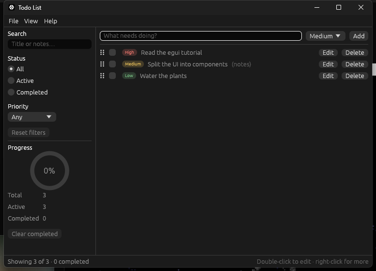

# Introduction

[Contents](../README.md) · [Next: Setup & installation](02-setup.md)

**egui** is an *immediate mode* GUI library. There is no widget tree that you build once and
then mutate, no callbacks, and no data binding. Instead, your code runs every frame, and each
call both draws a widget and tells you what the user did with it:

```rust,ignore
if ui.button("Save").clicked() {
    save();
}
```

Developers pick egui because:

- **State stays in your own structs.** The UI is a function of your data, so it cannot drift
  out of sync with it.
- **It is plain Rust.** Layout is closures, lists are `for` loops, conditional UI is `if`.
- **It is portable and self-contained.** The same code runs natively and on the web, with no
  system toolkit to install.

egui itself only turns input into shapes to draw. **eframe** is the official framework that
opens the window, runs the event loop and renders those shapes. An app depends on `eframe`,
which re-exports `egui`.

## What we are building



A todo app with a menu bar, a collapsible filter sidebar, list and table views, a modal edit
dialog, drag-to-reorder, keyboard shortcuts, a settings window, light and dark themes,
import over HTTP, and todos stored in a SQLite database.

| Stage | You add | egui features introduced |
|---|---|---|
| 1 | A working list in one file | `CentralPanel`, `TextEdit`, `ScrollArea`, layouts, `RichText`, `push_id` |
| 2 | A data model and reusable components | `impl Widget`, custom painting, `Sides`, `ComboBox`, accessibility names |
| 3 | A full application shell | `Panel`, `MenuBar`, `Modal`, `Grid`, `TableBuilder`, context menus, drag and drop, shortcuts |
| 4 | Persistence, theming, a custom widget, UI tests | `eframe::Storage`, `Style`, `Window`, `Slider`, colour picker, animation, `egui_kittest` |
| 5 | Import from a URL with `reqwest` | A background worker, `Context::request_repaint`, `Spinner`, disabled widgets, async results in an immediate mode UI |
| 6 | Todos in SQLite with `sqlx` | Loading state, saving as you go, error reporting in the status bar |

**What is left out.** "All of egui" is larger than one app can use sensibly. This tutorial
does not cover images and textures, custom fonts, multiple native windows (viewports),
plotting (`egui_plot`), custom GPU rendering, or the web target.

---

[Contents](../README.md) · [Next: Setup & installation](02-setup.md)
