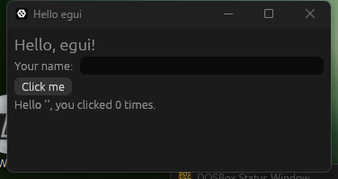

# Core concepts: Hello World

[Previous: Setup & installation](02-setup.md) · [Contents](../README.md) · [Next: Stage 1: a working list in one file](04-stage-1-one-file.md)

Replace `src/main.rs` with:

```rust
// Release builds on Windows would otherwise open a console window next to the GUI.
#![cfg_attr(not(debug_assertions), windows_subsystem = "windows")]

use eframe::egui;

fn main() -> eframe::Result {
    // `NativeOptions` configures the OS window; `viewport` is egui's word for "native window".
    let native_options = eframe::NativeOptions {
        viewport: egui::ViewportBuilder::default().with_inner_size([360.0, 160.0]),
        ..Default::default()
    };

    // The closure runs once, after the window and renderer exist, and returns our app state.
    eframe::run_native(
        "Hello egui",
        native_options,
        Box::new(|_creation_context| Ok(Box::new(HelloApp::default()))),
    )
}

/// All state lives in a plain struct that we own; egui keeps no copy of it.
#[derive(Default)]
struct HelloApp {
    name: String,
    click_count: u32,
}

impl eframe::App for HelloApp {
    /// Called every time the window needs repainting. The whole UI is rebuilt from `self`.
    fn ui(&mut self, ui: &mut egui::Ui, _frame: &mut eframe::Frame) {
        // The root `ui` has no margin or background; `CentralPanel` adds both.
        egui::CentralPanel::default().show(ui, |ui| {
            ui.heading("Hello, egui!");

            // `horizontal` lays its children out left-to-right instead of top-down.
            ui.horizontal(|ui| {
                ui.label("Your name:");
                // The widget edits our field in place through the `&mut` borrow.
                ui.text_edit_singleline(&mut self.name);
            });

            // A widget is drawn and its interaction reported in the same call.
            if ui.button("Click me").clicked() {
                self.click_count += 1;
            }

            ui.label(format!(
                "Hello '{}', you clicked {} times.",
                self.name, self.click_count
            ));
        });
    }
}
```



Run it with `cargo run`. What each part does, and why:

| Code | Why it is there |
|---|---|
| `#![cfg_attr(..., windows_subsystem = "windows")]` | Without it, a release build opens a console window behind the GUI. Debug builds keep the console so you can see `println!` and panics. |
| `use eframe::egui;` | `eframe` re-exports the exact `egui` version it was built with, so you never need a separate `egui` dependency that could drift out of step. |
| `fn main() -> eframe::Result` | Creating a window can fail (no GPU, no display). Returning the result reports that instead of panicking. |
| `NativeOptions { viewport, .. }` | [`NativeOptions`](../concepts/native-options.md) holds the start-up settings. A *viewport* is a native OS window. [`ViewportBuilder`](../concepts/viewport-builder.md) sets its size, title, icon and so on. |
| `run_native(name, options, creator)` | [`run_native`](../concepts/run-native.md) blocks until the window closes. The `creator` closure runs once, after the renderer exists, which is why it (and not `main`) receives the context you use to load fonts or saved state. It returns a `Result` so app setup can fail cleanly. |
| `struct HelloApp` | Your state. egui stores none of it. |
| `impl eframe::App` / `fn ui` | The one required method of [`eframe::App`](../concepts/app-trait.md). eframe calls it whenever the window needs repainting and gives you the root [`Ui`](../concepts/ui.md). |
| `CentralPanel::default().show(ui, ...)` | The root `Ui` has no margin or background. [`CentralPanel`](../concepts/central-panel.md) fills the remaining space and adds both. |
| `ui.horizontal(\|ui\| ...)` | Layout is nested closures. Each closure gets a child `Ui` with its own [`Layout`](../concepts/layout.md) direction. |
| `ui.text_edit_singleline(&mut self.name)` | Widgets borrow your data for the duration of the call and edit it in place. |
| `ui.button("Click me").clicked()` | Every widget returns a [`Response`](../concepts/response.md). You ask it what happened: `clicked()`, `hovered()`, `changed()`, `lost_focus()` and so on. |

A linked name opens a page that goes deeper into that type; the [concepts index](../concepts/README.md)
lists every page.

Three ideas explain almost everything else in egui:

1. **The UI is rebuilt from your state every frame.** A frame is cheap (typically a millisecond or
   two for an app like this), and egui only runs one when there is input or an
   animation in progress. You never "update" a label; you draw it again with the new value.
2. **`Ui` is a region with a layout cursor.** Adding a widget allocates the next rectangle
   and advances the cursor. Containers such as `horizontal`, `ScrollArea` and `Grid` hand
   you a child `Ui`.
3. **egui remembers a little state for you, keyed by widget ID.** Scroll offsets, which
   text box has focus, whether a header is collapsed. IDs are derived automatically, and
   [pitfall 1](10-pitfalls.md#pitfall-1-unstable-or-clashing-widget-ids) covers when you must help.

> **If you are following an older tutorial:** in earlier versions the trait method was
> `fn update(&mut self, ctx: &egui::Context, frame: &mut eframe::Frame)` and panels were shown
> with `.show(ctx, ...)`. In 0.37 that method no longer exists. You implement `fn ui` and
> pass the `ui` you are given. See the [migration table](10-pitfalls.md#coming-from-an-older-egui-version).

---

[Previous: Setup & installation](02-setup.md) · [Contents](../README.md) · [Next: Stage 1: a working list in one file](04-stage-1-one-file.md)
