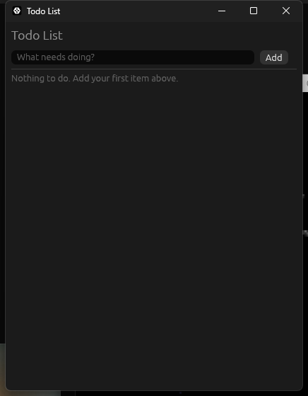

# Stage 1: a working list in one file

[Previous: Core concepts: Hello World](03-hello-world.md) · [Contents](../README.md) · [Next: Stage 2: reusable components](05-stage-2-components.md)

**Goal:** add, complete and delete todos. One file, no abstractions yet, so the raw
mechanics are visible.

`src/main.rs`:

```rust
#![cfg_attr(not(debug_assertions), windows_subsystem = "windows")]

use eframe::egui;

fn main() -> eframe::Result {
    let native_options = eframe::NativeOptions {
        viewport: egui::ViewportBuilder::default()
            .with_inner_size([420.0, 520.0])
            .with_min_inner_size([320.0, 240.0]),
        ..Default::default()
    };

    eframe::run_native(
        "Todo List",
        native_options,
        Box::new(|_creation_context| Ok(Box::new(TodoApp::default()))),
    )
}

struct Todo {
    /// A stable identity that survives deletions, unlike the item's index in the `Vec`.
    id: u64,
    title: String,
    done: bool,
}

#[derive(Default)]
struct TodoApp {
    todos: Vec<Todo>,
    /// The text currently typed into the "new todo" box.
    draft_title: String,
    next_id: u64,
}

impl TodoApp {
    fn add_todo_from_draft(&mut self) {
        let title = self.draft_title.trim();
        if title.is_empty() {
            return;
        }
        self.todos.push(Todo {
            id: self.next_id,
            title: title.to_owned(),
            done: false,
        });
        self.next_id += 1;
        self.draft_title.clear();
    }
}

impl eframe::App for TodoApp {
    fn ui(&mut self, ui: &mut egui::Ui, _frame: &mut eframe::Frame) {
        egui::CentralPanel::default().show(ui, |ui| {
            ui.heading("Todo List");
            ui.add_space(8.0);

            // --- Input row -------------------------------------------------------
            ui.horizontal(|ui| {
                // `TextEdit` is the builder behind `ui.text_edit_singleline`; using it
                // directly gives access to options such as the hint text.
                let draft_response = ui.add(
                    egui::TextEdit::singleline(&mut self.draft_title)
                        .hint_text("What needs doing?")
                        .desired_width(ui.available_width() - 60.0),
                );

                // A single-line `TextEdit` gives up focus when Enter is pressed, so
                // "lost focus + Enter pressed" means "the user submitted the text".
                let submitted_with_enter = draft_response.lost_focus()
                    && ui.input(|input| input.key_pressed(egui::Key::Enter));

                if ui.button("Add").clicked() || submitted_with_enter {
                    self.add_todo_from_draft();
                    // Put the cursor back so the user can keep typing the next item.
                    draft_response.request_focus();
                }
            });

            ui.separator();

            // --- List --------------------------------------------------------------
            // We cannot remove from `self.todos` while iterating over it, so we only
            // record what the user asked for and act on it after the loop.
            let mut id_to_delete = None;

            egui::ScrollArea::vertical()
                .auto_shrink([false, false])
                .show(ui, |ui| {
                    if self.todos.is_empty() {
                        ui.weak("Nothing to do. Add your first item above.");
                    }

                    for todo in &mut self.todos {
                        // Every row has the same widgets, so each row needs its own ID
                        // scope. Keying it by `todo.id` keeps widget state (focus,
                        // animations) attached to the item rather than to its position.
                        ui.push_id(todo.id, |ui| {
                            ui.horizontal(|ui| {
                                ui.checkbox(&mut todo.done, "");

                                let mut title = egui::RichText::new(&todo.title);
                                if todo.done {
                                    title = title.strikethrough().weak();
                                }
                                ui.label(title);

                                // Switch to a right-to-left layout to pin the delete
                                // button to the right edge of the row.
                                ui.with_layout(
                                    egui::Layout::right_to_left(egui::Align::Center),
                                    |ui| {
                                        if ui.small_button("Delete").clicked() {
                                            id_to_delete = Some(todo.id);
                                        }
                                    },
                                );
                            });
                        });
                    }
                });

            if let Some(id) = id_to_delete {
                self.todos.retain(|todo| todo.id != id);
            }
        });
    }
}
```



Why it is written this way:

- **`egui::TextEdit::singleline(..)` instead of `ui.text_edit_singleline(..)`.** The `ui.*`
  helpers are shortcuts for the common case. Every widget is also a builder struct that you
  configure and pass to `ui.add(..)`, which is how you reach options like `hint_text`.
- **`lost_focus()` plus `key_pressed(Enter)`.** There is no "on submit" event because there
  are no events. A single-line text box gives up focus when Enter is pressed, so that
  combination is the idiomatic test for "the user submitted this field".
- **`ui.input(|input| ...)`.** Input state is read through a closure because it sits behind a
  lock. Keep the closure short and never call other `ui` methods inside it.
- **`ui.push_id(todo.id, ...)`.** Each row contains identical widgets. Keying the row by a
  stable ID keeps egui's per-widget memory attached to the todo when rows are added or removed.
- **`id_to_delete`.** The list is borrowed by the `for` loop, so the delete button cannot
  remove from it. Recording the request and acting after the loop is the seed of the pattern
  that Stage 2 turns into the app's architecture.

This is a complete app, but it will not scale. The data rules (`trim`, "no blank titles")
are tangled into UI code, nothing can be unit tested, and every new feature makes `ui` longer.

---

[Previous: Core concepts: Hello World](03-hello-world.md) · [Contents](../README.md) · [Next: Stage 2: reusable components](05-stage-2-components.md)
