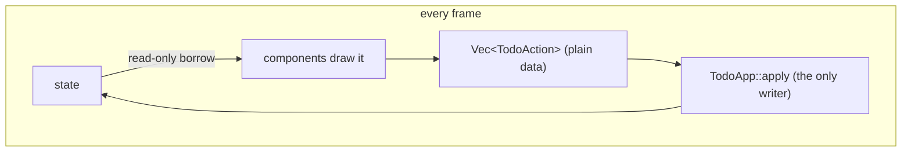
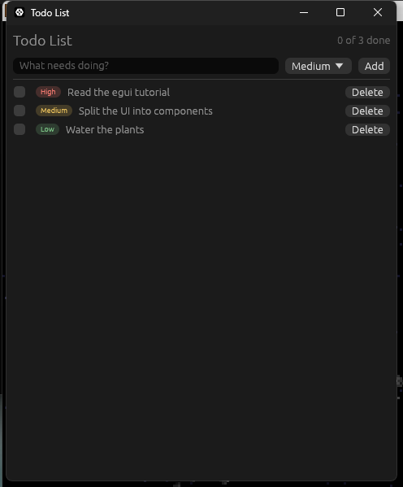

# Stage 2: reusable components

[Previous: Stage 1: a working list in one file](04-stage-1-one-file.md) · [Contents](../README.md) · [Next: Stage 3: a full application shell](06-stage-3-app-shell.md)

**Goal:** the same app plus priorities, restructured so that it can grow.

```text
src/
├── main.rs                  window setup only
├── app.rs                   owns the state, composes components, applies actions
├── model.rs                 data and rules; no egui in here
└── components/
    ├── mod.rs
    ├── priority_badge.rs    leaf widget         (impl egui::Widget)
    ├── todo_row.rs          composite component (returns an action)
    └── add_bar.rs           stateful component  (owns its draft)
```

The design rests on one rule: **components describe what the user asked for; only the app
changes state.**

```text
        ┌────────────── every frame ──────────────┐
        │                                         │
   state ──► components draw it ──► Vec<TodoAction> ──► TodoApp::apply ──► state
            (read-only borrow)        (plain data)       (the only writer)
```



That gives you three component shapes, each used below:

| Shape | Signature | Use it for |
|---|---|---|
| **Leaf widget** | `impl egui::Widget`, used as `ui.add(MyWidget::new(..))` | Something that is drawn and at most reports a `Response`: badges, icons, gauges. |
| **Composite component** | `fn show(self, ui: &mut Ui) -> Option<Action>` | A group of widgets that turns interaction into a domain action. Borrows data immutably. |
| **Stateful component** | `fn show(&mut self, ui: &mut Ui) -> Option<Action>` on a struct the app owns | UI with private working state, such as a half-typed draft. |

## The model

`src/model.rs`:

```rust
//! The data model. Nothing in this file depends on egui, so it can be unit tested
//! without opening a window and reused behind any other front end.

/// Identifies a todo for its whole lifetime. A newtype stops a `TodoId` from being
/// confused with an index or any other number.
#[derive(Clone, Copy, Debug, PartialEq, Eq, Hash)]
pub struct TodoId(u64);

#[derive(Clone, Copy, Debug, Default, PartialEq, Eq, PartialOrd, Ord)]
pub enum Priority {
    Low,
    #[default]
    Medium,
    High,
}

impl Priority {
    /// Every variant, in display order. Lets the UI build pickers with a loop.
    pub const ALL: [Self; 3] = [Self::Low, Self::Medium, Self::High];

    pub fn label(self) -> &'static str {
        match self {
            Self::Low => "Low",
            Self::Medium => "Medium",
            Self::High => "High",
        }
    }
}

#[derive(Clone, Debug, PartialEq)]
pub struct Todo {
    pub id: TodoId,
    pub title: String,
    pub priority: Priority,
    pub done: bool,
}

/// Everything the UI is allowed to ask for. Components return these instead of
/// mutating the list, which keeps every state change in one place: `TodoApp::apply`.
#[derive(Clone, Debug, PartialEq)]
pub enum TodoAction {
    Add { title: String, priority: Priority },
    Toggle(TodoId),
    Delete(TodoId),
}

/// Owns the todos and hands out IDs. The fields are private so the "IDs are never
/// reused" rule cannot be broken from outside.
#[derive(Debug, Default)]
pub struct TodoList {
    todos: Vec<Todo>,
    next_id: u64,
}

impl TodoList {
    /// Adds a todo and returns its ID, or `None` if the title is blank.
    pub fn add(&mut self, title: &str, priority: Priority) -> Option<TodoId> {
        let title = title.trim();
        if title.is_empty() {
            return None;
        }

        let id = TodoId(self.next_id);
        self.next_id += 1;
        self.todos.push(Todo {
            id,
            title: title.to_owned(),
            priority,
            done: false,
        });
        Some(id)
    }

    pub fn toggle(&mut self, id: TodoId) {
        if let Some(todo) = self.todos.iter_mut().find(|todo| todo.id == id) {
            todo.done = !todo.done;
        }
    }

    pub fn remove(&mut self, id: TodoId) {
        self.todos.retain(|todo| todo.id != id);
    }

    pub fn iter(&self) -> impl Iterator<Item = &Todo> {
        self.todos.iter()
    }

    pub fn len(&self) -> usize {
        self.todos.len()
    }

    pub fn is_empty(&self) -> bool {
        self.todos.is_empty()
    }

    pub fn completed_count(&self) -> usize {
        self.todos.iter().filter(|todo| todo.done).count()
    }
}

#[cfg(test)]
mod tests {
    use super::*;

    #[test]
    fn add_trims_the_title_and_rejects_blank_input() {
        let mut list = TodoList::default();

        assert!(list.add("   ", Priority::Low).is_none());
        assert!(list.is_empty());

        list.add("  Buy milk  ", Priority::High);
        let todo = list.iter().next().expect("one todo was added");
        assert_eq!(todo.title, "Buy milk");
        assert_eq!(todo.priority, Priority::High);
        assert!(!todo.done);
    }

    #[test]
    fn toggle_flips_only_the_matching_todo() {
        let mut list = TodoList::default();
        let first = list.add("First", Priority::Medium).unwrap();
        list.add("Second", Priority::Medium).unwrap();

        list.toggle(first);
        assert_eq!(list.completed_count(), 1);
        assert!(list.iter().next().unwrap().done);

        list.toggle(first);
        assert_eq!(list.completed_count(), 0);
    }

    #[test]
    fn ids_are_not_reused_after_a_removal() {
        let mut list = TodoList::default();
        let first = list.add("First", Priority::Medium).unwrap();
        list.remove(first);
        let second = list.add("Second", Priority::Medium).unwrap();

        assert_ne!(first, second);
        assert_eq!(list.len(), 1);
    }
}
```

- **No `egui` import.** The model compiles and is tested without a window. `cargo test` runs
  these tests in milliseconds.
- **`TodoAction` is plain data.** It derives `Debug` and `PartialEq`, so tests can assert on
  it, and you could later log it or push it onto an undo stack.
- **`TodoList` hides its `Vec`.** Callers can only change todos through methods that keep the
  rules (trimmed titles, unique IDs) intact.

## A leaf widget: `PriorityBadge`

`src/components/priority_badge.rs`:

```rust
use eframe::egui;

use crate::model::Priority;

/// A small coloured pill showing a priority.
///
/// This is a *leaf* widget: it draws itself, reports a `Response`, and changes
/// nothing. Implementing `egui::Widget` lets callers write `ui.add(PriorityBadge::new(..))`
/// exactly as they would for a built-in widget.
pub struct PriorityBadge {
    priority: Priority,
}

impl PriorityBadge {
    pub fn new(priority: Priority) -> Self {
        Self { priority }
    }

    /// Chosen per theme so the badge stays readable on both light and dark backgrounds.
    fn accent_color(&self, dark_mode: bool) -> egui::Color32 {
        match (self.priority, dark_mode) {
            (Priority::Low, true) => egui::Color32::from_rgb(120, 190, 130),
            (Priority::Low, false) => egui::Color32::from_rgb(40, 120, 60),
            (Priority::Medium, true) => egui::Color32::from_rgb(230, 190, 90),
            (Priority::Medium, false) => egui::Color32::from_rgb(150, 100, 0),
            (Priority::High, true) => egui::Color32::from_rgb(240, 120, 110),
            (Priority::High, false) => egui::Color32::from_rgb(180, 40, 40),
        }
    }
}

impl egui::Widget for PriorityBadge {
    fn ui(self, ui: &mut egui::Ui) -> egui::Response {
        let label = self.priority.label();
        let accent_color = self.accent_color(ui.visuals().dark_mode);
        let padding = egui::vec2(6.0, 2.0);

        // 1. Measure. Lay the text out first so we know how much space to ask for.
        let font_id = egui::TextStyle::Small.resolve(ui.style());
        let galley = ui
            .painter()
            .layout_no_wrap(label.to_owned(), font_id, accent_color);

        // 2. Allocate. This reserves the rectangle, advances the layout cursor and
        //    tells us how the pointer is interacting with that rectangle.
        let (rect, response) =
            ui.allocate_exact_size(galley.size() + 2.0 * padding, egui::Sense::hover());

        // Tell screen readers (and UI tests) what this rectangle of pixels means.
        response.widget_info(|| {
            egui::WidgetInfo::labeled(egui::Role::Label, true, format!("{label} priority"))
        });

        // 3. Paint. Skipped when the widget is scrolled out of view.
        if ui.is_rect_visible(rect) {
            let corner_radius = rect.height() / 2.0;
            ui.painter()
                .rect_filled(rect, corner_radius, accent_color.gamma_multiply(0.2));
            ui.painter()
                .galley(rect.min + padding, galley, accent_color);
        }

        response
    }
}
```

Every custom-painted widget follows the same three steps: **measure**, **allocate**,
**paint**. `allocate_exact_size` is the important call. It reserves the rectangle, moves the
layout cursor, and performs hit-testing according to the `Sense` you pass, returning a
`Response` like any built-in widget.

`widget_info` describes the widget to assistive technology. It also makes it findable in the
UI tests you will write in Stage 4.

## A composite component: `TodoRow`

`src/components/todo_row.rs`:

```rust
use eframe::egui;

use super::PriorityBadge;
use crate::model::{Todo, TodoAction};

/// One line in the list.
///
/// This is a *composite* component: it arranges other widgets and translates what
/// the user did into a `TodoAction`. It borrows the todo immutably, so the compiler
/// guarantees that drawing a row can never modify the data.
pub struct TodoRow<'a> {
    todo: &'a Todo,
}

impl<'a> TodoRow<'a> {
    pub fn new(todo: &'a Todo) -> Self {
        Self { todo }
    }

    pub fn show(self, ui: &mut egui::Ui) -> Option<TodoAction> {
        let todo = self.todo;
        let mut action = None;

        ui.horizontal(|ui| {
            // `checkbox` needs a `&mut bool`, so give it a copy and report the change.
            let mut done = todo.done;
            let checkbox = ui
                .checkbox(&mut done, "")
                // Nothing visible names this checkbox, so name it for screen
                // readers and UI tests.
                .accessible_name(format!("Done: {}", todo.title));
            if checkbox.changed() {
                action = Some(TodoAction::Toggle(todo.id));
            }

            ui.add(PriorityBadge::new(todo.priority));

            let mut title = egui::RichText::new(&todo.title);
            if todo.done {
                title = title.strikethrough().weak();
            }
            // Long titles are cut off with "…" rather than pushing the row wider.
            ui.add(egui::Label::new(title).truncate());

            ui.with_layout(egui::Layout::right_to_left(egui::Align::Center), |ui| {
                let delete_button = ui
                    .small_button("Delete")
                    // Every row has a "Delete" button; say which todo this one is for.
                    .accessible_name(format!("Delete: {}", todo.title));
                if delete_button.clicked() {
                    action = Some(TodoAction::Delete(todo.id));
                }
            });
        });

        action
    }
}
```

`TodoRow` holds `&Todo`, not `&mut Todo`. That one choice means the compiler proves that
drawing never changes data, and it means the row can be shown from any context that has a
shared reference.

The `accessible_name` calls name widgets that have no visible label of their own. Do this as
you write each widget. Stage 4 turns it into a test that fails when you forget.

## A stateful component: `AddBar`

`src/components/add_bar.rs`:

```rust
use eframe::egui;

use crate::model::{Priority, TodoAction};

/// The "new todo" input row.
///
/// This is a *stateful* component: it owns the half-typed draft, which is nobody
/// else's business, and only tells the outside world when the user commits it.
#[derive(Default)]
pub struct AddBar {
    draft_title: String,
    draft_priority: Priority,
    /// Set by `request_focus`, consumed the next time the bar is shown.
    focus_requested: bool,
}

impl AddBar {
    /// Moves keyboard focus to the title box on the next frame.
    pub fn request_focus(&mut self) {
        self.focus_requested = true;
    }

    /// Draws the bar. Returns `TodoAction::Add` on the frame the user submits.
    pub fn show(&mut self, ui: &mut egui::Ui) -> Option<TodoAction> {
        // `Sides` pins one group of widgets to each edge. With `shrink_left` the right
        // group is laid out first and the left group gets whatever width remains,
        // which is how the text box stretches without us hard-coding any widths.
        let (title_response, add_clicked) = egui::Sides::new().shrink_left().show(
            ui,
            |ui| {
                ui.add(
                    egui::TextEdit::singleline(&mut self.draft_title)
                        .hint_text("What needs doing?")
                        .desired_width(f32::INFINITY),
                )
                // The hint disappears once the user types, so name the box explicitly
                // for screen readers and UI tests.
                .accessible_name("New todo title")
            },
            |ui| {
                // The right side is filled right-to-left, so the button comes first.
                let add_clicked = ui.button("Add").clicked();

                // The salt only has to be unique among this widget's siblings.
                egui::ComboBox::from_id_salt("draft_priority")
                    .selected_text(self.draft_priority.label())
                    .width(80.0)
                    .show_ui(ui, |ui| {
                        for priority in Priority::ALL {
                            ui.selectable_value(
                                &mut self.draft_priority,
                                priority,
                                priority.label(),
                            );
                        }
                    })
                    .response
                    .accessible_name("Priority of the new todo");

                add_clicked
            },
        );

        if std::mem::take(&mut self.focus_requested) {
            title_response.request_focus();
        }

        // A single-line `TextEdit` surrenders focus when Enter is pressed.
        let submitted_with_enter =
            title_response.lost_focus() && ui.input(|input| input.key_pressed(egui::Key::Enter));

        if !(add_clicked || submitted_with_enter) || self.draft_title.trim().is_empty() {
            return None;
        }

        // Keep the cursor in the box so several todos can be typed in a row.
        title_response.request_focus();

        Some(TodoAction::Add {
            // `take` moves the text out and leaves the draft empty for the next todo.
            title: std::mem::take(&mut self.draft_title),
            priority: self.draft_priority,
        })
    }
}
```

- **The draft lives in the component, not in the app.** `TodoApp` does not care what is
  half-typed, so it should not have fields for it.
- **`focus_requested` is a one-shot flag.** Focus can only be requested on a `Response`,
  which exists only while the widget is being drawn. So `request_focus()` records the wish
  and `show` grants it. You will use this "request now, fulfil during the next draw"
  pattern whenever something outside a widget needs to affect it.
- **`egui::Sides`** solves the classic "stretchy input with fixed buttons on the right"
  layout without measuring anything.

`src/components/mod.rs`:

```rust
//! Reusable UI building blocks. Each component lives in its own file and only the
//! types re-exported here are part of the module's public surface.

mod add_bar;
mod priority_badge;
mod todo_row;

pub use add_bar::AddBar;
pub use priority_badge::PriorityBadge;
pub use todo_row::TodoRow;
```

## The app

`src/app.rs`:

```rust
use eframe::egui;

use crate::components::{AddBar, TodoRow};
use crate::model::{Priority, TodoAction, TodoList};

pub struct TodoApp {
    todos: TodoList,
    add_bar: AddBar,
}

impl TodoApp {
    pub fn new(_creation_context: &eframe::CreationContext<'_>) -> Self {
        let mut todos = TodoList::default();
        todos.add("Read the egui tutorial", Priority::High);
        todos.add("Split the UI into components", Priority::Medium);
        todos.add("Water the plants", Priority::Low);

        let mut add_bar = AddBar::default();
        // Start with the cursor in the input so the user can type straight away.
        add_bar.request_focus();

        Self { todos, add_bar }
    }

    /// The only place where app state changes in response to the UI.
    fn apply(&mut self, action: TodoAction) {
        match action {
            TodoAction::Add { title, priority } => {
                self.todos.add(&title, priority);
            }
            TodoAction::Toggle(id) => self.todos.toggle(id),
            TodoAction::Delete(id) => self.todos.remove(id),
        }
    }
}

impl eframe::App for TodoApp {
    fn ui(&mut self, ui: &mut egui::Ui, _frame: &mut eframe::Frame) {
        // Phase 1: draw the UI from the current state and collect what the user did.
        let mut actions: Vec<TodoAction> = Vec::new();

        egui::CentralPanel::default().show(ui, |ui| {
            ui.horizontal(|ui| {
                ui.heading("Todo List");
                ui.with_layout(egui::Layout::right_to_left(egui::Align::Center), |ui| {
                    ui.weak(format!(
                        "{} of {} done",
                        self.todos.completed_count(),
                        self.todos.len()
                    ));
                });
            });
            ui.add_space(8.0);

            // `Option` is iterable, so `extend` adds zero or one actions.
            actions.extend(self.add_bar.show(ui));

            ui.separator();

            egui::ScrollArea::vertical()
                .auto_shrink([false, false])
                .show(ui, |ui| {
                    if self.todos.is_empty() {
                        ui.weak("Nothing to do. Add your first item above.");
                    }

                    for todo in self.todos.iter() {
                        // Scope each row's widget IDs to the todo, not to its position.
                        ui.push_id(todo.id, |ui| {
                            actions.extend(TodoRow::new(todo).show(ui));
                        });
                    }
                });
        });

        // Phase 2: mutate. Nothing is borrowed any more, so this is always allowed.
        for action in actions {
            self.apply(action);
        }
    }
}
```

`src/main.rs`:

```rust
#![cfg_attr(not(debug_assertions), windows_subsystem = "windows")]

mod app;
mod components;
mod model;

use eframe::egui;

fn main() -> eframe::Result {
    let native_options = eframe::NativeOptions {
        viewport: egui::ViewportBuilder::default()
            .with_inner_size([480.0, 560.0])
            .with_min_inner_size([360.0, 280.0]),
        ..Default::default()
    };

    eframe::run_native(
        "Todo List",
        native_options,
        Box::new(|creation_context| Ok(Box::new(app::TodoApp::new(creation_context)))),
    )
}
```



`ui` is now two phases. Phase 1 holds shared borrows of the state and only *collects*
actions. Phase 2 holds no borrows and mutates freely. The borrow checker enforces the
split for you: try to call `self.todos.remove(..)` inside the row loop and it will not compile.

Run `cargo test` and the three model tests pass without a window opening.

---

[Previous: Stage 1: a working list in one file](04-stage-1-one-file.md) · [Contents](../README.md) · [Next: Stage 3: a full application shell](06-stage-3-app-shell.md)
