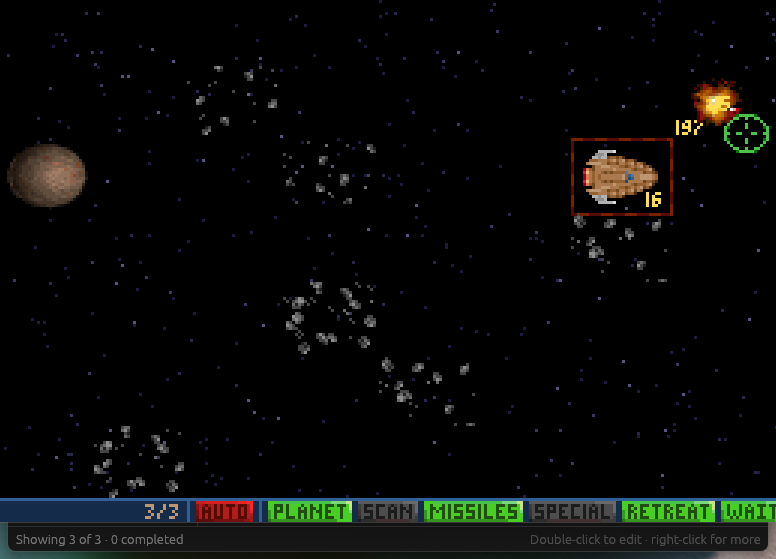

# Stage 3: a full application shell

[Previous: Stage 2: reusable components](05-stage-2-components.md) · [Contents](../README.md) · [Next: Stage 4: persistence, theming, custom painting and UI tests](07-stage-4-persistence.md)

**Goal:** make it feel like a desktop application: menus, a sidebar with filters, an edit
dialog, a table view, context menus, drag-to-reorder and keyboard shortcuts.

```powershell
cargo add egui_extras@0.37
```

```text
src/components/
├── add_bar.rs           unchanged
├── priority_badge.rs    unchanged
├── todo_row.rs          + drag handle, edit button, context menu, drop target
├── todo_menu.rs         new: context menu shared by the row and the table
├── filter_panel.rs      new: sidebar
├── edit_dialog.rs       new: modal dialog
└── todo_table.rs        new: table view
```

Two of the Stage 2 components are reused without touching them. That is the payoff of
the action pattern: `AddBar` and `PriorityBadge` know nothing about the rest of the app.

## The model grows

Todos gain notes, the action enum gains the new commands, and a `Filter` type describes
which todos are visible. `src/model.rs`, in full:

```rust
//! The data model. Nothing in this file depends on egui, so it can be unit tested
//! without opening a window and reused behind any other front end.

/// Identifies a todo for its whole lifetime. A newtype stops a `TodoId` from being
/// confused with an index or any other number.
#[derive(Clone, Copy, Debug, PartialEq, Eq, Hash)]
pub struct TodoId(u64);

#[derive(Clone, Copy, Debug, Default, PartialEq, Eq, PartialOrd, Ord)]
pub enum Priority {
    Low,
    #[default]
    Medium,
    High,
}

impl Priority {
    /// Every variant, in display order. Lets the UI build pickers with a loop.
    pub const ALL: [Self; 3] = [Self::Low, Self::Medium, Self::High];

    pub fn label(self) -> &'static str {
        match self {
            Self::Low => "Low",
            Self::Medium => "Medium",
            Self::High => "High",
        }
    }
}

#[derive(Clone, Debug, PartialEq)]
pub struct Todo {
    pub id: TodoId,
    pub title: String,
    pub notes: String,
    pub priority: Priority,
    pub done: bool,
}

/// Everything the UI is allowed to ask for. Components return these instead of
/// mutating the list, which keeps every state change in one place: `TodoApp::apply`.
#[derive(Clone, Debug, PartialEq)]
pub enum TodoAction {
    Add {
        title: String,
        priority: Priority,
    },
    Toggle(TodoId),
    Delete(TodoId),
    /// Open the edit dialog for this todo. Changes nothing by itself.
    StartEditing(TodoId),
    /// Commit the values typed into the edit dialog.
    Update {
        id: TodoId,
        title: String,
        notes: String,
        priority: Priority,
    },
    SetPriority(TodoId, Priority),
    /// Move `moved` into the list position currently held by `target`.
    Reorder {
        moved: TodoId,
        target: TodoId,
    },
    ClearCompleted,
}

/// Owns the todos and hands out IDs. The fields are private so the "IDs are never
/// reused" rule cannot be broken from outside.
#[derive(Debug, Default)]
pub struct TodoList {
    todos: Vec<Todo>,
    next_id: u64,
}

impl TodoList {
    /// Adds a todo and returns its ID, or `None` if the title is blank.
    pub fn add(&mut self, title: &str, priority: Priority) -> Option<TodoId> {
        let title = title.trim();
        if title.is_empty() {
            return None;
        }

        let id = TodoId(self.next_id);
        self.next_id += 1;
        self.todos.push(Todo {
            id,
            title: title.to_owned(),
            notes: String::new(),
            priority,
            done: false,
        });
        Some(id)
    }

    pub fn get(&self, id: TodoId) -> Option<&Todo> {
        self.todos.iter().find(|todo| todo.id == id)
    }

    fn get_mut(&mut self, id: TodoId) -> Option<&mut Todo> {
        self.todos.iter_mut().find(|todo| todo.id == id)
    }

    pub fn toggle(&mut self, id: TodoId) {
        if let Some(todo) = self.get_mut(id) {
            todo.done = !todo.done;
        }
    }

    pub fn set_priority(&mut self, id: TodoId, priority: Priority) {
        if let Some(todo) = self.get_mut(id) {
            todo.priority = priority;
        }
    }

    /// Replaces the editable fields. A blank title is ignored so that a todo can
    /// never end up without one.
    pub fn update(&mut self, id: TodoId, title: &str, notes: &str, priority: Priority) {
        let title = title.trim();
        if title.is_empty() {
            return;
        }
        if let Some(todo) = self.get_mut(id) {
            todo.title = title.to_owned();
            todo.notes = notes.trim().to_owned();
            todo.priority = priority;
        }
    }

    pub fn remove(&mut self, id: TodoId) {
        self.todos.retain(|todo| todo.id != id);
    }

    pub fn clear_completed(&mut self) {
        self.todos.retain(|todo| !todo.done);
    }

    /// Moves `moved` into the position currently held by `target`, shifting the
    /// todos in between. Dragging down therefore lands *after* the target and
    /// dragging up lands *before* it, which is what a user expects from a drop.
    pub fn reorder(&mut self, moved: TodoId, target: TodoId) {
        let position_of = |id| self.todos.iter().position(|todo| todo.id == id);
        let (Some(from), Some(to)) = (position_of(moved), position_of(target)) else {
            return;
        };
        let todo = self.todos.remove(from);
        self.todos.insert(to, todo);
    }

    pub fn iter(&self) -> impl Iterator<Item = &Todo> {
        self.todos.iter()
    }

    pub fn len(&self) -> usize {
        self.todos.len()
    }

    pub fn is_empty(&self) -> bool {
        self.todos.is_empty()
    }

    pub fn completed_count(&self) -> usize {
        self.todos.iter().filter(|todo| todo.done).count()
    }
}

#[derive(Clone, Copy, Debug, Default, PartialEq, Eq)]
pub enum StatusFilter {
    #[default]
    All,
    Active,
    Completed,
}

impl StatusFilter {
    pub const ALL: [Self; 3] = [Self::All, Self::Active, Self::Completed];

    pub fn label(self) -> &'static str {
        match self {
            Self::All => "All",
            Self::Active => "Active",
            Self::Completed => "Completed",
        }
    }
}

/// Which todos are shown. This is *view* state: it changes what the user sees but
/// never the todos themselves, so the UI is allowed to edit it directly.
#[derive(Clone, Debug, Default, PartialEq)]
pub struct Filter {
    pub status: StatusFilter,
    /// Case-insensitive text to look for in the title and notes.
    pub search: String,
    /// `None` shows every priority.
    pub priority: Option<Priority>,
}

impl Filter {
    pub fn matches(&self, todo: &Todo) -> bool {
        let status_matches = match self.status {
            StatusFilter::All => true,
            StatusFilter::Active => !todo.done,
            StatusFilter::Completed => todo.done,
        };

        let priority_matches = self
            .priority
            .is_none_or(|priority| priority == todo.priority);

        let needle = self.search.trim().to_lowercase();
        let search_matches = needle.is_empty()
            || todo.title.to_lowercase().contains(&needle)
            || todo.notes.to_lowercase().contains(&needle);

        status_matches && priority_matches && search_matches
    }

    pub fn is_active(&self) -> bool {
        *self != Self::default()
    }
}

#[cfg(test)]
mod tests {
    use super::*;

    /// Builds a list from titles and returns it with the IDs in insertion order.
    fn list_of(titles: &[&str]) -> (TodoList, Vec<TodoId>) {
        let mut list = TodoList::default();
        let ids = titles
            .iter()
            .map(|title| list.add(title, Priority::Medium).unwrap())
            .collect();
        (list, ids)
    }

    fn titles(list: &TodoList) -> Vec<&str> {
        list.iter().map(|todo| todo.title.as_str()).collect()
    }

    #[test]
    fn add_trims_the_title_and_rejects_blank_input() {
        let mut list = TodoList::default();

        assert!(list.add("   ", Priority::Low).is_none());
        assert!(list.is_empty());

        list.add("  Buy milk  ", Priority::High);
        let todo = list.iter().next().expect("one todo was added");
        assert_eq!(todo.title, "Buy milk");
        assert_eq!(todo.priority, Priority::High);
        assert!(!todo.done);
    }

    #[test]
    fn toggle_flips_only_the_matching_todo() {
        let (mut list, ids) = list_of(&["First", "Second"]);

        list.toggle(ids[0]);
        assert_eq!(list.completed_count(), 1);
        assert!(list.get(ids[0]).unwrap().done);

        list.toggle(ids[0]);
        assert_eq!(list.completed_count(), 0);
    }

    #[test]
    fn ids_are_not_reused_after_a_removal() {
        let (mut list, ids) = list_of(&["First"]);
        list.remove(ids[0]);
        let second = list.add("Second", Priority::Medium).unwrap();

        assert_ne!(ids[0], second);
        assert_eq!(list.len(), 1);
    }

    #[test]
    fn update_changes_fields_but_refuses_a_blank_title() {
        let (mut list, ids) = list_of(&["Old title"]);

        list.update(ids[0], " New title ", " some notes ", Priority::High);
        let todo = list.get(ids[0]).unwrap();
        assert_eq!(todo.title, "New title");
        assert_eq!(todo.notes, "some notes");
        assert_eq!(todo.priority, Priority::High);

        list.update(ids[0], "   ", "", Priority::Low);
        assert_eq!(list.get(ids[0]).unwrap().title, "New title");
    }

    #[test]
    fn clear_completed_keeps_active_todos() {
        let (mut list, ids) = list_of(&["Keep", "Drop"]);
        list.toggle(ids[1]);

        list.clear_completed();
        assert_eq!(titles(&list), ["Keep"]);
    }

    #[test]
    fn reorder_moves_a_todo_into_the_targets_position() {
        let (mut list, ids) = list_of(&["A", "B", "C", "D"]);

        // Dragging down: A lands after C.
        list.reorder(ids[0], ids[2]);
        assert_eq!(titles(&list), ["B", "C", "A", "D"]);

        // Dragging up: D lands before B.
        list.reorder(ids[3], ids[1]);
        assert_eq!(titles(&list), ["D", "B", "C", "A"]);

        // Dropping a todo on itself changes nothing.
        list.reorder(ids[2], ids[2]);
        assert_eq!(titles(&list), ["D", "B", "C", "A"]);
    }

    #[test]
    fn filter_combines_status_priority_and_search() {
        let (mut list, ids) = list_of(&["Buy milk", "Call the bank"]);
        list.toggle(ids[0]);
        list.update(
            ids[1],
            "Call the bank",
            "Ask about the MILK subsidy",
            Priority::High,
        );
        let matching = |filter: &Filter| -> Vec<TodoId> {
            list.iter()
                .filter(|todo| filter.matches(todo))
                .map(|todo| todo.id)
                .collect()
        };

        let mut filter = Filter::default();
        assert!(!filter.is_active());
        assert_eq!(matching(&filter), ids);

        // The search is case-insensitive and also looks inside the notes.
        filter.search = "milk".to_owned();
        assert!(filter.is_active());
        assert_eq!(matching(&filter), ids);

        filter.status = StatusFilter::Active;
        assert_eq!(matching(&filter), [ids[1]]);

        filter.priority = Some(Priority::Low);
        assert!(matching(&filter).is_empty());
    }
}
```

`Filter` is *view state*: changing it never changes a todo. That distinction decides how
components may treat it, as you will see in `FilterPanel`.

## A shared context menu

`src/components/todo_menu.rs`:

```rust
use eframe::egui;

use crate::model::{Priority, Todo, TodoAction};

/// The contents of a todo's right-click menu.
///
/// A plain function is the lightest kind of component. It is shared by the list
/// row and the table row, so both views offer exactly the same commands.
pub fn todo_context_menu(ui: &mut egui::Ui, todo: &Todo) -> Option<TodoAction> {
    let mut action = None;

    if ui.button("Edit…").clicked() {
        action = Some(TodoAction::StartEditing(todo.id));
    }

    // A `menu_button` inside a menu becomes a sub-menu.
    ui.menu_button("Priority", |ui| {
        for priority in Priority::ALL {
            if ui
                .radio(todo.priority == priority, priority.label())
                .clicked()
            {
                action = Some(TodoAction::SetPriority(todo.id, priority));
            }
        }
    });

    ui.separator();

    if ui.button("Delete").clicked() {
        action = Some(TodoAction::Delete(todo.id));
    }

    // No explicit "close" call is needed: menus close when something in them is clicked.
    action
}
```

A component does not have to be a struct. A function that takes `&mut Ui` and returns an
action is enough when there are no options to configure.

## `TodoRow`, upgraded

`src/components/todo_row.rs`:

```rust
use eframe::egui;

use super::{PriorityBadge, todo_context_menu};
use crate::model::{Todo, TodoAction, TodoId};

/// One line in the list.
///
/// This is a *composite* component: it arranges other widgets and translates what
/// the user did into a `TodoAction`. It borrows the todo immutably, so the compiler
/// guarantees that drawing a row can never modify the data.
pub struct TodoRow<'a> {
    todo: &'a Todo,
}

impl<'a> TodoRow<'a> {
    pub fn new(todo: &'a Todo) -> Self {
        Self { todo }
    }

    pub fn show(self, ui: &mut egui::Ui) -> Option<TodoAction> {
        let todo = self.todo;
        let mut action = None;

        // Make the row itself clickable. Giving the *scope* a sense registers it
        // before its children, so the checkbox and buttons stay on top and still
        // receive their own clicks; the row only gets what they do not use.
        let row_builder = egui::UiBuilder::new().sense(egui::Sense::click());
        let row_response = ui
            .scope_builder(row_builder, |ui| {
                ui.horizontal(|ui| {
                    // --- Drag handle ---------------------------------------------
                    let handle = drag_handle(ui);
                    // Stores the ID as the drag payload when a drag starts here.
                    handle.dnd_set_drag_payload(todo.id);

                    // `checkbox` needs a `&mut bool`, so give it a copy and report
                    // the change.
                    let mut done = todo.done;
                    let checkbox = ui
                        .checkbox(&mut done, "")
                        // Nothing visible names this checkbox, so name it for
                        // screen readers and UI tests.
                        .accessible_name(format!("Done: {}", todo.title));
                    if checkbox.changed() {
                        action = Some(TodoAction::Toggle(todo.id));
                    }

                    ui.add(PriorityBadge::new(todo.priority));

                    // Buttons first, in a right-to-left layout, so the title can
                    // then take whatever width is left over.
                    ui.with_layout(egui::Layout::right_to_left(egui::Align::Center), |ui| {
                        // Every row has these two buttons, so their accessible
                        // names say which todo they belong to.
                        let delete_button = ui
                            .small_button("Delete")
                            .accessible_name(format!("Delete: {}", todo.title));
                        if delete_button.clicked() {
                            action = Some(TodoAction::Delete(todo.id));
                        }
                        let edit_button = ui
                            .small_button("Edit")
                            .accessible_name(format!("Edit: {}", todo.title));
                        if edit_button.clicked() {
                            action = Some(TodoAction::StartEditing(todo.id));
                        }

                        // Back to left-to-right for the text itself.
                        ui.with_layout(egui::Layout::left_to_right(egui::Align::Center), |ui| {
                            let mut title = egui::RichText::new(&todo.title);
                            if todo.done {
                                title = title.strikethrough().weak();
                            }
                            // Not selectable, so that clicks on the text fall
                            // through to the row (double-click, context menu).
                            let title_label = egui::Label::new(title).truncate().selectable(false);
                            let title_response = ui.add(title_label);
                            if !todo.notes.is_empty() {
                                title_response.on_hover_text(&todo.notes);
                                ui.weak("(notes)");
                            }
                        });
                    });
                });
            })
            .response;

        if row_response.double_clicked() {
            action = Some(TodoAction::StartEditing(todo.id));
        }

        row_response.context_menu(|ui| {
            if let Some(menu_action) = todo_context_menu(ui, todo) {
                action = Some(menu_action);
            }
        });

        // --- Drop target ---------------------------------------------------------
        // While another todo is dragged over this row, outline it as the target.
        if let Some(dragged_id) = row_response.dnd_hover_payload::<TodoId>()
            && *dragged_id != todo.id
        {
            ui.painter().rect_stroke(
                row_response.rect.expand(2.0),
                4.0,
                ui.visuals().selection.stroke,
                egui::StrokeKind::Outside,
            );
        }

        // The payload is handed over on the frame the pointer is released here.
        if let Some(dragged_id) = row_response.dnd_release_payload::<TodoId>()
            && *dragged_id != todo.id
        {
            action = Some(TodoAction::Reorder {
                moved: *dragged_id,
                target: todo.id,
            });
        }

        action
    }
}

/// A six-dot "grip" that can be dragged. Painted by hand rather than with a text
/// glyph, so it does not depend on what the current font happens to contain.
fn drag_handle(ui: &mut egui::Ui) -> egui::Response {
    let size = egui::vec2(10.0, ui.spacing().interact_size.y);
    let (rect, response) = ui.allocate_exact_size(size, egui::Sense::drag());

    if ui.is_rect_visible(rect) {
        // `interact` picks the colours for the widget's current state (idle,
        // hovered, dragged), so the grip lights up like any built-in widget.
        let dot_color = ui.style().interact(&response).fg_stroke.color;
        for column in [-1.0, 1.0] {
            for row in [-1.0, 0.0, 1.0] {
                let dot_center = rect.center() + egui::vec2(column * 2.5, row * 4.0);
                ui.painter().circle_filled(dot_center, 1.2, dot_color);
            }
        }
    }

    response.on_hover_text("Drag to reorder")
}
```

Three techniques are worth studying here:

- **Making a container clickable.** `UiBuilder::new().sense(Sense::click())` gives the row's
  own `Ui` a click sense. Because the scope is registered *before* its children, the
  children sit on top of it and keep their clicks. If you instead called
  `ui.interact(rect, ..)` *after* drawing the children, the row would cover them and the
  checkbox would stop working.
- **Drag and drop is typed.** `dnd_set_drag_payload(todo.id)` stores a `TodoId`, and
  `dnd_release_payload::<TodoId>()` only returns payloads of that type. A row cannot
  accidentally accept something else that is being dragged.
- **Painting your own icon.** The grip is six circles rather than a character such as "☰",
  because egui 0.37's bundled font contains no symbols or emoji
  (see [the migration table](10-pitfalls.md#coming-from-an-older-egui-version)).

## The sidebar: `FilterPanel`

`src/components/filter_panel.rs`:

```rust
use eframe::egui;

use crate::model::{Filter, Priority, StatusFilter, TodoAction, TodoList};

/// The sidebar: filter controls on top, progress underneath.
///
/// The filter is passed as `&mut` and edited in place, exactly like the built-in
/// widgets edit a `&mut String` or `&mut bool`. That is appropriate here because the
/// filter is view state. Anything that touches the todos still goes out as an action.
pub struct FilterPanel<'a> {
    filter: &'a mut Filter,
    total_count: usize,
    completed_count: usize,
    focus_search: bool,
}

impl<'a> FilterPanel<'a> {
    pub fn new(filter: &'a mut Filter, todos: &TodoList) -> Self {
        Self {
            filter,
            total_count: todos.len(),
            completed_count: todos.completed_count(),
            focus_search: false,
        }
    }

    /// Builder-style option, following the convention of egui's own widgets.
    pub fn focus_search(mut self, focus_search: bool) -> Self {
        self.focus_search = focus_search;
        self
    }

    pub fn show(self, ui: &mut egui::Ui) -> Option<TodoAction> {
        let mut action = None;

        ui.add_space(4.0);
        let search_label = ui.strong("Search");
        let search_response = ui
            .add(
                egui::TextEdit::singleline(&mut self.filter.search)
                    .hint_text("Title or notes…")
                    .desired_width(f32::INFINITY),
            )
            // Ties the box to the visible label next to it, for screen readers.
            .labelled_by(search_label.id);
        if self.focus_search {
            search_response.request_focus();
        }

        ui.add_space(8.0);
        ui.strong("Status");
        for status in StatusFilter::ALL {
            ui.radio_value(&mut self.filter.status, status, status.label());
        }

        ui.add_space(8.0);
        let priority_label = ui.strong("Priority");
        egui::ComboBox::from_id_salt("priority_filter")
            .selected_text(self.filter.priority.map_or("Any", Priority::label))
            .show_ui(ui, |ui| {
                ui.selectable_value(&mut self.filter.priority, None, "Any");
                for priority in Priority::ALL {
                    ui.selectable_value(
                        &mut self.filter.priority,
                        Some(priority),
                        priority.label(),
                    );
                }
            })
            .response
            .labelled_by(priority_label.id);

        ui.add_space(8.0);
        // `add_enabled` greys the button out and ignores clicks when the flag is false.
        let reset_button = egui::Button::new("Reset filters");
        if ui
            .add_enabled(self.filter.is_active(), reset_button)
            .clicked()
        {
            *self.filter = Filter::default();
        }

        ui.separator();

        ui.strong("Progress");
        let completed_fraction = if self.total_count == 0 {
            0.0
        } else {
            self.completed_count as f32 / self.total_count as f32
        };
        ui.add(egui::ProgressBar::new(completed_fraction).show_percentage());

        // `Grid` aligns its cells into columns; `end_row` starts the next line.
        egui::Grid::new("todo_statistics")
            .num_columns(2)
            .show(ui, |ui| {
                ui.label("Total");
                ui.label(self.total_count.to_string());
                ui.end_row();

                ui.label("Active");
                ui.label((self.total_count - self.completed_count).to_string());
                ui.end_row();

                ui.label("Completed");
                ui.label(self.completed_count.to_string());
                ui.end_row();
            });

        ui.add_space(8.0);
        let clear_button = egui::Button::new("Clear completed");
        if ui
            .add_enabled(self.completed_count > 0, clear_button)
            .clicked()
        {
            action = Some(TodoAction::ClearCompleted);
        }

        action
    }
}
```

This component takes `&mut Filter` and edits it directly, which looks like a violation of
"components only return actions". It is not. The rule protects *domain* state. `Filter`
is view state, and editing a borrowed value in place is exactly what `ui.checkbox(&mut bool)`
does. The one thing here that touches todos, "Clear completed", still goes out as an action.

`focus_search(..)` is a builder method, mirroring how egui's own widgets take options.

## A modal: `EditDialog`

`src/components/edit_dialog.rs`:

```rust
use eframe::egui;

use crate::model::{Priority, Todo, TodoAction, TodoId};

/// What happened to the dialog this frame.
pub enum DialogOutcome {
    /// Still open; keep showing it.
    Open,
    /// Closed without saving.
    Cancelled,
    /// Closed with changes to apply.
    Saved(TodoAction),
}

/// A modal editor for one todo.
///
/// The dialog edits its *own copy* of the fields. The real todo is untouched until
/// the user presses Save, which makes Cancel trivial: just drop the dialog.
pub struct EditDialog {
    id: TodoId,
    title: String,
    notes: String,
    priority: Priority,
    /// True until the first frame has been shown, to focus the title box once.
    focus_title: bool,
}

impl EditDialog {
    pub fn new(todo: &Todo) -> Self {
        Self {
            id: todo.id,
            title: todo.title.clone(),
            notes: todo.notes.clone(),
            priority: todo.priority,
            focus_title: true,
        }
    }

    pub fn show(&mut self, ctx: &egui::Context) -> DialogOutcome {
        let can_save = !self.title.trim().is_empty();
        let mut save_requested = false;
        let mut cancel_requested = false;

        // A `Modal` is drawn above everything else and blocks input to the rest of
        // the window. It takes the `Context` because it is not placed inside a parent
        // `Ui`; it floats over the whole viewport.
        let modal = egui::Modal::new(egui::Id::unique("edit_todo_dialog")).show(ctx, |ui| {
            ui.set_width(360.0);
            ui.heading("Edit todo");
            ui.add_space(8.0);

            egui::Grid::new("edit_todo_fields")
                .num_columns(2)
                .spacing([12.0, 8.0])
                .show(ui, |ui| {
                    let title_label = ui.label("Title");
                    let title_response = ui
                        .add(egui::TextEdit::singleline(&mut self.title).desired_width(280.0))
                        .labelled_by(title_label.id);
                    if std::mem::take(&mut self.focus_title) {
                        title_response.request_focus();
                    }
                    // Enter in the title box is a shortcut for Save.
                    if title_response.lost_focus()
                        && ui.input(|input| input.key_pressed(egui::Key::Enter))
                    {
                        save_requested = true;
                    }
                    ui.end_row();

                    ui.label("Priority");
                    ui.horizontal(|ui| {
                        for priority in Priority::ALL {
                            ui.selectable_value(&mut self.priority, priority, priority.label());
                        }
                    });
                    ui.end_row();

                    let notes_label = ui.label("Notes");
                    ui.add(
                        egui::TextEdit::multiline(&mut self.notes)
                            .desired_rows(4)
                            .desired_width(280.0),
                    )
                    .labelled_by(notes_label.id);
                    ui.end_row();
                });

            ui.separator();

            egui::Sides::new().show(
                ui,
                |_left| {},
                |ui| {
                    if ui
                        .add_enabled(can_save, egui::Button::new("Save"))
                        .clicked()
                    {
                        save_requested = true;
                    }
                    if ui.button("Cancel").clicked() {
                        cancel_requested = true;
                    }
                },
            );
        });

        if save_requested && can_save {
            DialogOutcome::Saved(TodoAction::Update {
                id: self.id,
                title: self.title.clone(),
                notes: self.notes.clone(),
                priority: self.priority,
            })
        } else if cancel_requested || modal.should_close() {
            // `should_close` is true when Escape is pressed or the backdrop is clicked.
            DialogOutcome::Cancelled
        } else {
            DialogOutcome::Open
        }
    }
}
```

- **Edit a copy.** The dialog owns clones of the fields. Cancel is free (drop the
  dialog), and a half-edited title never appears in the list behind it.
- **A three-way outcome enum** is clearer than `Option<Option<..>>` or a pair of booleans, and
  the `match` in the app must handle every case.
- **`Id::unique`.** `Modal` floats above everything, outside any parent `Ui`, so its ID
  must be unique across the whole app. Compare that with `Grid::new("edit_todo_fields")`,
  whose string is only a *salt* that has to be unique among its siblings.

## A table: `TodoTable`

`src/components/todo_table.rs`:

```rust
use eframe::egui;
use egui_extras::{Column, TableBuilder};

use super::{PriorityBadge, todo_context_menu};
use crate::model::{Todo, TodoAction};

/// A denser, spreadsheet-like view of the same todos.
///
/// It reuses `PriorityBadge` and `todo_context_menu`, and returns the same
/// `TodoAction`s as `TodoRow`, so the app can swap views without any other change.
pub struct TodoTable<'a> {
    todos: &'a [&'a Todo],
}

impl<'a> TodoTable<'a> {
    pub fn new(todos: &'a [&'a Todo]) -> Self {
        Self { todos }
    }

    pub fn show(self, ui: &mut egui::Ui) -> Option<TodoAction> {
        let todos = self.todos;
        let mut action = None;
        let row_height = ui.spacing().interact_size.y + 4.0;

        TableBuilder::new(ui)
            .striped(true)
            .resizable(true)
            // Lets whole rows report clicks, for double-click and the context menu.
            .sense(egui::Sense::click())
            .cell_layout(egui::Layout::left_to_right(egui::Align::Center))
            .column(Column::auto())
            .column(Column::auto().at_least(64.0))
            .column(Column::initial(220.0).at_least(80.0).clip(true))
            .column(Column::remainder().clip(true))
            .header(row_height, |mut header| {
                for column_title in ["Done", "Priority", "Title", "Notes"] {
                    header.col(|ui| {
                        ui.strong(column_title);
                    });
                }
            })
            .body(|body| {
                // `rows` only runs the closure for rows that are scrolled into view,
                // so the table stays fast with thousands of todos.
                body.rows(row_height, todos.len(), |mut row| {
                    let todo = todos[row.index()];

                    row.col(|ui| {
                        let mut done = todo.done;
                        let checkbox = ui
                            .checkbox(&mut done, "")
                            .accessible_name(format!("Done: {}", todo.title));
                        if checkbox.changed() {
                            action = Some(TodoAction::Toggle(todo.id));
                        }
                    });
                    row.col(|ui| {
                        ui.add(PriorityBadge::new(todo.priority));
                    });
                    row.col(|ui| {
                        let mut title = egui::RichText::new(&todo.title);
                        if todo.done {
                            title = title.strikethrough().weak();
                        }
                        ui.add(egui::Label::new(title).selectable(false));
                    });
                    row.col(|ui| {
                        // Show only the first line; the edit dialog has the rest.
                        let first_line = todo.notes.lines().next().unwrap_or_default();
                        let notes = egui::RichText::new(first_line).weak();
                        ui.add(egui::Label::new(notes).selectable(false));
                    });

                    let row_response = row.response();
                    if row_response.double_clicked() {
                        action = Some(TodoAction::StartEditing(todo.id));
                    }
                    row_response.context_menu(|ui| {
                        if let Some(menu_action) = todo_context_menu(ui, todo) {
                            action = Some(menu_action);
                        }
                    });
                });
            });

        action
    }
}
```

`TodoTable` returns the same `TodoAction`s as `TodoRow`, so the app treats the two views
identically. Note the `body.rows(..)` call: it is virtualised, so only visible rows run.

`src/components/mod.rs`:

```rust
//! Reusable UI building blocks. Each component lives in its own file and only the
//! types re-exported here are part of the module's public surface.

mod add_bar;
mod edit_dialog;
mod filter_panel;
mod priority_badge;
mod todo_menu;
mod todo_row;
mod todo_table;

pub use add_bar::AddBar;
pub use edit_dialog::{DialogOutcome, EditDialog};
pub use filter_panel::FilterPanel;
pub use priority_badge::PriorityBadge;
pub use todo_menu::todo_context_menu;
pub use todo_row::TodoRow;
pub use todo_table::TodoTable;
```

## The app shell

`src/app.rs`:

```rust
use eframe::egui;

use crate::components::{AddBar, DialogOutcome, EditDialog, FilterPanel, TodoRow, TodoTable};
use crate::model::{Filter, Priority, Todo, TodoAction, TodoList};

// `COMMAND` means Ctrl on Windows and Linux and ⌘ on macOS.
const FOCUS_NEW_TODO: egui::KeyboardShortcut =
    egui::KeyboardShortcut::new(egui::Modifiers::COMMAND, egui::Key::N);
const FOCUS_SEARCH: egui::KeyboardShortcut =
    egui::KeyboardShortcut::new(egui::Modifiers::COMMAND, egui::Key::F);

#[derive(Clone, Copy, Default, PartialEq)]
enum ViewMode {
    #[default]
    List,
    Table,
}

pub struct TodoApp {
    todos: TodoList,
    add_bar: AddBar,
    filter: Filter,
    view_mode: ViewMode,
    sidebar_open: bool,
    /// Set by the Ctrl+F shortcut, consumed when the sidebar is next drawn.
    search_focus_requested: bool,
    /// `Some` while the edit dialog is open.
    edit_dialog: Option<EditDialog>,
}

impl TodoApp {
    pub fn new(_creation_context: &eframe::CreationContext<'_>) -> Self {
        let mut add_bar = AddBar::default();
        // Start with the cursor in the input so the user can type straight away.
        add_bar.request_focus();

        Self {
            todos: sample_todos(),
            add_bar,
            filter: Filter::default(),
            view_mode: ViewMode::default(),
            sidebar_open: true,
            search_focus_requested: false,
            edit_dialog: None,
        }
    }

    /// The only place where app state changes in response to the UI.
    fn apply(&mut self, action: TodoAction) {
        match action {
            TodoAction::Add { title, priority } => {
                self.todos.add(&title, priority);
            }
            TodoAction::Toggle(id) => self.todos.toggle(id),
            TodoAction::Delete(id) => self.todos.remove(id),
            TodoAction::StartEditing(id) => {
                self.edit_dialog = self.todos.get(id).map(EditDialog::new);
            }
            TodoAction::Update {
                id,
                title,
                notes,
                priority,
            } => self.todos.update(id, &title, &notes, priority),
            TodoAction::SetPriority(id, priority) => self.todos.set_priority(id, priority),
            TodoAction::Reorder { moved, target } => self.todos.reorder(moved, target),
            TodoAction::ClearCompleted => self.todos.clear_completed(),
        }
    }

    fn handle_shortcuts(&mut self, ctx: &egui::Context) {
        // While the modal is open the rest of the window is blocked, so the
        // shortcuts that target it should be too.
        if self.edit_dialog.is_some() {
            return;
        }

        // `consume_shortcut` removes the key press from this frame's input, so a
        // focused text box will not also see it as typing.
        if ctx.input_mut(|input| input.consume_shortcut(&FOCUS_NEW_TODO)) {
            self.add_bar.request_focus();
        }
        if ctx.input_mut(|input| input.consume_shortcut(&FOCUS_SEARCH)) {
            self.sidebar_open = true;
            self.search_focus_requested = true;
        }
    }

    fn menu_bar(&mut self, ui: &mut egui::Ui, actions: &mut Vec<TodoAction>) {
        egui::MenuBar::new().ui(ui, |ui| {
            ui.menu_button("File", |ui| {
                let new_todo_button = egui::Button::new("New todo")
                    .shortcut_text(ui.ctx().format_shortcut(&FOCUS_NEW_TODO));
                if ui.add(new_todo_button).clicked() {
                    self.add_bar.request_focus();
                }

                let clear_button = egui::Button::new("Clear completed");
                if ui
                    .add_enabled(self.todos.completed_count() > 0, clear_button)
                    .clicked()
                {
                    actions.push(TodoAction::ClearCompleted);
                }

                ui.separator();

                if ui.button("Quit").clicked() {
                    // Window-level requests go to the viewport, not to a widget.
                    ui.send_viewport_cmd(egui::ViewportCommand::Close);
                }
            });

            ui.menu_button("View", |ui| {
                ui.checkbox(&mut self.sidebar_open, "Sidebar");
                let find_button = egui::Button::new("Find…")
                    .shortcut_text(ui.ctx().format_shortcut(&FOCUS_SEARCH));
                if ui.add(find_button).clicked() {
                    self.sidebar_open = true;
                    self.search_focus_requested = true;
                }

                ui.separator();

                ui.radio_value(&mut self.view_mode, ViewMode::List, "List");
                ui.radio_value(&mut self.view_mode, ViewMode::Table, "Table");
            });

            ui.menu_button("Help", |ui| {
                ui.hyperlink_to("egui documentation", "https://docs.rs/egui/0.37.0");
            });
        });
    }

    fn status_bar(&self, ui: &mut egui::Ui, visible_count: usize) {
        egui::Sides::new().show(
            ui,
            |ui| {
                ui.label(format!(
                    "Showing {visible_count} of {} · {} completed",
                    self.todos.len(),
                    self.todos.completed_count()
                ));
            },
            |ui| {
                ui.weak("Double-click to edit · right-click for more");
            },
        );
    }

    fn todo_views(
        &self,
        ui: &mut egui::Ui,
        visible_todos: &[&Todo],
        actions: &mut Vec<TodoAction>,
    ) {
        if visible_todos.is_empty() {
            // Tell the user *why* the list is empty.
            let message = if self.todos.is_empty() {
                "Nothing to do. Add your first item above."
            } else {
                "No todos match the current filters."
            };
            ui.weak(message);
            return;
        }

        match self.view_mode {
            ViewMode::List => {
                egui::ScrollArea::vertical()
                    .auto_shrink([false, false])
                    .show(ui, |ui| {
                        for &todo in visible_todos {
                            // Scope each row's widget IDs to the todo, not to its position.
                            ui.push_id(todo.id, |ui| {
                                actions.extend(TodoRow::new(todo).show(ui));
                            });
                        }
                    });
            }
            ViewMode::Table => actions.extend(TodoTable::new(visible_todos).show(ui)),
        }
    }
}

impl eframe::App for TodoApp {
    fn ui(&mut self, ui: &mut egui::Ui, _frame: &mut eframe::Frame) {
        // Phase 1: draw the UI from the current state and collect what the user did.
        let mut actions: Vec<TodoAction> = Vec::new();

        self.handle_shortcuts(ui.ctx());

        // Panels are carved out of the remaining space in the order they are shown,
        // so the outer panels come first and `CentralPanel` must come last.
        egui::Panel::top("menu_bar").show(ui, |ui| self.menu_bar(ui, &mut actions));

        let visible_count = self
            .todos
            .iter()
            .filter(|todo| self.filter.matches(todo))
            .count();
        egui::Panel::bottom("status_bar").show(ui, |ui| self.status_bar(ui, visible_count));

        let focus_search = std::mem::take(&mut self.search_focus_requested);
        egui::Panel::left("sidebar")
            .resizable(true)
            .default_size(190.0)
            .size_range(160.0..=320.0)
            // Slides the panel in and out, and lets the user drag it shut.
            .show_collapsible(ui, &mut self.sidebar_open, |ui| {
                actions.extend(
                    FilterPanel::new(&mut self.filter, &self.todos)
                        .focus_search(focus_search)
                        .show(ui),
                );
            });

        egui::CentralPanel::default().show(ui, |ui| {
            actions.extend(self.add_bar.show(ui));
            ui.separator();

            // Computed after the sidebar so that typing in the search box filters
            // the list in the same frame.
            let visible_todos: Vec<&Todo> = self
                .todos
                .iter()
                .filter(|todo| self.filter.matches(todo))
                .collect();
            self.todo_views(ui, &visible_todos, &mut actions);
        });

        if let Some(dialog) = &mut self.edit_dialog {
            match dialog.show(ui.ctx()) {
                DialogOutcome::Open => {}
                DialogOutcome::Cancelled => self.edit_dialog = None,
                DialogOutcome::Saved(action) => {
                    actions.push(action);
                    self.edit_dialog = None;
                }
            }
        }

        // Phase 2: mutate. Nothing is borrowed any more, so this is always allowed.
        for action in actions {
            self.apply(action);
        }
    }
}

fn sample_todos() -> TodoList {
    let mut todos = TodoList::default();
    todos.add("Read the egui tutorial", Priority::High);
    if let Some(id) = todos.add("Split the UI into components", Priority::Medium) {
        todos.update(
            id,
            "Split the UI into components",
            "Leaf widgets implement egui::Widget.\nComposite components return actions.",
            Priority::Medium,
        );
    }
    todos.add("Water the plants", Priority::Low);
    todos
}
```

In `src/main.rs`, only the window size changes, to make room for the sidebar:

```rust
            .with_inner_size([760.0, 520.0])
            .with_min_inner_size([520.0, 320.0]),
```



Points to notice in `app.rs`:

- **Panel order is layout.** Each `Panel` takes its space from what is left, so top and
  bottom bars are shown first, then the sidebar, and `CentralPanel` last. Add the central
  panel first and it would take everything.
- **`show_collapsible`** takes `&mut bool`, animates the slide, and clears the flag if the
  user drags the panel shut. The *View → Sidebar* checkbox edits the same flag.
- **Shortcuts are declared once** as `KeyboardShortcut` constants and used twice: to
  consume the key press and to print the platform-correct text ("Ctrl+N" or "⌘N") in the menu.
- **The methods take `&mut Vec<TodoAction>`** rather than returning one. With several
  sources of actions per frame, pushing into a shared buffer keeps the call sites short.
- **`apply` grew, `ui` did not get more complicated.** Each new feature added one `match`
  arm. `StartEditing` shows that an action does not have to change the todos: it opens a
  dialog, which later produces an `Update` action of its own.

Try it: right-click a row, double-click to edit, drag a row by its grip, press Ctrl+F,
switch *View → Table*. `cargo test` now runs seven model tests.

---

[Previous: Stage 2: reusable components](05-stage-2-components.md) · [Contents](../README.md) · [Next: Stage 4: persistence, theming, custom painting and UI tests](07-stage-4-persistence.md)
