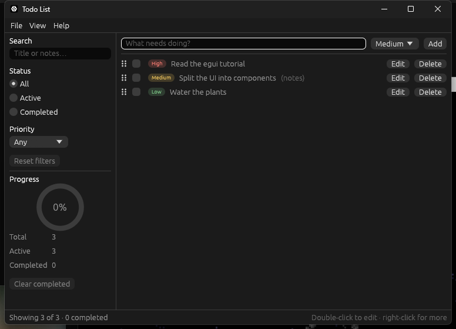

# Stage 4: persistence, theming, custom painting and UI tests

[Previous: Stage 3: a full application shell](06-stage-3-app-shell.md) · [Contents](../README.md) · [Next: Stage 5: HTTP requests on a background worker](08-stage-5-http.md)

**Goal:** remember todos and settings between runs, let the user restyle the app, replace
the stock progress bar with a custom animated widget, and test the UI headlessly.

`Cargo.toml` dependencies:

```toml
[dependencies]
# "persistence" lets eframe save app state (and egui's own memory) between runs.
eframe = { version = "0.37", features = ["persistence"] }
egui_extras = "0.37"
serde = { version = "1", features = ["derive"] }

[dev-dependencies]
egui_kittest = "0.37"
```

## Make the model serialisable

In `src/model.rs`, import serde and add the two derives to the four persisted types.
Nothing else in the file changes:

```rust
use serde::{Deserialize, Serialize};
```

```rust
#[derive(Clone, Copy, Debug, PartialEq, Eq, Hash, Serialize, Deserialize)]
pub struct TodoId(u64);
```

```rust
#[derive(Clone, Copy, Debug, Default, PartialEq, Eq, PartialOrd, Ord, Serialize, Deserialize)]
pub enum Priority {
```

```rust
#[derive(Clone, Debug, PartialEq, Serialize, Deserialize)]
pub struct Todo {
```

```rust
#[derive(Debug, Default, Serialize, Deserialize)]
pub struct TodoList {
```

`Filter` is deliberately not persisted. Reopening the app to a list that is silently
filtered by last week's search is a bug from the user's point of view.

## Settings and style

`src/settings.rs`:

```rust
use eframe::egui;
use serde::{Deserialize, Serialize};

/// User preferences that change how the app looks.
///
/// `#[serde(default)]` fills in any field missing from an older save file with its
/// default, so adding a setting later never invalidates what users already saved.
#[derive(Clone, Debug, PartialEq, Serialize, Deserialize)]
#[serde(default)]
pub struct Settings {
    /// Colour of selections, the progress ring and links, as sRGB bytes.
    pub accent_color: [u8; 3],
    /// Vertical gap between neighbouring widgets, in points.
    pub row_spacing: f32,
}

impl Default for Settings {
    fn default() -> Self {
        Self {
            accent_color: [60, 130, 200],
            row_spacing: 4.0,
        }
    }
}

impl Settings {
    pub const ROW_SPACING_RANGE: std::ops::RangeInclusive<f32> = 2.0..=12.0;

    /// Pushes the settings into egui's style. Call once at startup and again
    /// whenever a setting changes; the style then stays in effect for every frame.
    pub fn apply(&self, ctx: &egui::Context) {
        let [red, green, blue] = self.accent_color;
        let accent_color = egui::Color32::from_rgb(red, green, blue);
        let text_on_accent = readable_text_color(self.accent_color);

        // egui keeps one style for the light theme and one for the dark theme.
        // `all_styles_mut` edits both, so the settings survive a theme switch.
        ctx.all_styles_mut(|style| {
            style.visuals.selection.bg_fill = accent_color;
            style.visuals.selection.stroke.color = text_on_accent;
            style.visuals.hyperlink_color = accent_color;
            style.spacing.item_spacing.y = self.row_spacing;
        });
    }
}

/// Picks black or white, whichever contrasts better with the given background.
fn readable_text_color([red, green, blue]: [u8; 3]) -> egui::Color32 {
    // Perceived brightness: the eye is most sensitive to green and least to blue.
    let brightness = 0.299 * f32::from(red) + 0.587 * f32::from(green) + 0.114 * f32::from(blue);
    if brightness > 150.0 {
        egui::Color32::BLACK
    } else {
        egui::Color32::WHITE
    }
}

#[cfg(test)]
mod tests {
    use super::*;

    #[test]
    fn text_on_the_accent_colour_stays_readable() {
        assert_eq!(readable_text_color([250, 240, 120]), egui::Color32::BLACK);
        assert_eq!(readable_text_color([20, 40, 120]), egui::Color32::WHITE);
    }

    #[test]
    fn apply_writes_the_settings_into_both_themes() {
        let ctx = egui::Context::default();
        let settings = Settings {
            accent_color: [200, 30, 30],
            row_spacing: 9.0,
        };

        settings.apply(&ctx);

        for theme in [egui::Theme::Light, egui::Theme::Dark] {
            let style = ctx.style_of(theme);
            assert_eq!(
                style.visuals.selection.bg_fill,
                egui::Color32::from_rgb(200, 30, 30)
            );
            assert_eq!(style.spacing.item_spacing.y, 9.0);
        }
    }
}
```

egui's look is data: a `Style` holding `Visuals` (colours, strokes) and `Spacing`. You
change it once and it stays in effect, so `apply` is called at startup and when a setting
changes, not every frame. The theme itself (light, dark or follow the system) is not in
`Settings` because egui already stores and saves that preference.

`apply` is tested against a bare `egui::Context`. No window is needed to check styling.

## A custom animated widget: `ProgressRing`

`src/components/progress_ring.rs`:

```rust
use std::f32::consts::TAU;

use eframe::egui;

/// A circular progress indicator, drawn entirely with the painter.
pub struct ProgressRing {
    fraction: f32,
    diameter: f32,
}

impl ProgressRing {
    /// `fraction` is the completed share, from 0.0 to 1.0.
    pub fn new(fraction: f32) -> Self {
        Self {
            fraction: fraction.clamp(0.0, 1.0),
            diameter: 64.0,
        }
    }

    pub fn diameter(mut self, diameter: f32) -> Self {
        self.diameter = diameter;
        self
    }
}

impl egui::Widget for ProgressRing {
    fn ui(self, ui: &mut egui::Ui) -> egui::Response {
        let (rect, response) =
            ui.allocate_exact_size(egui::Vec2::splat(self.diameter), egui::Sense::hover());

        response.widget_info(|| {
            let percent = (self.fraction * 100.0).round();
            egui::WidgetInfo::labeled(
                egui::Role::ProgressIndicator,
                true,
                format!("{percent}% completed"),
            )
        });

        // egui remembers the previous value under this ID and eases towards the new
        // one. While the animation runs it also requests repaints for us.
        let animated_fraction = ui
            .ctx()
            .animate_value_with_time(response.id, self.fraction, 0.4);

        if ui.is_rect_visible(rect) {
            let visuals = ui.visuals();
            let ring_width = self.diameter * 0.12;
            let radius = (self.diameter - ring_width) / 2.0;
            let center = rect.center();

            // The full circle underneath, as the "empty" track.
            ui.painter().circle_stroke(
                center,
                radius,
                egui::Stroke::new(ring_width, visuals.widgets.inactive.bg_fill),
            );

            // The completed part: a polyline along the arc, starting at 12 o'clock
            // and running clockwise.
            if animated_fraction > 0.0 {
                let segment_count = (64.0 * animated_fraction).ceil().max(2.0) as usize;
                let arc_points = (0..=segment_count)
                    .map(|segment| {
                        let progress = segment as f32 / segment_count as f32;
                        let angle = -TAU / 4.0 + TAU * animated_fraction * progress;
                        center + radius * egui::Vec2::angled(angle)
                    })
                    .collect();
                ui.painter().line(
                    arc_points,
                    egui::Stroke::new(ring_width, visuals.selection.bg_fill),
                );
            }

            ui.painter().text(
                center,
                egui::Align2::CENTER_CENTER,
                format!("{:.0}%", animated_fraction * 100.0),
                egui::FontId::proportional(self.diameter * 0.24),
                visuals.text_color(),
            );
        }

        response
    }
}
```

`animate_value_with_time` is all it takes to animate. egui stores the previous value under
the given ID, interpolates, and keeps requesting repaints until the animation settles. The
colours come from `ui.visuals()`, so the ring follows the theme and the accent colour
without knowing that `Settings` exists.

To use it, change two places in `src/components/filter_panel.rs`. Add the import:

```rust
use super::ProgressRing;
```

and replace the `ProgressBar` line with:

```rust
        ui.vertical_centered(|ui| {
            ui.add(ProgressRing::new(completed_fraction).diameter(72.0));
        });
```

That is the whole migration, because both are `impl Widget`.

## A floating window: `SettingsWindow`

`src/components/settings_window.rs`:

```rust
use eframe::egui;

use crate::settings::Settings;

/// A floating, non-modal settings window.
///
/// Unlike the edit dialog it does not block the rest of the app, and changes take
/// effect immediately, so the user can watch the list restyle as they adjust.
pub struct SettingsWindow<'a> {
    settings: &'a mut Settings,
    open: &'a mut bool,
    /// Where the app's data is saved, shown for reference.
    storage_path: Option<std::path::PathBuf>,
}

impl<'a> SettingsWindow<'a> {
    pub fn new(settings: &'a mut Settings, open: &'a mut bool) -> Self {
        Self {
            settings,
            open,
            storage_path: None,
        }
    }

    pub fn storage_path(mut self, storage_path: Option<std::path::PathBuf>) -> Self {
        self.storage_path = storage_path;
        self
    }

    /// Returns `true` if any setting changed this frame.
    pub fn show(self, ctx: &egui::Context) -> bool {
        // Comparing before and after is simpler and more robust than collecting
        // `changed()` from every widget, and it also catches the reset button.
        let settings_before = self.settings.clone();

        egui::Window::new("Settings")
            // Adds a close button to the title bar and clears the flag when it is used.
            .open(self.open)
            .collapsible(false)
            .resizable(false)
            .show(ctx, |ui| {
                egui::Grid::new("settings_fields")
                    .num_columns(2)
                    .spacing([16.0, 8.0])
                    .show(ui, |ui| {
                        ui.label("Theme");
                        theme_picker(ui);
                        ui.end_row();

                        let accent_label = ui.label("Accent colour");
                        ui.color_edit_button_srgb(&mut self.settings.accent_color)
                            .labelled_by(accent_label.id);
                        ui.end_row();

                        let spacing_label = ui.label("Row spacing");
                        ui.add(
                            egui::Slider::new(
                                &mut self.settings.row_spacing,
                                Settings::ROW_SPACING_RANGE,
                            )
                            .step_by(1.0)
                            .suffix(" pt"),
                        )
                        .labelled_by(spacing_label.id);
                        ui.end_row();
                    });

                ui.add_space(4.0);
                // Enabled only while the value differs from `Settings::default()`.
                egui::reset_button(ui, self.settings, "Reset to defaults");

                ui.separator();

                // Collapsed by default; egui remembers whether the user opened it.
                ui.collapsing("Storage", |ui| {
                    ui.label("Todos and settings are saved automatically to:");
                    match &self.storage_path {
                        Some(path) => ui.monospace(path.display().to_string()),
                        None => ui.weak("(no storage location available)"),
                    };
                });
            });

        *self.settings != settings_before
    }
}

/// A System / Light / Dark switch.
///
/// The theme preference is not part of our `Settings`: egui already owns it,
/// applies it, and saves it with its own memory, so we only read and write it.
fn theme_picker(ui: &mut egui::Ui) {
    let current_preference = ui.ctx().options(|options| options.theme_preference);
    let mut chosen_preference = current_preference;

    ui.horizontal(|ui| {
        for (preference, label) in [
            (egui::ThemePreference::System, "System"),
            (egui::ThemePreference::Light, "Light"),
            (egui::ThemePreference::Dark, "Dark"),
        ] {
            ui.selectable_value(&mut chosen_preference, preference, label);
        }
    });

    if chosen_preference != current_preference {
        ui.ctx().set_theme(chosen_preference);
    }
}
```

`Window` and `Modal` are both shown on the `Context`, but they behave differently. A window
can be moved, does not block the app, and stays open while the user works. Use a modal when
the user must answer before continuing, and a window for tools and inspectors.

`src/components/mod.rs`:

```rust
//! Reusable UI building blocks. Each component lives in its own file and only the
//! types re-exported here are part of the module's public surface.

mod add_bar;
mod edit_dialog;
mod filter_panel;
mod priority_badge;
mod progress_ring;
mod settings_window;
mod todo_menu;
mod todo_row;
mod todo_table;

pub use add_bar::AddBar;
pub use edit_dialog::{DialogOutcome, EditDialog};
pub use filter_panel::FilterPanel;
pub use priority_badge::PriorityBadge;
pub use progress_ring::ProgressRing;
pub use settings_window::SettingsWindow;
pub use todo_menu::todo_context_menu;
pub use todo_row::TodoRow;
pub use todo_table::TodoTable;
```

## Persistence in the app

`src/main.rs`:

```rust
#![cfg_attr(not(debug_assertions), windows_subsystem = "windows")]

mod app;
mod components;
mod model;
mod settings;

use eframe::egui;

fn main() -> eframe::Result {
    let native_options = eframe::NativeOptions {
        viewport: egui::ViewportBuilder::default()
            .with_title("Todo List")
            .with_inner_size([760.0, 520.0])
            .with_min_inner_size([520.0, 320.0]),
        ..Default::default()
    };

    // The first argument names the storage folder; the window title is set above.
    eframe::run_native(
        app::APP_ID,
        native_options,
        Box::new(|creation_context| Ok(Box::new(app::TodoApp::new(creation_context)))),
    )
}
```

`src/app.rs`:

```rust
use eframe::egui;
use serde::{Deserialize, Serialize};

use crate::components::{
    AddBar, DialogOutcome, EditDialog, FilterPanel, SettingsWindow, TodoRow, TodoTable,
};
use crate::model::{Filter, Priority, Todo, TodoAction, TodoList};
use crate::settings::Settings;

/// Names the folder the app's data is saved in. Kept separate from the window
/// title so that renaming the window never orphans existing save files.
pub const APP_ID: &str = "egui-todo-tutorial";

// `COMMAND` means Ctrl on Windows and Linux and ⌘ on macOS.
const FOCUS_NEW_TODO: egui::KeyboardShortcut =
    egui::KeyboardShortcut::new(egui::Modifiers::COMMAND, egui::Key::N);
const FOCUS_SEARCH: egui::KeyboardShortcut =
    egui::KeyboardShortcut::new(egui::Modifiers::COMMAND, egui::Key::F);

#[derive(Clone, Copy, Default, PartialEq, Serialize, Deserialize)]
enum ViewMode {
    #[default]
    List,
    Table,
}

/// Everything that should survive a restart, and nothing else.
#[derive(Serialize, Deserialize)]
#[serde(default)]
pub struct PersistedState {
    todos: TodoList,
    view_mode: ViewMode,
    sidebar_open: bool,
    settings: Settings,
}

impl Default for PersistedState {
    fn default() -> Self {
        Self {
            todos: TodoList::default(),
            view_mode: ViewMode::default(),
            sidebar_open: true,
            settings: Settings::default(),
        }
    }
}

impl PersistedState {
    /// What a new user sees the first time the app starts.
    pub fn with_sample_todos() -> Self {
        let mut todos = TodoList::default();
        todos.add("Read the egui tutorial", Priority::High);
        if let Some(id) = todos.add("Split the UI into components", Priority::Medium) {
            todos.update(
                id,
                "Split the UI into components",
                "Leaf widgets implement egui::Widget.\nComposite components return actions.",
                Priority::Medium,
            );
        }
        todos.add("Water the plants", Priority::Low);

        Self {
            todos,
            ..Self::default()
        }
    }
}

pub struct TodoApp {
    /// Saved to disk.
    state: PersistedState,

    // Everything below is transient: it is rebuilt from scratch on every start.
    add_bar: AddBar,
    filter: Filter,
    /// Set by the Ctrl+F shortcut, consumed when the sidebar is next drawn.
    search_focus_requested: bool,
    /// `Some` while the edit dialog is open.
    edit_dialog: Option<EditDialog>,
    settings_open: bool,
}

impl TodoApp {
    pub fn new(creation_context: &eframe::CreationContext<'_>) -> Self {
        // `storage` is `None` if the "persistence" feature is off, and `get_value`
        // returns `None` on first launch or if the saved data cannot be parsed.
        let state = creation_context
            .storage
            .and_then(|storage| eframe::get_value(storage, eframe::APP_KEY))
            .unwrap_or_else(PersistedState::with_sample_todos);

        state.settings.apply(&creation_context.egui_ctx);
        Self::from_state(state)
    }

    /// Builds the app without a window, which is what the UI tests use.
    pub fn from_state(state: PersistedState) -> Self {
        let mut add_bar = AddBar::default();
        // Start with the cursor in the input so the user can type straight away.
        add_bar.request_focus();

        Self {
            state,
            add_bar,
            filter: Filter::default(),
            search_focus_requested: false,
            edit_dialog: None,
            settings_open: false,
        }
    }

    /// The only place where app state changes in response to the UI.
    fn apply(&mut self, action: TodoAction) {
        let todos = &mut self.state.todos;
        match action {
            TodoAction::Add { title, priority } => {
                todos.add(&title, priority);
            }
            TodoAction::Toggle(id) => todos.toggle(id),
            TodoAction::Delete(id) => todos.remove(id),
            TodoAction::StartEditing(id) => {
                self.edit_dialog = todos.get(id).map(EditDialog::new);
            }
            TodoAction::Update {
                id,
                title,
                notes,
                priority,
            } => todos.update(id, &title, &notes, priority),
            TodoAction::SetPriority(id, priority) => todos.set_priority(id, priority),
            TodoAction::Reorder { moved, target } => todos.reorder(moved, target),
            TodoAction::ClearCompleted => todos.clear_completed(),
        }
    }

    fn handle_shortcuts(&mut self, ctx: &egui::Context) {
        // While the modal is open the rest of the window is blocked, so the
        // shortcuts that target it should be too.
        if self.edit_dialog.is_some() {
            return;
        }

        // `consume_shortcut` removes the key press from this frame's input, so a
        // focused text box will not also see it as typing.
        if ctx.input_mut(|input| input.consume_shortcut(&FOCUS_NEW_TODO)) {
            self.add_bar.request_focus();
        }
        if ctx.input_mut(|input| input.consume_shortcut(&FOCUS_SEARCH)) {
            self.state.sidebar_open = true;
            self.search_focus_requested = true;
        }
    }

    fn menu_bar(&mut self, ui: &mut egui::Ui, actions: &mut Vec<TodoAction>) {
        egui::MenuBar::new().ui(ui, |ui| {
            ui.menu_button("File", |ui| {
                let new_todo_button = egui::Button::new("New todo")
                    .shortcut_text(ui.ctx().format_shortcut(&FOCUS_NEW_TODO));
                if ui.add(new_todo_button).clicked() {
                    self.add_bar.request_focus();
                }

                let clear_button = egui::Button::new("Clear completed");
                if ui
                    .add_enabled(self.state.todos.completed_count() > 0, clear_button)
                    .clicked()
                {
                    actions.push(TodoAction::ClearCompleted);
                }

                ui.separator();

                if ui.button("Settings…").clicked() {
                    self.settings_open = true;
                }

                ui.separator();

                if ui.button("Quit").clicked() {
                    // Window-level requests go to the viewport, not to a widget.
                    ui.send_viewport_cmd(egui::ViewportCommand::Close);
                }
            });

            ui.menu_button("View", |ui| {
                ui.checkbox(&mut self.state.sidebar_open, "Sidebar");
                let find_button = egui::Button::new("Find…")
                    .shortcut_text(ui.ctx().format_shortcut(&FOCUS_SEARCH));
                if ui.add(find_button).clicked() {
                    self.state.sidebar_open = true;
                    self.search_focus_requested = true;
                }

                ui.separator();

                ui.radio_value(&mut self.state.view_mode, ViewMode::List, "List");
                ui.radio_value(&mut self.state.view_mode, ViewMode::Table, "Table");
            });

            ui.menu_button("Help", |ui| {
                ui.hyperlink_to("egui documentation", "https://docs.rs/egui/0.37.0");
            });
        });
    }

    fn status_bar(&self, ui: &mut egui::Ui, visible_count: usize) {
        egui::Sides::new().show(
            ui,
            |ui| {
                ui.label(format!(
                    "Showing {visible_count} of {} · {} completed",
                    self.state.todos.len(),
                    self.state.todos.completed_count()
                ));
            },
            |ui| {
                ui.weak("Double-click to edit · right-click for more");
            },
        );
    }

    fn todo_views(
        &self,
        ui: &mut egui::Ui,
        visible_todos: &[&Todo],
        actions: &mut Vec<TodoAction>,
    ) {
        if visible_todos.is_empty() {
            // Tell the user *why* the list is empty.
            let message = if self.state.todos.is_empty() {
                "Nothing to do. Add your first item above."
            } else {
                "No todos match the current filters."
            };
            ui.weak(message);
            return;
        }

        match self.state.view_mode {
            ViewMode::List => {
                egui::ScrollArea::vertical()
                    .auto_shrink([false, false])
                    .show(ui, |ui| {
                        for &todo in visible_todos {
                            // Scope each row's widget IDs to the todo, not to its position.
                            ui.push_id(todo.id, |ui| {
                                actions.extend(TodoRow::new(todo).show(ui));
                            });
                        }
                    });
            }
            ViewMode::Table => actions.extend(TodoTable::new(visible_todos).show(ui)),
        }
    }

    /// Draws the whole app into `ui`. Separate from `eframe::App::ui` so that tests
    /// can drive it without an `eframe::Frame`.
    pub fn show(&mut self, ui: &mut egui::Ui) {
        // Phase 1: draw the UI from the current state and collect what the user did.
        let mut actions: Vec<TodoAction> = Vec::new();

        self.handle_shortcuts(ui.ctx());

        // Panels are carved out of the remaining space in the order they are shown,
        // so the outer panels come first and `CentralPanel` must come last.
        egui::Panel::top("menu_bar").show(ui, |ui| self.menu_bar(ui, &mut actions));

        let visible_count = self
            .state
            .todos
            .iter()
            .filter(|todo| self.filter.matches(todo))
            .count();
        egui::Panel::bottom("status_bar").show(ui, |ui| self.status_bar(ui, visible_count));

        let focus_search = std::mem::take(&mut self.search_focus_requested);
        egui::Panel::left("sidebar")
            .resizable(true)
            .default_size(190.0)
            .size_range(160.0..=320.0)
            // Slides the panel in and out, and lets the user drag it shut.
            .show_collapsible(ui, &mut self.state.sidebar_open, |ui| {
                actions.extend(
                    FilterPanel::new(&mut self.filter, &self.state.todos)
                        .focus_search(focus_search)
                        .show(ui),
                );
            });

        egui::CentralPanel::default().show(ui, |ui| {
            actions.extend(self.add_bar.show(ui));
            ui.separator();

            // Computed after the sidebar so that typing in the search box filters
            // the list in the same frame.
            let visible_todos: Vec<&Todo> = self
                .state
                .todos
                .iter()
                .filter(|todo| self.filter.matches(todo))
                .collect();
            self.todo_views(ui, &visible_todos, &mut actions);
        });

        if let Some(dialog) = &mut self.edit_dialog {
            match dialog.show(ui.ctx()) {
                DialogOutcome::Open => {}
                DialogOutcome::Cancelled => self.edit_dialog = None,
                DialogOutcome::Saved(action) => {
                    actions.push(action);
                    self.edit_dialog = None;
                }
            }
        }

        let settings_changed =
            SettingsWindow::new(&mut self.state.settings, &mut self.settings_open)
                .storage_path(eframe::storage_dir(APP_ID))
                .show(ui.ctx());
        if settings_changed {
            self.state.settings.apply(ui.ctx());
        }

        // Phase 2: mutate. Nothing is borrowed any more, so this is always allowed.
        for action in actions {
            self.apply(action);
        }
    }
}

impl eframe::App for TodoApp {
    fn ui(&mut self, ui: &mut egui::Ui, _frame: &mut eframe::Frame) {
        self.show(ui);
    }

    /// Called on shutdown and every `auto_save_interval` (30 seconds by default).
    fn save(&mut self, storage: &mut dyn eframe::Storage) {
        eframe::set_value(storage, eframe::APP_KEY, &self.state);
    }
}

#[cfg(test)]
mod tests {
    use egui_kittest::Harness;
    use egui_kittest::kittest::Queryable as _;

    use super::*;

    /// Runs the real app headlessly, starting from the sample todos.
    fn app_harness() -> Harness<'static, TodoApp> {
        let app = TodoApp::from_state(PersistedState::with_sample_todos());
        let mut harness = Harness::builder()
            .with_size(egui::vec2(760.0, 520.0))
            .build_ui_state(|ui, app: &mut TodoApp| app.show(ui), app);
        // Let the first frames settle (focus requests, panel sizing).
        harness.run();
        harness
    }

    /// Focuses the text box with the given accessible name, then types into it.
    /// `type_text` on its own sends the text to whichever widget has focus.
    fn type_into(harness: &mut Harness<'_, TodoApp>, label: &str, text: &str) {
        harness.get_by_label(label).focus();
        harness.run();
        harness.get_by_label(label).type_text(text);
        harness.run();
    }

    fn titles(harness: &Harness<'_, TodoApp>) -> Vec<String> {
        let todos = &harness.state().state.todos;
        todos.iter().map(|todo| todo.title.clone()).collect()
    }

    #[test]
    fn typing_a_title_and_pressing_enter_adds_a_todo() {
        let mut harness = app_harness();

        type_into(&mut harness, "New todo title", "Buy milk");
        harness.key_press(egui::Key::Enter);
        harness.run();

        assert_eq!(titles(&harness).last().unwrap(), "Buy milk");
        // The new row is on screen, and the box is ready for the next todo.
        harness.get_by_label("Done: Buy milk");
        assert!(harness.get_by_label("New todo title").is_focused());
    }

    #[test]
    fn ticking_a_checkbox_completes_the_todo() {
        let mut harness = app_harness();

        harness.get_by_label("Done: Water the plants").click();
        harness.run();

        assert_eq!(harness.state().state.todos.completed_count(), 1);
        harness.get_by_label("Showing 3 of 3 · 1 completed");
    }

    #[test]
    fn searching_hides_todos_that_do_not_match() {
        let mut harness = app_harness();

        type_into(&mut harness, "Search", "plants");

        harness.get_by_label("Done: Water the plants");
        assert!(
            harness
                .query_by_label("Done: Read the egui tutorial")
                .is_none()
        );
        // Filtering is a view concern: the todos themselves are untouched.
        assert_eq!(titles(&harness).len(), 3);
    }

    #[test]
    fn the_edit_dialog_saves_a_new_title() {
        let mut harness = app_harness();

        harness.get_by_label("Edit: Water the plants").click();
        harness.run();

        type_into(&mut harness, "Title", " today");
        harness.get_by_label("Save").click();
        harness.run();

        assert!(titles(&harness).contains(&"Water the plants today".to_owned()));
        // The dialog is gone again.
        assert!(harness.query_by_label("Edit todo").is_none());
    }

    #[test]
    fn cancelling_the_edit_dialog_changes_nothing() {
        let mut harness = app_harness();
        let titles_before = titles(&harness);

        harness.get_by_label("Edit: Water the plants").click();
        harness.run();
        type_into(&mut harness, "Title", " (changed)");
        harness.get_by_label("Cancel").click();
        harness.run();

        assert_eq!(titles(&harness), titles_before);
    }

    #[test]
    fn the_table_view_reports_the_same_actions_as_the_list() {
        let mut harness = app_harness();
        harness.state_mut().state.view_mode = ViewMode::Table;
        harness.run();

        harness.get_by_label("Done: Water the plants").click();
        harness.run();

        assert_eq!(harness.state().state.todos.completed_count(), 1);
    }

    #[test]
    fn the_file_menu_opens_the_settings_window() {
        let mut harness = app_harness();
        assert!(harness.query_by_label("Accent colour").is_none());

        harness.get_by_label("File").click();
        harness.run();
        harness.get_by_label("Settings…").click();
        harness.run();

        harness.get_by_label("Accent colour");

        // Choosing a theme goes straight to egui, which owns that preference.
        harness.get_by_label("Light").click();
        harness.run();
        assert_eq!(harness.ctx.theme(), egui::Theme::Light);
    }

    #[test]
    fn right_clicking_a_row_offers_delete_in_a_context_menu() {
        let mut harness = app_harness();

        // The title label does not sense clicks, so the click reaches the row.
        harness.get_by_label("Water the plants").click_secondary();
        harness.run();
        harness.get_by_label("Delete").click();
        harness.run();

        assert_eq!(
            titles(&harness),
            ["Read the egui tutorial", "Split the UI into components"]
        );
    }

    #[test]
    fn dragging_a_row_by_its_handle_reorders_the_list() {
        let mut harness = app_harness();

        // The drag handle sits just left of each row's checkbox.
        let handle_of = |harness: &Harness<'_, TodoApp>, title: &str| {
            let checkbox_label = format!("Done: {title}");
            let checkbox_rect = harness.get_by_label(&checkbox_label).rect();
            checkbox_rect.left_center() - egui::vec2(13.0, 0.0)
        };
        let drag_from = handle_of(&harness, "Read the egui tutorial");
        let drop_onto = handle_of(&harness, "Water the plants");

        harness.hover_at(drag_from);
        harness.run();
        harness.drag_at(drag_from);
        harness.run();
        harness.hover_at(drop_onto);
        harness.run();
        harness.drop_at(drop_onto);
        harness.run();

        assert_eq!(
            titles(&harness),
            [
                "Split the UI into components",
                "Water the plants",
                "Read the egui tutorial"
            ]
        );
    }
}
```



What changed, and why:

- **`PersistedState` separates what is saved from what is not.** Serialising the whole
  `TodoApp` would either save transient things (an open dialog, a half-typed draft) or
  need `#[serde(skip)]` on most fields. One nested struct makes the boundary obvious.
- **`#[serde(default)]` on every persisted struct** is what makes old save files load after
  you add a field. Without it, one new setting discards every user's data.
- **`save` is called for you** on exit and every 30 seconds. On Windows the file is
  `%APPDATA%\egui-todo-tutorial\data\app.ron`. Delete it to reset the app.
- **`APP_ID` is not the window title.** The first argument of `run_native` names the storage
  folder, so the title is set separately with `with_title`.
- **`show` is separate from `eframe::App::ui`** so that tests can drive the whole app
  without an `eframe::Frame`.

## Testing the UI

`egui_kittest` runs your UI without a window or GPU. It finds widgets through the
accessibility tree, the same way a screen reader does, and simulates clicks and typing.
The tests at the bottom of `app.rs` above cover the main flows. Three things to know:

- **`harness.run()`** runs frames until the UI settles. Call it after each simulated input.
- **Widgets are found by accessible name.** This is why the earlier stages added `accessible_name` and
  `labelled_by`. After each `run`, the harness also *fails the test* if any interactive
  widget has no name, so accessibility regressions are caught automatically.
- **`type_text` types into whichever widget has focus.** Focus the target first, as the
  `type_into` helper does.

Components that return actions can also be tested in isolation. Append this to
`src/components/todo_row.rs`:

```rust
#[cfg(test)]
mod tests {
    use egui_kittest::Harness;
    use egui_kittest::kittest::Queryable as _;

    use super::*;
    use crate::model::{Priority, TodoList};

    /// A component that returns actions can be tested on its own: no app, no
    /// window, just "given this todo and this click, expect this action".
    #[test]
    fn clicking_delete_returns_a_delete_action_and_changes_nothing() {
        let mut todos = TodoList::default();
        let id = todos.add("Water the plants", Priority::Low).unwrap();
        let todo = todos.get(id).unwrap();

        let mut harness = Harness::new_ui_state(
            |ui, actions: &mut Vec<TodoAction>| actions.extend(TodoRow::new(todo).show(ui)),
            Vec::new(),
        );

        harness.get_by_label("Delete: Water the plants").click();
        harness.run();

        assert_eq!(harness.state(), &[TodoAction::Delete(id)]);
        assert_eq!(todos.len(), 1);
    }
}
```

```powershell
cargo test
```

```text
test result: ok. 19 passed; 0 failed; 0 ignored; 0 measured; 0 filtered out
```

Seven model tests, two settings tests, nine whole-app UI tests and one component test, all
without opening a window.

---

[Previous: Stage 3: a full application shell](06-stage-3-app-shell.md) · [Contents](../README.md) · [Next: Stage 5: HTTP requests on a background worker](08-stage-5-http.md)
