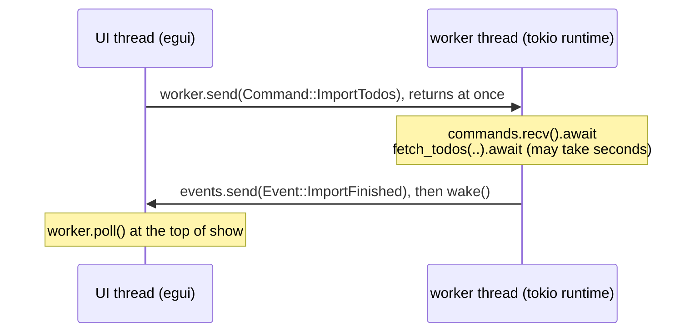
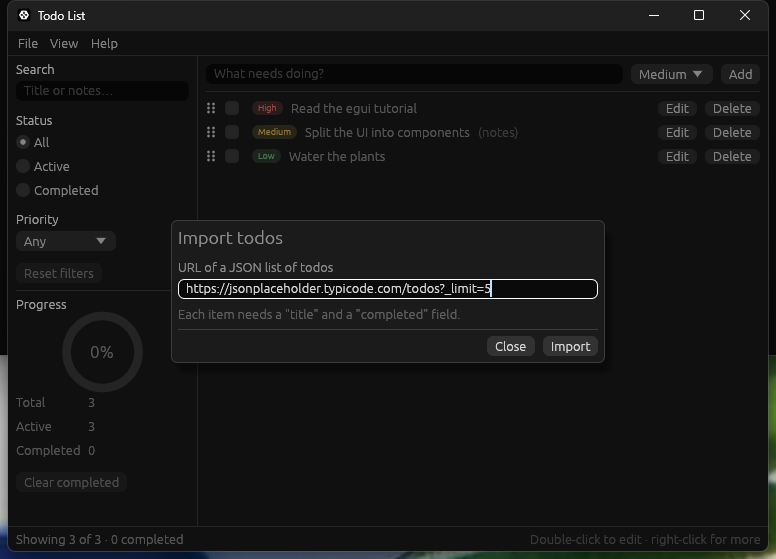
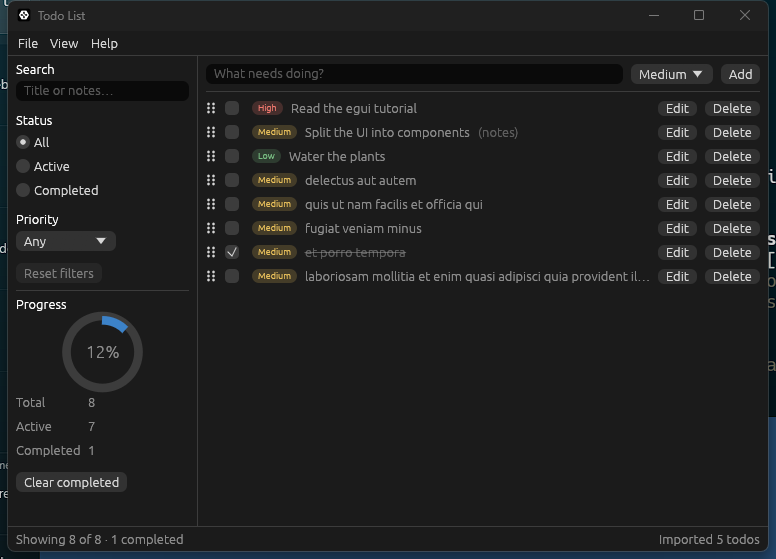

# Stage 5: HTTP requests on a background worker

[Previous: Stage 4: persistence, theming, custom painting and UI tests](07-stage-4-persistence.md) · [Contents](../README.md) · [Next: Stage 6: a SQLite database with sqlx](09-stage-6-sqlite.md)

**Goal:** import todos from a URL, without the window ever freezing while the request runs.

`Cargo.toml` dependencies added in this stage:

```toml
[dependencies]
# HTTP client. "json" adds `Response::json`, which decodes a body with serde.
reqwest = { version = "0.13", features = ["json"] }
# reqwest is async, so something has to drive it: "rt" is the runtime and "sync" the
# channel the UI uses to send it work.
tokio = { version = "1", features = ["rt", "sync"] }

[dev-dependencies]
# A real HTTP server on a random local port, so tests never touch the network.
wiremock = "0.6"
tokio = { version = "1", features = ["macros"] }
```

An HTTP request takes anywhere from milliseconds to the length of its timeout. `ui` has to
return in a few milliseconds, every frame. So the request cannot happen inside `ui`, and
`ui` cannot wait for it. This stage solves that with three pieces, each ignorant of the
other two:

| File | Knows about | Does not know about |
|---|---|---|
| `import.rs` | HTTP, JSON, the model | egui, threads |
| `worker.rs` | threads, channels, the async runtime | egui, what a window is |
| `components/import_dialog.rs` | egui | HTTP, threads |

`TodoApp` is the only place that connects them:

```text
UI thread (egui)                          worker thread (tokio runtime)
----------------                          -----------------------------
worker.send(Command::ImportTodos)  ---->  commands.recv().await
        (returns at once)                 fetch_todos(..).await   (may take seconds)
worker.poll() at the top of `show` <----  events.send(Event::ImportFinished); wake()
```



## The request: `import.rs`

Create `src/import.rs`:

```rust
//! Fetching todos over HTTP. Like the model, nothing here depends on egui: it is plain
//! async code that can be tested against a local server without opening a window.

use std::fmt;
use std::time::Duration;

use serde::Deserialize;

use crate::model::NewTodo;

/// A public demo API that returns todo-shaped JSON. `/todos` on its own returns 200
/// items, so the default asks for the first five.
pub const DEFAULT_URL: &str = "https://jsonplaceholder.typicode.com/todos?_limit=5";

/// How long one request may take from start to finish, body included.
pub const REQUEST_TIMEOUT: Duration = Duration::from_secs(10);

/// One item exactly as the server sends it. Keeping the wire format in its own type
/// means a change to the API touches this file and nothing else. Fields the app has
/// no use for (`id`, `userId`) are simply not listed; serde skips them.
#[derive(Deserialize)]
struct RemoteTodo {
    title: String,
    completed: bool,
}

impl From<RemoteTodo> for NewTodo {
    fn from(remote: RemoteTodo) -> Self {
        Self {
            title: remote.title,
            done: remote.completed,
        }
    }
}

/// Why an import failed, in terms the user can act on.
#[derive(Clone, Debug, PartialEq, Eq)]
pub enum ImportError {
    InvalidUrl,
    TimedOut,
    /// The server could not be reached at all.
    Unreachable,
    /// The server answered, but not with a success status.
    Status(u16),
    /// The body was not the JSON we expected.
    UnexpectedBody,
}

impl fmt::Display for ImportError {
    fn fmt(&self, formatter: &mut fmt::Formatter<'_>) -> fmt::Result {
        match self {
            Self::InvalidUrl => write!(formatter, "That is not a valid http(s) URL."),
            Self::TimedOut => write!(formatter, "The server took too long to answer."),
            Self::Unreachable => write!(formatter, "Could not reach the server."),
            Self::Status(code) => write!(formatter, "The server answered with HTTP {code}."),
            Self::UnexpectedBody => write!(formatter, "The response was not a list of todos."),
        }
    }
}

impl From<reqwest::Error> for ImportError {
    fn from(error: reqwest::Error) -> Self {
        // reqwest reports every failure through one error type; these predicates sort
        // it into the cases the user would want told apart.
        if error.is_timeout() {
            Self::TimedOut
        } else if error.is_builder() {
            Self::InvalidUrl
        } else if error.is_decode() {
            Self::UnexpectedBody
        } else {
            Self::Unreachable
        }
    }
}

/// Builds the HTTP client. A `Client` holds a connection pool, so the app creates one
/// and reuses it for every request instead of building one per call.
pub fn build_client(timeout: Duration) -> reqwest::Result<reqwest::Client> {
    reqwest::Client::builder()
        // Without a timeout a stalled server would leave the request waiting forever.
        .timeout(timeout)
        .user_agent("egui-todo-tutorial")
        .build()
}

/// Downloads a JSON array of todos from `url`.
pub async fn fetch_todos(client: &reqwest::Client, url: &str) -> Result<Vec<NewTodo>, ImportError> {
    let response = client.get(url.trim()).send().await?;

    // A 404 or 500 is a *successful* request as far as the transport is concerned, so
    // it has to be checked for explicitly.
    let status = response.status();
    if !status.is_success() {
        return Err(ImportError::Status(status.as_u16()));
    }

    let remote_todos: Vec<RemoteTodo> = response.json().await?;
    Ok(remote_todos.into_iter().map(NewTodo::from).collect())
}

#[cfg(test)]
mod tests {
    use wiremock::matchers::{method, path};
    use wiremock::{Mock, MockServer, ResponseTemplate};

    use super::*;

    /// Starts a local server that answers `GET /todos` with `response`.
    async fn server_answering(response: ResponseTemplate) -> MockServer {
        let server = MockServer::start().await;
        Mock::given(method("GET"))
            .and(path("/todos"))
            .respond_with(response)
            .mount(&server)
            .await;
        server
    }

    fn todos_url(server: &MockServer) -> String {
        format!("{}/todos", server.uri())
    }

    #[tokio::test]
    async fn a_json_array_becomes_new_todos() {
        let body = r#"[
            {"userId": 1, "id": 1, "title": "Buy milk", "completed": false},
            {"userId": 1, "id": 2, "title": "Call the bank", "completed": true}
        ]"#;
        let server =
            server_answering(ResponseTemplate::new(200).set_body_raw(body, "application/json"))
                .await;
        let client = build_client(REQUEST_TIMEOUT).unwrap();

        let todos = fetch_todos(&client, &todos_url(&server)).await.unwrap();

        assert_eq!(
            todos,
            [
                NewTodo {
                    title: "Buy milk".to_owned(),
                    done: false
                },
                NewTodo {
                    title: "Call the bank".to_owned(),
                    done: true
                },
            ]
        );
    }

    #[tokio::test]
    async fn an_error_status_is_reported_with_its_code() {
        let server = server_answering(ResponseTemplate::new(500)).await;
        let client = build_client(REQUEST_TIMEOUT).unwrap();

        let error = fetch_todos(&client, &todos_url(&server)).await.unwrap_err();

        assert_eq!(error, ImportError::Status(500));
    }

    #[tokio::test]
    async fn a_body_that_is_not_a_todo_list_is_rejected() {
        let server = server_answering(
            ResponseTemplate::new(200).set_body_raw(r#"{"message": "hello"}"#, "application/json"),
        )
        .await;
        let client = build_client(REQUEST_TIMEOUT).unwrap();

        let error = fetch_todos(&client, &todos_url(&server)).await.unwrap_err();

        assert_eq!(error, ImportError::UnexpectedBody);
    }

    #[tokio::test]
    async fn a_slow_server_times_out() {
        let server = server_answering(
            ResponseTemplate::new(200)
                .set_body_raw("[]", "application/json")
                .set_delay(Duration::from_secs(5)),
        )
        .await;
        let impatient_client = build_client(Duration::from_millis(200)).unwrap();

        let error = fetch_todos(&impatient_client, &todos_url(&server))
            .await
            .unwrap_err();

        assert_eq!(error, ImportError::TimedOut);
    }

    #[tokio::test]
    async fn a_malformed_url_is_rejected_before_any_request_is_made() {
        let client = build_client(REQUEST_TIMEOUT).unwrap();

        let error = fetch_todos(&client, "not a url").await.unwrap_err();

        assert_eq!(error, ImportError::InvalidUrl);
    }

    #[tokio::test]
    async fn a_server_that_is_not_listening_is_unreachable() {
        // Port 9 ("discard") on localhost has nothing listening on a normal machine.
        let client = build_client(REQUEST_TIMEOUT).unwrap();

        let error = fetch_todos(&client, "http://127.0.0.1:9/todos")
            .await
            .unwrap_err();

        assert_eq!(error, ImportError::Unreachable);
    }
}
```

What to notice:

- **`RemoteTodo` is not `NewTodo`.** The server's JSON shape and the app's model are
  different things that happen to look alike today. Decoding into a private wire type and
  converting keeps a renamed JSON field from rippling through the app.
- **One `Client`, built once, with a timeout.** A `Client` owns a connection pool. The
  default has *no* overall timeout, so a server that accepts the connection and then says
  nothing would leave the import running forever.
- **A non-2xx status is not an error to reqwest.** `send` succeeds for a 404. Check
  `status()` yourself (or call `error_for_status`).
- **`ImportError` is written for the user.** `reqwest::Error` says things like
  "error sending request for url"; the enum turns that into something a person can act on,
  and gives tests a value to compare against.

The tests run against `wiremock`, which starts a real HTTP server on a free local port.
That exercises the whole client stack (connection, status, headers, body decoding,
timeout) with no dependency on the internet.

## The background worker: `worker.rs`

Create `src/worker.rs`:

```rust
//! The background worker: one thread that owns an async runtime and does every job
//! that would otherwise make the UI wait.
//!
//! The UI thread and the worker never share state. They exchange messages instead:
//! [`Command`]s go in, [`Event`]s come out. That keeps locks out of the UI code and
//! makes the worker testable without a window.

use std::sync::Arc;
use std::sync::mpsc as std_mpsc;
use std::thread;

use tokio::sync::mpsc as tokio_mpsc;
use tokio::task::JoinHandle;

use crate::import::{self, ImportError};
use crate::model::NewTodo;

/// Work the UI can ask for.
#[derive(Debug)]
pub enum Command {
    /// Download todos from `url`. `request_id` comes back with the result so the UI
    /// can tell which request an answer belongs to.
    ImportTodos { request_id: u64, url: String },
    /// Stop the import that is running, if any.
    CancelImport,
}

/// What the worker reports back.
#[derive(Debug)]
pub enum Event {
    ImportFinished {
        request_id: u64,
        result: Result<Vec<NewTodo>, ImportError>,
    },
}

/// The UI's handle to the worker thread.
pub struct Worker {
    /// `Option` so that `Drop` can close the channel before joining the thread.
    commands: Option<tokio_mpsc::UnboundedSender<Command>>,
    events: std_mpsc::Receiver<Event>,
    thread: Option<thread::JoinHandle<()>>,
}

impl Worker {
    /// Starts the worker thread. `wake` is called after every event is queued; the
    /// app passes a closure that asks egui to repaint, so a result is shown even
    /// while the window is idle.
    pub fn spawn(wake: impl Fn() + Send + Sync + 'static) -> Self {
        // Two different channels, because the two ends live in different worlds: the
        // worker *awaits* commands (tokio), the UI *polls* for events (std).
        let (command_sender, command_receiver) = tokio_mpsc::unbounded_channel();
        let (event_sender, event_receiver) = std_mpsc::channel();

        let thread = thread::Builder::new()
            .name("todo-worker".to_owned())
            .spawn(move || run(command_receiver, event_sender, Arc::new(wake)))
            .expect("the operating system refused to start a thread");

        Self {
            commands: Some(command_sender),
            events: event_receiver,
            thread: Some(thread),
        }
    }

    /// Queues a command. Never blocks, so it is safe to call while drawing.
    pub fn send(&self, command: Command) {
        if let Some(commands) = &self.commands {
            // Sending only fails if the worker thread has died, and then there is
            // nobody left to do the work anyway.
            let _ = commands.send(command);
        }
    }

    /// Returns the events that have arrived since the last call, without waiting.
    pub fn poll(&self) -> Vec<Event> {
        self.events.try_iter().collect()
    }
}

impl Drop for Worker {
    fn drop(&mut self) {
        // Closing the command channel is the shutdown signal: the worker's loop ends
        // once it has handled the commands already queued.
        self.commands = None;
        if let Some(thread) = self.thread.take() {
            let _ = thread.join();
        }
    }
}

/// The body of the worker thread.
fn run(
    mut commands: tokio_mpsc::UnboundedReceiver<Command>,
    events: std_mpsc::Sender<Event>,
    wake: Arc<dyn Fn() + Send + Sync>,
) {
    // A current-thread runtime runs every task on this one thread. That is plenty for
    // I/O-bound work and avoids starting a thread pool the app does not need.
    let runtime = tokio::runtime::Builder::new_current_thread()
        .enable_all()
        .build()
        .expect("failed to start the async runtime");
    let client =
        import::build_client(import::REQUEST_TIMEOUT).expect("failed to build the HTTP client");

    runtime.block_on(async move {
        let mut running_import: Option<JoinHandle<()>> = None;

        // `recv` returns `None` once the `Worker` handle has been dropped.
        while let Some(command) = commands.recv().await {
            match command {
                Command::ImportTodos { request_id, url } => {
                    // Only one import at a time: a new one replaces the old one.
                    if let Some(previous_import) = running_import.take() {
                        previous_import.abort();
                    }

                    let client = client.clone();
                    let events = events.clone();
                    let wake = Arc::clone(&wake);
                    // Spawning, rather than awaiting here, keeps the loop free to
                    // receive a `CancelImport` while the request is in flight.
                    running_import = Some(tokio::spawn(async move {
                        let result = import::fetch_todos(&client, &url).await;
                        let _ = events.send(Event::ImportFinished { request_id, result });
                        wake();
                    }));
                }
                Command::CancelImport => {
                    // Aborting drops the request future, which closes the connection.
                    if let Some(running_import) = running_import.take() {
                        running_import.abort();
                    }
                }
            }
        }
    });
    // Dropping the runtime here cancels any request still in flight, so quitting the
    // app never waits for the network.
}

#[cfg(test)]
mod tests {
    use std::sync::atomic::{AtomicUsize, Ordering};
    use std::time::Duration;

    use super::*;

    #[test]
    fn a_command_produces_an_event_and_a_wake_up() {
        let wake_count = Arc::new(AtomicUsize::new(0));
        let worker = Worker::spawn({
            let wake_count = Arc::clone(&wake_count);
            move || {
                wake_count.fetch_add(1, Ordering::SeqCst);
            }
        });

        // An invalid URL fails without any network access, which keeps this test
        // about the plumbing rather than about HTTP.
        worker.send(Command::ImportTodos {
            request_id: 7,
            url: "not a url".to_owned(),
        });

        // `recv_timeout` blocks, which a test may do and the UI never should.
        let event = worker
            .events
            .recv_timeout(Duration::from_secs(5))
            .expect("the worker answers");
        let Event::ImportFinished { request_id, result } = event;
        assert_eq!(request_id, 7);
        assert_eq!(result, Err(ImportError::InvalidUrl));

        // Dropping the handle joins the thread, so the wake-up has happened by now.
        drop(worker);
        assert_eq!(wake_count.load(Ordering::SeqCst), 1);
    }
}
```

What to notice:

- **Messages, not shared state.** No `Arc<Mutex<..>>` appears anywhere. The UI owns the
  todos, the worker owns the HTTP client, and the only things that cross between threads
  are `Command` and `Event` values.
- **The worker does not depend on egui.** It is handed a `wake` closure and calls it when
  an event is ready. The app passes `ctx.request_repaint()`; the test passes a counter.
- **`send` and `poll` never block.** Both are safe to call in the middle of drawing.
- **The import is spawned, not awaited.** If the loop awaited the request, it could not
  receive `CancelImport` until the request had finished, which defeats the purpose.
- **`Drop` shuts the thread down.** Dropping the handle closes the command channel, the
  loop ends, the runtime is dropped and any request in flight is cancelled with it.

## The dialog: `ImportDialog`

Create `src/components/import_dialog.rs` and re-export `ImportDialog` and `ImportOutcome`
from `components/mod.rs`:

```rust
use eframe::egui;

/// What the dialog wants the app to do this frame.
pub enum ImportOutcome {
    /// Still open; nothing to do.
    Open,
    /// The user dismissed the dialog.
    Closed,
    /// Start downloading from this URL.
    Start(String),
    /// Stop the download that is running.
    Stop,
}

/// Where the import currently stands. The dialog only *displays* this; the app
/// decides when it changes, because the app is what talks to the worker.
#[derive(Debug, PartialEq)]
enum Progress {
    Idle,
    Fetching,
    Failed(String),
}

/// A modal that asks for a URL and shows the progress of the download.
///
/// It knows nothing about HTTP or threads. It reports what the user asked for and
/// is told what happened, which is why it can be tested with no network at all.
pub struct ImportDialog {
    url: String,
    progress: Progress,
    /// True until the first frame has been shown, to focus the URL box once.
    focus_url: bool,
}

impl ImportDialog {
    pub fn new(url: &str) -> Self {
        Self {
            url: url.to_owned(),
            progress: Progress::Idle,
            focus_url: true,
        }
    }

    pub fn set_fetching(&mut self) {
        self.progress = Progress::Fetching;
    }

    pub fn set_idle(&mut self) {
        self.progress = Progress::Idle;
    }

    pub fn set_failed(&mut self, message: String) {
        self.progress = Progress::Failed(message);
    }

    pub fn is_fetching(&self) -> bool {
        self.progress == Progress::Fetching
    }

    pub fn show(&mut self, ctx: &egui::Context) -> ImportOutcome {
        let fetching = self.is_fetching();
        let can_start = !fetching && !self.url.trim().is_empty();
        let mut start_requested = false;
        let mut stop_requested = false;
        let mut close_requested = false;

        let modal = egui::Modal::new(egui::Id::unique("import_todos_dialog")).show(ctx, |ui| {
            ui.set_width(420.0);
            ui.heading("Import todos");
            ui.add_space(8.0);

            let url_label = ui.label("URL of a JSON list of todos");
            // The URL cannot be changed while a request for it is in flight.
            let url_response = ui
                .add_enabled(
                    !fetching,
                    egui::TextEdit::singleline(&mut self.url).desired_width(f32::INFINITY),
                )
                .labelled_by(url_label.id);
            if std::mem::take(&mut self.focus_url) {
                url_response.request_focus();
            }
            if url_response.lost_focus() && ui.input(|input| input.key_pressed(egui::Key::Enter)) {
                start_requested = true;
            }

            ui.add_space(4.0);
            match &self.progress {
                Progress::Idle => {
                    ui.weak("Each item needs a \"title\" and a \"completed\" field.");
                }
                Progress::Fetching => {
                    ui.horizontal(|ui| {
                        // The spinner animates by asking for a repaint every frame, so
                        // the window stays live for as long as it is on screen.
                        ui.spinner();
                        ui.label("Fetching…");
                    });
                }
                Progress::Failed(message) => {
                    ui.colored_label(ui.visuals().error_fg_color, message);
                }
            }

            ui.separator();

            egui::Sides::new().show(
                ui,
                |_left| {},
                |ui| {
                    if fetching {
                        if ui.button("Stop").clicked() {
                            stop_requested = true;
                        }
                    } else if ui
                        .add_enabled(can_start, egui::Button::new("Import"))
                        .clicked()
                    {
                        start_requested = true;
                    }
                    if ui.button("Close").clicked() {
                        close_requested = true;
                    }
                },
            );
        });

        if start_requested && can_start {
            ImportOutcome::Start(self.url.trim().to_owned())
        } else if stop_requested {
            ImportOutcome::Stop
        } else if close_requested || modal.should_close() {
            ImportOutcome::Closed
        } else {
            ImportOutcome::Open
        }
    }
}

#[cfg(test)]
mod tests {
    use egui_kittest::Harness;
    use egui_kittest::kittest::Queryable as _;

    use super::*;

    /// Shows the dialog on its own and records the last thing it asked for.
    fn dialog_harness(dialog: ImportDialog) -> Harness<'static, (ImportDialog, Option<String>)> {
        Harness::builder()
            .with_size(egui::vec2(520.0, 260.0))
            .build_ui_state(
                |ui, (dialog, started_url): &mut (ImportDialog, Option<String>)| {
                    if let ImportOutcome::Start(url) = dialog.show(ui.ctx()) {
                        *started_url = Some(url);
                    }
                },
                (dialog, None),
            )
    }

    #[test]
    fn import_reports_the_trimmed_url() {
        let mut harness = dialog_harness(ImportDialog::new("  http://example.test/todos  "));
        harness.run();

        harness.get_by_label("Import").click();
        harness.run();

        assert_eq!(
            harness.state().1.as_deref(),
            Some("http://example.test/todos")
        );
    }

    #[test]
    fn a_failure_is_shown_and_the_import_button_comes_back() {
        let mut dialog = ImportDialog::new("http://example.test/todos");
        dialog.set_failed("The server answered with HTTP 500.".to_owned());
        let mut harness = dialog_harness(dialog);
        harness.run();

        harness.get_by_label("The server answered with HTTP 500.");
        harness.get_by_label("Import");
        assert!(harness.query_by_label("Stop").is_none());
    }
}
```

This is the stateful component shape from Stage 2 again, with one difference: part of its
state (`Progress`) is set from outside. The dialog cannot know when a download finishes,
so it exposes `set_fetching`, `set_idle` and `set_failed` and lets the app call them.
`ui.add_enabled(false, ..)` greys the URL box out and stops it taking input while a
request for that URL is running.

## The model

An imported item is not a `Todo` yet, because only the list hands out IDs. Add a type for
it, an action that carries a batch of them, and a method that appends them:

```rust
/// A todo that does not exist yet: what an import hands over. It has no ID because
/// only the [`TodoList`] gives those out.
#[derive(Clone, Debug, PartialEq, Eq)]
pub struct NewTodo {
    pub title: String,
    pub done: bool,
}
```

```rust
    /// Append todos that came from outside the app.
    Import(Vec<NewTodo>),
```

```rust
    /// Appends imported todos and returns how many were added. Items with a blank
    /// title are skipped, by the same rule as [`TodoList::add`].
    pub fn import(&mut self, new_todos: Vec<NewTodo>) -> usize {
        let mut added_count = 0;
        for new_todo in new_todos {
            if let Some(id) = self.add(&new_todo.title, Priority::default()) {
                if new_todo.done {
                    self.toggle(id);
                }
                added_count += 1;
            }
        }
        added_count
    }
```

## Wiring it into the app

Add `mod import;` and `mod worker;` to `main.rs`. The complete `app.rs` for this stage is
in [`code/stage5/src/app.rs`](../code/stage5/src/app.rs); these are the parts that changed.

`TodoApp` gains the worker handle and the transient state for one import:

```rust
    /// Does the slow work on another thread; see `worker.rs`.
    worker: Worker,
    /// `Some` while the import dialog is open.
    import_dialog: Option<ImportDialog>,
    /// The URL offered when the import dialog opens: the last one used this session.
    import_url: String,
    /// The ID of the newest import request. An answer carrying any other ID belongs
    /// to a request the user has since stopped or replaced, and is thrown away.
    latest_import_id: u64,
    /// A one-line result message for the status bar.
    notice: Option<String>,
```

`new` starts the worker, giving it a way to wake the UI. `from_state` now takes the worker
as a second argument and stores it:

```rust
        // `Context` is a cheap, thread-safe handle. The worker uses its copy for one
        // thing only: waking the UI when a result is ready.
        let ctx = creation_context.egui_ctx.clone();
        let worker = Worker::spawn(move || ctx.request_repaint());

        Self::from_state(state, worker)
```

`apply` gets an arm for the new action:

```rust
            TodoAction::Import(new_todos) => {
                let added_count = todos.import(new_todos);
                self.notice = Some(format!("Imported {added_count} todos"));
            }
```

Three new functions talk to the worker:

```rust
    /// Picks up whatever the worker has finished since the last frame. This never
    /// waits: if nothing has arrived, the loop body simply does not run.
    fn handle_worker_events(&mut self) {
        for event in self.worker.poll() {
            match event {
                Event::ImportFinished { request_id, result } => {
                    if request_id != self.latest_import_id {
                        continue;
                    }
                    match result {
                        Ok(new_todos) => {
                            self.import_dialog = None;
                            self.apply(TodoAction::Import(new_todos));
                        }
                        Err(error) => {
                            if let Some(dialog) = &mut self.import_dialog {
                                dialog.set_failed(error.to_string());
                            }
                        }
                    }
                }
            }
        }
    }

    fn start_import(&mut self, url: String) {
        self.latest_import_id += 1;
        self.import_url.clone_from(&url);
        self.worker.send(Command::ImportTodos {
            request_id: self.latest_import_id,
            url,
        });
    }

    fn cancel_import(&mut self) {
        // Bumping the ID covers the race the abort cannot: an answer that was already
        // in the channel when the user pressed Stop.
        self.latest_import_id += 1;
        self.worker.send(Command::CancelImport);
    }
```

`show` starts by taking in whatever the worker finished since the last frame:

```rust
        // Phase 0: take in results from the worker, so this frame draws them.
        self.handle_worker_events();
```

And, after the edit dialog, it shows the import dialog and acts on what the user asked for:

```rust
        // The dialog only reports what the user asked for. Talking to the worker is
        // the app's job.
        if let Some(dialog) = &mut self.import_dialog {
            match dialog.show(ui.ctx()) {
                ImportOutcome::Open => {}
                ImportOutcome::Start(url) => {
                    dialog.set_fetching();
                    self.start_import(url);
                }
                ImportOutcome::Stop => {
                    dialog.set_idle();
                    self.cancel_import();
                }
                ImportOutcome::Closed => {
                    // Closing mid-download also abandons the download.
                    let was_fetching = dialog.is_fetching();
                    self.import_dialog = None;
                    if was_fetching {
                        self.cancel_import();
                    }
                }
            }
        }
```

The File menu gets an "Import from URL…" item that sets
`self.import_dialog = Some(ImportDialog::new(&self.import_url))`, and the status bar shows
`notice` when there is one.





What changed, and why:

- **Results enter through `apply`, like everything else.** A downloaded batch becomes a
  `TodoAction::Import`, so there is still exactly one function that changes the list.
- **`latest_import_id` handles the race that cancelling cannot.** Pressing Stop aborts the
  request, but its answer may already be sitting in the channel. Every request carries an
  ID, and an answer whose ID is not the newest is dropped. Without this, a stopped import
  could add its todos a moment after the user pressed Stop.
- **The spinner keeps the window alive while it is visible.** `ui.spinner()` requests a
  repaint each frame, so events are picked up promptly. Once the dialog closes nothing is
  animating, and that is when the `wake` callback matters: without it, a result arriving
  while the window is idle would not appear until the user moved the mouse.
- **Nothing in `ui` waits.** `worker.poll()` returns an empty list when nothing has
  arrived. There is no `recv()`, no `block_on`, no `join` on the UI thread.

## Testing asynchronous UI

The existing tests call `harness.run()`, which steps frames until the UI stops asking for
repaints. Two things are different once a worker is involved: the result arrives in its
own time, and a visible spinner asks for repaints forever. So the tests step one frame at
a time until the thing they are waiting for is true:

```rust
    /// Steps the app one frame at a time until `is_done` holds. Work on the worker
    /// thread finishes in its own time, so the test has to keep drawing frames, as a
    /// real window would, and give up if nothing happens.
    fn step_until(
        harness: &mut Harness<'_, TodoApp>,
        mut is_done: impl FnMut(&Harness<'_, TodoApp>) -> bool,
    ) {
        let deadline = Instant::now() + Duration::from_secs(10);
        while !is_done(harness) {
            assert!(
                Instant::now() < deadline,
                "timed out waiting for the worker"
            );
            std::thread::sleep(Duration::from_millis(10));
            // `step`, not `run`: the spinner repaints forever, so `run` would never
            // see the UI settle.
            harness.step();
        }
    }
```

A whole-app test then reads like the user's actions, against a local mock server:

```rust
    fn importing_from_a_url_appends_the_downloaded_todos() {
        let body = r#"[
            {"userId": 1, "id": 1, "title": "Renew passport", "completed": false},
            {"userId": 1, "id": 2, "title": "Book flights", "completed": true}
        ]"#;
        let (_server, url) =
            todo_server(ResponseTemplate::new(200).set_body_raw(body, "application/json"));
        let mut harness = app_harness();

        open_import_dialog(&mut harness, &url);
        harness.get_by_label("Import").click();
        step_until(&mut harness, |harness| {
            harness.state().import_dialog.is_none()
        });
        harness.run();

        assert_eq!(
            titles(&harness),
            [
                "Read the egui tutorial",
                "Split the UI into components",
                "Water the plants",
                "Renew passport",
                "Book flights"
            ]
        );
        harness.get_by_label("Showing 5 of 5 · 1 completed");
        harness.get_by_label("Imported 2 todos");
    }
```

```powershell
cargo test -p stage5
```

```text
test result: ok. 32 passed; 0 failed; 0 ignored; 0 measured; 0 filtered out
```

The thirteen new tests cover the request (six cases, including a timeout and a server
that is not there), the worker, the dialog on its own, the model, and three whole-app
flows: a successful import, a failed one, and one stopped half-way.

---

[Previous: Stage 4: persistence, theming, custom painting and UI tests](07-stage-4-persistence.md) · [Contents](../README.md) · [Next: Stage 6: a SQLite database with sqlx](09-stage-6-sqlite.md)
