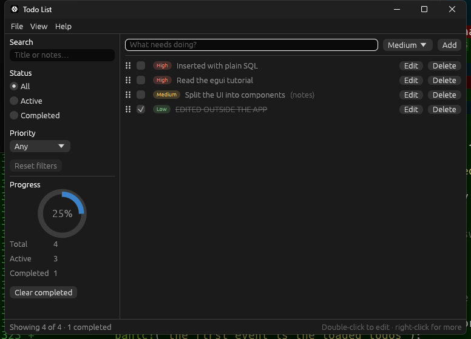

# Stage 6: a SQLite database with sqlx

[Previous: Stage 5: HTTP requests on a background worker](08-stage-5-http.md) · [Contents](../README.md) · [Next: Common pitfalls & best practices](10-pitfalls.md)

**Goal:** store the todos in a real database, written as they change, and keep the UI as
immediate as it was.

`Cargo.toml` dependencies added in this stage:

```toml
[dependencies]
# Async SQL toolkit. "runtime-tokio" makes it use the runtime the worker already has,
# "sqlite" compiles SQLite into the app (nothing to install), "migrate" runs the
# migrations folder and "macros" provides `migrate!` and `#[derive(FromRow)]`.
sqlx = { version = "0.9", default-features = false, features = ["runtime-tokio", "sqlite", "migrate", "macros"] }

[dev-dependencies]
# Throwaway folders for tests that need a real database file.
tempfile = "3"
```

Until now the whole todo list was serialised into eframe's save file on exit and every 30
seconds. That is fine for preferences, and a poor fit for data: a crash loses up to 30
seconds of work, and nothing else can read the file. From this stage on:

- **Todos** live in `todos.db`, a SQLite file next to the save file, and each change is
  written as it happens.
- **Preferences** (view mode, sidebar, settings) stay in eframe's save file.

The design rule is the one the app already follows. The in-memory `TodoList` remains what
every frame is drawn from. A change is applied to it first, so the UI responds at once,
and the matching write is then sent to the worker from Stage 5. The database is never
read while drawing; it is read once, at start-up.

## The schema: a migration

Create `migrations/0001_create_todos.sql` next to `Cargo.toml`:

```sql
-- The schema, version 1. sqlx records which migration files have run in a table of
-- its own (_sqlx_migrations), so each file is applied exactly once per database.
CREATE TABLE todos (
    id       INTEGER PRIMARY KEY,
    title    TEXT    NOT NULL,
    notes    TEXT    NOT NULL DEFAULT '',
    -- 0 = low, 1 = medium, 2 = high.
    priority INTEGER NOT NULL DEFAULT 1 CHECK (priority BETWEEN 0 AND 2),
    -- SQLite has no boolean type; 0 and 1 are the convention.
    done     INTEGER NOT NULL DEFAULT 0 CHECK (done IN (0, 1)),
    -- Where the todo sits in the list. Lower comes first.
    position INTEGER NOT NULL
);
```

A migration is a numbered SQL file. sqlx records which ones a database has had, so the
schema can grow one file at a time without ever hand-editing a user's data. `position`
exists because rows in a table have no order of their own, and the user can drag todos.

The migrations are embedded at compile time, and Cargo does not watch SQL files. Add a
`build.rs` next to `Cargo.toml` so that editing a migration triggers a rebuild:

```rust
fn main() {
    // `migrate!` embeds the SQL files at compile time, but Cargo only rebuilds when
    // Rust sources change. This makes a new or edited migration trigger a rebuild too.
    println!("cargo:rerun-if-changed=migrations");
}
```

## The repository: `storage.rs`

Create `src/storage.rs`. Every line of SQL in the app is in this file:

```rust
//! Saving and loading todos with SQLite, through sqlx.
//!
//! Everything SQL lives in this file. The rest of the app sees a [`Repository`] with
//! a handful of methods that speak in model types, so swapping SQLite for Postgres
//! later would change this file and the migrations folder, and nothing else.

use std::path::PathBuf;

use sqlx::sqlite::{SqliteConnectOptions, SqlitePool, SqlitePoolOptions};

use crate::model::{Priority, Todo, TodoId};

/// Every storage operation can fail the same way, so one alias keeps signatures short.
pub type StorageResult<T> = Result<T, sqlx::Error>;

/// Where the database lives.
#[derive(Clone, Debug)]
pub enum DbLocation {
    File(PathBuf),
    /// A private database that disappears when it is closed. Used by tests.
    InMemory,
}

/// One row of the `todos` table, exactly as SQLite stores it.
///
/// `FromRow` matches columns to fields *by name* when the query runs. Keeping this
/// separate from [`Todo`] lets the table use plain SQL types (integers for the ID
/// and priority) without those choices leaking into the model.
#[derive(sqlx::FromRow)]
struct TodoRecord {
    id: i64,
    title: String,
    notes: String,
    priority: i64,
    done: bool,
}

impl From<TodoRecord> for Todo {
    fn from(record: TodoRecord) -> Self {
        Self {
            id: TodoId::from_raw(record.id),
            title: record.title,
            notes: record.notes,
            priority: priority_from_db(record.priority),
            done: record.done,
        }
    }
}

fn priority_to_db(priority: Priority) -> i64 {
    match priority {
        Priority::Low => 0,
        Priority::Medium => 1,
        Priority::High => 2,
    }
}

fn priority_from_db(value: i64) -> Priority {
    match value {
        0 => Priority::Low,
        2 => Priority::High,
        // The table's CHECK constraint rules out anything but 0, 1 and 2.
        _ => Priority::Medium,
    }
}

pub struct Repository {
    pool: SqlitePool,
}

impl Repository {
    /// Opens the database, creating the file if needed, and brings its schema up
    /// to date.
    pub async fn open(location: &DbLocation) -> StorageResult<Self> {
        let connect_options = match location {
            DbLocation::File(path) => SqliteConnectOptions::new()
                .filename(path)
                .create_if_missing(true),
            DbLocation::InMemory => SqliteConnectOptions::new().in_memory(true),
        };

        let pool = SqlitePoolOptions::new()
            // One connection is the right size here: the worker runs one statement at
            // a time, and SQLite allows only one writer anyway. It is also what makes
            // `InMemory` work, because every new in-memory connection would otherwise
            // get its own empty database.
            .max_connections(1)
            // Keep that connection for the life of the app. Recycling it would wipe
            // an in-memory database.
            .idle_timeout(None)
            .max_lifetime(None)
            .connect_with(connect_options)
            .await?;

        // `migrate!` reads the `migrations` folder at compile time and embeds the SQL
        // in the executable. Running it applies whichever files this database has not
        // seen yet, so it is safe to call on every start.
        sqlx::migrate!("./migrations").run(&pool).await?;

        Ok(Self { pool })
    }

    /// Returns every todo in list order.
    pub async fn load_all(&self) -> StorageResult<Vec<Todo>> {
        let records: Vec<TodoRecord> = sqlx::query_as(
            "SELECT id, title, notes, priority, done FROM todos ORDER BY position, id",
        )
        .fetch_all(&self.pool)
        .await?;

        Ok(records.into_iter().map(Todo::from).collect())
    }

    /// Adds a todo at the end of the list.
    pub async fn insert(&self, todo: &Todo) -> StorageResult<()> {
        // Values always go through `bind`, never into the SQL text. That is what
        // makes a title like `'); DROP TABLE todos; --` harmless.
        sqlx::query(
            "INSERT INTO todos (id, title, notes, priority, done, position)
             VALUES (?, ?, ?, ?, ?, (SELECT COALESCE(MAX(position), -1) + 1 FROM todos))",
        )
        .bind(todo.id.raw())
        .bind(&todo.title)
        .bind(&todo.notes)
        .bind(priority_to_db(todo.priority))
        .bind(todo.done)
        .execute(&self.pool)
        .await?;
        Ok(())
    }

    /// Writes the editable fields of an existing todo.
    pub async fn update(&self, todo: &Todo) -> StorageResult<()> {
        sqlx::query("UPDATE todos SET title = ?, notes = ?, priority = ?, done = ? WHERE id = ?")
            .bind(&todo.title)
            .bind(&todo.notes)
            .bind(priority_to_db(todo.priority))
            .bind(todo.done)
            .bind(todo.id.raw())
            .execute(&self.pool)
            .await?;
        Ok(())
    }

    pub async fn delete(&self, id: TodoId) -> StorageResult<()> {
        sqlx::query("DELETE FROM todos WHERE id = ?")
            .bind(id.raw())
            .execute(&self.pool)
            .await?;
        Ok(())
    }

    pub async fn delete_completed(&self) -> StorageResult<()> {
        sqlx::query("DELETE FROM todos WHERE done = 1")
            .execute(&self.pool)
            .await?;
        Ok(())
    }

    /// Stores a new list order: `ordered_ids[0]` comes first, and so on.
    pub async fn set_order(&self, ordered_ids: &[TodoId]) -> StorageResult<()> {
        // A transaction makes the renumbering all-or-nothing. Without it, a crash
        // half-way through would leave some rows with old positions and some with new.
        let mut transaction = self.pool.begin().await?;
        for (position, id) in ordered_ids.iter().enumerate() {
            sqlx::query("UPDATE todos SET position = ? WHERE id = ?")
                .bind(position as i64)
                .bind(id.raw())
                .execute(&mut *transaction)
                .await?;
        }
        transaction.commit().await
    }

    /// Closes the connection, which flushes everything to the file.
    pub async fn close(self) {
        self.pool.close().await;
    }
}

#[cfg(test)]
mod tests {
    use super::*;

    fn todo(id: i64, title: &str) -> Todo {
        Todo {
            id: TodoId::from_raw(id),
            title: title.to_owned(),
            notes: String::new(),
            priority: Priority::Medium,
            done: false,
        }
    }

    /// An empty in-memory database holding the given titles, with IDs 1, 2, 3, ...
    async fn repository_with(titles: &[&str]) -> Repository {
        let repository = Repository::open(&DbLocation::InMemory).await.unwrap();
        for (index, title) in titles.iter().enumerate() {
            repository
                .insert(&todo(index as i64 + 1, title))
                .await
                .unwrap();
        }
        repository
    }

    async fn titles(repository: &Repository) -> Vec<String> {
        let todos = repository.load_all().await.unwrap();
        todos.into_iter().map(|todo| todo.title).collect()
    }

    #[tokio::test]
    async fn a_new_database_is_empty() {
        let repository = repository_with(&[]).await;

        assert!(repository.load_all().await.unwrap().is_empty());
    }

    #[tokio::test]
    async fn every_field_survives_a_round_trip() {
        let repository = repository_with(&[]).await;
        let original = Todo {
            id: TodoId::from_raw(42),
            title: "Robert'); DROP TABLE todos; --".to_owned(),
            notes: "line one\nline two".to_owned(),
            priority: Priority::High,
            done: true,
        };

        repository.insert(&original).await.unwrap();

        assert_eq!(repository.load_all().await.unwrap(), [original]);
    }

    #[tokio::test]
    async fn todos_load_in_the_order_they_were_inserted() {
        let repository = repository_with(&["First", "Second", "Third"]).await;

        assert_eq!(titles(&repository).await, ["First", "Second", "Third"]);
    }

    #[tokio::test]
    async fn update_changes_only_the_matching_row() {
        let repository = repository_with(&["Keep", "Change"]).await;
        let mut changed = todo(2, "Changed");
        changed.notes = "with notes".to_owned();
        changed.priority = Priority::Low;
        changed.done = true;

        repository.update(&changed).await.unwrap();

        let todos = repository.load_all().await.unwrap();
        assert_eq!(todos, [todo(1, "Keep"), changed]);
    }

    #[tokio::test]
    async fn delete_and_delete_completed_remove_the_right_rows() {
        let repository = repository_with(&["Open", "Done", "Unwanted"]).await;
        let mut done = todo(2, "Done");
        done.done = true;
        repository.update(&done).await.unwrap();

        repository.delete(TodoId::from_raw(3)).await.unwrap();
        assert_eq!(titles(&repository).await, ["Open", "Done"]);

        repository.delete_completed().await.unwrap();
        assert_eq!(titles(&repository).await, ["Open"]);
    }

    #[tokio::test]
    async fn set_order_is_what_load_all_returns() {
        let repository = repository_with(&["A", "B", "C"]).await;
        let id = TodoId::from_raw;

        repository.set_order(&[id(3), id(1), id(2)]).await.unwrap();
        assert_eq!(titles(&repository).await, ["C", "A", "B"]);

        // A todo added after a reorder still goes to the end.
        repository.insert(&todo(4, "D")).await.unwrap();
        assert_eq!(titles(&repository).await, ["C", "A", "B", "D"]);
    }

    #[tokio::test]
    async fn reopening_a_file_keeps_its_data_and_reruns_no_migration() {
        let folder = tempfile::tempdir().unwrap();
        let location = DbLocation::File(folder.path().join("todos.db"));

        let repository = Repository::open(&location).await.unwrap();
        repository.insert(&todo(1, "Still here")).await.unwrap();
        repository.close().await;

        // If the migration ran a second time, `CREATE TABLE` would fail here.
        let reopened = Repository::open(&location).await.unwrap();
        assert_eq!(titles(&reopened).await, ["Still here"]);
        reopened.close().await;
    }
}
```

What to notice:

- **`query_as` with `FromRow`.** `query_as::<_, TodoRecord>` runs the SQL and builds one
  `TodoRecord` per row, matching column names to field names at run time. A misspelt
  column is a run-time error, which is why every method has a test.
- **`TodoRecord` is not `Todo`,** for the same reason `RemoteTodo` was not `NewTodo`. The
  table stores the priority as an integer; the model has an enum. The conversion lives
  here, and the model stays free of sqlx.
- **Always `bind`.** Values never go into the SQL text. One of the tests stores a title
  that would be an injection attack if it were pasted into the statement.
- **One connection.** A pool of one suits a single-user app and SQLite's single writer,
  and it is required for in-memory databases, where each connection would otherwise get
  its own empty database.
- **`set_order` uses a transaction,** so a reorder is stored completely or not at all.

## The model

`TodoId` now wraps an `i64`, the integer type SQLite stores, and can be rebuilt from a
stored value:

```rust
pub struct TodoId(i64);

impl TodoId {
    /// Rebuilds an ID that was stored outside the app. Signed, because that is the
    /// integer type SQLite stores.
    pub fn from_raw(raw: i64) -> Self {
        Self(raw)
    }

    pub fn raw(self) -> i64 {
        self.0
    }
}
```

`TodoList` can be rebuilt from loaded rows. It carries on numbering after the highest ID
in use, so a new todo never clashes with a stored one:

```rust
    /// Rebuilds a list from todos that were loaded from storage, in the given order.
    pub fn from_todos(todos: Vec<Todo>) -> Self {
        // Carry on numbering after the highest ID in use.
        let highest_id = todos.iter().map(|todo| todo.id.raw()).max();
        Self {
            next_id: highest_id.map_or(0, |id| id + 1),
            todos,
        }
    }
```

Three smaller changes: the `serde` derives are removed from the model, since it is no
longer serialised; the sample todos move from `app.rs` to `TodoList::with_sample_todos`;
and `TodoList::import` returns the IDs it assigned instead of a count, so the app can
save each new todo.

## The worker learns to save

Add `mod storage;` to `main.rs`. The worker from Stage 5 gains five database commands and
two events, opens the database when it starts, and closes it when it stops:

```rust
//! The background worker: one thread that owns an async runtime and does every job
//! that would otherwise make the UI wait.
//!
//! The UI thread and the worker never share state. They exchange messages instead:
//! [`Command`]s go in, [`Event`]s come out. That keeps locks out of the UI code and
//! makes the worker testable without a window.

use std::sync::Arc;
use std::sync::mpsc as std_mpsc;
use std::thread;

use tokio::sync::mpsc as tokio_mpsc;
use tokio::task::JoinHandle;

use crate::import::{self, ImportError};
use crate::model::{NewTodo, Todo, TodoId, TodoList};
use crate::storage::{DbLocation, Repository, StorageResult};

/// Work the UI can ask for.
#[derive(Debug)]
pub enum Command {
    /// Download todos from `url`. `request_id` comes back with the result so the UI
    /// can tell which request an answer belongs to.
    ImportTodos {
        request_id: u64,
        url: String,
    },
    /// Stop the import that is running, if any.
    CancelImport,

    // Database writes. Each one is answered with an `Event::WriteFinished`.
    InsertTodo(Todo),
    UpdateTodo(Todo),
    DeleteTodo(TodoId),
    DeleteCompletedTodos,
    /// Store the list order: the first ID comes first.
    SetTodoOrder(Vec<TodoId>),
}

/// What the worker reports back. Errors cross the channel as text, because all the
/// UI does with them is show them.
#[derive(Debug)]
pub enum Event {
    ImportFinished {
        request_id: u64,
        result: Result<Vec<NewTodo>, ImportError>,
    },
    /// Sent once, shortly after start-up: the todos read from the database.
    TodosLoaded(Result<Vec<Todo>, String>),
    WriteFinished(Result<(), String>),
}

/// The UI's handle to the worker thread.
pub struct Worker {
    /// `Option` so that `Drop` can close the channel before joining the thread.
    commands: Option<tokio_mpsc::UnboundedSender<Command>>,
    events: std_mpsc::Receiver<Event>,
    thread: Option<thread::JoinHandle<()>>,
}

impl Worker {
    /// Starts the worker thread, which opens the database at `db_location` and
    /// reports its contents. `wake` is called after every event is queued; the app
    /// passes a closure that asks egui to repaint, so a result is shown even while
    /// the window is idle.
    pub fn spawn(db_location: DbLocation, wake: impl Fn() + Send + Sync + 'static) -> Self {
        // Two different channels, because the two ends live in different worlds: the
        // worker *awaits* commands (tokio), the UI *polls* for events (std).
        let (command_sender, command_receiver) = tokio_mpsc::unbounded_channel();
        let (event_sender, event_receiver) = std_mpsc::channel();

        let thread = thread::Builder::new()
            .name("todo-worker".to_owned())
            .spawn(move || run(db_location, command_receiver, event_sender, Arc::new(wake)))
            .expect("the operating system refused to start a thread");

        Self {
            commands: Some(command_sender),
            events: event_receiver,
            thread: Some(thread),
        }
    }

    /// Queues a command. Never blocks, so it is safe to call while drawing.
    pub fn send(&self, command: Command) {
        if let Some(commands) = &self.commands {
            // Sending only fails if the worker thread has died, and then there is
            // nobody left to do the work anyway.
            let _ = commands.send(command);
        }
    }

    /// Returns the events that have arrived since the last call, without waiting.
    pub fn poll(&self) -> Vec<Event> {
        self.events.try_iter().collect()
    }
}

impl Drop for Worker {
    fn drop(&mut self) {
        // Closing the command channel is the shutdown signal: the worker's loop ends
        // once it has handled the commands already queued. Joining then waits for
        // that, so a todo added a moment before quitting is still written.
        self.commands = None;
        if let Some(thread) = self.thread.take() {
            let _ = thread.join();
        }
    }
}

/// Sends events to the UI and wakes it up.
#[derive(Clone)]
struct Reporter {
    events: std_mpsc::Sender<Event>,
    wake: Arc<dyn Fn() + Send + Sync>,
}

impl Reporter {
    fn report(&self, event: Event) {
        // Sending only fails if the UI has gone away, and then nobody is listening.
        let _ = self.events.send(event);
        (self.wake)();
    }
}

/// The body of the worker thread.
fn run(
    db_location: DbLocation,
    mut commands: tokio_mpsc::UnboundedReceiver<Command>,
    events: std_mpsc::Sender<Event>,
    wake: Arc<dyn Fn() + Send + Sync>,
) {
    // A current-thread runtime runs every task on this one thread. That is plenty for
    // I/O-bound work and avoids starting a thread pool the app does not need.
    let runtime = tokio::runtime::Builder::new_current_thread()
        .enable_all()
        .build()
        .expect("failed to start the async runtime");
    let client =
        import::build_client(import::REQUEST_TIMEOUT).expect("failed to build the HTTP client");
    let reporter = Reporter { events, wake };

    runtime.block_on(async move {
        let repository = match open_and_load(&db_location).await {
            Ok((repository, todos)) => {
                reporter.report(Event::TodosLoaded(Ok(todos)));
                Some(repository)
            }
            Err(error) => {
                // Without a database the app still runs; it just cannot save.
                reporter.report(Event::TodosLoaded(Err(error.to_string())));
                None
            }
        };
        let mut running_import: Option<JoinHandle<()>> = None;

        // `recv` returns `None` once the `Worker` handle has been dropped *and* the
        // queue is empty, so nothing that was sent is ever skipped.
        while let Some(command) = commands.recv().await {
            match command {
                Command::ImportTodos { request_id, url } => {
                    // Only one import at a time: a new one replaces the old one.
                    if let Some(previous_import) = running_import.take() {
                        previous_import.abort();
                    }

                    let client = client.clone();
                    let reporter = reporter.clone();
                    // Spawning, rather than awaiting here, keeps the loop free to
                    // receive a `CancelImport` while the request is in flight.
                    running_import = Some(tokio::spawn(async move {
                        let result = import::fetch_todos(&client, &url).await;
                        reporter.report(Event::ImportFinished { request_id, result });
                    }));
                }
                Command::CancelImport => {
                    // Aborting drops the request future, which closes the connection.
                    if let Some(running_import) = running_import.take() {
                        running_import.abort();
                    }
                }
                database_write => {
                    // Awaited right here, unlike the import. Writes take milliseconds,
                    // and finishing one before starting the next keeps them in the
                    // order the user made them: an insert can never overtake the
                    // update that follows it.
                    let result = match &repository {
                        Some(repository) => write(repository, database_write)
                            .await
                            .map_err(|error| error.to_string()),
                        None => Err("The database is not open.".to_owned()),
                    };
                    reporter.report(Event::WriteFinished(result));
                }
            }
        }

        if let Some(repository) = repository {
            repository.close().await;
        }
    });
    // Dropping the runtime here cancels any request still in flight, so quitting the
    // app never waits for the network.
}

/// Opens the database and reads the todos. A database that did not exist before is
/// first filled with the sample todos, so a new user does not start on an empty list.
async fn open_and_load(db_location: &DbLocation) -> StorageResult<(Repository, Vec<Todo>)> {
    let is_new_database = match db_location {
        DbLocation::File(path) => {
            if let Some(folder) = path.parent() {
                // SQLite creates the file but not the folders above it.
                std::fs::create_dir_all(folder)?;
            }
            !path.exists()
        }
        DbLocation::InMemory => true,
    };

    let repository = Repository::open(db_location).await?;
    if is_new_database {
        for todo in TodoList::with_sample_todos().iter() {
            repository.insert(todo).await?;
        }
    }

    let todos = repository.load_all().await?;
    Ok((repository, todos))
}

/// Carries out one database command.
async fn write(repository: &Repository, command: Command) -> StorageResult<()> {
    match command {
        Command::InsertTodo(todo) => repository.insert(&todo).await,
        Command::UpdateTodo(todo) => repository.update(&todo).await,
        Command::DeleteTodo(id) => repository.delete(id).await,
        Command::DeleteCompletedTodos => repository.delete_completed().await,
        Command::SetTodoOrder(ordered_ids) => repository.set_order(&ordered_ids).await,
        // The two import commands are handled by the caller and never reach here.
        Command::ImportTodos { .. } | Command::CancelImport => Ok(()),
    }
}

#[cfg(test)]
mod tests {
    use std::sync::atomic::{AtomicUsize, Ordering};
    use std::time::Duration;

    use super::*;
    use crate::model::Priority;

    /// Waits for the worker's next event. `recv_timeout` blocks, which a test may do
    /// and the UI never should.
    fn next_event(worker: &Worker) -> Event {
        worker
            .events
            .recv_timeout(Duration::from_secs(5))
            .expect("the worker answers")
    }

    #[test]
    fn a_new_database_is_seeded_with_the_sample_todos_and_loaded() {
        let worker = Worker::spawn(DbLocation::InMemory, || {});

        let Event::TodosLoaded(Ok(todos)) = next_event(&worker) else {
            panic!("the first event is the loaded todos");
        };

        let titles: Vec<&str> = todos.iter().map(|todo| todo.title.as_str()).collect();
        assert_eq!(
            titles,
            [
                "Read the egui tutorial",
                "Split the UI into components",
                "Water the plants"
            ]
        );
    }

    #[test]
    fn a_command_produces_an_event_and_a_wake_up() {
        let wake_count = Arc::new(AtomicUsize::new(0));
        let worker = Worker::spawn(DbLocation::InMemory, {
            let wake_count = Arc::clone(&wake_count);
            move || {
                wake_count.fetch_add(1, Ordering::SeqCst);
            }
        });
        assert!(matches!(next_event(&worker), Event::TodosLoaded(Ok(_))));

        // An invalid URL fails without any network access, which keeps this test
        // about the plumbing rather than about HTTP.
        worker.send(Command::ImportTodos {
            request_id: 7,
            url: "not a url".to_owned(),
        });

        let Event::ImportFinished { request_id, result } = next_event(&worker) else {
            panic!("the import is answered");
        };
        assert_eq!(request_id, 7);
        assert_eq!(result, Err(ImportError::InvalidUrl));

        // Dropping the handle joins the thread, so both wake-ups have happened by
        // now: one for the loaded todos and one for the import.
        drop(worker);
        assert_eq!(wake_count.load(Ordering::SeqCst), 2);
    }

    #[test]
    fn writes_queued_just_before_shutdown_still_reach_the_file() {
        let folder = tempfile::tempdir().unwrap();
        let location = DbLocation::File(folder.path().join("nested").join("todos.db"));
        // Start from the samples so the new ID does not clash with theirs.
        let mut todos = TodoList::with_sample_todos();
        let id = todos
            .add("Written at the last moment", Priority::High)
            .unwrap();
        let todo = todos.get(id).unwrap().clone();

        // Send and drop immediately, without waiting for any answer.
        let worker = Worker::spawn(location.clone(), || {});
        worker.send(Command::InsertTodo(todo.clone()));
        drop(worker);

        // A second worker on the same file plays the part of the next launch.
        let worker = Worker::spawn(location, || {});
        let Event::TodosLoaded(Ok(loaded_todos)) = next_event(&worker) else {
            panic!("the first event is the loaded todos");
        };
        assert_eq!(loaded_todos.last(), Some(&todo));
        // Three sample todos plus ours: the file was seeded once, not twice.
        assert_eq!(loaded_todos.len(), 4);
    }
}
```

What to notice:

- **Writes are awaited in the loop; the import is still spawned.** The two kinds of work
  want opposite things. Writes must happen in the order the user made them, and take
  milliseconds. An import must be interruptible, and may take seconds.
- **Shutdown finishes the queue.** `recv` only returns `None` when the channel is closed
  *and* empty, and `Drop` joins the thread. A todo added a moment before the window
  closes is still written; a test proves it by dropping the worker straight after `send`.
- **A new database gets the sample todos.** "New" means the file did not exist, not that
  the table is empty, so deleting every todo does not bring the samples back.
- **A database that cannot be opened is reported, not fatal.** The app starts with an
  empty list and says in the status bar that nothing is being saved.

## The app

`app.rs` in full:

```rust
use eframe::egui;
use serde::{Deserialize, Serialize};

use crate::components::{
    AddBar, DialogOutcome, EditDialog, FilterPanel, ImportDialog, ImportOutcome, SettingsWindow,
    TodoRow, TodoTable,
};
use crate::import;
use crate::model::{Filter, Todo, TodoAction, TodoId, TodoList};
use crate::settings::Settings;
use crate::storage::DbLocation;
use crate::worker::{Command, Event, Worker};

/// Names the folder the app's data is saved in. Kept separate from the window
/// title so that renaming the window never orphans existing save files.
pub const APP_ID: &str = "egui-todo-tutorial";

// `COMMAND` means Ctrl on Windows and Linux and ⌘ on macOS.
const FOCUS_NEW_TODO: egui::KeyboardShortcut =
    egui::KeyboardShortcut::new(egui::Modifiers::COMMAND, egui::Key::N);
const FOCUS_SEARCH: egui::KeyboardShortcut =
    egui::KeyboardShortcut::new(egui::Modifiers::COMMAND, egui::Key::F);

#[derive(Clone, Copy, Default, PartialEq, Serialize, Deserialize)]
enum ViewMode {
    #[default]
    List,
    Table,
}

/// The file the todos are stored in, inside the app's data folder.
const DATABASE_FILE_NAME: &str = "todos.db";

/// The user's preferences, which eframe saves as one small file. The todos are not
/// here any more: they are rows in the database.
#[derive(Serialize, Deserialize)]
#[serde(default)]
pub struct PersistedState {
    view_mode: ViewMode,
    sidebar_open: bool,
    settings: Settings,
}

impl Default for PersistedState {
    fn default() -> Self {
        Self {
            view_mode: ViewMode::default(),
            sidebar_open: true,
            settings: Settings::default(),
        }
    }
}

pub struct TodoApp {
    /// Saved to disk by eframe.
    state: PersistedState,

    /// The app's working copy of the todos. Every frame is drawn from this, never
    /// from the database; the database is how the list survives a restart.
    todos: TodoList,
    /// False until the worker has reported what is in the database.
    todos_loaded: bool,
    /// How many database writes have been sent and not yet answered.
    pending_writes: usize,
    /// The most recent database failure, shown in the status bar.
    storage_error: Option<String>,

    // Everything below is transient: it is rebuilt from scratch on every start.
    add_bar: AddBar,
    filter: Filter,
    /// Set by the Ctrl+F shortcut, consumed when the sidebar is next drawn.
    search_focus_requested: bool,
    /// `Some` while the edit dialog is open.
    edit_dialog: Option<EditDialog>,
    settings_open: bool,

    /// Does the slow work on another thread; see `worker.rs`.
    worker: Worker,
    /// `Some` while the import dialog is open.
    import_dialog: Option<ImportDialog>,
    /// The URL offered when the import dialog opens: the last one used this session.
    import_url: String,
    /// The ID of the newest import request. An answer carrying any other ID belongs
    /// to a request the user has since stopped or replaced, and is thrown away.
    latest_import_id: u64,
    /// A one-line result message for the status bar.
    notice: Option<String>,
}

impl TodoApp {
    pub fn new(creation_context: &eframe::CreationContext<'_>) -> Self {
        // `storage` is `None` if the "persistence" feature is off, and `get_value`
        // returns `None` on first launch or if the saved data cannot be parsed.
        let state: PersistedState = creation_context
            .storage
            .and_then(|storage| eframe::get_value(storage, eframe::APP_KEY))
            .unwrap_or_default();

        state.settings.apply(&creation_context.egui_ctx);

        // `Context` is a cheap, thread-safe handle. The worker uses its copy for one
        // thing only: waking the UI when a result is ready.
        let ctx = creation_context.egui_ctx.clone();
        // The database sits next to the file eframe saves. Without a data folder
        // (which would be unusual) the app still works, but forgets on exit.
        let db_location = eframe::storage_dir(APP_ID).map_or(DbLocation::InMemory, |folder| {
            DbLocation::File(folder.join(DATABASE_FILE_NAME))
        });
        let worker = Worker::spawn(db_location, move || ctx.request_repaint());

        Self::from_state(state, worker)
    }

    /// Builds the app without a window, which is what the UI tests use.
    pub fn from_state(state: PersistedState, worker: Worker) -> Self {
        let mut add_bar = AddBar::default();
        // Start with the cursor in the input so the user can type straight away.
        add_bar.request_focus();

        Self {
            state,
            todos: TodoList::default(),
            todos_loaded: false,
            pending_writes: 0,
            storage_error: None,
            add_bar,
            filter: Filter::default(),
            search_focus_requested: false,
            edit_dialog: None,
            settings_open: false,
            worker,
            import_dialog: None,
            import_url: import::DEFAULT_URL.to_owned(),
            latest_import_id: 0,
            notice: None,
        }
    }

    /// The only place where app state changes in response to the UI.
    ///
    /// Each change happens twice: to the list in memory straight away, so the next
    /// frame shows it, and then to the database through the worker, so it lasts.
    fn apply(&mut self, action: TodoAction) {
        let todos = &mut self.todos;
        // The database commands that will make this change permanent.
        let mut writes: Vec<Command> = Vec::new();
        // Changed todos are sent whole, read back from the list after the change, so
        // the database always receives exactly what the model decided on.
        let insert_of =
            |todos: &TodoList, id: TodoId| todos.get(id).cloned().map(Command::InsertTodo);
        let update_of =
            |todos: &TodoList, id: TodoId| todos.get(id).cloned().map(Command::UpdateTodo);

        match action {
            TodoAction::Add { title, priority } => {
                if let Some(id) = todos.add(&title, priority) {
                    writes.extend(insert_of(todos, id));
                }
            }
            TodoAction::Toggle(id) => {
                todos.toggle(id);
                writes.extend(update_of(todos, id));
            }
            TodoAction::Delete(id) => {
                todos.remove(id);
                writes.push(Command::DeleteTodo(id));
            }
            TodoAction::StartEditing(id) => {
                self.edit_dialog = todos.get(id).map(EditDialog::new);
            }
            TodoAction::Update {
                id,
                title,
                notes,
                priority,
            } => {
                todos.update(id, &title, &notes, priority);
                writes.extend(update_of(todos, id));
            }
            TodoAction::SetPriority(id, priority) => {
                todos.set_priority(id, priority);
                writes.extend(update_of(todos, id));
            }
            TodoAction::Reorder { moved, target } => {
                todos.reorder(moved, target);
                let ordered_ids = todos.iter().map(|todo| todo.id).collect();
                writes.push(Command::SetTodoOrder(ordered_ids));
            }
            TodoAction::ClearCompleted => {
                todos.clear_completed();
                writes.push(Command::DeleteCompletedTodos);
            }
            TodoAction::Import(new_todos) => {
                let added_ids = todos.import(new_todos);
                self.notice = Some(format!("Imported {} todos", added_ids.len()));
                for id in added_ids {
                    writes.extend(insert_of(todos, id));
                }
            }
        }

        for write in writes {
            self.pending_writes += 1;
            self.worker.send(write);
        }
    }

    /// Picks up whatever the worker has finished since the last frame. This never
    /// waits: if nothing has arrived, the loop body simply does not run.
    fn handle_worker_events(&mut self) {
        for event in self.worker.poll() {
            match event {
                Event::ImportFinished { request_id, result } => {
                    if request_id != self.latest_import_id {
                        continue;
                    }
                    match result {
                        Ok(new_todos) => {
                            self.import_dialog = None;
                            self.apply(TodoAction::Import(new_todos));
                        }
                        Err(error) => {
                            if let Some(dialog) = &mut self.import_dialog {
                                dialog.set_failed(error.to_string());
                            }
                        }
                    }
                }
                Event::TodosLoaded(result) => {
                    self.todos_loaded = true;
                    match result {
                        Ok(todos) => self.todos = TodoList::from_todos(todos),
                        // Carry on with an empty list rather than refuse to start.
                        Err(message) => self.storage_error = Some(message),
                    }
                }
                Event::WriteFinished(result) => {
                    self.pending_writes = self.pending_writes.saturating_sub(1);
                    if let Err(message) = result {
                        self.storage_error = Some(message);
                    }
                }
            }
        }
    }

    fn start_import(&mut self, url: String) {
        self.latest_import_id += 1;
        self.import_url.clone_from(&url);
        self.worker.send(Command::ImportTodos {
            request_id: self.latest_import_id,
            url,
        });
    }

    fn cancel_import(&mut self) {
        // Bumping the ID covers the race the abort cannot: an answer that was already
        // in the channel when the user pressed Stop.
        self.latest_import_id += 1;
        self.worker.send(Command::CancelImport);
    }

    fn handle_shortcuts(&mut self, ctx: &egui::Context) {
        // While a modal is open the rest of the window is blocked, so the
        // shortcuts that target it should be too.
        if self.edit_dialog.is_some() || self.import_dialog.is_some() {
            return;
        }

        // `consume_shortcut` removes the key press from this frame's input, so a
        // focused text box will not also see it as typing.
        if ctx.input_mut(|input| input.consume_shortcut(&FOCUS_NEW_TODO)) {
            self.add_bar.request_focus();
        }
        if ctx.input_mut(|input| input.consume_shortcut(&FOCUS_SEARCH)) {
            self.state.sidebar_open = true;
            self.search_focus_requested = true;
        }
    }

    fn menu_bar(&mut self, ui: &mut egui::Ui, actions: &mut Vec<TodoAction>) {
        egui::MenuBar::new().ui(ui, |ui| {
            ui.menu_button("File", |ui| {
                let new_todo_button = egui::Button::new("New todo")
                    .shortcut_text(ui.ctx().format_shortcut(&FOCUS_NEW_TODO));
                if ui.add(new_todo_button).clicked() {
                    self.add_bar.request_focus();
                }

                // Importing into a list that is about to be replaced by the loaded
                // one would lose the import, so wait for the load.
                let import_button = egui::Button::new("Import from URL…");
                if ui.add_enabled(self.todos_loaded, import_button).clicked() {
                    self.import_dialog = Some(ImportDialog::new(&self.import_url));
                }

                let clear_button = egui::Button::new("Clear completed");
                if ui
                    .add_enabled(self.todos.completed_count() > 0, clear_button)
                    .clicked()
                {
                    actions.push(TodoAction::ClearCompleted);
                }

                ui.separator();

                if ui.button("Settings…").clicked() {
                    self.settings_open = true;
                }

                ui.separator();

                if ui.button("Quit").clicked() {
                    // Window-level requests go to the viewport, not to a widget.
                    ui.send_viewport_cmd(egui::ViewportCommand::Close);
                }
            });

            ui.menu_button("View", |ui| {
                ui.checkbox(&mut self.state.sidebar_open, "Sidebar");
                let find_button = egui::Button::new("Find…")
                    .shortcut_text(ui.ctx().format_shortcut(&FOCUS_SEARCH));
                if ui.add(find_button).clicked() {
                    self.state.sidebar_open = true;
                    self.search_focus_requested = true;
                }

                ui.separator();

                ui.radio_value(&mut self.state.view_mode, ViewMode::List, "List");
                ui.radio_value(&mut self.state.view_mode, ViewMode::Table, "Table");
            });

            ui.menu_button("Help", |ui| {
                ui.hyperlink_to("egui documentation", "https://docs.rs/egui/0.37.0");
            });
        });
    }

    fn status_bar(&self, ui: &mut egui::Ui, visible_count: usize) {
        egui::Sides::new().show(
            ui,
            |ui| {
                ui.label(format!(
                    "Showing {visible_count} of {} · {} completed",
                    self.todos.len(),
                    self.todos.completed_count()
                ));
                if let Some(message) = &self.storage_error {
                    ui.colored_label(ui.visuals().error_fg_color, format!("Not saved: {message}"));
                }
            },
            |ui| {
                if self.pending_writes > 0 {
                    // Usually gone within a frame or two; it lingers only if the
                    // disk is slow, which is exactly when the user should see it.
                    ui.weak("Saving…");
                } else if let Some(notice) = &self.notice {
                    ui.label(notice);
                } else {
                    ui.weak("Double-click to edit · right-click for more");
                }
            },
        );
    }

    fn todo_views(
        &self,
        ui: &mut egui::Ui,
        visible_todos: &[&Todo],
        actions: &mut Vec<TodoAction>,
    ) {
        if visible_todos.is_empty() {
            // Tell the user *why* the list is empty.
            let message = if self.todos.is_empty() {
                "Nothing to do. Add your first item above."
            } else {
                "No todos match the current filters."
            };
            ui.weak(message);
            return;
        }

        match self.state.view_mode {
            ViewMode::List => {
                egui::ScrollArea::vertical()
                    .auto_shrink([false, false])
                    .show(ui, |ui| {
                        for &todo in visible_todos {
                            // Scope each row's widget IDs to the todo, not to its position.
                            ui.push_id(todo.id, |ui| {
                                actions.extend(TodoRow::new(todo).show(ui));
                            });
                        }
                    });
            }
            ViewMode::Table => actions.extend(TodoTable::new(visible_todos).show(ui)),
        }
    }

    /// Draws the whole app into `ui`. Separate from `eframe::App::ui` so that tests
    /// can drive it without an `eframe::Frame`.
    pub fn show(&mut self, ui: &mut egui::Ui) {
        // Phase 0: take in results from the worker, so this frame draws them.
        self.handle_worker_events();

        // Phase 1: draw the UI from the current state and collect what the user did.
        let mut actions: Vec<TodoAction> = Vec::new();

        self.handle_shortcuts(ui.ctx());

        // Panels are carved out of the remaining space in the order they are shown,
        // so the outer panels come first and `CentralPanel` must come last.
        egui::Panel::top("menu_bar").show(ui, |ui| self.menu_bar(ui, &mut actions));

        let visible_count = self
            .todos
            .iter()
            .filter(|todo| self.filter.matches(todo))
            .count();
        egui::Panel::bottom("status_bar").show(ui, |ui| self.status_bar(ui, visible_count));

        let focus_search = std::mem::take(&mut self.search_focus_requested);
        egui::Panel::left("sidebar")
            .resizable(true)
            .default_size(190.0)
            .size_range(160.0..=320.0)
            // Slides the panel in and out, and lets the user drag it shut.
            .show_collapsible(ui, &mut self.state.sidebar_open, |ui| {
                actions.extend(
                    FilterPanel::new(&mut self.filter, &self.todos)
                        .focus_search(focus_search)
                        .show(ui),
                );
            });

        egui::CentralPanel::default().show(ui, |ui| {
            if !self.todos_loaded {
                // Nothing can be added until the list it would be added to exists.
                ui.horizontal(|ui| {
                    ui.spinner();
                    ui.label("Loading todos…");
                });
                return;
            }

            actions.extend(self.add_bar.show(ui));
            ui.separator();

            // Computed after the sidebar so that typing in the search box filters
            // the list in the same frame.
            let visible_todos: Vec<&Todo> = self
                .todos
                .iter()
                .filter(|todo| self.filter.matches(todo))
                .collect();
            self.todo_views(ui, &visible_todos, &mut actions);
        });

        if let Some(dialog) = &mut self.edit_dialog {
            match dialog.show(ui.ctx()) {
                DialogOutcome::Open => {}
                DialogOutcome::Cancelled => self.edit_dialog = None,
                DialogOutcome::Saved(action) => {
                    actions.push(action);
                    self.edit_dialog = None;
                }
            }
        }

        // The dialog only reports what the user asked for. Talking to the worker is
        // the app's job.
        if let Some(dialog) = &mut self.import_dialog {
            match dialog.show(ui.ctx()) {
                ImportOutcome::Open => {}
                ImportOutcome::Start(url) => {
                    dialog.set_fetching();
                    self.start_import(url);
                }
                ImportOutcome::Stop => {
                    dialog.set_idle();
                    self.cancel_import();
                }
                ImportOutcome::Closed => {
                    // Closing mid-download also abandons the download.
                    let was_fetching = dialog.is_fetching();
                    self.import_dialog = None;
                    if was_fetching {
                        self.cancel_import();
                    }
                }
            }
        }

        let settings_changed =
            SettingsWindow::new(&mut self.state.settings, &mut self.settings_open)
                .storage_path(eframe::storage_dir(APP_ID))
                .show(ui.ctx());
        if settings_changed {
            self.state.settings.apply(ui.ctx());
        }

        // Phase 2: mutate. Nothing is borrowed any more, so this is always allowed.
        if !actions.is_empty() {
            // The notice describes the last thing that happened; it is stale now.
            self.notice = None;
        }
        for action in actions {
            self.apply(action);
        }
    }
}

impl eframe::App for TodoApp {
    fn ui(&mut self, ui: &mut egui::Ui, _frame: &mut eframe::Frame) {
        self.show(ui);
    }

    /// Called on shutdown and every `auto_save_interval` (30 seconds by default).
    /// Only the preferences go this way; todos are written as they change.
    fn save(&mut self, storage: &mut dyn eframe::Storage) {
        eframe::set_value(storage, eframe::APP_KEY, &self.state);
    }
}

#[cfg(test)]
mod tests {
    use std::time::{Duration, Instant};

    use egui_kittest::Harness;
    use egui_kittest::kittest::Queryable as _;
    use wiremock::matchers::{method, path};
    use wiremock::{Mock, MockServer, ResponseTemplate};

    use super::*;

    /// Runs the real app headlessly on a new in-memory database, which the worker
    /// fills with the sample todos.
    fn app_harness() -> Harness<'static, TodoApp> {
        app_harness_on(DbLocation::InMemory)
    }

    /// Runs the real app headlessly on the given database and waits for its todos.
    fn app_harness_on(db_location: DbLocation) -> Harness<'static, TodoApp> {
        // No window means nothing to wake, so the wake-up callback does nothing and
        // the tests step the app themselves.
        let worker = Worker::spawn(db_location, || {});
        let app = TodoApp::from_state(PersistedState::default(), worker);
        let mut harness = Harness::builder()
            .with_size(egui::vec2(760.0, 520.0))
            .build_ui_state(|ui, app: &mut TodoApp| app.show(ui), app);
        step_until(&mut harness, |harness| harness.state().todos_loaded);
        // Let the first frames settle (focus requests, panel sizing).
        harness.run();
        harness
    }

    /// Steps until every database write the app has sent has been answered.
    fn wait_for_writes(harness: &mut Harness<'_, TodoApp>) {
        step_until(harness, |harness| harness.state().pending_writes == 0);
        assert_eq!(harness.state().storage_error, None);
    }

    /// Focuses the text box with the given accessible name, then types into it.
    /// `type_text` on its own sends the text to whichever widget has focus.
    fn type_into(harness: &mut Harness<'_, TodoApp>, label: &str, text: &str) {
        harness.get_by_label(label).focus();
        harness.run();
        harness.get_by_label(label).type_text(text);
        harness.run();
    }

    fn titles(harness: &Harness<'_, TodoApp>) -> Vec<String> {
        let todos = &harness.state().todos;
        todos.iter().map(|todo| todo.title.clone()).collect()
    }

    #[test]
    fn changes_made_in_the_ui_are_still_there_after_a_restart() {
        let folder = tempfile::tempdir().unwrap();
        let db_location = DbLocation::File(folder.path().join("todos.db"));

        // First run: add a todo, complete another, delete a third, reorder the rest.
        let mut harness = app_harness_on(db_location.clone());
        type_into(&mut harness, "New todo title", "Buy milk");
        harness.key_press(egui::Key::Enter);
        harness.run();
        harness.get_by_label("Done: Read the egui tutorial").click();
        harness.run();
        harness.get_by_label("Delete: Water the plants").click();
        harness.run();
        let ids: Vec<TodoId> = harness.state().todos.iter().map(|todo| todo.id).collect();
        harness.state_mut().apply(TodoAction::Reorder {
            moved: ids[2],
            target: ids[0],
        });
        wait_for_writes(&mut harness);
        let titles_before_restart = titles(&harness);
        assert_eq!(
            titles_before_restart,
            [
                "Buy milk",
                "Read the egui tutorial",
                "Split the UI into components"
            ]
        );
        // Dropping the app closes the database, as quitting would.
        drop(harness);

        // Second run, on the same file.
        let harness = app_harness_on(db_location);

        assert_eq!(titles(&harness), titles_before_restart);
        assert_eq!(harness.state().todos.completed_count(), 1);
        harness.get_by_label("Showing 3 of 3 · 1 completed");
    }

    #[test]
    fn a_database_that_cannot_be_opened_is_reported_and_the_app_still_runs() {
        // A folder cannot be opened as a database file.
        let folder = tempfile::tempdir().unwrap();
        let mut harness = app_harness_on(DbLocation::File(folder.path().to_owned()));

        assert!(harness.state().storage_error.is_some());
        assert!(titles(&harness).is_empty());

        // Adding still works for this session; the failure to save is shown.
        type_into(&mut harness, "New todo title", "Unsaved");
        harness.key_press(egui::Key::Enter);
        harness.run();
        step_until(&mut harness, |harness| harness.state().pending_writes == 0);
        harness.run();

        assert_eq!(titles(&harness), ["Unsaved"]);
        harness.get_by_label("Not saved: The database is not open.");
    }

    /// Starts a local HTTP server that answers `GET /todos` with `response`, and
    /// returns it with the URL to import from. The server runs on its own thread
    /// until it is dropped.
    fn todo_server(response: ResponseTemplate) -> (MockServer, String) {
        let runtime = tokio::runtime::Builder::new_current_thread()
            .enable_all()
            .build()
            .unwrap();
        let server = runtime.block_on(async {
            let server = MockServer::start().await;
            Mock::given(method("GET"))
                .and(path("/todos"))
                .respond_with(response)
                .mount(&server)
                .await;
            server
        });
        let url = format!("{}/todos", server.uri());
        (server, url)
    }

    /// Opens the import dialog through the menu, pointed at `url`.
    fn open_import_dialog(harness: &mut Harness<'_, TodoApp>, url: &str) {
        harness.state_mut().import_url = url.to_owned();
        harness.get_by_label("File").click();
        harness.run();
        harness.get_by_label("Import from URL…").click();
        harness.run();
    }

    /// Steps the app one frame at a time until `is_done` holds. Work on the worker
    /// thread finishes in its own time, so the test has to keep drawing frames, as a
    /// real window would, and give up if nothing happens.
    fn step_until(
        harness: &mut Harness<'_, TodoApp>,
        mut is_done: impl FnMut(&Harness<'_, TodoApp>) -> bool,
    ) {
        let deadline = Instant::now() + Duration::from_secs(10);
        while !is_done(harness) {
            assert!(
                Instant::now() < deadline,
                "timed out waiting for the worker"
            );
            std::thread::sleep(Duration::from_millis(10));
            // `step`, not `run`: the spinner repaints forever, so `run` would never
            // see the UI settle.
            harness.step();
        }
    }

    #[test]
    fn importing_from_a_url_appends_the_downloaded_todos() {
        let body = r#"[
            {"userId": 1, "id": 1, "title": "Renew passport", "completed": false},
            {"userId": 1, "id": 2, "title": "Book flights", "completed": true}
        ]"#;
        let (_server, url) =
            todo_server(ResponseTemplate::new(200).set_body_raw(body, "application/json"));
        let mut harness = app_harness();

        open_import_dialog(&mut harness, &url);
        harness.get_by_label("Import").click();
        step_until(&mut harness, |harness| {
            harness.state().import_dialog.is_none()
        });
        harness.run();

        assert_eq!(
            titles(&harness),
            [
                "Read the egui tutorial",
                "Split the UI into components",
                "Water the plants",
                "Renew passport",
                "Book flights"
            ]
        );
        harness.get_by_label("Showing 5 of 5 · 1 completed");
        harness.get_by_label("Imported 2 todos");
    }

    #[test]
    fn a_failed_import_shows_the_error_and_leaves_the_list_unchanged() {
        let (_server, url) = todo_server(ResponseTemplate::new(500));
        let mut harness = app_harness();
        let titles_before = titles(&harness);

        open_import_dialog(&mut harness, &url);
        harness.get_by_label("Import").click();
        step_until(&mut harness, |harness| {
            harness
                .query_by_label("The server answered with HTTP 500.")
                .is_some()
        });
        harness.run();

        // The dialog stays open so the user can correct the URL and try again.
        harness.get_by_label("Import");
        assert_eq!(titles(&harness), titles_before);
    }

    #[test]
    fn stopping_an_import_discards_its_result() {
        let slow_response = ResponseTemplate::new(200)
            .set_body_raw(
                r#"[{"title": "Too late", "completed": false}]"#,
                "application/json",
            )
            .set_delay(Duration::from_millis(300));
        let (_server, url) = todo_server(slow_response);
        let mut harness = app_harness();
        let titles_before = titles(&harness);

        open_import_dialog(&mut harness, &url);
        harness.get_by_label("Import").click();
        step_until(&mut harness, |harness| {
            harness.query_by_label("Stop").is_some()
        });
        harness.get_by_label("Stop").click();
        harness.run();

        // Wait past the point where the answer would have arrived.
        std::thread::sleep(Duration::from_millis(600));
        harness.run();

        harness.get_by_label("Import");
        assert_eq!(titles(&harness), titles_before);
    }

    #[test]
    fn typing_a_title_and_pressing_enter_adds_a_todo() {
        let mut harness = app_harness();

        type_into(&mut harness, "New todo title", "Buy milk");
        harness.key_press(egui::Key::Enter);
        harness.run();

        assert_eq!(titles(&harness).last().unwrap(), "Buy milk");
        // The new row is on screen, and the box is ready for the next todo.
        harness.get_by_label("Done: Buy milk");
        assert!(harness.get_by_label("New todo title").is_focused());
    }

    #[test]
    fn ticking_a_checkbox_completes_the_todo() {
        let mut harness = app_harness();

        harness.get_by_label("Done: Water the plants").click();
        harness.run();

        assert_eq!(harness.state().todos.completed_count(), 1);
        harness.get_by_label("Showing 3 of 3 · 1 completed");
    }

    #[test]
    fn searching_hides_todos_that_do_not_match() {
        let mut harness = app_harness();

        type_into(&mut harness, "Search", "plants");

        harness.get_by_label("Done: Water the plants");
        assert!(
            harness
                .query_by_label("Done: Read the egui tutorial")
                .is_none()
        );
        // Filtering is a view concern: the todos themselves are untouched.
        assert_eq!(titles(&harness).len(), 3);
    }

    #[test]
    fn the_edit_dialog_saves_a_new_title() {
        let mut harness = app_harness();

        harness.get_by_label("Edit: Water the plants").click();
        harness.run();

        type_into(&mut harness, "Title", " today");
        harness.get_by_label("Save").click();
        harness.run();

        assert!(titles(&harness).contains(&"Water the plants today".to_owned()));
        // The dialog is gone again.
        assert!(harness.query_by_label("Edit todo").is_none());
    }

    #[test]
    fn cancelling_the_edit_dialog_changes_nothing() {
        let mut harness = app_harness();
        let titles_before = titles(&harness);

        harness.get_by_label("Edit: Water the plants").click();
        harness.run();
        type_into(&mut harness, "Title", " (changed)");
        harness.get_by_label("Cancel").click();
        harness.run();

        assert_eq!(titles(&harness), titles_before);
    }

    #[test]
    fn the_table_view_reports_the_same_actions_as_the_list() {
        let mut harness = app_harness();
        harness.state_mut().state.view_mode = ViewMode::Table;
        harness.run();

        harness.get_by_label("Done: Water the plants").click();
        harness.run();

        assert_eq!(harness.state().todos.completed_count(), 1);
    }

    #[test]
    fn the_file_menu_opens_the_settings_window() {
        let mut harness = app_harness();
        assert!(harness.query_by_label("Accent colour").is_none());

        harness.get_by_label("File").click();
        harness.run();
        harness.get_by_label("Settings…").click();
        harness.run();

        harness.get_by_label("Accent colour");

        // Choosing a theme goes straight to egui, which owns that preference.
        harness.get_by_label("Light").click();
        harness.run();
        assert_eq!(harness.ctx.theme(), egui::Theme::Light);
    }

    #[test]
    fn right_clicking_a_row_offers_delete_in_a_context_menu() {
        let mut harness = app_harness();

        // The title label does not sense clicks, so the click reaches the row.
        harness.get_by_label("Water the plants").click_secondary();
        harness.run();
        harness.get_by_label("Delete").click();
        harness.run();

        assert_eq!(
            titles(&harness),
            ["Read the egui tutorial", "Split the UI into components"]
        );
    }

    #[test]
    fn dragging_a_row_by_its_handle_reorders_the_list() {
        let mut harness = app_harness();

        // The drag handle sits just left of each row's checkbox.
        let handle_of = |harness: &Harness<'_, TodoApp>, title: &str| {
            let checkbox_label = format!("Done: {title}");
            let checkbox_rect = harness.get_by_label(&checkbox_label).rect();
            checkbox_rect.left_center() - egui::vec2(13.0, 0.0)
        };
        let drag_from = handle_of(&harness, "Read the egui tutorial");
        let drop_onto = handle_of(&harness, "Water the plants");

        harness.hover_at(drag_from);
        harness.run();
        harness.drag_at(drag_from);
        harness.run();
        harness.hover_at(drop_onto);
        harness.run();
        harness.drop_at(drop_onto);
        harness.run();

        assert_eq!(
            titles(&harness),
            [
                "Split the UI into components",
                "Water the plants",
                "Read the egui tutorial"
            ]
        );
    }
}
```



The screenshot shows the app after its database was edited from outside: one row was
inserted and one was renamed and completed with ordinary SQL while the app was closed.

What changed, and why:

- **`apply` changes memory first, then queues the write.** The frame after a click draws
  the new state without waiting for the disk. The model decides what the todo looks like
  (trimming the title, refusing a blank one) and the database is sent the result, so the
  two cannot disagree about the rules.
- **`todos_loaded` gates the UI.** For the few milliseconds before the first
  `TodosLoaded` event, the central panel shows a spinner instead of the add bar, and
  Import is disabled. Anything added before the load would be thrown away when the loaded
  list replaced it.
- **`pending_writes` and `storage_error` make saving visible.** "Saving…" appears only
  when a write is slow, and a failed write is shown in the status bar instead of being
  lost in a log.
- **`PersistedState` shrank to preferences.** eframe's `save` still runs on exit and every
  30 seconds, but it no longer carries anything the user would miss.

To look at the data yourself, open `%APPDATA%\egui-todo-tutorial\data\todos.db` with any
SQLite tool while the app is closed, for example `sqlite3 todos.db "SELECT * FROM todos"`.

## Testing persistence

The repository tests use `DbLocation::InMemory`, so each test gets a private, empty
database and they can run in parallel. The whole-app tests do the same through
`app_harness`, which now waits for the todos to load before returning.

The test that matters most starts the app twice on one database file:

```rust
    fn changes_made_in_the_ui_are_still_there_after_a_restart() {
        let folder = tempfile::tempdir().unwrap();
        let db_location = DbLocation::File(folder.path().join("todos.db"));

        // First run: add a todo, complete another, delete a third, reorder the rest.
        let mut harness = app_harness_on(db_location.clone());
        type_into(&mut harness, "New todo title", "Buy milk");
        harness.key_press(egui::Key::Enter);
        harness.run();
        harness.get_by_label("Done: Read the egui tutorial").click();
        harness.run();
        harness.get_by_label("Delete: Water the plants").click();
        harness.run();
        let ids: Vec<TodoId> = harness.state().todos.iter().map(|todo| todo.id).collect();
        harness.state_mut().apply(TodoAction::Reorder {
            moved: ids[2],
            target: ids[0],
        });
        wait_for_writes(&mut harness);
        let titles_before_restart = titles(&harness);
        assert_eq!(
            titles_before_restart,
            [
                "Buy milk",
                "Read the egui tutorial",
                "Split the UI into components"
            ]
        );
        // Dropping the app closes the database, as quitting would.
        drop(harness);

        // Second run, on the same file.
        let harness = app_harness_on(db_location);

        assert_eq!(titles(&harness), titles_before_restart);
        assert_eq!(harness.state().todos.completed_count(), 1);
        harness.get_by_label("Showing 3 of 3 · 1 completed");
    }
```

```powershell
cargo test -p stage6
```

```text
test result: ok. 44 passed; 0 failed; 0 ignored; 0 measured; 0 filtered out
```

## Going further with sqlx

**Compile-time checked queries.** This stage checks its SQL at run time, with tests. sqlx
can instead check it while compiling, against a real database:

```rust,ignore
let records = sqlx::query_as!(
    TodoRecord,
    r#"SELECT id, title, notes, priority, done AS "done: bool" FROM todos ORDER BY position, id"#
)
.fetch_all(&self.pool)
.await?;
```

The macro connects to the database named by the `DATABASE_URL` environment variable at
build time, so a misspelt column or a wrong type fails the build. The cost is setup: every
build needs either that database or a query cache generated with `cargo sqlx prepare` and
committed to the repository. That trade is usually worth making on a team project and
rarely on a small one.

**Another database.** To move to Postgres, enable sqlx's `postgres` feature, replace
`SqlitePool` with `PgPool`, write `$1, $2` where SQLite uses `?`, and adjust the column
types in the migration. Nothing outside `storage.rs` and `migrations/` changes.

---

[Previous: Stage 5: HTTP requests on a background worker](08-stage-5-http.md) · [Contents](../README.md) · [Next: Common pitfalls & best practices](10-pitfalls.md)
