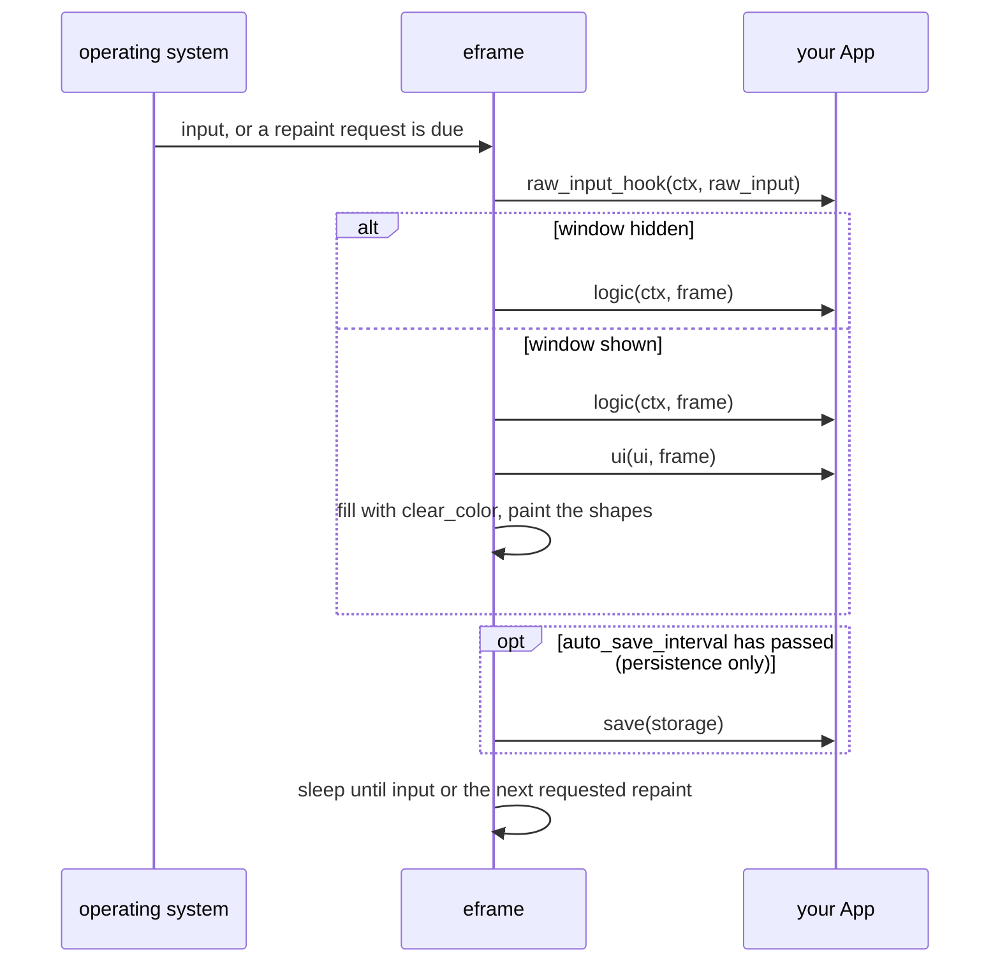
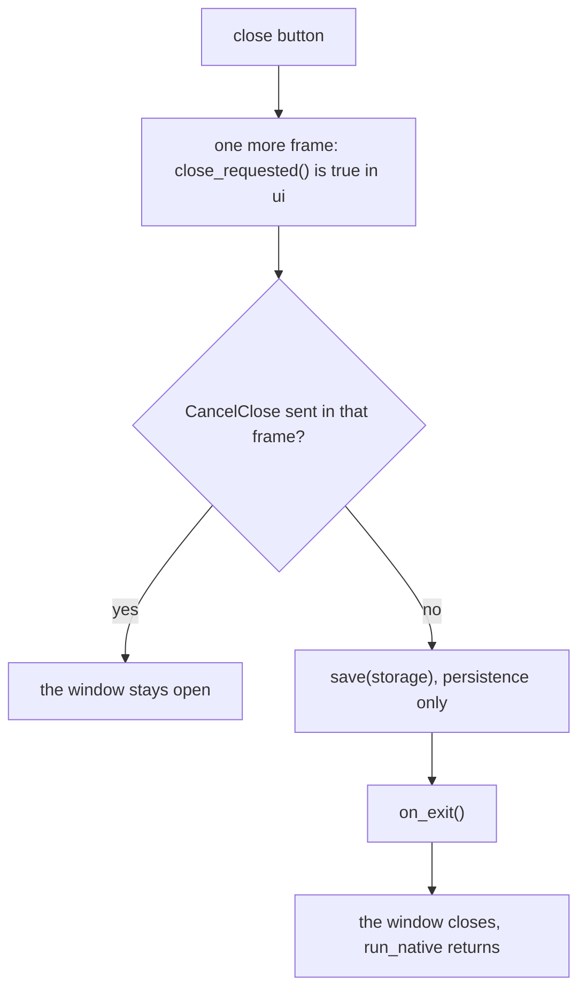
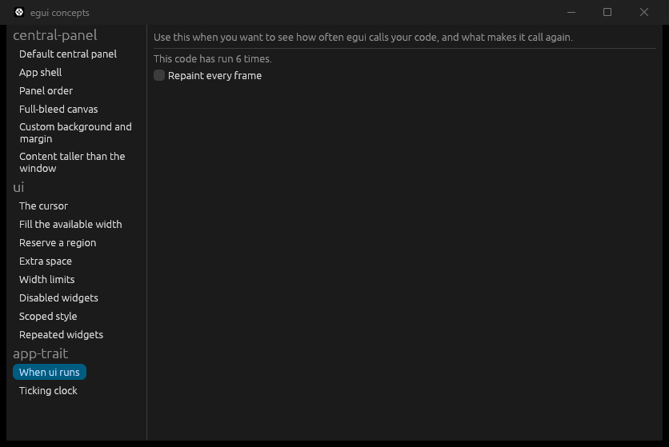
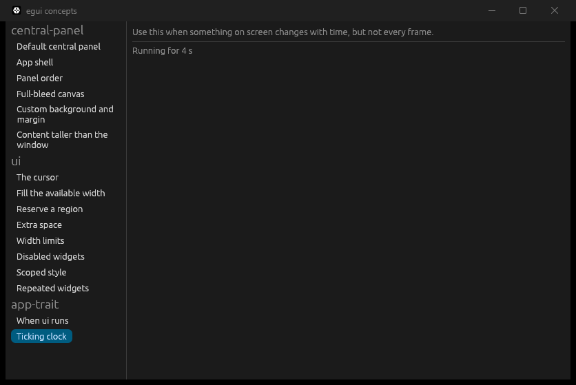
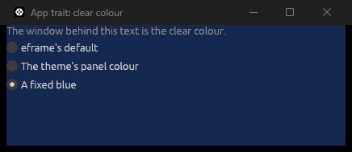
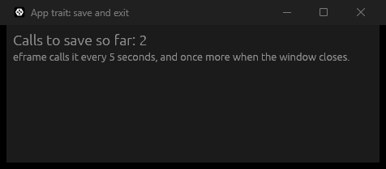

# `eframe::App`

[Back to the tutorial](../chapters/03-hello-world.md)

## In one paragraph

`eframe::App` is the trait your app type implements so eframe can run it. It has one required
method, `ui`, which eframe calls every time the window needs drawing, handing you the root
[`Ui`](ui.md): the whole window, with no margin and no background. You draw the entire UI from
your own state in that call, every time. The other methods all have defaults and are hooks into
the life of the app: `logic` runs before each `ui`, `raw_input_hook` sees the input first,
`save` and `auto_save_interval` decide when your state is written, `persist_egui_memory` whether
egui's own memory is, `clear_color` what is behind the UI, and `on_exit` runs once at the end.
Input, `request_repaint` and `request_repaint_after` make eframe call `ui` again.

## The mental model

Think of `ui` as a function from your state to the screen. eframe calls it, you describe the
whole window from `self`, and eframe paints what you described. Next time, you describe it
again. Nothing you drew is kept: a label is not an object you change later, it is a line of
code that runs again with the new value.

eframe does not call it on a timer. It calls it when something happens: input, a resize, an
egui animation, or code asking for a repaint. Otherwise the app sleeps and uses no CPU. So most
`App` code answers two questions: "what do I draw from this state?" and "who wakes the app when
the state changes without input?".

> **If you come from the web.** `ui` is a render function re-run when something changes, as in
> React: `function App() { ... return <main>...</main>; }`, called again after state changes and
> mounted with `root.render(<App />)`.
>
> Where the comparison breaks:
>
> - **There is no diffing.** React compares the new tree with the old one and changes only the
>   DOM nodes that differ. egui keeps no tree. It lays out and paints everything you describe,
>   every frame. That is cheap because a frame is a list of shapes, not DOM nodes.
> - **There are no hooks.** No `useState`, no `useEffect`, no rules about calling them in the same
>   order. State is plain fields on your struct, and `ui` gets `&mut self`, so it reads and
>   changes them directly.
> - **You own the state, and changing it does not re-render.** `setCount` schedules a render.
>   Assigning `self.count += 1` schedules nothing. In practice the change comes from a click,
>   which was input, so a frame follows anyway; a change from a thread or a timer needs a
>   `request_repaint`.
> - **It re-runs on any input, not only on state changes.** Moving the mouse over the window
>   runs `ui`, even if nothing in your state changed.
>
> Below, wherever the web platform has a real equivalent, the web way (CSS, HTML, JS or React)
> is shown first and the egui way after it.

## How it works

The trait in eframe 0.37:

| Method | Default | When eframe calls it |
|---|---|---|
| `ui(&mut self, ui: &mut egui::Ui, frame: &mut eframe::Frame)` | none: required | Every frame of the root window, with the root `Ui` |
| `logic(&mut self, ctx: &egui::Context, frame: &mut eframe::Frame)` | does nothing | Just before each `ui`, and instead of `ui` while the window is hidden and something asked for a repaint. It may not draw |
| `raw_input_hook(&mut self, ctx: &egui::Context, raw_input: &mut egui::RawInput)` | does nothing | At the start of every frame, before egui sees the input |
| `clear_color(&self, visuals: &egui::Visuals) -> [f32; 4]` | a near-black grey, partly transparent | Every time the window is painted, to fill it before the UI is drawn |
| `save(&mut self, storage: &mut dyn eframe::Storage)` | does nothing | Only with eframe's `persistence` feature: every `auto_save_interval`, and when the app closes |
| `auto_save_interval(&self) -> Duration` | 30 seconds | After each frame, to decide whether `save` is due |
| `persist_egui_memory(&self) -> bool` | `true` | At each save: whether egui's own memory goes into the save file too |
| `on_exit(&mut self)` | does nothing | Once, when the app closes, after the last `save` |

With eframe's `glow` feature, `on_exit` takes an `Option<&glow::Context>` so you can free OpenGL
objects. The web build has one more, `as_any_mut`. The `&mut eframe::Frame` that `ui` and `logic`
get, which most apps ignore, gives `info()`, `storage()`/`storage_mut()` and `winit_window()`.

One frame, in order, is drawn below. While the window is hidden (minimized, say), eframe runs
`logic` only and leaves all UI state where it was. Rarely, egui runs the pass twice in one frame
(when something calls `request_discard` to get a layout right), so `ui` can run twice per frame.

```text
operating system         eframe                                     your App
  input or a repaint  -->  collect RawInput
  request wakes it         raw_input_hook(ctx, &mut raw_input)  -->  may change the input
                           window hidden?
                             yes: logic(ctx, frame) only        -->  work, no drawing
                             no:  logic(ctx, frame)             -->  work, no drawing
                                  ui(ui, frame)                 -->  draw everything from self
                           clear_color(visuals), then paint
                           save timer due? save(storage)        -->  write your state
                           sleep until: input, or now (request_repaint),
                           or the shortest request_repaint_after
```



### Closing

Clicking the window's close button does not close it straight away. eframe runs one more frame
in which `ui.input(|input| input.viewport().close_requested())` is `true`. If your code sends
`ViewportCommand::CancelClose` during that frame, the window stays open. Otherwise eframe calls
`save` one last time (with the `persistence` feature), then `on_exit`, closes the window, and
[`run_native`](run-native.md) returns.

```text
close button
  -> one more frame: close_requested() is true in ui
       CancelClose sent in that frame?  yes -> the window stays open
                                        no  -> save(storage)   (persistence only)
                                               on_exit()
                                               the window closes, run_native returns
```



## Standard usage

Keep `App::ui` to one line that calls your app's own `show(ui)`. `show` takes any `Ui`, so a
test can run the whole app headlessly with `egui_kittest`, which has no `eframe::Frame` to give
it, and the gallery that runs this page's examples can draw them in a region of its window.
Stages 4 to 6 of the tutorial are built this way.

**The JS way:** a component renders from its state, and `root.render` mounts it.

```jsx
function Counter() {
  const [count, setCount] = useState(0);
  return (
    <main>
      <h1>Count: {count}</h1>
      <button onClick={() => setCount(count + 1)}>Add one</button>
    </main>
  );
}

createRoot(document.getElementById("app")).render(<Counter />);
```

**The egui way:** the state is a field, the click is a `bool` you check where the button is
drawn, and nothing is mounted: eframe calls `ui` again at the next input.

```rust
impl CounterApp {
    /// The whole UI. It takes any `Ui`, so it does not know or care whether it is the root of
    /// a window, a region of the gallery, or a test harness.
    fn show(&mut self, ui: &mut egui::Ui) {
        egui::CentralPanel::default().show(ui, |ui| {
            ui.heading(format!("Count: {}", self.count));
            if ui.button("Add one").clicked() {
                self.count += 1;
            }
        });
    }
}

impl eframe::App for CounterApp {
    /// The only required method, kept to one line.
    fn ui(&mut self, ui: &mut egui::Ui, _frame: &mut eframe::Frame) {
        self.show(ui);
    }
}
```

Run: `cargo run -p concepts --example app_trait_thin_ui`

The example's tests drive `show` through `egui_kittest` (`Harness::new_ui_state`), click the
button and check the count. They also check that `show` does not depend on where it is drawn:
its central panel fills the whole window at the root, and exactly the region it is given when
nested.

## Micro-examples

The first two are in [`code/concepts/src/app_trait.rs`](../code/concepts/src/app_trait.rs) and
open in the gallery, whose `App::ui` calls each example's `show(ui)` once per frame;
`code/concepts/tests/app_trait.rs` checks that the root `Ui` is the whole window with no margin
and that an example lays out the same nested as at the root. The rest override trait methods, so
they are whole programs in [`code/concepts/examples/`](../code/concepts/examples/). Run them from
`tutorial/code`.

### When `ui` runs

**Use this when** you want to see how often egui calls your code, and what makes it call again.

**The JS way:** a page that animates asks for every frame itself; a page that does not just
waits for events.

```js
function frame() {
  draw();
  if (animating) requestAnimationFrame(frame);
}
requestAnimationFrame(frame);
```

**The egui way:** the same idea. `request_repaint` asks for one more frame as soon as this one
ends, so calling it every frame is the animation loop.

```rust
impl Demo for FrameCounter {
    fn show(&mut self, ui: &mut egui::Ui) {
        self.frames += 1;
        ui.label(format!("This code has run {} times.", self.frames));
        ui.checkbox(&mut self.repaint_every_frame, "Repaint every frame");
        if self.repaint_every_frame {
            // Ask for another frame as soon as this one is done: an animation loop.
            ui.ctx().request_repaint();
        }
    }
}
```

Run: `cargo run -p concepts -- "When ui runs"`



Taken about five seconds after start-up with the mouse still: six frames in all. Move the mouse
over the window and it climbs; stop and it stops. Tick the checkbox and it climbs at the screen's
refresh rate (with vsync on) even with the mouse still.

### Ticking clock

**Use this when** something on screen changes with time, but not every frame.

**The JS way:** set a timer for the moment the text will change.

```js
const started = performance.now();
function tick() {
  const elapsed = (performance.now() - started) / 1000;
  label.textContent = `Running for ${Math.floor(elapsed)} s`;
  setTimeout(tick, (1 - (elapsed % 1)) * 1000);
}
tick();
```

**The egui way:** ask for a frame at that moment with `request_repaint_after`. There is no
callback: the whole `ui` runs then, and draws the new value.

```rust
impl Demo for TickingClock {
    fn show(&mut self, ui: &mut egui::Ui) {
        // Seconds since the app started, set by eframe at the start of every frame.
        let now = ui.input(|input| input.time);
        let started = *self.started.get_or_insert(now);
        self.elapsed = now - started;
        ui.label(format!("Running for {} s", self.whole_seconds()));

        // Wake up when the number changes, and not before.
        let until_next_second = 1.0 - self.elapsed.fract();
        ui.ctx()
            .request_repaint_after(Duration::from_secs_f64(until_next_second));
    }
}
```

Run: `cargo run -p concepts -- "Ticking clock"`



`ui.input(|input| input.time)` is the time in seconds since the app started, set once per
frame. If several pieces of code ask for a repaint after different delays, the shortest wins,
and any input in between runs a frame earlier. A test checks that the clock, drawn at 2.25
seconds, asks to be woken 0.75 seconds later.

### The clear colour

**Use this when** parts of the window show no panel, or you want a different colour behind the
UI.

**The CSS way:** the root element's background shows wherever nothing is painted on top.

```css
html { background: #142850; }
body { margin: 0; background: transparent; }
```

**The egui way:** `clear_color` returns the colour eframe fills the window with before each
paint. It takes `&self`, so it can depend on your state.

```rust
    /// Read every frame, after `ui`, so a choice made in `ui` shows in the same frame.
    fn clear_color(&self, visuals: &egui::Visuals) -> [f32; 4] {
        let colour = match self.background {
            // What the trait returns if you do not override it.
            Background::EframeDefault => egui::Color32::from_rgba_unmultiplied(12, 12, 12, 180),
            // Follows the theme, like a `CentralPanel` background.
            Background::ThemePanel => visuals.panel_fill,
            Background::Fixed => egui::Color32::from_rgb(20, 40, 80),
        };
        // The renderer takes gamma-space values from 0 to 1.
        colour.to_normalized_gamma_f32()
    }
```

Run: `cargo run -p concepts --example app_trait_clear_color`



The UI draws straight into the root `Ui`, so the clear colour is all there is behind it. Pick
"eframe's default" to see the near-black grey you get when you override nothing. The renderer
takes the four numbers as they are, which is why the colour goes through
`to_normalized_gamma_f32` rather than a conversion to linear `Rgba`. Most apps never override
this: a `CentralPanel` covers the clear colour with the theme's background.

### Asking before closing

**Use this when** closing the window would lose unsaved work.

**The JS way:** cancel the `beforeunload` event, and the browser shows its own dialog.

```js
window.addEventListener("beforeunload", (event) => {
  if (hasUnsavedChanges()) event.preventDefault();
});
```

**The egui way:** answer the close request with `CancelClose` in the same frame, then show your
own dialog. To close for real, send `ViewportCommand::Close`; it comes back next frame as a new
close request.

```rust
        // The close button sets this for one frame. Unless the app answers with
        // `CancelClose` in that same frame, the window closes after it.
        let close_requested = ui.input(|input| input.viewport().close_requested());
        if close_requested && self.has_unsaved_changes() && !self.close_confirmed {
            ui.send_viewport_cmd(egui::ViewportCommand::CancelClose);
            self.asking = true;
        }
```

Run: `cargo run -p concepts --example app_trait_confirm_close`

After that, `show` draws an `egui::Modal` while `self.asking` is set; its "Close without saving"
button sets `close_confirmed` and sends `ViewportCommand::Close`. Type something and close the
window: it stays open and asks. Save first and it closes at once, and the terminal shows the line
`on_exit` prints. The example's tests run a frame with a close request and check that
`CancelClose` is sent only when there are unsaved changes the user has not confirmed losing.

### Filtering input

**Use this when** some input should never reach the UI: a read-only mode, a shortcut you
reserve, or events you inject yourself, such as an on-screen keyboard.

**The JS way:** catch the event before any text box does and cancel it.

```js
window.addEventListener("beforeinput", (event) => {
  if (readOnly) event.preventDefault();
}, { capture: true });
```

**The egui way:** `raw_input_hook` gets the frame's input before egui does, as a list of events
you can edit.

```rust
/// Removes typed text and pasted text, so no text box can change. Keys such as the arrows
/// still arrive, so the cursor can still move.
fn block_text_input(raw_input: &mut egui::RawInput) {
    raw_input
        .events
        .retain(|event| !matches!(event, egui::Event::Text(_) | egui::Event::Paste(_)));
}

impl eframe::App for HookApp {
    fn raw_input_hook(&mut self, _ctx: &egui::Context, raw_input: &mut egui::RawInput) {
        if self.read_only {
            block_text_input(raw_input);
        }
    }
```

Run: `cargo run -p concepts --example app_trait_input_hook`

Tick the checkbox and the text box no longer changes when you type or paste, while the arrow keys
still move the cursor and the mouse still works: only `Event::Text` and `Event::Paste` are
removed. The hook runs before every frame, the hidden-window ones included. Keep the filter in a
plain function, as here, and a test can feed it a `RawInput` and check what is left.

### Saving on a timer, and on exit

**Use this when** your state must survive a crash or a forced shutdown, not only a normal close.

**The JS way:** save on an interval, and once more when the page goes away.

```js
setInterval(() => localStorage.setItem("state", JSON.stringify(state)), 5000);
window.addEventListener("pagehide", () => {
  localStorage.setItem("state", JSON.stringify(state));
});
```

**The egui way:** set the interval with `auto_save_interval`. eframe calls `save` on that timer
and again on close, then `on_exit`.

```rust
    /// How often eframe calls `save` while the app runs. The default is 30 seconds.
    fn auto_save_interval(&self) -> Duration {
        Duration::from_secs(5)
    }

    /// Called on the timer and when the window closes. Write your state here.
    fn save(&mut self, storage: &mut dyn eframe::Storage) {
        self.saves += 1;
        storage.set_string(SAVES_KEY, self.saves.to_string());
        eprintln!("save: call number {}", self.saves);
    }

    /// Leave egui's memory (scroll positions, collapsed headers, the theme choice) out of the
    /// save file. The window position and size are still saved.
    fn persist_egui_memory(&self) -> bool {
        false
    }

    /// Called once, after the last `save`.
    fn on_exit(&mut self) {
        eprintln!("on_exit: after {} saves", self.saves);
    }
}
```

Run: `cargo run -p concepts --example app_trait_save_and_exit --features persistence`



Run for twelve seconds and close it, and the terminal shows:

```text
save: call number 1
save: call number 2
save: call number 3
on_exit: after 3 saves
```

Two saves on the timer, one on close, then `on_exit`. eframe checks the timer only after a
frame, so an idle app saves at its next frame after the interval; this example asks for a frame
every second to keep it on time. Because `persist_egui_memory` returns `false`, the save file
holds your key and the window's position and size, but no `egui` entry. Without the
`persistence` feature `save` is never called, and `on_exit` still is. Each run creates
`%APPDATA%\egui-concepts-save-and-exit`; delete it when you are done.

## Best practices

- **Keep `App::ui` to one line.** Forward to `show(&mut self, ui: &mut egui::Ui)` on your app
  type, so tests and other hosts can draw it without an `eframe::Frame`.
- **Draw from state, change state in response.** `ui` describes the window from `self` and reacts
  to the `Response`s it gets back. Keep work that is not drawing (draining a channel, advancing a
  simulation) at the top of `ui` or in `logic`.
- **Ask for exactly the repaints you need:** `request_repaint` when a thread's result arrives,
  `request_repaint_after` for anything timed.
- **Keep `ui` fast.** It runs on the UI thread, often many times a second: slow work goes on a
  thread.

## Common mistakes

**Implementing `update`.** Older examples implement
`fn update(&mut self, ctx: &egui::Context, frame: &mut eframe::Frame)`. In 0.37 that method does
not exist and `ui` is required. Move the body into `ui` and show panels with `.show(ui, ..)`;
the [migration table](../chapters/10-pitfalls.md#coming-from-an-older-egui-version) has the rest.

**A value that only updates when the mouse moves.** A thread or a timer changed the state, but
nothing asked for a frame. Call `request_repaint` on a clone of the context when the value
changes, or `request_repaint_after` for a clock. See
[pitfall 3](../chapters/10-pitfalls.md#pitfall-3-assuming-ui-runs-continuously-or-blocking-inside-it).

**Calling `request_repaint` every frame unconditionally.** The app redraws at the refresh rate
forever, and the CPU and GPU never rest. Ask only while something is moving.

**Counting calls to `ui` as events.** `ui` runs on every mouse move and can run twice in one
frame. Count clicks with `Response::clicked`, not with calls.

## See also

- [Hello World](../chapters/03-hello-world.md), where `impl eframe::App` first appears.
- [Stage 4: persistence](../chapters/07-stage-4-persistence.md#persistence-in-the-app), which
  forwards `ui` to `show` and saves the todo list in `App::save`, and
  [Testing the UI](../chapters/07-stage-4-persistence.md#testing-the-ui), which drives `show`
  with `egui_kittest`.
- [`run_native`](run-native.md), which builds your app in the creator and calls these methods,
  and [`NativeOptions`](native-options.md#saving-the-window-and-your-state), for the save file.
- [`Ui`](ui.md), the root region, and [`CentralPanel`](central-panel.md), its margin and background.
- docs.rs: [`App`](https://docs.rs/eframe/0.37.0/eframe/trait.App.html),
  [`Frame`](https://docs.rs/eframe/0.37.0/eframe/struct.Frame.html),
  [`Context::request_repaint`](https://docs.rs/egui/0.37.0/egui/struct.Context.html#method.request_repaint),
  [`ViewportCommand`](https://docs.rs/egui/0.37.0/egui/viewport/enum.ViewportCommand.html).
