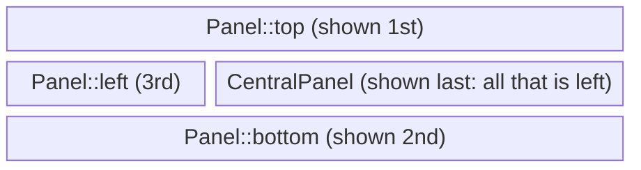
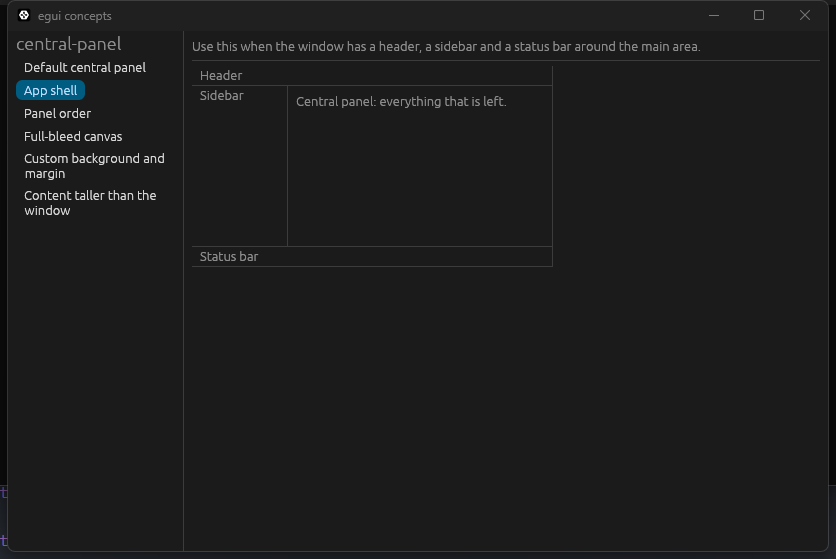
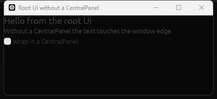

# `CentralPanel`

[Back to the tutorial](../chapters/03-hello-world.md)

## In one paragraph

`CentralPanel` is the region that takes whatever space is left in a `Ui` once the other
panels have taken theirs. You meet it in the first lines of almost every egui app, because
the root `Ui` that eframe hands to `App::ui` is bare: it covers the whole window but paints
no background and keeps no margin from the edges. Wrapping your content in
`CentralPanel::default().show(ui, ..)` gives it both, and in an app with a header or a
sidebar, it is the main area that fills the rest.

## The mental model

Think of the window as a sheet of paper that you cut strips from. Each `Panel` you show cuts
a strip off one edge of what is left: `Panel::top` off the top, `Panel::left` off the left,
and so on. `CentralPanel` takes everything that remains. Nothing is negotiated afterwards:
whoever is declared first cuts first, and the central panel has to come last because it
leaves nothing behind.

The second half of the model is the frame. A `CentralPanel` is that rectangle plus a
`Frame`, and the frame decides what it looks like: a background colour and an inner margin by
default, nothing at all if you ask for none.

> **If you come from the web.** The root `Ui` is a `<body>` with no padding and no
> background. The usual layout of a header, a sidebar and a main area is like a flexbox
> page where the header and sidebar have fixed sizes and the main region has `flex: 1`.
> `CentralPanel` is that `flex: 1` region with its own padding and background.
>
> Where the comparison breaks:
>
> - **There is no cascade.** Nothing inherits padding or a background from a parent. Each
>   panel draws its own frame, built from the current style when it is shown.
> - **The order of the calls is the layout.** In CSS grid, `grid-template-areas` places
>   regions whatever their order in the HTML. In egui, the panel shown first takes its strip
>   first. Show the central panel first and it takes the whole window.
> - **Overflow is hidden, not scrolled.** Content taller than the panel is clipped, like
>   `overflow: hidden`. If you want scrolling, put a `ScrollArea` inside.
>
> Below, wherever the web has an equivalent, the web way (CSS, HTML or JS) is shown first and
> the egui way after it.

## How it works

Every frame, eframe gives `App::ui` the root `Ui`, sized to the window. Then, in the order
your code runs:

1. **Each `Panel` takes a strip.** It reads what is still available in the `Ui`, sizes itself
   against that, draws, and moves the `Ui`'s cursor so its strip is no longer available.
2. **`CentralPanel::show` takes the rest.** It reads the same "what is still available"
   rectangle, and makes a child `Ui` covering exactly that, with a top-to-bottom,
   left-aligned layout whatever the parent's layout is. The child is clipped to the
   rectangle.
3. **It draws its frame.** With no frame chosen, it uses `Frame::central_panel(style)`: an
   8-point inner margin and the theme's `panel_fill` colour. The frame is stretched to the
   whole rectangle even when the content is small, so the background always fills the area.
4. **It runs your closure** inside the frame, and returns an `InnerResponse` holding the
   closure's return value and the panel's `Response`.
5. **It moves the cursor past itself.** Nothing is left for anything shown after it.

For the app shell below, that order produces this:

```text
+-----------------------------------------+
| Panel::top          (shown 1st)         |
+-----------+-----------------------------+
| Panel::   | CentralPanel                |
| left      | (shown last: all that is    |
| (3rd)     |  left)                      |
+-----------+-----------------------------+
| Panel::bottom       (shown 2nd)         |
+-----------------------------------------+
```



Three consequences follow, and each is behind a common surprise:

- **Anything shown in the same `Ui` after the central panel is placed below it,** outside the
  window, where it is not drawn. That includes a second `CentralPanel`.
- **It stores nothing between frames.** Unlike a `Panel`, it takes no id and remembers no
  size. It is recomputed from what is left every frame, which is why it follows the window
  as it is resized.
- **It works in any `Ui`, not only the root.** "What is left" is a property of whichever
  `Ui` you pass in, so a `CentralPanel` inside a child `Ui` fills that child. The gallery
  that runs these examples relies on this.

Windows (`egui::Window`) and other floating areas are drawn above the root `Ui`, so they
cover the central panel rather than taking space from it.

## Standard usage

Most desktop apps have the shape below: panels around the edges first, the central panel
last. Stage 3 of the tutorial builds this shape for the todo app.

**The CSS way:** a grid. The template says where each region goes, and `1fr` gives the main
area whatever is left.

```html
<body class="app">
  <header>Header</header>
  <nav>Sidebar</nav>
  <main>Central panel: everything that is left.</main>
  <footer>Status bar</footer>
</body>
```

```css
.app {
  display: grid;
  grid-template-areas:
    "header header"
    "nav    main"
    "footer footer";
  grid-template-columns: 110px 1fr; /* fixed sidebar, main takes the rest */
  grid-template-rows: auto 1fr auto;
  height: 100vh;
  margin: 0;
}
header { grid-area: header; }
nav    { grid-area: nav; }
main   { grid-area: main; padding: 8px; }
footer { grid-area: footer; }
```

**The egui way:** no template. Each call takes its strip in turn, and the central panel,
called last, is the `1fr`.

```rust
/// The shape of most desktop apps. Every `Panel` takes a strip off the edge of what is left;
/// the central panel, declared last, gets the rest.
fn app_shell(ui: &mut egui::Ui) {
    egui::Panel::top("header").show(ui, |ui| {
        ui.label("Header");
    });
    egui::Panel::bottom("status_bar").show(ui, |ui| {
        ui.label("Status bar");
    });
    egui::Panel::left("sidebar")
        .default_size(110.0)
        .show(ui, |ui| {
            ui.label("Sidebar");
        });
    egui::CentralPanel::default().show(ui, |ui| {
        ui.label("Central panel: everything that is left.");
    });
}
```



The panels share the same background colour (`panel_fill`), so the separator lines are what
show the edges. In a smaller app, the Hello World form is all you need: one
`CentralPanel` with nothing around it.

## Micro-examples

Every example is real code from
[`code/concepts/src/central_panel.rs`](../code/concepts/src/central_panel.rs). The command
under each one, run from `tutorial/code`, opens the concepts gallery at it. The gallery draws
each example in a bordered box that stands in for a window. Panels divide whatever `Ui` they
are given, so the shapes in the box are the ones a real window of that size would show (a test
in `code/concepts/tests/central_panel.rs` checks this). The exception, the root `Ui` with no
panel at all, is a program of its own at the end.

### Default central panel

**Use this when** the main content should fill whatever space the other panels leave.

**The CSS way:**

```css
main {
  flex: 1;                         /* take the space the siblings leave */
  padding: 8px;
  background: var(--panel-fill);   /* a theme colour, not a fixed one */
  overflow: hidden;                /* egui clips; it does not scroll */
}
```

**The egui way:**

```rust
/// The Hello World form: one central panel, nothing else.
fn default_panel(ui: &mut egui::Ui) {
    egui::CentralPanel::default().show(ui, |ui| {
        ui.heading("Central panel");
        ui.label("It fills the space left over and adds a margin and a background.");
    });
}
```

Run: `cargo run -p concepts -- "Default central panel"`

`CentralPanel::default()` and `CentralPanel::default_margins()` are the same thing: no frame
chosen, so the default one is built from the current style each frame. That is why it
changes colour when the theme changes.

### Panel order

**Use this when** deciding which panel gets the corners, or when a panel has vanished.

**The CSS way:** the template decides who gets the corner. The order of the elements in the
HTML does not matter.

```css
/* Header the full width, sidebar below it */
.app { grid-template-areas: "header header"
                            "nav    main"; }

/* Sidebar the full height, header to its right */
.app { grid-template-areas: "nav header"
                            "nav main"; }
```

**The egui way:** the order of the calls decides. Whoever is called first runs the full
length of its edge.

```rust
/// The panel declared first is the outermost, so it runs the full length of its edge.
fn panels_in_order(ui: &mut egui::Ui, first: First) {
    let header = |ui: &mut egui::Ui| {
        egui::Panel::top("header").show(ui, |ui| {
            ui.label("Header");
        });
    };
    let sidebar = |ui: &mut egui::Ui| {
        egui::Panel::left("sidebar")
            .default_size(110.0)
            .show(ui, |ui| {
                ui.label("Sidebar");
            });
    };
    let central = |ui: &mut egui::Ui| {
        egui::CentralPanel::default().show(ui, |ui| {
            ui.label("Central panel");
        });
    };
    match first {
        First::Header => {
            header(ui);
            sidebar(ui);
            central(ui);
        }
        First::Sidebar => {
            sidebar(ui);
            header(ui);
            central(ui);
        }
        // Wrong: the central panel takes everything, and the two panels after it get no space.
        First::CentralPanel => {
            central(ui);
            header(ui);
            sidebar(ui);
        }
    }
}
```

Run: `cargo run -p concepts -- "Panel order"`

Pick each order with the radio buttons. With the header first it runs the full width and the
sidebar starts below it. With the sidebar first it runs the full height and the header sits
to its right. With the central panel first, the header and sidebar disappear: they were
placed below the window.

### Full-bleed canvas

**Use this when** you paint the whole area yourself: a canvas, a map, an image viewer.

**The CSS way:**

```css
main { padding: 0; background: none; }
main canvas { display: block; width: 100%; height: 100%; }
```

**The egui way:** there is no separate canvas element. You paint into the panel's own area.

```rust
/// No frame means no margin and no background: the painting reaches every edge.
fn full_bleed_canvas(ui: &mut egui::Ui) {
    egui::CentralPanel::no_frame().show(ui, |ui| {
        let rect = ui.max_rect();
        let painter = ui.painter();
        painter.rect_filled(rect, 0.0, ui.visuals().extreme_bg_color);
        let grid_stroke = ui.visuals().widgets.noninteractive.bg_stroke;
        let spacing = 20.0;
        let mut x = rect.left();
        while x < rect.right() {
            painter.vline(x, rect.y_range(), grid_stroke);
            x += spacing;
        }
        let mut y = rect.top();
        while y < rect.bottom() {
            painter.hline(rect.x_range(), y, grid_stroke);
            y += spacing;
        }
        ui.label("The grid starts at the very edge.");
    });
}
```

Run: `cargo run -p concepts -- "Full-bleed canvas"`

`CentralPanel::no_frame()` is shorthand for `.frame(egui::Frame::NONE)`: no margin, no
fill, no border. Because there is no background either, paint one yourself, or the clear
colour of the window shows through. Inside the panel, `ui.max_rect()` is the whole area.

### Custom background and margin

**Use this when** the main area needs its own colour or more room around the content.

**The CSS way:** override two properties. Everything else keeps its value from the cascade.

```css
main {
  background: var(--surface-sunken);
  padding: 24px;
}
```

**The egui way:** there is no cascade to keep the rest, so start from the default frame and
change the same two things.

```rust
/// Start from the default frame and change only what you need, so the rest still follows the
/// theme.
fn custom_frame(ui: &mut egui::Ui) {
    let frame = egui::Frame::central_panel(ui.style())
        .fill(ui.visuals().extreme_bg_color)
        .inner_margin(24);
    egui::CentralPanel::default().frame(frame).show(ui, |ui| {
        ui.heading("Document");
        ui.label("A different background, and a 24-point margin instead of 8.");
    });
}
```

Run: `cargo run -p concepts -- "Custom background and margin"`

`.frame(..)` replaces the whole frame, so build the new one from `Frame::central_panel` and
change only what you need. Taking the colour from `ui.visuals()` rather than a fixed
`Color32` keeps it right in both light and dark themes.

### Content taller than the window

**Use this when** the content can be longer than the space the panel gets.

**The CSS way:** scrolling is a property of the region.

```css
main { overflow-y: auto; }
```

**The egui way:** scrolling is a container you put inside the region.

```rust
/// A central panel clips what does not fit. A `ScrollArea` inside it makes the rest reachable.
fn scrolling_content(ui: &mut egui::Ui) {
    egui::CentralPanel::default().show(ui, |ui| {
        egui::ScrollArea::vertical()
            // Fill the panel, so the scroll bar sits at its right edge rather than next to
            // the text.
            .auto_shrink(false)
            .show(ui, |ui| {
                for line in 1..=40 {
                    ui.label(format!("Line {line}"));
                }
            });
    });
}
```

Run: `cargo run -p concepts -- "Content taller than the window"`

Without the `ScrollArea`, lines past the bottom are not drawn and cannot be reached. A scroll
area shrinks to fit its content by default, which is why `auto_shrink(false)` is there.

### Root `Ui` without a `CentralPanel`

**Use this when** you want to see what the central panel adds, or you are wondering why text
touches the window edge.

This one is a whole program,
[`code/concepts/examples/central_panel_root.rs`](../code/concepts/examples/central_panel_root.rs),
because the difference only shows at the root of a real window. Inside the gallery, the
gallery's own central panel has already painted a background behind every example.

**The CSS way:** browsers give `<body>` an 8px margin by default. The root `Ui` is the body
with that reset and no background at all:

```css
body { margin: 0; background: transparent; }
```

**The egui way:** the `CentralPanel` is what puts the margin and the background back.

```rust
impl eframe::App for RootDemo {
    fn ui(&mut self, ui: &mut egui::Ui, _frame: &mut eframe::Frame) {
        if self.use_central_panel {
            egui::CentralPanel::default().show(ui, |ui| self.contents(ui));
        } else {
            // Straight into the root `Ui`: no margin, and no background behind the text.
            self.contents(ui);
        }
    }
}
```

Run: `cargo run -p concepts --example central_panel_root`



The text starts at the very edge, and behind it is the colour eframe clears the window to
before drawing (`App::clear_color`). By default that is a near-black grey whatever the theme,
so in the light theme, which the program switches on, you get dark text on a dark window.
Tick the checkbox to wrap the same content in a `CentralPanel`.

## Best practices

- **One `CentralPanel` per `Ui`, shown last.** Declare all the panels of a `Ui` together at
  the top of the function, in the order you want them to take space, and keep their contents
  in separate methods. Stage 3's `App::ui` reads as a plan of the window for this reason.
- **Take colours from `ui.visuals()`.** A colour from the style follows the theme; a fixed
  `Color32` looks right in one theme only.
- **Use `no_frame()` for anything you paint edge to edge**, and paint your own background.
- **Use a `Window` for things that should float**, such as a settings dialog. It sits above
  the central panel and takes no space from it.

## Common mistakes

**Showing the central panel before another panel.** The later panel is laid out below the
window and never appears, and nothing warns you. Move the `CentralPanel` call to the end.

**Code written for older egui.** Older examples show panels with a `Context`:
`CentralPanel::default().show(ctx, ..)`. In 0.37 `show` takes the `&mut Ui` that `App::ui`
receives. `show_inside` still exists but is deprecated: it was renamed to `show`.
`TopBottomPanel` and `SidePanel` are gone; use `Panel::top`, `Panel::bottom`, `Panel::left`
and `Panel::right`. The tutorial's [migration table](../chapters/10-pitfalls.md#coming-from-an-older-egui-version)
lists the other changes.

**Expecting the panel to scroll.** It clips. Content past the bottom is not drawn and cannot
be reached. Put a `ScrollArea` inside.

**Replacing the frame to change one thing.** `.frame(egui::Frame::NONE.fill(colour))` gives
the colour but drops the 8-point margin, so the content touches the edges. Start from
`Frame::central_panel(ui.style())` instead.

**Using two central panels to split the area.** The second one gets nothing. Give the second
region a `Panel` of its own, or split inside the one central panel with `ui.columns`.

**Drawing straight into the root `Ui`.** Everything works, but the content touches the window
edge and sits on the window's clear colour instead of the theme's background.

## See also

- [Hello World](../chapters/03-hello-world.md), where `CentralPanel` first appears.
- [Stage 3: a full application shell](../chapters/06-stage-3-app-shell.md), which
  combines a menu bar, a status bar, a collapsible sidebar and the central panel.
- docs.rs: [`CentralPanel`](https://docs.rs/egui/0.37.0/egui/containers/panel/struct.CentralPanel.html),
  [`Panel`](https://docs.rs/egui/0.37.0/egui/containers/panel/struct.Panel.html),
  [`Frame`](https://docs.rs/egui/0.37.0/egui/containers/frame/struct.Frame.html).
