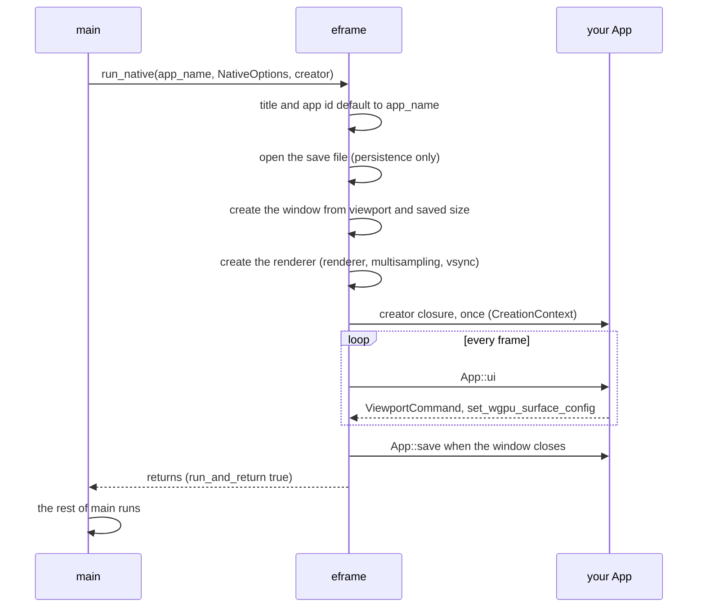
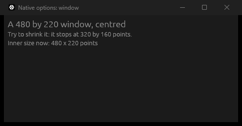
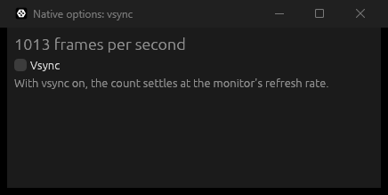
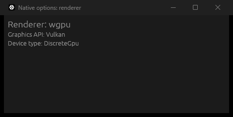
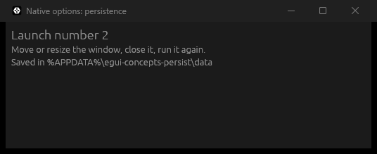

# `NativeOptions`

[Back to the tutorial](../chapters/03-hello-world.md)

## In one paragraph

`NativeOptions` is the set of start-up settings you hand to `eframe::run_native` in `main`.
Its `viewport` field describes the window: title, size, minimum size, icon and the like. The
other fields describe what eframe builds around the window: which renderer draws it, whether
it waits for the display's refresh (vsync), whether it opens centred, whether it remembers
its position and size between runs, and what happens to `main` when the window closes.
eframe reads it once, while it creates the window. After that, changes go through other
channels: `ViewportCommand` for the window, `Frame` for vsync.

## The mental model

Think of `NativeOptions` as the order form for a window, filled in before anything exists.
eframe takes the form, opens the save file (if persistence is on), builds the window from the
`viewport` part and any saved position and size, sets up the renderer, and then calls your
creator closure once. From then on the form is not read again. Editing it later does
nothing, because eframe has already used it.

So every setting has a start-up value, which goes in `NativeOptions`, and some also have a
way to change it while the app runs. The window's own properties (title, size, position,
decorations) all do, through `ViewportCommand`. The renderer, multisampling and the depth
buffer do not: they are fixed when the renderer is created.

`ViewportBuilder` is the window part of the form, and it is not specific to `main`. The same
type describes every extra native window you open later with `ctx.show_viewport_deferred`
or `ctx.show_viewport_immediate`. `NativeOptions` holds the one for the first window, the
root viewport, and adds the settings that belong to the whole program.

> **If you come from the web.** The closest thing is the third argument of `window.open`, the
> feature string such as `"width=600,height=400"`, together with `<title>` and `localStorage`:
> what the window looks like when it opens, what it is called, and where its saved state
> lives.
>
> Where the comparison breaks:
>
> - **A page does not own its window.** The browser does, and the user can resize, zoom or
>   close it whatever the page wants. `NativeOptions` describes the program's own window.
> - **`window.open` features are requests.** The browser may ignore them, and many open a tab
>   instead of a sized window. eframe passes the settings to the operating system and they
>   take effect, within its limits.
> - **The storage is different.** `localStorage` is per origin and each `setItem` is stored at
>   once. eframe's storage is per app id, and is written when eframe calls `App::save`: when
>   the window closes and every 30 seconds.
> - **A page does not choose how it is drawn.** The browser renders the HTML and CSS. eframe
>   draws everything itself, so `NativeOptions` picks the renderer and its settings.
>
> Below, wherever the browser has a real equivalent, the web way (CSS, HTML or JS) is shown
> first and the egui way after it. Most settings have none.

## How it works

`run_native(app_name, native_options, creator)` blocks until the window closes. Inside it,
in order:

1. **Fill in the gaps from the app name.** If `viewport` has no title, the app name becomes
   the title. If it has no app id, the app name becomes the app id.
2. **Open the save file** (only with eframe's `persistence` feature). The folder is named
   after the app id, so in practice after `app_name`. On Windows it is
   `%APPDATA%\<app id>\data\app.ron`; `persistence_path` overrides it.
3. **Create the window.** Start from `viewport`. If a saved position and size exist, they
   replace the ones in `viewport`. If `centered` is true, place the window in the middle of
   the primary monitor (using an 800 by 600 size when none is set). The window starts hidden
   until the first frame is drawn, to avoid a white flash.
4. **Create the renderer**, the one `renderer` names, with the `multisampling`,
   `depth_buffer` and `stencil_buffer` settings, and with wgpu, the present mode (vsync) from
   `wgpu_options.surface`.
5. **Call the creator closure once.** It gets a `CreationContext`: the egui context, the
   storage, the wgpu render state. It returns your app.
6. **Run frames.** Each frame calls `App::ui`. A `ViewportCommand` sent in there changes the
   window; `frame.set_wgpu_surface_config` changes vsync before the next paint.
7. **When the window closes, save.** eframe calls `App::save` (also every 30 seconds while
   running). In the same file it stores the window's position and size (if
   `persist_window`) and egui's own memory (unless `App::persist_egui_memory` says no).
8. **Return or exit.** With `run_and_return: true`, the default, `run_native` returns and
   `main` goes on. With `false`, eframe saves and ends the process there.

```text
main
 |  build NativeOptions
 |  run_native(app_name, native_options, creator)
 |     eframe: title and app id default to app_name
 |     eframe: open the save file under the app id       (persistence feature only)
 |     eframe: create the window from viewport + saved position and size
 |     eframe: create the renderer (renderer, multisampling, depth, vsync)
 |     eframe -> creator closure, once                   (CreationContext)
 |     every frame: eframe -> App::ui
 |                  App::ui -> ViewportCommand, frame.set_wgpu_surface_config
 |     window closes: eframe -> App::save, window position and size saved
 |  run_native returns                                   (run_and_return: true)
 |  the rest of main runs
```



### The fields that matter

With eframe's default cargo features (wgpu, no glow), `NativeOptions::default()` gives:

| Field | Default | What it controls |
|---|---|---|
| `viewport` | nothing set | The window: title, size, position, icon, decorations and so on (`ViewportBuilder`) |
| `renderer` | `Renderer::Wgpu` | Which renderer draws. `Renderer::Glow` exists only with eframe's `glow` feature |
| `wgpu_options.surface` | `present_mode: AutoVsync`, frame latency 1 | Vsync and how many frames may queue up, for wgpu |
| `multisampling` | `0` (off) | MSAA level, a power of two. For your own 3D; egui already smooths its edges |
| `depth_buffer`, `stencil_buffer` | `0` | Bits per pixel. egui needs neither; they are for your own 3D |
| `centered` | `false` | Open in the middle of the primary monitor (not on Wayland) |
| `persist_window` | `true` | Save the window's position and size (with the `persistence` feature) |
| `persistence_path` | `None` | Where to save, instead of the default folder for the app id |
| `run_and_return` | `true` | Whether `run_native` returns when the window closes, or ends the process |

Smaller ones: `dithering` (on), `clipboard_shortcuts` (on: Ctrl+C, X and V become copy, cut
and paste events), `system_font_fallback` (on), and two hooks, `event_loop_builder` and
`window_builder`, for platform-specific changes. Cloning `NativeOptions` drops the hooks.
There is no `vsync` field: with wgpu it is the present mode above, with glow
`glow_options.vsync`.

### Where a setting goes

| You want to set | Start-up value | Changed while running with |
|---|---|---|
| Title, size, minimum size, position, icon, decorations, always on top | `viewport` (`ViewportBuilder`) | `ViewportCommand`, sent with `ctx.send_viewport_cmd` |
| Open centred | `centered` | `ViewportCommand::OuterPosition` |
| Vsync (wgpu) | `wgpu_options.surface.present_mode` | `frame.set_wgpu_surface_config` |
| Renderer, multisampling, depth and stencil buffers | `renderer`, `multisampling`, `depth_buffer`, `stencil_buffer` | Not at all: fixed when the renderer is created |
| Saving the window, the save folder | `persist_window`, `persistence_path`, the app name | Not at all |
| What happens to `main` on close | `run_and_return` | Not at all |

## Standard usage

Most apps set a title, a starting size and a minimum size, and leave the rest at the
defaults. Stage 4 of the tutorial starts like this, with a fixed app name for its save
folder and the title set separately.

**The JS way:** a page cannot choose its own window size. It sets the title in `<title>`;
only a script that opens a *new* window can ask for a size, and the browser may ignore it.
There is no minimum size and no "centred".

```html
<title>Native options: window</title>
```

```js
window.open("app.html", "_blank", "width=480,height=220");
```

**The egui way:** the program owns its window, so the size it asks for is the size it gets,
and the minimum is enforced.

```rust
/// The usual start of `main`: what the window looks like, then where it opens.
fn main() -> eframe::Result {
    let native_options = eframe::NativeOptions {
        // Everything about the window itself goes in the `ViewportBuilder`.
        viewport: egui::ViewportBuilder::default()
            .with_title("Native options: window")
            .with_inner_size([480.0, 220.0])
            .with_min_inner_size([320.0, 160.0]),
        // Open in the middle of the primary monitor instead of where the OS puts it.
        centered: true,
        // Everything else keeps eframe's defaults.
        ..Default::default()
    };
    eframe::run_native(
        "egui-concepts-window",
        native_options,
        Box::new(|_creation_context| Ok(Box::new(WindowDemo))),
    )
}
```

Run: `cargo run -p concepts --example native_options_window`



Sizes are in points, not physical pixels, so the window is the same apparent size on a
high-DPI screen. The first argument of `run_native` is the app name. Here it only fills in
the app id, because the title is set; with persistence on, it would also name the save
folder.

## Micro-examples

Every example on this page is a whole program in
[`code/concepts/examples/`](../code/concepts/examples/), because each one is about `main` or
the window itself, which the gallery cannot show. Run them from `tutorial/code` with the
command under each.

### Vsync on and off

**Use this when** an app redraws all the time (an animation, a game, a live chart) and you
need to decide between a steady frame rate and the lowest latency.

**The JS way:** a browser always paces animation frames to the display. You can count them,
but you cannot turn the pacing off.

```js
let frames = 0;
function tick() { frames++; requestAnimationFrame(tick); }
requestAnimationFrame(tick);
setInterval(() => { console.log(frames, "frames per second"); frames = 0; }, 1000);
```

**The egui way:** vsync is a renderer setting. Its start-up value is in `NativeOptions`:

```rust
/// Vsync lives in the renderer's options, not in the `ViewportBuilder`.
fn main() -> eframe::Result {
    let mut native_options = eframe::NativeOptions {
        viewport: egui::ViewportBuilder::default()
            .with_title("Native options: vsync")
            .with_inner_size([420.0, 180.0]),
        ..Default::default()
    };
    // Start without vsync. The default is `AutoVsync`.
    native_options.wgpu_options.surface.present_mode = PresentMode::AutoNoVsync;
```

and the app can change it while running, through `Frame`:

```rust
            if let Some(mut surface) = frame.wgpu_surface_config() {
                let mut vsync = surface.present_mode == PresentMode::AutoVsync;
                if ui.checkbox(&mut vsync, "Vsync").changed() {
                    surface.present_mode = if vsync {
                        PresentMode::AutoVsync
                    } else {
                        PresentMode::AutoNoVsync
                    };
                    // Takes effect before the next paint; no restart needed.
                    frame.set_wgpu_surface_config(surface);
                }
            }
```

Run: `cargo run -p concepts --example native_options_vsync`



The example starts with vsync off and repaints continuously, so the count is as high as the
machine allows (about a thousand here). Tick the box and it drops to the monitor's refresh
rate. `AutoVsync` and `AutoNoVsync` pick the best mode the display supports and fall back to
plain vsync, so both work everywhere. An app that only repaints on input, as most egui apps
do, gains nothing from turning vsync off.

### Renderer and graphics adapter

**Use this when** you need to know what is drawing your window, for a bug report, or because
you draw your own 3D with the GPU.

```rust
/// Choosing the renderer, and the settings that only matter if you draw 3D yourself.
fn main() -> eframe::Result {
    let native_options = eframe::NativeOptions {
        viewport: egui::ViewportBuilder::default()
            .with_title("Native options: renderer")
            .with_inner_size([460.0, 200.0]),
        // The default already; spelled out because it is the point of this example.
        renderer: eframe::Renderer::Wgpu,
        // egui needs neither of these. They are for your own 3D drawing.
        multisampling: 0,
        depth_buffer: 0,
        ..Default::default()
    };
    eframe::run_native(
        "egui-concepts-renderer",
        native_options,
        Box::new(|creation_context| {
            // The render state exists by the time the creator closure runs.
            let adapter = creation_context
                .wgpu_render_state
                .as_ref()
                .map(|render_state| render_state.adapter.get_info());
            Ok(Box::new(RendererDemo { adapter }))
        }),
    )
}
```

Run: `cargo run -p concepts --example native_options_renderer`



With eframe's default features only wgpu is compiled in, so `Renderer::Wgpu` is the only
value there is. To offer glow as well, turn on eframe's `glow` feature; with both compiled in,
the default is wgpu. `multisampling` and `depth_buffer` are shown at their defaults: egui
smooths its own edges ("feathering") and has no depth, so these only matter when you add
your own 3D through a paint callback. The graphics API and device type in the screenshot
are what wgpu chose on the machine that took it; yours may differ. `AdapterInfo` also has
the GPU's model name in `name`, useful in a bug report; the example leaves it out.

### Changing the window after start-up

**Use this when** the window's title or size should change while the app runs: the open
file's name in the title, a compact mode.

**The JS way:** a page can change its title at any time. It can resize only a window that a
script of its own opened.

```js
document.title = "Title changed 1 times";
popup.resizeTo(640, 320); // popup = the window returned by window.open
```

**The egui way:** send a `ViewportCommand`. `NativeOptions` is not read again after start-up.

```rust
    /// Changing the window while the app runs.
    fn ui(&mut self, ui: &mut egui::Ui, _frame: &mut eframe::Frame) {
        egui::CentralPanel::default().show(ui, |ui| {
            ui.label("The title and size of this window were set at start-up.");
            if ui.button("Change the title").clicked() {
                self.clicks += 1;
                let title = format!("Title changed {} times", self.clicks);
                ui.ctx()
                    .send_viewport_cmd(egui::ViewportCommand::Title(title));
            }
            ui.horizontal(|ui| {
                if ui.button("Small").clicked() {
                    ui.ctx()
                        .send_viewport_cmd(egui::ViewportCommand::InnerSize(egui::vec2(
                            360.0, 160.0,
                        )));
                }
                if ui.button("Large").clicked() {
                    ui.ctx()
                        .send_viewport_cmd(egui::ViewportCommand::InnerSize(egui::vec2(
                            640.0, 320.0,
                        )));
                }
            });
        });
    }
```

Run: `cargo run -p concepts --example native_options_viewport_commands`

Click **Change the title** and watch the title bar; **Small** and **Large** resize the
window. The commands are carried out after the frame ends. There is a command for each
builder setting: `Title`, `InnerSize`, `MinInnerSize`, `OuterPosition`, `Maximized`,
`Fullscreen`, `Decorations`, `WindowLevel`, `Icon` and more, plus `Close` to close the
window from code.

### Code after the window closes

**Use this when** `main` has work to do after the window closes, such as writing a log or
cleaning up, or when you want to open a second window afterwards.

```rust
/// Code after `run_native` runs once the window has closed.
fn main() -> eframe::Result {
    let native_options = eframe::NativeOptions {
        viewport: egui::ViewportBuilder::default()
            .with_title("Native options: run and return")
            .with_inner_size([420.0, 140.0]),
        // The default. With `false`, eframe ends the process when the window closes and
        // nothing below `run_native` runs.
        run_and_return: true,
        ..Default::default()
    };
    let result = eframe::run_native(
        "egui-concepts-run-and-return",
        native_options,
        Box::new(|_creation_context| Ok(Box::new(ReturnDemo))),
    );
    println!("run_native returned {result:?}; main is still running.");
    result
}
```

Run: `cargo run -p concepts --example native_options_run_and_return`

Close the window and the terminal shows
`run_native returned Ok(()); main is still running.` That is the default,
`run_and_return: true`. With `false`, eframe saves, then ends the process with exit code 0
when the window closes, and nothing after `run_native` runs. The source keeps `false` only
as a fallback in case the default has bugs, so there is rarely a reason to set it.

### Saving the window and your state

**Use this when** the app should reopen where the user left it, at the same size, with its
data.

**The JS way:** `localStorage` is a string store per site, and each write is immediate. The
browser remembers its own window size; the page has no say in it.

```js
const launches = Number(localStorage.getItem("launches") ?? 0) + 1;
localStorage.setItem("launches", String(launches));
```

**The egui way:** a string store per app name, read once in the creator closure and written
in `App::save`, which eframe calls when the window closes and every 30 seconds. The window's
position and size are saved for you.

```rust
/// The save folder is named after this, so it must not change between releases.
const APP_NAME: &str = "egui-concepts-persist";
const LAUNCHES_KEY: &str = "launches";

/// The window settings are saved for you; your own state you save in `App::save`.
fn main() -> eframe::Result {
    let native_options = eframe::NativeOptions {
        viewport: egui::ViewportBuilder::default()
            .with_title("Native options: persistence")
            .with_inner_size([520.0, 180.0]),
        // The default: remember where the window was and how big.
        persist_window: true,
        ..Default::default()
    };
    eframe::run_native(
        APP_NAME,
        native_options,
        Box::new(|creation_context| {
            // `storage` is `None` without the `persistence` feature.
            let stored = creation_context
                .storage
                .and_then(|storage| storage.get_string(LAUNCHES_KEY));
            Ok(Box::new(PersistDemo {
                launches: next_launch_count(stored.as_deref()),
            }))
        }),
    )
}

/// One more than the stored count; a missing or unreadable value counts as no launches yet.
fn next_launch_count(stored: Option<&str>) -> u32 {
    let previous: u32 = stored.and_then(|text| text.parse().ok()).unwrap_or(0);
    previous + 1
}
```

```rust
    /// Called when the window closes, and every 30 seconds by default.
    fn save(&mut self, storage: &mut dyn eframe::Storage) {
        storage.set_string(LAUNCHES_KEY, self.launches.to_string());
    }
```

Run: `cargo run -p concepts --example native_options_persist --features persistence`



Without eframe's `persistence` feature, `creation_context.storage` is `None` and `App::save`
is never called, so the example needs it turned on. This crate has its own `persistence`
feature for that, required by the three examples that save (`native_options_persist`,
`run_native_restore` and `app_trait_save_and_exit`); an app turns on `eframe/persistence` in its
own `Cargo.toml`, as stage 4 does. The save file also holds the window's position and size
under `window`, and egui's own memory under `egui`. `storage.get_string` and `set_string`
store plain strings; `eframe::get_value` and `set_value` store any serde type as RON.
Each run of this example adds a folder `%APPDATA%\egui-concepts-persist`; delete it when you
are done.

## Best practices

- **Choose the app name once and keep it.** It names the save folder, so changing it, or
  setting a different `with_app_id`, loses every user's saved state. Set the title
  separately with `with_title`, as stage 4 does, so you can change the title freely.
- **Set a minimum size.** `with_min_inner_size` stops the user shrinking the window until
  your layout breaks.
- **Leave the renderer settings at their defaults** unless you draw your own 3D. egui needs
  no multisampling, depth or stencil buffer.
- **Change the window with `ViewportCommand`**, not by rebuilding options. Keep
  `NativeOptions` for the start.
- **Turn on persistence in the application crate only.** Libraries of components should not
  decide where an app saves.

## Common mistakes

**Changing `with_inner_size` and seeing no difference.** With persistence on, the saved size
from the last run replaces the one in `viewport`. Delete the save folder (on Windows,
`%APPDATA%\<app id>\data`) to see the new default. `persist_window: false` stops eframe saving
the window from then on, but a size already saved is still read.

**Expecting a change to `NativeOptions` to reach the window.** It is read once, before the
first frame. Send a `ViewportCommand` instead.

**Looking for `vsync` on `NativeOptions`.** There is no such field in 0.37. With wgpu it is
`wgpu_options.surface.present_mode`; with glow, `glow_options.vsync`.

**Expecting `cc.storage` or `App::save` to work without the feature.** Without
`eframe/persistence`, storage is `None` and `save` is never called, and nothing warns you.

**Turning on `multisampling` to make egui look smoother.** egui already anti-aliases its
shapes by feathering their edges. Multisampling costs GPU memory and only helps your own 3D.

**Relying on the window title for the save folder.** The folder comes from the app id, which
defaults to the first argument of `run_native`, not from `with_title`.

## See also

- [Hello World](../chapters/03-hello-world.md), where `NativeOptions` first appears.
- [Stage 4: persistence](../chapters/07-stage-4-persistence.md), which turns on
  `persistence` and saves the todo list with `App::save`.
- [`CentralPanel`](central-panel.md), what the window usually holds.
- docs.rs: [`NativeOptions`](https://docs.rs/eframe/0.37.0/eframe/struct.NativeOptions.html),
  [`ViewportBuilder`](https://docs.rs/egui/0.37.0/egui/viewport/struct.ViewportBuilder.html),
  [`ViewportCommand`](https://docs.rs/egui/0.37.0/egui/viewport/enum.ViewportCommand.html),
  [`Frame`](https://docs.rs/eframe/0.37.0/eframe/struct.Frame.html).
