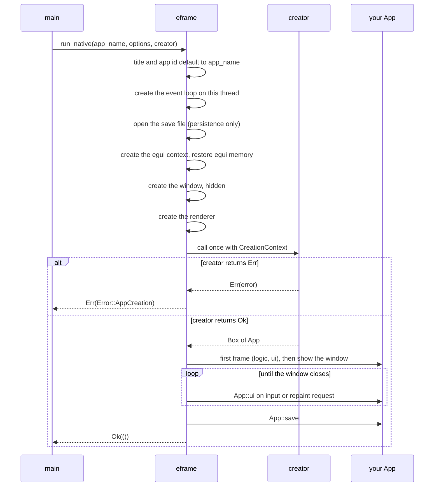
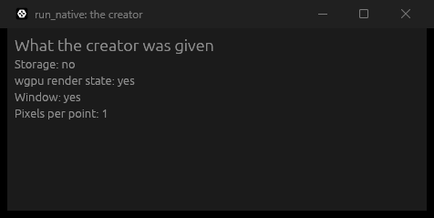
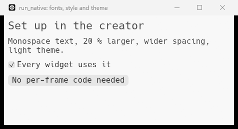
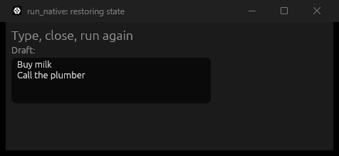
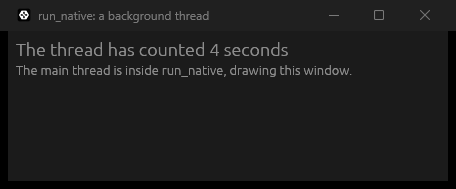
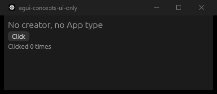

# `run_native`

[Back to the tutorial](../chapters/03-hello-world.md)

## In one paragraph

`eframe::run_native(app_name, native_options, creator)` is the call in `main` that turns your
program into a desktop app. It opens the window, sets up the renderer, calls your creator
closure once to build your app, and then runs the event loop, calling `App::ui` whenever the
window needs drawing. It does not return until the window closes. The creator closure is the
one place that runs after the window and renderer exist but before anything is drawn, so it
is where you set fonts, style and theme, restore saved state, start background threads, and
report a set-up failure as an error.

## The mental model

Think of `run_native` as handing your `main` thread over to eframe. You give it three things:
a name, the start-up settings ([`NativeOptions`](native-options.md)), and a recipe for your
app (the creator). eframe does the rest on that same thread: it builds the window, then
follows your recipe, then sits in a loop answering the operating system until the user closes
the window. Only then does it give the thread back.

The creator is a recipe rather than a finished app because your app needs things that do not
exist yet when `main` starts: the egui context, the saved state, the GPU device. eframe
creates those first and hands them to the creator in a `CreationContext`. Whatever the creator
does is in place before the first frame, so the first frame already has your fonts, your
theme and your restored data.

The creator can fail. It returns a `Result`, and an `Err` stops start-up before the window is
shown. `run_native` then returns that error to `main`.

> **If you come from the web.** `run_native` is page load and app bootstrap in one call. The
> browser loads the page, fires `DOMContentLoaded`, and your script creates the app and mounts
> it: `new App(document.getElementById("app"))`, or a framework's
> `createRoot(element).render(...)`. The creator closure is that bootstrap code. Reading
> `localStorage` on start is restoring state; setting styles on `:root` is setting the theme.
>
> Where the comparison breaks:
>
> - **eframe owns the loop, and it runs on your thread.** In a browser your script runs, returns,
>   and the browser's event loop carries on without it. `run_native` *is* the event loop: the
>   line after it runs only when the window closes.
> - **The window exists before your code runs.** It is created hidden, the creator runs, and the
>   window appears after the first frame is drawn. A slow creator means no window at all, not a
>   blank page with a spinner.
> - **Failure is a return value.** A page whose bootstrap throws stays open with whatever it
>   managed to draw. A creator that returns `Err` ends start-up, and `main` gets the error.
>
> Below, wherever the browser has a real equivalent, the web way (CSS, HTML or JS) is shown
> first and the egui way after it.

## How it works

`run_native` runs these steps in order, all on the thread that called it:

1. **Fill in the gaps from the app name.** With no title set in `viewport`, the app name
   becomes the window title. With no app id set, it becomes the app id.
2. **Create the event loop** on this thread. On Windows the windowing library panics if this is
   not the main thread.
3. **Open the save file** (only with eframe's `persistence` feature), in the folder named after
   the app id, or at `persistence_path` if set. [`NativeOptions`](native-options.md) has the
   details.
4. **Create the egui context** and load egui's own saved memory into it: the theme preference,
   the zoom factor, window and scroll positions.
5. **Create the window, hidden**, from `viewport` and any saved position and size.
6. **Create the renderer** for the window, and tell egui the screen's pixels per point.
7. **Call the creator once**, with a `CreationContext`. If it returns `Err`, eframe wraps the
   error in `eframe::Error::AppCreation`, leaves the event loop, and `run_native` returns it.
   The window is never shown.
8. **Draw the first frame** (`App::logic`, then `App::ui`, then paint), and only then show the
   window, so it never flashes white.
9. **Run frames** whenever there is input or a repaint request, until the window closes.
10. **Save and return.** eframe calls `App::save`, and `run_native` returns `Ok(())`. With
    `run_and_return: false` it ends the process instead.

```text
main             eframe (same thread)                        your code
 |  run_native(app_name, options, creator)
 |   ---------> title and app id default to app_name
 |              create the event loop on this thread
 |              open the save file          (persistence only)
 |              create the egui context, restore egui memory
 |              create the window, hidden
 |              create the renderer, learn pixels per point
 |              call the creator, once  ----------------------> creator(&CreationContext)
 |                                                               set fonts, style, theme
 |                                                               restore state, start threads
 |              Err? -> leave the loop, return Error::AppCreation
 |              Ok(app):                <---------------------- Box<dyn App>
 |              first frame: logic, ui, paint ----------------> App::ui
 |              show the window
 |              loop: input or repaint request -> frame ------> App::ui
 |              window closes: save ----------------------------> App::save
 |   <--------- return Ok(())
 |  the rest of main runs
```



### What the creator is given

`CreationContext` in eframe 0.37 has these public parts:

| Part | What it is for |
|---|---|
| `egui_ctx` | The egui context. Set fonts, style, theme and zoom on it; clone it into threads that need to request a repaint |
| `storage` | The save file, to restore your state. `None` without eframe's `persistence` feature |
| `integration_info` | Information about the environment. On desktop, `cpu_usage` (seconds per frame), which is `None` at creation |
| `wgpu_render_state` | The GPU device, queue and renderer, for your own wgpu drawing. `Some` with the wgpu renderer |
| `gl`, `get_proc_address` | The OpenGL context, only with eframe's `glow` feature and the glow renderer |
| `winit_window()` | The root window, for platform-specific calls |

The `CreationContext` is lent for the creator's run only. Clone what you want to keep:
`egui_ctx` and `wgpu_render_state` are both cheap to clone.

### What `app_name` is used for

The first argument is the app's identity, not just a label. It becomes the window title if
you set none, the app id if you set none (on Wayland, the id the desktop uses to group
windows), and through the app id, the name of the save folder: `%APPDATA%\<app id>\data` on
Windows. Saved data is keyed by the app name the way `localStorage` is keyed by the site's
origin. Pick it once and keep it; see
[`NativeOptions`](native-options.md#best-practices).

## Standard usage

Give your app type a `new(cc: &eframe::CreationContext)` function and make the creator a
one-line call to it. All set-up then lives with the type that owns the state.

**The JS way:** wait for the document, then create the app and give it its element.

```js
document.addEventListener("DOMContentLoaded", () => {
  const app = new StartupApp(document.getElementById("app"));
  app.render();
});
```

**The egui way:** `run_native` waits for the window and renderer, then calls the creator with
what it built. There is no element to mount into: the app is handed the whole window every
frame.

```rust
/// The creator closure only forwards to `StartupApp::new`.
fn main() -> eframe::Result {
    let native_options = eframe::NativeOptions {
        viewport: egui::ViewportBuilder::default()
            .with_title("run_native: the creator")
            .with_inner_size([460.0, 200.0]),
        ..Default::default()
    };
    eframe::run_native(
        "egui-concepts-run-native",
        native_options,
        Box::new(|creation_context| Ok(Box::new(StartupApp::new(creation_context)))),
    )
}
```

```rust
impl StartupApp {
    /// Runs once: after the window and the renderer exist, before the first frame.
    fn new(creation_context: &eframe::CreationContext<'_>) -> Self {
        Self {
            // `None` unless eframe's `persistence` feature is on.
            has_storage: creation_context.storage.is_some(),
            // The GPU device and queue, for your own wgpu drawing.
            has_wgpu: creation_context.wgpu_render_state.is_some(),
            // The window exists already, still hidden.
            has_window: creation_context.winit_window().is_some(),
            // Already known, so sizes can be worked out before the first frame.
            pixels_per_point: creation_context.egui_ctx.pixels_per_point(),
        }
    }
}
```

Run: `cargo run -p concepts --example run_native_creator`



Storage is "no" because the example runs without the `persistence` feature. Pixels per point
(1 here, 1.5 or 2 on a high-DPI screen) is known before the first frame. The creator returns
`Ok(..)` even when nothing can fail: the `Result` is part of its type.

## Micro-examples

Every example on this page is a whole program in
[`code/concepts/examples/`](../code/concepts/examples/), because each one is about `main` and
start-up, which the gallery cannot show. Run them from `tutorial/code` with the command under
each.

### Fonts, style and theme

**Use this when** the whole app should have your look from the first frame: a font, larger
text, more spacing, a fixed light or dark theme.

**The CSS way:** declare it once on `:root`, and every element picks it up.

```css
:root {
  color-scheme: light;      /* light, whatever the system uses */
  font-family: monospace;
  font-size: 120%;
}
```

**The egui way:** set it once on the context in the creator. There is no cascade; every
widget reads the context's style when it is drawn.

```rust
/// Everything about the look, done once on the context. The first frame already uses it.
fn set_up_look(ctx: &egui::Context) {
    // Fonts: put the bundled monospace font first for ordinary text too.
    let mut fonts = egui::FontDefinitions::default();
    fonts
        .families
        .entry(egui::FontFamily::Proportional)
        .or_default()
        .insert(0, "Hack".to_owned());
    ctx.set_fonts(fonts);

    // Style: larger text and more space between widgets, in both the dark and light style.
    ctx.all_styles_mut(|style| {
        for font_id in style.text_styles.values_mut() {
            font_id.size *= 1.2;
        }
        style.spacing.item_spacing = egui::vec2(10.0, 10.0);
    });

    // Theme: light, whatever the operating system uses.
    ctx.set_theme(egui::Theme::Light);
}
```

Run: `cargo run -p concepts --example run_native_style`



egui bundles `Ubuntu-Light` for ordinary text and `Hack` for monospace; the example puts
`Hack` first for ordinary text too. To add a font file of your own, `ctx.add_font` with a
`FontInsert` keeps the existing fonts. `all_styles_mut` changes the dark and light styles
together. `set_theme` also takes `ThemePreference::System`, the default. Keep this out of `ui`:
`set_fonts` compares all the font data with the current fonts on every call.

### Restoring state

**Use this when** the app should reopen with the user's data from last time.

**The JS way:** read `localStorage` while starting up, write it when the page goes away.

```js
const draft = document.querySelector("textarea");
draft.value = localStorage.getItem("draft") ?? "";
window.addEventListener("pagehide", () => localStorage.setItem("draft", draft.value));
```

**The egui way:** read `storage` in the creator, write in `App::save`. eframe calls `save`
when the window closes and every 30 seconds.

```rust
        Box::new(|creation_context| {
            Ok(Box::new(DraftApp {
                draft: restore_draft(creation_context.storage),
            }))
        }),
```

```rust
/// The saved draft, or an empty one on the first run (or without persistence).
fn restore_draft(storage: Option<&dyn eframe::Storage>) -> String {
    storage
        .and_then(|storage| storage.get_string(DRAFT_KEY))
        .unwrap_or_default()
}
```

Run: `cargo run -p concepts --example run_native_restore --features persistence`



`App::save` writes the draft back with `storage.set_string(DRAFT_KEY, ..)`.
`creation_context.storage` is an `Option`: `None` without the `persistence` feature, so
handle it rather than unwrap it, and treat a missing key as a first run. Keeping the read in
a small function of its own (`restore_draft`) lets a test feed it a fake storage, as the
example's tests do. For any serde type, `eframe::get_value` and `eframe::set_value` store it
as RON. Each run adds a folder `%APPDATA%\egui-concepts-run-native-restore`; delete it when
you are done. [`NativeOptions`](native-options.md#saving-the-window-and-your-state) covers the
save file itself.

### Set-up that can fail

**Use this when** the app cannot start without something it reads at start-up: a setting, a
config file, a database, a GPU feature.

**The JS way:** catch the failure during bootstrap and show it in the page, which stays open.

```js
try {
  const zoom = parseZoom(new URLSearchParams(location.search).get("zoom") ?? "1.0");
  document.body.style.zoom = zoom;
  startApp();
} catch (error) {
  document.body.textContent = `Could not start: ${error.message}`;
}
```

**The egui way:** return the error from the creator with `?`. Any error type that implements
`std::error::Error + Send + Sync` is boxed for you. Keep the fallible work in a plain function,
so a test can check it without a window:

```rust
/// The fallible part of set-up, kept out of the creator so a test can call it without a window.
fn parse_zoom(text: &str) -> Result<f32, ZoomError> {
    let zoom: f32 = text
        .trim()
        .parse()
        .map_err(|_| ZoomError::NotANumber(text.to_owned()))?;
    if ZOOM_RANGE.contains(&zoom) {
        Ok(zoom)
    } else {
        Err(ZoomError::OutOfRange(zoom))
    }
}
```

```rust
    // The first command-line argument, if there is one, is the zoom factor.
    let zoom_argument = std::env::args().nth(1);
    eframe::run_native(
        "egui-concepts-run-native-error",
        native_options,
        Box::new(move |creation_context| {
            // `?` boxes a `ZoomError` into the creator's error type.
            let zoom = parse_zoom(zoom_argument.as_deref().unwrap_or("1.0"))?;
            creation_context.egui_ctx.set_zoom_factor(zoom);
            Ok(Box::new(ZoomDemo { zoom }))
        }),
```

Run: `cargo run -p concepts --example run_native_error -- 10`

```text
Error: AppCreation(OutOfRange(10.0))
```

No window appears, and the process exits with code 1. `run_native` returned
`Err(eframe::Error::AppCreation(..))`, and since `main` returns it, Rust prints it with
`{:?}`. Its `Display` form reads `app creation error: zoom 10 is outside 0.5 to 3`; print that
yourself (or show a message box) if users will see it. Run with `-- 1.5` and the app starts at
150 % zoom. A creator that panics instead of returning `Err` takes the process down with a
panic message, and `main` gets no chance to react.

### Work alongside the UI

**Use this when** something must keep running while the window is open: a timer, a file
watcher, a download, a connection.

**The JS way:** a timer is enough for small, quick steps, but long-running script on the page
blocks its thread. A worker keeps the slow work off the page's thread and posts results back.

```js
const worker = new Worker("counter.js");
worker.onmessage = (event) => {
  document.querySelector("h1").textContent = `The worker has counted ${event.data} seconds`;
};

// counter.js
let seconds = 0;
setInterval(() => postMessage(++seconds), 1000);
```

**The egui way:** `run_native` keeps the main thread, so start a thread in the creator. Give it
a clone of the context, so it can ask for a repaint when it has news.

```rust
        Box::new(|creation_context| {
            let seconds = Arc::new(AtomicU32::new(0));
            let ctx = creation_context.egui_ctx.clone();
            let thread_seconds = Arc::clone(&seconds);
            std::thread::spawn(move || {
                loop {
                    std::thread::sleep(Duration::from_secs(1));
                    thread_seconds.fetch_add(1, Ordering::Relaxed);
                    // Without this, nothing is redrawn until the next mouse move or key.
                    ctx.request_repaint();
                }
            });
            Ok(Box::new(ThreadDemo { seconds }))
        }),
```

Run: `cargo run -p concepts --example run_native_thread`



`main` prints a line before and after `run_native`. Close the window and the terminal shows
`main: calling run_native`, then `main: run_native returned`: everything happened inside the
call. egui only redraws on input or on request, so without `request_repaint` the count would
update only when the mouse moves. The thread is not stopped when the window closes; it ends
with the process, when `main` returns. A thread that must clean up needs its own stop signal.

### No creator: `run_ui_native`

**Use this when** a small tool needs no set-up and no saved state, only a UI.

```rust
    let mut clicks = 0;
    eframe::run_ui_native(
        "egui-concepts-ui-only",
        native_options,
        move |ui, _frame| {
            egui::CentralPanel::default().show(ui, |ui| {
                ui.heading("No creator, no App type");
                if ui.button("Click").clicked() {
                    clicks += 1;
                }
                ui.label(format!("Clicked {clicks} times"));
            });
        },
    )
}
```

Run: `cargo run -p concepts --example run_native_ui_only`



`run_ui_native` is `run_native` with a creator that wraps your closure in an `App`. The state
lives in the closure (`move` takes `clicks` in). It cannot restore or save your own data, but
with the `persistence` feature egui's memory and the window size are still saved. The title
bar shows `egui-concepts-ui-only` because the options set only `with_inner_size`, so the app
name became the title.

## Best practices

- **Make the creator a call to `YourApp::new(cc)`.** `main` stays a list of settings, and the
  set-up lives with the state it sets up.
- **Do look and feel once, in the creator.** Fonts, style and theme set there are in place for
  the first frame and cost nothing afterwards.
- **Return errors, do not panic.** Use `?` in the creator and let `main` return
  `eframe::Result`, or match on it and show a readable message.
- **Keep the creator fast.** The window stays hidden until it returns and the first frame is
  drawn. Start slow loading on a thread and show progress in the UI.

## Common mistakes

**Calling `run_native` from a spawned thread.** On Windows, creating the event loop off the
main thread panics ("Initializing the event loop outside of the main thread is a significant
cross-platform compatibility hazard").

**Setting the theme in the creator and wondering why the user's choice is lost.** With
persistence on, egui saves its theme preference and zoom factor in its memory and restores
them before the creator runs. A `set_theme` in the creator overrides the saved choice on every
launch. If the user can change the theme, set it in the creator only on the first run, or not
at all.

**Combining a fallible creator with `run_and_return: false`.** In that mode eframe ends the
process itself on any error, with exit code 0, and only logs the error. `main` never sees it.
The default, `true`, returns the error.

## See also

- [Hello World](../chapters/03-hello-world.md), where `run_native` first appears.
- [Stage 4: persistence](../chapters/07-stage-4-persistence.md#persistence-in-the-app), which
  restores the todo list in the creator and saves it in `App::save`.
- [`NativeOptions`](native-options.md), the start-up settings passed to `run_native`, the save
  folder, and `run_and_return`.
- [`ViewportBuilder`](viewport-builder.md), the window part of those settings.
- docs.rs: [`run_native`](https://docs.rs/eframe/0.37.0/eframe/fn.run_native.html),
  [`run_ui_native`](https://docs.rs/eframe/0.37.0/eframe/fn.run_ui_native.html),
  [`CreationContext`](https://docs.rs/eframe/0.37.0/eframe/struct.CreationContext.html),
  [`Error`](https://docs.rs/eframe/0.37.0/eframe/enum.Error.html),
  [`Storage`](https://docs.rs/eframe/0.37.0/eframe/trait.Storage.html).
